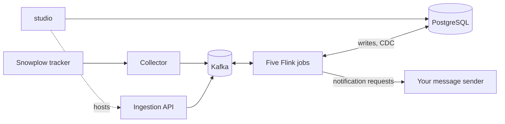

# Salarose

Salarose is a real-time customer journey engine. It turns what shoppers do on a website or app into marketing messages within seconds.

A Snowplow tracker sends behavior events to a collector. Five Apache Flink jobs parse each event, stitch the person's identity, update their metrics, decide which journey steps the event satisfies, and move the person through each journey. Marketers build the journeys on a canvas in **studio**, a Next.js app, and changes reach the running jobs through change data capture, with no restart.



## What it does

- **Journey builder.** Draw a journey from triggers, waits, condition splits, and messages. Publish it, and it runs at once.
- **Identity stitching.** Anonymous visits and signed-in sessions merge into one person.
- **Live metrics.** Per-person counters and sums over time windows, such as "added to cart 3 times in the last hour", ready for conditions.
- **Segments.** Reusable audiences that journeys can enter on or check.
- **Data management.** An event catalog, source keys for the ingestion API, dead-letter browsing, and data import.
- **Analytics.** How many people reached, passed, or are waiting at each step.

## Tech stack

| Layer | Technology |
|---|---|
| Ingestion | Snowplow tracker, OpenSnowcat collector, an HTTP ingestion API |
| Streaming | Apache Kafka 4.3 (Strimzi) |
| Processing | Apache Flink 2.2 on Java 21, RocksDB state, Postgres CDC |
| Storage | PostgreSQL 16 (CloudNativePG), Flyway, jOOQ |
| studio | Next.js 16, React 19, TypeScript, Tailwind CSS, React Flow, OIDC sign-in |
| Runtime | k3s, Argo CD, Prometheus and Grafana, Terraform on AWS |

## Repository layout

| Path | Holds |
|---|---|
| `event-processor/` | The five Flink jobs and their shared models, repositories, and config |
| `studio/` | The admin app: journeys, segments, customers, data, and platform pages |
| `shared/` | TypeScript package for studio: UI components, DB client, campaign types |
| `infra/db/` | Postgres schema and migrations |
| `infra/local/` | Podman compose stack for one machine |
| `infra/k8s/`, `infra/aws-free-plan/` | Kubernetes manifests synced by Argo CD, and the Terraform and scripts for the AWS environment |
| `simulator/` | Traffic simulator for smoke, load, and benchmark runs |
| `docs/internal/` | Architecture, feature and component contracts, known issues, operations |

## Getting started

Prerequisites: Podman with `podman compose`, pnpm, and Java 21.

```bash
pnpm install
podman build -t flink-custom:2.2.0-java21 event-processor          # Flink base image
pnpm flink:build                                                   # job JAR
cp .env.example .env && cp studio/.env.example studio/.env.local   # then fill in the values
pnpm infra:up && pnpm db:reset                                     # Kafka, Flink, Postgres, collector
pnpm flink:submit                                                  # start the five jobs
pnpm studio:dev                                                    # http://localhost:3001
```

studio signs staff in through any OpenID Connect provider. [The local environment guide](docs/internal/operations/local-environment.md) covers the settings and the known rough edges.

## Tests

```bash
./event-processor/mvnw -f event-processor/pom.xml clean test
pnpm --filter studio test
pnpm --filter studio lint
pnpm studio:build
```

## Documentation

Start with [the architecture overview](docs/internal/architecture/overview.md). It goes from the system context to the layers, the tech stack, the data flow, each event's steps, and CI/CD. [docs/internal/README.md](docs/internal/README.md) explains how the contracts, known issues, and decision records fit together.

- [Deployment](docs/internal/operations/deployment.md) and [the AWS environment](docs/internal/operations/aws-free-plan.md)
- [Configuration](docs/internal/operations/configuration.md)
- [Known issues](docs/internal/known-issues/README.md)

## Status

Salarose is a working prototype. It runs end to end on a small Kubernetes cluster, and [the known issues](docs/internal/known-issues/README.md) list where the code still departs from its contracts. One deployment serves one business.

## License

MIT. See [LICENSE](LICENSE).
