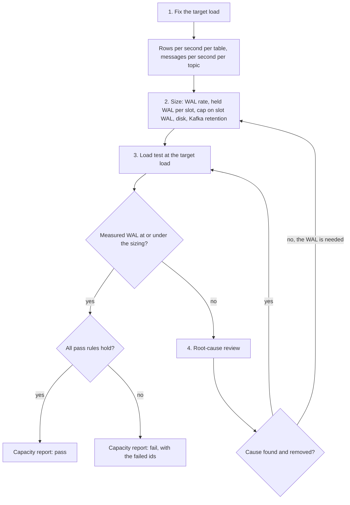

# Platform capacity

## Purpose

On 2026-11-07 a load run wrote WAL faster than the CDC slots could release it, and Postgres invalidated all seven slots the database had then ([decision 0039](decisions/0039-shorten-the-cdc-restore-window.md)). The cap on slot WAL, the CDC restore window, and the disk had each been set on its own, and nobody had worked out what load they had to carry together. This contract fixes the target load, says how to turn it into the size of every resource that load fills, and sets the load test and its pass rules that prove the sizing. An operator who changes a cap, a window, a retention, or a disk checks the change against this page.

## Scope

In scope:

- The target load the platform must carry.
- The sizing method: rows written per table, the WAL rate, the WAL each slot holds, the cap on slot WAL, disk, and Kafka retention.
- The load test at the target load, what it measures, and its pass rules.
- The root-cause review when the measured WAL is higher than the sizing.

Out of scope:

- Each component's own throughput and latency rules. Each [component contract](../README.md#components) owns them.
- How the load generator sends traffic, its phases, and its stop conditions other than the slot stop of CAP-FR-16. [The traffic simulator](../features/traffic-simulator.md) owns them.
- The import store. It holds no replication slot, so its WAL does not reach a slot ([decision 0040](decisions/0040-import-through-a-batch-path-and-a-separate-store.md)).
- Alert rules and their thresholds. [Monitoring](../operations/monitoring.md) lists them.
- A second customer on the same deployment ([decision 0027](decisions/0027-multi-tenancy.md)).

## Terms

| Term | Meaning |
|---|---|
| Target load | The events per second the platform must carry, counted where the collector accepts them. It has two parts, the sustained load and the burst. |
| Sustained load | 500 events per second, held for as long as the platform runs. |
| Burst | 2,000 events per second for 10 minutes. The rate at the collector is 2,000 during the burst, not 500 plus 2,000. |
| Workload profile | The mix of the test traffic: people, devices, event names, and the share that stitches a new device, updates a metric, or completes a journey node. [The traffic simulator's funnel](../features/traffic-simulator.md#funnel) and scenarios set it. Rows per event depend on it. |
| Event path | Every table write and topic message that one event causes as it flows from the collector to the last journey transition, except the writes of a paced writer. |
| Paced writer | A writer whose own contract caps its rate: the membership sink, which writes `segment_members` ([PRW-NFR-06](components/profile-writer.md#non-functional-requirements)), and the passes under the WAL governor, the import metric pass ([IMP-NFR-02](components/import-metric-pass.md#non-functional-requirements)) and the segment membership pass ([SMP-NFR-02](components/segment-membership-pass.md#non-functional-requirements)). The sizing counts each one by its budget, not by rows per event. |
| WAL rate | The bytes of write-ahead log the whole database writes per second, read as the change of its current WAL position over time. |
| WAL per event | The WAL that the event path writes, divided by the events the collector accepted over the same time. |
| Confirm window | How long a running CDC slot keeps WAL on purpose: the confirm count plus one, times the job's checkpoint interval. With the defaults of [JEX-NFR-10](components/journey-execution.md#non-functional-requirements), 11 × 30 s = 330 s, and 11 × 60 s = 660 s for the notification outbox and its timer flow. |
| Held WAL | The WAL one slot keeps Postgres from removing: the current WAL position minus the slot's restart position. |
| Cap on slot WAL | The most WAL the database lets one slot hold. A slot past it is invalidated. |
| Margin | The cap on slot WAL divided by the largest held WAL the sizing expects. 2 is the lead's default, pending owner review. [Decision 0039](decisions/0039-shorten-the-cdc-restore-window.md#why) chose a cap twice its largest hold but did not set a margin as a rule. |
| Slot status | The database's WAL status of a slot: `reserved`, `extended`, `unreserved`, or `lost`. A slot is `extended` while it holds more WAL than the database keeps anyway, its maximum WAL size, which is 1 GB by default. At the held WAL this contract expects, every slot is `extended` at the burst, and that is normal. `unreserved` means the next checkpoint may remove WAL the slot needs. `lost` means it already has. |
| Consumer lag | Per consumer of a Kafka topic, the messages written to the topic that the consumer has not yet read. |
| Normal lag | The highest lag a consumer shows at the sustained load over the longest confirm window before the burst starts. |
| Sizing sheet | The written result of the sizing: every input, every formula, and every result, next to the setting each result sets. |
| Capacity report | The written result of a load test: the measurements, the comparison with the sizing sheet, and a pass or fail for each requirement. |

## Behavior

Capacity work follows four steps, in order. A step uses only what the steps before it produced.

1. **Fix the target load.** The load is 500 events per second sustained and 2,000 for 10 minutes, at the collector. From the workload profile, write the rows each event writes to each table on the event path, and the messages and bytes it writes to each topic. Multiply by both rates.
2. **Size.** Turn the rows into a WAL rate, add the paced writers, turn the WAL rate into the WAL each slot holds, and the hold into the cap on slot WAL. Size each disk for the data on it, and size Kafka's retention against its disk. The [algorithm](#algorithm) gives the formulas.
3. **Load test.** Run the target load through the collector and measure what the sizing predicted, and what the pass rules bound.
4. **Find the root cause.** If the measured WAL rate or held WAL is above the sizing sheet, find why before any cap, disk, or retention goes up. Raising a cap to fit WAL nobody needs moves the incident of 2026-11-07 to a larger number.

### Example

Only one WAL rate has been recorded: about 6 MB/s at 3,000 events per second, in the run of [decision 0039](decisions/0039-shorten-the-cdc-restore-window.md#context). That run was not measured at the collector, its workload profile is not recorded, and its WAL includes every writer. It is not a measurement under this contract. It serves here to show the arithmetic. The numbers below are an illustration, not a sizing. The cap is the 8 GB in force, which Postgres reads as 8 GiB, about 8.6 GB.

| Step | Arithmetic | Result |
|---|---|---|
| WAL per event | 6 MB/s ÷ 3,000 events/s | about 2 KB |
| Event-path WAL, sustained and burst | 500 × 2 KB, 2,000 × 2 KB | 1 MB/s, 4 MB/s |
| Plus the membership sink at its limit | + 1 MB/s | 2 MB/s, 5 MB/s |
| Plus the governed passes, each at 0.25 MB/s | Sustained: 2 MB/s is not above their 2 MB/s pause threshold, so both count. Burst: 5 MB/s is above it, so neither writes. | 2.5 MB/s, 5 MB/s |
| Held WAL at the burst, 30 s jobs | 5 MB/s × 330 s | 1.65 GB |
| Held WAL at the burst, 60 s jobs | 5 MB/s × 660 s | 3.3 GB |
| Cap on slot WAL, margin 2 | 2 × 3.3 GB | at least 6.6 GB. 8.6 GB fits. |
| A 60 s job stops at the burst: time to the cap | (8.6 GB − 3.3 GB) ÷ 5 MB/s | about 18 minutes |
| A 60 s job stops at the sustained load: time to the cap | (8.6 GB − 2.5 MB/s × 660 s) ÷ 2.5 MB/s | about 46 minutes |

Without the membership sink the cap would need only 5.3 GB. A paced writer can decide whether a cap fits, so the sizing counts every one.

## Algorithm

Inputs:

- The target load: the sustained rate and the burst rate, in events per second.
- For each table on the event path, the rows per event. For each topic on the event path, the messages per event, the bytes per event, and its partitions. All from a measured run of the workload profile.
- The WAL per event, from a measured run.
- The budget of each paced writer: its rate cap, and for a governed pass its pause threshold.
- For each CDC job, its confirm count and checkpoint interval.
- The margin.
- The bursts per retention period. One is the lead's default, pending owner review.
- For each disk, its size and every store on it.

Steps:

1. **Rows.** For each table `t` and each rate `r`, rows per second = `r` × rows per event(`t`). Do the same for each topic's messages and bytes.
2. **WAL rate.** `E(r)` = `r` × WAL per event. `W(r)` = `E(r)` + the membership sink's rate cap + each governed pass's rate cap, except that a governed pass counts 0 when `E(r)` plus the membership sink is above its pause threshold. The governor reads the cluster WAL rate, which includes the paced writers, and it resumes only under a lower threshold. A rate inside that band can find a pass writing, so the sizing counts it there.
3. **Held WAL.** For each slot `s` and rate `r`, `H(s, r)` = `W(r)` × (confirm count + 1) × the checkpoint interval of its job. For the cap, use `H(s, burst)`, with the burst rate for the whole confirm window, even where the window is longer than the burst. This holds while checkpoints complete on schedule and the CDC source keeps up with the WAL. A long checkpoint or a source behind the WAL adds to the hold, so the load test measures the hold itself (CAP-FR-09).
4. **Cap.** The cap on slot WAL must be at least the margin × the largest `H(s, burst)`.
5. **Stopped slot.** A stopped job confirms nothing, and its slot already holds `H(s, r)` when the job stops. Time to the cap = (cap − `H(s, r)`) ÷ `W(r)`, for each slot, at both rates.
6. **Kafka.** For each topic, retained bytes = the topic's sustained bytes per second × its time retention + bursts per retention period × (burst rate − sustained rate) × 600 s × the topic's bytes per event. Multiply by the topic's replicas for the bytes on disk. A byte limit applies to each partition, so a topic's byte limit must be at least its retained bytes divided by its partitions, assuming its messages spread evenly over them.
7. **Disk.** For each disk, used space at the target = the Postgres data on it, grown at the sustained rate over the period the sizing sheet states + the cap on slot WAL + every topic's retained bytes on it + everything else it holds. Postgres and Kafka sum when they share a disk.

Output: the sizing sheet. Each result sits next to the setting it sets, and each input says where it was measured.

Ties and edge cases:

- If a job has more than one slot, each slot gets its own `H(s, r)`. All slots read the same WAL stream, so the WAL that Postgres keeps for them runs from the oldest restart position, and the slot with the largest `H(s, r)` decides it.
- A job that restarts, or whose checkpoints fail, confirms nothing until its count of completed checkpoints catches up. The sizing treats it as stopped, step 5. [Decision 0039](decisions/0039-shorten-the-cdc-restore-window.md#consequences) inferred this from the connector and a recovery. It has not been run.
- Rows per event, WAL per event, and bytes per event come from measurement. Before the first run, the sizing sheet marks each one as an estimate and says where it came from.

## Functional requirements

| Id | Requirement |
|---|---|
| CAP-FR-01 | The sizing sheet must list, for both rates of the target load, the rows per second written to each table on the event path and the messages and bytes per second written to each topic. |
| CAP-FR-02 | The sizing sheet must derive the WAL rate from the WAL per event, plus the budget of every paced writer, counted as step 2 of the [algorithm](#algorithm) says. |
| CAP-FR-03 | The sizing sheet must give the held WAL of every replication slot at both rates, from the confirm window of its job ([JEX-NFR-10](components/journey-execution.md#non-functional-requirements)). |
| CAP-FR-04 | The sizing sheet must give the cap on slot WAL as at least the margin times the largest held WAL at the burst, and must write the arithmetic next to the setting. |
| CAP-FR-05 | The sizing sheet must give, for each slot at both rates, the time a stopped job's slot takes to reach the cap from the hold it had when the job stopped. |
| CAP-FR-06 | The sizing sheet must give each topic's retained bytes at the target load, its byte limit per partition where one is set, and each disk's used space with every store on it. |
| CAP-FR-07 | A change to the target load, the confirm count, a checkpoint interval, the cap on slot WAL, a disk, a topic's retention, the set of replication slots, a paced writer's budget, or the tables on the event path must check the sizing sheet again in the same change. |
| CAP-FR-08 | The load test must send its traffic through the collector, with the workload profile the sizing used, and count the rate at the collector. It must run, in order: a ramp up to the sustained load, the sustained load for at least two of the longest confirm windows, the burst for 10 minutes, and the sustained load again until every consumer's lag is back to its normal lag, or until the operator ends the run and records the lag left. Two windows is the lead's default, pending owner review: the first lets the held WAL reach a steady value, and the second gives CAP-NFR-06 a reading to compare with. |
| CAP-FR-09 | The load test must measure, throughout the run: the event rate at the collector, the WAL rate, the held WAL and the slot status of every replication slot, each job's checkpoint duration and its failed or expired checkpoints, the lag of every consumer of every topic, each job's restarts, and the free space on each volume that holds Postgres or Kafka and on the disk under it. |
| CAP-FR-10 | The load test must measure the rows per event per table and the WAL per event, and the capacity report must compare them with the sizing sheet. |
| CAP-FR-11 | When the measured WAL rate or a slot's held WAL is above the sizing sheet, the root-cause review must run, and no cap on slot WAL, disk, or retention may go up for that reason until it has. |
| CAP-FR-12 | The root-cause review must check each of these causes, and record for each what it found and how much WAL it explains: a table in a CDC publication that no job reads; a table with full replica identity; updates where inserts would do; large rows; indexes on busy tables; checkpoint frequency and full-page writes; and the confirm delay. |
| CAP-FR-13 | Every table that a CDC publication covers must be read by a job, except the heartbeat table that every publication covers on purpose. This is the lead's default, pending owner review. |
| CAP-FR-14 | A table that no CDC publication covers must not have full replica identity. With logical WAL, the database logs the whole old row of such a table on every update and delete, and no reader uses it. This is the lead's default, pending owner review. Whether the readers of the tables a publication covers need the old row is an [open question](#open-questions). |
| CAP-FR-15 | The capacity report must state the deployed version, the settings in force, the workload profile, every measurement of CAP-FR-09 and CAP-FR-10, and pass or fail for each requirement in [Non-functional requirements](#non-functional-requirements). |
| CAP-FR-16 | The load generator's load mode must stop the run on its own, and report why, when any replication slot's status becomes `unreserved` or `lost`. `extended` must never stop a run. |

## Non-functional requirements

| Id | Requirement |
|---|---|
| CAP-NFR-01 | The target load is 500 events per second sustained, and 2,000 events per second for 10 minutes, measured at the collector. |
| CAP-NFR-02 | At the target load, no replication slot's status may become `unreserved` or `lost`. `extended` is allowed. |
| CAP-NFR-03 | At the target load, with every job running, no slot's held WAL may exceed the cap on slot WAL divided by the margin. |
| CAP-NFR-04 | At the target load, no checkpoint of any job may fail or expire. |
| CAP-NFR-05 | At the target load, no job may restart. |
| CAP-NFR-06 | At the sustained load, every consumer keeps up: its lag at the end of the sustained phase must be no higher than its lag at the end of the first of the longest confirm windows in that phase. This is the lead's default, pending owner review. |
| CAP-NFR-07 | After the burst ends, every consumer's lag must return to its normal lag within a bound. The bound is an [open question](#open-questions). |
| CAP-NFR-08 | At the target load, each volume that holds Postgres or Kafka, and the disk under it, must keep at least 30% of its space free. This is the lead's default, pending owner review. A load run aborts above 70% full (SIM-FR-12 of [the traffic simulator](../features/traffic-simulator.md#functional-requirements)), so a finished run has shown it, and it keeps the disk clear of the WAL governor's pause under 20% free ([IMP-NFR-03](components/import-metric-pass.md#non-functional-requirements)). |
| CAP-NFR-09 | The sizing must not meet the cap by lowering the confirm count of [JEX-NFR-10](components/journey-execution.md#non-functional-requirements). A shorter CDC restore window needs its own decision record. |
| CAP-NFR-10 | `snowplow-good` must keep at least 72 hours of messages at the target load, and the volume that holds Kafka must be sized by CAP-FR-06 to hold that. A recovery that keeps Flink state relies on the raw events waiting there ([rollout known issues](../operations/rollout-known-issues.md#a-new-job-image-cannot-restore-its-savepoint)). From step 6 of the [algorithm](#algorithm), with one burst, the topic alone retains (500 × 259,200 s + 1,500 × 600 s) × its bytes per event, about 130.5 million events: about 13 GB for every 100 bytes per event, and about 65 GB at 500 bytes. The bytes per event come from measurement, so the bound is that product, not a fixed number. |

## Interfaces

The sizing and the load test read these. None of them is new.

| Interface | What capacity work reads |
|---|---|
| The collector | The accepted event rate. |
| Tables on the event path: `identity_graph`, `event_volume`, `user_metrics`, and `user_campaign_state_transitions` | Rows written per second, and WAL per row from the database's per-statement WAL statistics. [The data model](data-model.md) says which job writes each. |
| `segment_members`, once built, and the tables of the governed passes | Nothing per event. The paced writers' budgets stand for them. |
| The CDC publications and their replication slots | Which tables each publication covers, each slot's held WAL and status. [The data model](data-model.md#publications-for-cdc) lists them. |
| The database | Its current WAL position, its cap on slot WAL, its maximum WAL size, and each table's replica identity. |
| Kafka topics on the event path: `snowplow-good`, `snowplow-parsed`, `customer-profile-mutations`, `journey-engine-matched-events`, `journey-engine-segment-checks`, `journey-engine-outbound-noti`, and, once built, `segment-membership-changes` | Messages and bytes per second, partitions, each consumer's lag, and each topic's retention. [The architecture overview](overview.md#kafka-topics) lists them. |
| Each Flink job | Checkpoint duration, failed and expired checkpoints, and restarts. |
| Each node | Free space on each volume that holds Postgres or Kafka, and on the disk under it. |

## Failure handling

| Case | What happens |
|---|---|
| A slot becomes `unreserved` or `lost` during the load test | The load generator stops the run (CAP-FR-16). The run has failed CAP-NFR-02, and the root-cause review runs. |
| A slot's held WAL passes the cap divided by the margin | The run has failed CAP-NFR-03. It goes on measuring unless a slot's held WAL nears the cap, and the root-cause review runs. |
| A slot is `extended` | Nothing. The held WAL is above the database's maximum WAL size, which the sizing expects. |
| A volume passes 70% full, or 1% of the run's events reach the dead-letter topic | The load generator aborts the run (SIM-FR-12). Past 70% full, the run has failed CAP-NFR-08. |
| The load generator cannot reach the target rate | The run does not count. The capacity report says the generator was the limiter, not the platform. |
| A job restarts or fails a checkpoint during the run | The run fails CAP-NFR-04 or CAP-NFR-05. Its slot is treated as stopped from that moment, and the report gives its held WAL until it caught up. |
| A measured value has no sizing value to compare with | The sizing sheet is incomplete. Complete it, then compare. |
| The root-cause review finds no cause, and the WAL is needed | Size again with the measured WAL per event, step 2, and test again. |
| A burst arrives while a job is stopped | Its slot grows at the full WAL rate. CAP-FR-05 gives the time the operators have before Postgres invalidates it. |

## Acceptance criteria

- Given the sizing sheet, when a reviewer reads it, then it lists rows per second for every table on the event path and messages and bytes per second for every topic on the event path, at 500 and at 2,000 events per second. (CAP-FR-01)
- Given a WAL per event of 2 KB, the membership sink's cap of 1 MB/s, and two governed passes of 0.25 MB/s with a pause threshold of 2 MB/s, when the sizing runs, then the WAL rate is 2.5 MB/s at the sustained load and 5 MB/s at the burst. (CAP-FR-02)
- Given a burst WAL rate of 5 MB/s, a confirm count of 10, and checkpoint intervals of 30 and 60 seconds, when the sizing runs, then the held WAL at the burst is 1.65 GB and 3.3 GB, and with a margin of 2 the cap is at least 6.6 GB. (CAP-FR-03, CAP-FR-04)
- Given a cap of 8 GiB and a burst WAL rate of 5 MB/s, when the sizing runs, then a 60 s job's slot that stops at the burst reaches the cap in about 18 minutes. (CAP-FR-05)
- Given `snowplow-good` with 3 partitions and a byte limit, when the sizing sheet is read, then it gives the topic's retained bytes at the target load, and the byte limit per partition is at least a third of them. (CAP-FR-06)
- Given a change that raises the checkpoint interval of one job, when it is reviewed, then the sizing sheet in the same change shows the new held WAL against the cap. (CAP-FR-07)
- Given a load test, when it runs, then its rate at the collector rises to 500 events per second in the ramp, holds 500 for at least two of the longest confirm windows, holds 2,000 for 10 minutes, then holds 500 until every lag is back to normal or the operator ends the run and records the lag left. (CAP-FR-08, CAP-NFR-01)
- Given a load test, when it ends, then the capacity report gives every measurement of CAP-FR-09 for the whole run, and the measured rows per event per table and WAL per event beside the sizing sheet's. (CAP-FR-09, CAP-FR-10, CAP-FR-15)
- Given a measured WAL per event above the sizing sheet's, when an operator proposes raising the cap on slot WAL, then the proposal includes the root-cause review, with a finding for each of the seven causes. (CAP-FR-11, CAP-FR-12)
- Given the database's publications, when the review lists each covered table and its reader, then every table but the heartbeat table has a reader. (CAP-FR-13)
- Given the database's tables, when the review lists each table with full replica identity, then a CDC publication covers each one. (CAP-FR-14)
- Given the whole run, when the slots are read, then every slot's status stays `reserved` or `extended`, and every slot's held WAL stays at or under the cap divided by the margin. (CAP-NFR-02, CAP-NFR-03)
- Given the whole run, when the jobs are read, then no job fails or expires a checkpoint, and no job restarts. (CAP-NFR-04, CAP-NFR-05)
- Given the sustained phase, when each consumer's lag is read at the end of the first of the longest confirm windows in the phase and at the end of the phase, then the second reading is no higher than the first. (CAP-NFR-06)
- Given the burst has ended, when each consumer's lag is read, then the capacity report gives the time each took to return to its normal lag, and judges CAP-NFR-07 against the bound once the owner sets one. (CAP-NFR-07)
- Given the run, when free space is read on each volume that holds Postgres or Kafka and on the disk under it, then no reading is under 30%. (CAP-NFR-08)
- Given a sizing that does not fit the cap, when it is proposed, then it does not lower the confirm count below 10 without a decision record. (CAP-NFR-09)
- Given a load run in load mode, when a slot's status becomes `unreserved` or `lost`, then the run stops at that reading and its report names the slot. Given a slot that is only `extended`, then the run goes on. (CAP-FR-16)
- Given the measured bytes per event of `snowplow-good`, when the sizing sheet is read, then the topic's retained bytes for 72 hours at the target load fit the volume that holds Kafka, with CAP-NFR-08's free space left. (CAP-NFR-10, CAP-FR-06)

## Open questions

- **Bursts per retention period.** The Kafka sizing assumes one burst per retention period. That is the lead's default, pending owner review.
- **Lag recovery bound.** How long after the burst ends may a consumer's lag take to return to normal (CAP-NFR-07)? No contract or decision sets it. Until the owner does, the capacity report gives the measured time and marks CAP-NFR-07 as not judged.
- **End-to-end latency.** What latency from the collector to a journey transition must hold at the target load? No contract sets one for the whole path. The load test measures it, and the report states it without a pass or fail.
- **Sustained phase length.** CAP-FR-08 requires at least two of the longest confirm windows. Whether the test must run longer, for example to show that Kafka retention and disk hold at the sustained rate, is undecided.
- **The lead's defaults.** The margin of 2, the lag rule of CAP-NFR-06, the 30% free of CAP-NFR-08, the two windows of CAP-FR-08, and the standing rules CAP-FR-13 and CAP-FR-14 wait for owner review.
- **Old rows for CDC readers.** Six tables that a publication covers have full replica identity. Whether each reader needs the old row of an update is not checked, so whether those tables need it is undecided.
- **The segment membership pass's budget.** SMP-NFR-02 gives the pass the governor's thresholds but no rate cap of its own. The sizing counts it at the import metric pass's 0.25 MB/s. That is the lead's default, pending owner review.
- **Checkpoint duration bound.** The load test measures checkpoint duration, and CAP-NFR-04 forbids failures. Whether a duration under the timeout but close to it fails the run is undecided.
- **Background writers during the test.** Whether the load test runs with the paced writers at their caps, or counts them only on paper, is undecided. The sizing counts them either way (CAP-FR-02).
- **Rerunning the test.** CAP-FR-07 requires the sizing sheet to be checked again on a change. Which changes also require a new load test is undecided.

## Related

- [Decision 0039. Shorten the CDC restore window to keep slots under the WAL cap](decisions/0039-shorten-the-cdc-restore-window.md): the incident and the cap.
- [Decision 0040. Import through a batch path and a separate store](decisions/0040-import-through-a-batch-path-and-a-separate-store.md): why imports write no WAL to a slot.
- [Journey execution](components/journey-execution.md#non-functional-requirements), JEX-NFR-10: the CDC restore window.
- [Profile writer](components/profile-writer.md#non-functional-requirements), PRW-NFR-06; [import metric pass](components/import-metric-pass.md#non-functional-requirements), IMP-NFR-02 and IMP-NFR-03; [segment membership pass](components/segment-membership-pass.md#non-functional-requirements), SMP-NFR-02: the paced writers.
- [Traffic simulator](../features/traffic-simulator.md): the load generator.
- [Data model](data-model.md#publications-for-cdc): the CDC publications and slots.
- [Rollout known issues](../operations/rollout-known-issues.md#cdc-slots-were-invalidated-by-a-write-burst): the slot incident, step by step.
- [Platform known issues](../known-issues/platform.md): where the platform falls short of this contract.
