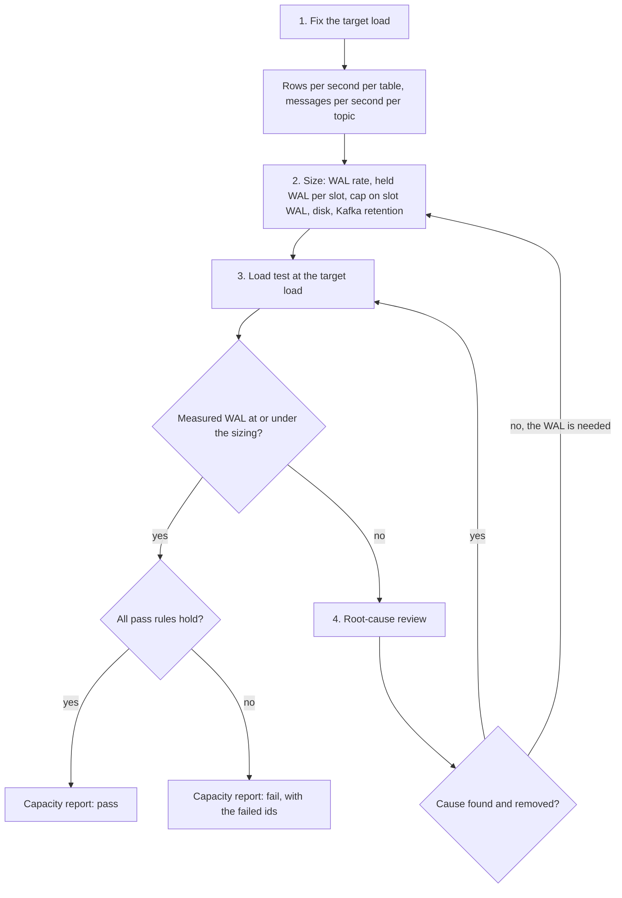

# Platform capacity

## Purpose

On 2026-11-07 a load run wrote WAL faster than the CDC slots could release it, and Postgres invalidated all seven slots ([decision 0039](decisions/0039-shorten-the-cdc-restore-window.md)). The cap on slot WAL, the CDC restore window, and the disk had each been set on its own, and nobody had worked out what load they had to carry together. This contract fixes the target load, says how to turn it into the size of every resource that load fills, and sets the load test and its pass rules that prove the sizing. An operator who changes a cap, a window, a retention, or a disk checks the change against this page.

## Scope

In scope:

- The target load the platform must carry.
- The sizing method: rows written per table, the WAL rate, the WAL each slot holds, the cap on slot WAL, disk, and Kafka retention.
- The load test at the target load, what it measures, and its pass rules.
- The root-cause review when the measured WAL is higher than the sizing.

Out of scope:

- Each component's own throughput and latency rules. Each [component contract](../README.md#components) owns them.
- How the load generator sends traffic, its phases, and its safety stops. [The traffic simulator](../features/traffic-simulator.md) owns them.
- The import store. It holds no replication slot, so its WAL does not reach a slot ([decision 0040](decisions/0040-import-through-a-batch-path-and-a-separate-store.md)).
- Alert rules and their thresholds. [Monitoring](../operations/monitoring.md) lists them.
- A second customer on the same deployment ([decision 0027](decisions/0027-multi-tenancy.md)).

## Terms

| Term | Meaning |
|---|---|
| Target load | The events per second the platform must carry, counted where the collector accepts them. It has two parts, the sustained load and the burst. |
| Sustained load | 500 events per second, held for as long as the platform runs. |
| Burst | 2,000 events per second for 10 minutes. The rate at the collector is 2,000 during the burst, not 500 plus 2,000. |
| Workload profile | The mix of the test traffic: people, devices, event names, and the share that stitches a new device, updates a metric, or completes a journey node. [The traffic simulator's](../features/traffic-simulator.md#logical-scenarios) scenarios set it. Rows per event depend on it. |
| Event path | Every table write and topic message that one event causes, from the collector to the last journey transition. |
| WAL rate | The bytes of write-ahead log the whole database writes per second, read as the change of its current WAL position over time. |
| WAL per event | The WAL rate during a run divided by the event rate at the collector over the same time. |
| Confirm window | How long a running CDC slot keeps WAL on purpose: the confirm count plus one, times the job's checkpoint interval. With the defaults of [JEX-NFR-10](components/journey-execution.md#non-functional-requirements), 11 × 30 s = 330 s, and 11 × 60 s = 660 s for the notification outbox and its timer flow. |
| Held WAL | The WAL one slot keeps Postgres from removing: the current WAL position minus the slot's restart position. |
| Cap on slot WAL | The most WAL the database lets one slot hold. A slot past it is invalidated. |
| Margin | The cap on slot WAL divided by the largest held WAL the sizing expects. [Decision 0039](decisions/0039-shorten-the-cdc-restore-window.md#why) set it to 2. |
| Slot status | The database's WAL status of a slot: `reserved`, `extended`, `unreserved`, or `lost`. `extended` is normal. `unreserved` means the next checkpoint may remove WAL the slot needs. `lost` means it already has. |
| Consumer lag | Per consumer of a Kafka topic, the messages written to the topic that the consumer has not yet read. |
| Normal lag | The highest lag a consumer shows at the sustained load over the longest confirm window before the burst starts. |
| Sizing sheet | The written result of the sizing: every input, every formula, and every result, next to the setting each result sets. |
| Capacity report | The written result of a load test: the measurements, the comparison with the sizing sheet, and a pass or fail for each requirement. |

## Behavior

Capacity work follows four steps, in order. A step uses only what the steps before it produced.

1. **Fix the target load.** The load is 500 events per second sustained and 2,000 for 10 minutes, at the collector. From the workload profile, write the rows each event writes to each table on the event path, and the messages it writes to each topic. Multiply by both rates.
2. **Size.** Turn the rows into a WAL rate, the WAL rate into the WAL each slot holds, and the hold into the cap on slot WAL. Size each disk for the data on it, and size Kafka's retention against its disk. The [algorithm](#algorithm) gives the formulas.
3. **Load test.** Run the target load through the collector and measure what the sizing predicted, and what the pass rules bound.
4. **Find the root cause.** If the measured WAL rate or held WAL is above the sizing sheet, find why before any cap, disk, or retention goes up. Raising a cap to fit WAL nobody needs moves the incident of 2026-11-07 to a larger number.

### Example

Only one WAL rate has been recorded: about 6 MB/s at 3,000 events per second, in the run of [decision 0039](decisions/0039-shorten-the-cdc-restore-window.md#context). That run was not measured at the collector, and its workload profile is not recorded, so it is not a measurement under this contract. It serves here to show the arithmetic. The numbers below are an illustration, not a sizing.

| Step | Arithmetic | Result |
|---|---|---|
| WAL per event | 6 MB/s ÷ 3,000 events/s | about 2 KB |
| Event WAL at the burst | 2,000 events/s × 2 KB | 4 MB/s |
| Plus the membership sink at its limit ([PRW-NFR-06](components/profile-writer.md#non-functional-requirements)) | 4 MB/s + 1 MB/s | 5 MB/s |
| The governed passes ([IMP-NFR-02](components/import-metric-pass.md#non-functional-requirements), [SMP-NFR-02](components/segment-membership-pass.md#non-functional-requirements)) | 5 MB/s is above their 2 MB/s pause threshold, so they write nothing | 5 MB/s |
| Held WAL, 30 s jobs | 5 MB/s × 330 s | 1.65 GB |
| Held WAL, 60 s jobs | 5 MB/s × 660 s | 3.3 GB |
| Cap on slot WAL, margin 2 | 2 × 3.3 GB | at least 6.6 GB. The 8 GB in force fits. |
| A stopped job's slot reaches the cap | 8 GB ÷ 5 MB/s | about 27 minutes |

Without the membership sink the cap would need only 5.3 GB. A writer outside the event path can decide whether a cap fits, so the sizing counts every writer.

## Algorithm

Inputs:

- The target load: the sustained rate and the burst rate, in events per second.
- For each table on the event path, the rows per event. For each topic on the event path, the messages per event and the bytes per message. All from a measured run of the workload profile.
- The WAL per event, from a measured run.
- The WAL budget of each writer outside the event path, from its contract.
- For each CDC job, its confirm count and checkpoint interval.
- The margin.
- For each disk, its size and every store on it.

Steps:

1. **Rows.** For each table `t` and each rate `r`, rows per second = `r` × rows per event(`t`). Do the same for each topic's messages and bytes.
2. **WAL rate.** `W(r)` = `r` × WAL per event + the budgets of the writers outside the event path that can write at that rate. A writer that pauses above a cluster WAL rate counts only when the event WAL alone is under its pause threshold.
3. **Held WAL.** For each slot `s`, `H(s)` = `W(burst)` × (confirm count + 1) × the checkpoint interval of its job. Use the burst rate for the whole confirm window, even where the window is longer than the burst. This makes the hold an upper bound.
4. **Cap.** The cap on slot WAL must be at least the margin × the largest `H(s)`.
5. **Stopped slot.** A stopped job confirms nothing. Time to the cap = cap ÷ `W(r)`, at both rates.
6. **Kafka.** For each topic, retained bytes = the topic's sustained bytes per second × its time retention + (burst rate − sustained rate) × 600 s × the topic's bytes per event. A byte limit on a topic must be at least that number.
7. **Disk.** For each disk, used space at the target = the Postgres data on it, grown at the sustained rate over the period the sizing sheet states + the cap on slot WAL + every topic's retained bytes on it + everything else it holds. Postgres and Kafka sum when they share a disk.

Output: the sizing sheet. Each result sits next to the setting it sets, and each input says where it was measured.

Ties and edge cases:

- If a job has more than one slot, each slot gets its own `H(s)`. All slots read the same WAL, so they hold the same bytes, and together they hold at most the largest `H(s)` beyond what Postgres keeps anyway.
- A job that restarts, or whose checkpoints fail, confirms nothing until its count of completed checkpoints catches up ([decision 0039](decisions/0039-shorten-the-cdc-restore-window.md#consequences)). The sizing treats it as stopped, step 5.
- Rows per event, WAL per event, and bytes per message come from measurement. Before the first run, the sizing sheet marks each one as an estimate and says where it came from.

## Functional requirements

| Id | Requirement |
|---|---|
| CAP-FR-01 | The sizing sheet must list, for both rates of the target load, the rows per second written to each table on the event path and the messages and bytes per second written to each topic. |
| CAP-FR-02 | The sizing sheet must derive the WAL rate from the WAL per event, plus the budget of every writer outside the event path: the membership sink ([PRW-NFR-06](components/profile-writer.md#non-functional-requirements)) and the passes under the WAL governor ([IMP-NFR-02](components/import-metric-pass.md#non-functional-requirements), [SMP-NFR-02](components/segment-membership-pass.md#non-functional-requirements)), counted as step 2 of the [algorithm](#algorithm) says. |
| CAP-FR-03 | The sizing sheet must give the held WAL of every replication slot at the burst, from the confirm window of its job ([JEX-NFR-10](components/journey-execution.md#non-functional-requirements)). |
| CAP-FR-04 | The sizing sheet must give the cap on slot WAL as at least the margin times the largest held WAL, and must write the arithmetic next to the setting. |
| CAP-FR-05 | The sizing sheet must give, at both rates, the time a stopped job's slot takes to reach the cap. |
| CAP-FR-06 | The sizing sheet must give each topic's retained bytes at the target load, and each disk's used space with every store on it. |
| CAP-FR-07 | A change to the target load, the confirm count, a checkpoint interval, the cap on slot WAL, a disk, a topic's retention, the set of replication slots, or the tables on the event path must check the sizing sheet again in the same change. |
| CAP-FR-08 | The load test must send its traffic through the collector, with the workload profile the sizing used, and count the rate at the collector. It must run, in order: a ramp to the sustained load, the sustained load for at least the longest confirm window, the burst for 10 minutes, and the sustained load again until every consumer's lag is back to its normal lag, or until the operator ends the run and records the lag left. |
| CAP-FR-09 | The load test must measure, throughout the run: the event rate at the collector, the WAL rate, the held WAL and the slot status of every replication slot, each job's checkpoint duration and its failed or expired checkpoints, the lag of every consumer of every topic, each job's restarts, and the free space on each disk that holds Postgres or Kafka. |
| CAP-FR-10 | The load test must measure the rows per event per table and the WAL per event, and the capacity report must compare them with the sizing sheet. |
| CAP-FR-11 | When the measured WAL rate or a slot's held WAL is above the sizing sheet, the root-cause review must run, and no cap on slot WAL, disk, or retention may go up for that reason until it has. |
| CAP-FR-12 | The root-cause review must check each of these causes, and record for each what it found and how much WAL it explains: a table in a CDC publication that no job reads; a table with full replica identity; updates where inserts would do; large rows; indexes on busy tables; checkpoint frequency and full-page writes; and the confirm delay. |
| CAP-FR-13 | Every table that a CDC publication covers must be read by a job, except the heartbeat table that every publication covers on purpose. |
| CAP-FR-14 | A table must have full replica identity only when a CDC publication covers it and its reader needs the old row. |
| CAP-FR-15 | The capacity report must state the deployed version, the settings in force, the workload profile, every measurement of CAP-FR-09 and CAP-FR-10, and pass or fail for each requirement in [Non-functional requirements](#non-functional-requirements). |

## Non-functional requirements

| Id | Requirement |
|---|---|
| CAP-NFR-01 | The target load is 500 events per second sustained, and 2,000 events per second for 10 minutes, measured at the collector. |
| CAP-NFR-02 | At the target load, no replication slot's status may become `unreserved` or `lost`. |
| CAP-NFR-03 | At the target load, with every job running, no slot's held WAL may exceed the cap on slot WAL divided by the margin. The margin is 2 ([decision 0039](decisions/0039-shorten-the-cdc-restore-window.md#why)). |
| CAP-NFR-04 | At the target load, no checkpoint of any job may fail or expire. |
| CAP-NFR-05 | At the target load, no job may restart. |
| CAP-NFR-06 | At the sustained load, every consumer keeps up: its lag at the end of the sustained phase must be no higher than its lag at the end of the phase's first confirm window. |
| CAP-NFR-07 | After the burst ends, every consumer's lag must return to its normal lag within a bound. The bound is an [open question](#open-questions). |
| CAP-NFR-08 | At the target load, each disk that holds Postgres or Kafka must keep at least 20% of its space free. This is the lead's default, pending owner review. It matches the free-disk pause of the WAL governor ([IMP-NFR-03](components/import-metric-pass.md#non-functional-requirements)), so the target load alone does not pause the nightly passes. |
| CAP-NFR-09 | Kafka must keep the messages of `snowplow-good` for at least 72 hours at the sustained load. A recovery that keeps Flink state relies on the raw events waiting there that long. A byte limit on the topic must hold 72 hours at the sustained load plus one burst. Every other topic keeps the retention its contract allows, and the disk sizing counts it (CAP-FR-06). |
| CAP-NFR-10 | The sizing must not meet the cap by lowering the confirm count of [JEX-NFR-10](components/journey-execution.md#non-functional-requirements). A shorter CDC restore window needs its own decision record. |

## Interfaces

The sizing and the load test read these. None of them is new.

| Interface | What capacity work reads |
|---|---|
| The collector | The accepted event rate. |
| Tables on the event path: `identity_graph`, `event_volume`, `user_metrics`, `user_campaign_state_transitions`, and, once built, `segment_members` | Rows written per second, and WAL per row from the database's per-statement WAL statistics. [The data model](data-model.md) says which job writes each. |
| The CDC publications and their replication slots | Which tables each publication covers, each slot's held WAL and status. [The data model](data-model.md#publications-for-cdc) lists them. |
| The database | Its current WAL position, its cap on slot WAL, and each table's replica identity. |
| Kafka topics on the event path: `snowplow-good`, `snowplow-parsed`, `customer-profile-mutations`, `journey-engine-matched-events`, `journey-engine-segment-checks`, `journey-engine-outbound-noti`, and, once built, `segment-membership-changes` | Messages and bytes per second, each consumer's lag, and each topic's retention. [The architecture overview](overview.md#kafka-topics) lists them. |
| Each Flink job | Checkpoint duration, failed and expired checkpoints, and restarts. |
| Each node | Free space on the disk that holds Postgres or Kafka. |

## Failure handling

| Case | What happens |
|---|---|
| A slot's held WAL passes 70% of the cap, or a slot is no longer `reserved`, during the load test | The load generator stops the run ([the traffic simulator's](../features/traffic-simulator.md#how-a-bench-run-measures-a-job) safety stop). Past 70% of the cap, the run has failed CAP-NFR-03, and the root-cause review runs. A slot that is only `extended` fails nothing, so the run is incomplete and runs again. |
| The load generator cannot reach the target rate | The run does not count. The capacity report says the generator was the limiter, not the platform. |
| A job restarts or fails a checkpoint during the run | The run fails CAP-NFR-04 or CAP-NFR-05. Its slot is treated as stopped from that moment, and the report gives its held WAL until it caught up. |
| A measured value has no sizing value to compare with | The sizing sheet is incomplete. Complete it, then compare. |
| The root-cause review finds no cause, and the WAL is needed | Size again with the measured WAL per event, step 2, and test again. |
| A burst arrives while a job is stopped | Its slot grows at the full WAL rate. CAP-FR-05 gives the time the operators have before Postgres invalidates it. |

## Acceptance criteria

- Given the sizing sheet, when a reviewer reads it, then it lists rows per second for every table on the event path and messages and bytes per second for every topic on the event path, at 500 and at 2,000 events per second. (CAP-FR-01)
- Given a WAL per event of 2 KB and the membership sink's limit of 1 MB/s, when the sizing runs, then the burst WAL rate is 5 MB/s and the governed passes add nothing. (CAP-FR-02)
- Given a burst WAL rate of 5 MB/s, a confirm count of 10, and checkpoint intervals of 30 and 60 seconds, when the sizing runs, then the held WAL is 1.65 GB and 3.3 GB, and the cap is at least 6.6 GB. (CAP-FR-03, CAP-FR-04)
- Given a cap of 8 GB and a burst WAL rate of 5 MB/s, when the sizing runs, then a stopped job's slot reaches the cap in about 27 minutes. (CAP-FR-05)
- Given a change that raises the checkpoint interval of one job, when it is reviewed, then the sizing sheet in the same change shows the new held WAL against the cap. (CAP-FR-07)
- Given a load test, when it runs, then its rate at the collector holds 500 events per second through the ramp and the sustained phase, 2,000 for 10 minutes, then 500 until every lag is back to normal. (CAP-FR-08, CAP-NFR-01)
- Given a load test, when it ends, then the capacity report gives every measurement of CAP-FR-09 for the whole run, and the measured rows per event per table and WAL per event beside the sizing sheet's. (CAP-FR-09, CAP-FR-10, CAP-FR-15)
- Given a measured WAL per event above the sizing sheet's, when an operator proposes raising the cap on slot WAL, then the proposal includes the root-cause review, with a finding for each of the seven causes. (CAP-FR-11, CAP-FR-12)
- Given the database's publications, when the review lists each covered table and its reader, then every table but the heartbeat table has a reader. (CAP-FR-13)
- Given the database's tables, when the review lists each table with full replica identity, then a CDC publication covers each one. (CAP-FR-14)
- Given the burst, when it runs, then every slot's status stays `reserved` or `extended`, and every slot's held WAL stays at or under half the cap. (CAP-NFR-02, CAP-NFR-03)
- Given the burst, when it runs, then no job fails or expires a checkpoint, and no job restarts. (CAP-NFR-04, CAP-NFR-05)
- Given the sustained phase, when each consumer's lag is read at the end of the phase's first confirm window and at the end of the phase, then the second reading is no higher than the first. (CAP-NFR-06)
- Given the run, when free space is read on each disk that holds Postgres or Kafka, then no reading is under 20%. (CAP-NFR-08)
- Given the sustained load and the retention of `snowplow-good`, when the sizing sheet is read, then the topic keeps at least 72 hours, and its byte limit, where set, holds 72 hours plus one burst. (CAP-NFR-09)
- Given a sizing that does not fit the cap, when it is proposed, then it does not lower the confirm count below 10 without a decision record. (CAP-NFR-10)

## Open questions

- **Lag recovery bound.** How long after the burst ends may a consumer's lag take to return to normal (CAP-NFR-07)? No contract or decision sets it. Until the owner does, the capacity report gives the measured time and marks CAP-NFR-07 as not judged.
- **End-to-end latency.** What latency from the collector to a journey transition must hold at the target load? No contract sets one for the whole path. The load test measures it, and the report states it without a pass or fail.
- **Sustained phase length.** CAP-FR-08 requires at least the longest confirm window, so the held WAL reaches a steady value. Whether the test must run longer, for example to show that Kafka retention and disk hold at the sustained rate, is undecided.
- **Disk headroom.** CAP-NFR-08's 20% free is the lead's default, pending owner review.
- **Checkpoint duration bound.** The load test measures checkpoint duration, and CAP-NFR-04 forbids failures. Whether a duration under the timeout but close to it fails the run is undecided.
- **Background writers during the test.** Whether the load test runs with the membership sink at its limit, or counts it only on paper, is undecided. The sizing counts it either way (CAP-FR-02).
- **Rerunning the test.** CAP-FR-07 requires the sizing sheet to be checked again on a change. Which changes also require a new load test is undecided.

## Related

- [Decision 0039. Shorten the CDC restore window to keep slots under the WAL cap](decisions/0039-shorten-the-cdc-restore-window.md): the incident, the cap, and the margin.
- [Decision 0040. Import through a batch path and a separate store](decisions/0040-import-through-a-batch-path-and-a-separate-store.md): why imports write no WAL to a slot.
- [Journey execution](components/journey-execution.md#non-functional-requirements), JEX-NFR-10: the CDC restore window.
- [Profile writer](components/profile-writer.md#non-functional-requirements), PRW-NFR-06; [import metric pass](components/import-metric-pass.md#non-functional-requirements), IMP-NFR-02 and IMP-NFR-03; [segment membership pass](components/segment-membership-pass.md#non-functional-requirements), SMP-NFR-02: the writers outside the event path.
- [Traffic simulator](../features/traffic-simulator.md): the load generator.
- [Data model](data-model.md#publications-for-cdc): the CDC publications and slots.
- [Rollout known issues](../operations/rollout-known-issues.md#cdc-slots-were-invalidated-by-a-write-burst): the slot incident, step by step.
- [Platform known issues](../known-issues/platform.md): where the platform falls short of this contract.
