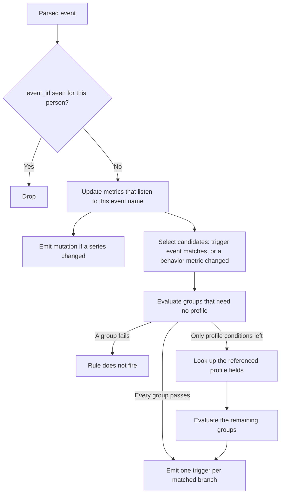
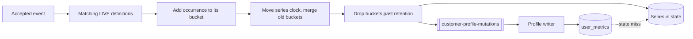
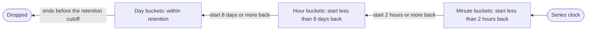

# Customer decision

## Purpose

A journey node asks a question such as "did this person add to cart an item over 500,000, do they live in Hanoi, and have they added to cart at least 3 times in the last 7 days?". Customer decision answers that question for every event and every node of every active campaign. It keeps each person's behavior metrics up to date and emits a trigger for each node that the event satisfies. [Journey execution](journey-execution.md) consumes the triggers.

## Scope

In scope:

- Computing per-person metrics from events, by the metric definitions.
- Evaluating the trigger events, filters, and conditions of journey nodes.
- Emitting journey triggers and metric mutations.
- Tracking every person's membership of every segment at their events, and publishing membership changes.
- Evaluating business-event matches and emitting their setup triggers.
- Entering a segment's current members at publish, from the messages the segment membership pass sends.
- Evaluating a condition split when a person reaches it, on a segment check from [journey execution](journey-execution.md#segment-checks).

Out of scope:

- Whether a trigger advances a journey. [Journey execution](journey-execution.md) decides that from the graph.
- Watch timeouts. The timer flow in [journey execution](journey-execution.md#watch-timers) emits them.
- Storing metrics in Postgres. The [profile writer](profile-writer.md) does that.
- Creating metric definitions. [Campaign management](../../features/campaign-management.md) creates them when a campaign is published.
- Finding the people a business event concerns. [Business event fan-out](business-event-fan-out.md) does that.
- Storing membership. The [profile writer](profile-writer.md#segment-membership) stores tracked members in `segment_members`.
- Customers known only from imports, who have no events. The [segment membership pass](segment-membership-pass.md) evaluates them once a night.
- Computing imported fields. The [import metric pass](import-metric-pass.md) writes them to `customer_attributes` once a night.

## Terms

| Term | Meaning |
|---|---|
| Rule | One journey node's trigger event and conditions, from `campaign_nodes`. |
| Trigger event | A rule's event name and the filters on that event's attributes. The [journey builder](../../features/journey-builder.md#conditions) calls it the trigger. A condition split has none. |
| Filter | A test on an attribute of an event, of type `event_property`. |
| Condition | A test on the person: a profile field, of type `profile_property`, or behavior over a window, of type `behavior`. |
| Group | A list of filters or conditions. A group passes when any of them passes. A rule's filters pass, and its conditions pass, when every group passes. |
| Metric definition | One catalog event, one function, optionally one attribute, and filters, with a retention period. Row in `user_metric_definitions`. Publish derives it from a behavior condition. |
| Occurrence | One counted event in a metric: its event time and its value. |
| Bucket | The totals of a metric's occurrences in one whole UTC minute, hour, or day. See [Buckets](#buckets). |
| Series | A person's buckets for one metric, within the retention period. |
| Series clock | The newest `event_timestamp` counted in a series. Bucket sizes are measured back from it. |
| Snapshot | All of a person's series after the current event is counted. |
| Segment | A saved list of condition groups, from `segments`. See [segments](../../features/segments.md). |
| Membership flag | Whether the job last saw a person in a segment. Keyed state, per `canon_id` and segment, for every segment. |
| Entry id | The id of one person's pass through one campaign, carried by a setup trigger. See [decision 0033](../decisions/0033-a-journey-instance-is-one-entry.md). |
| Match | A record from [business event fan-out](business-event-fan-out.md) that one business event concerns one person for one campaign. |
| Segment check | A message from journey execution that one person reached one condition split. |
| Candidate | A rule that might fire for the current event. |
| Trigger | A message that says one person's event satisfied one node on one branch. |
| Mutation | A message with the series that one event changed for one person. |

## Behavior

Example. A check node in campaign `CAMP-0001` has:

- Trigger event: `add_to_cart`, with the filter `product.price > 500000`.
- Conditions, in two groups: `city IN [Hanoi, Ho Chi Minh City]`, and `add_to_cart` `COUNT >= 3` over 7 days.

A shopper adds a 12,990,000 item to the cart for the third time this week. The job counts the event, so the series for that behavior condition now has 3 occurrences in the window, and the behavior group passes. Only the city group is left, so the job looks up the shopper's `city`, and nothing else from the profile. The shopper lives in Hanoi, so the job emits a trigger for that node on branch `yes`. If the shopper had added to cart only twice, the behavior group would fail, and the job would not look up the profile at all.



Rules and metric definitions arrive by CDC and apply to the next event, without a restart. See [decision 0003](../decisions/0003-load-rules-through-cdc-and-broadcast-state.md).

## Algorithm

All steps run keyed by `canon_id`, so one subtask owns each person. Every rule evaluated for one event comes from one version of the rules, the one the job held when the event arrived. See [decision 0004](../decisions/0004-compute-metrics-and-decisions-in-one-keyed-job.md) and [decision 0030](../decisions/0030-make-every-rule-decision-in-one-keyed-operator.md).

### 1. Accept the event

Accept an event only if it has a `canon_id`, an `event_id`, an `event_name`, and an `event_timestamp`, and its `event_json` is within the size limit. Drop an event whose `event_id` is among the last 512 ids accepted for this person.

### 2. Update metrics

1. Select the metric definitions whose event is this event's name, whose `processing_mode` is `LIVE`, and whose `enabled` is not false. Use an index by event name. Do not scan all definitions. A definition whose event name is blank or `*` fails to parse. There is no wildcard. This rule was chosen during the fix and is pending owner review.
2. Keep the definitions whose `default_properties` and `filter_conditions` match the event. A condition that is null or `{}` is absent and matches every event.
3. For each kept definition, read the person's series from state. On a state miss, read it from `user_metrics`. The read does not block the subtask. The owner decided this on 2026-10-20. While it runs, the person's later events and segment checks wait, and run in the order they arrived once it returns. Other people's events do not wait. How they wait was chosen during the fix, and is pending owner review. See DEC-NFR-13 and [decision 0026](../decisions/0026-read-user-metrics-through-the-mailbox-of-the-behavior-operator.md).
4. Add the occurrence to its bucket, as [Buckets](#buckets) describes. Its value is the definition's attribute on the event, read as the definition's [value type](../../features/campaign-management.md#metric-definitions), or none for a presence metric. A definition with any other value type fails to parse. When the event lacks the attribute, or its value cannot be read as the type, the occurrence has no value. It is still an occurrence. The owner decided this on 2026-10-18. When the optional per-event schema check of [event ingestion](event-ingestion.md) is on, such an event does not reach this job, so no occurrence lacks its value.
5. If the event is newer than the series clock, move the clock to the event's `event_timestamp`, and merge each bucket that is now too old for its size into the larger bucket that holds it.
6. Drop every bucket that ends before the series clock minus the retention period minus the allowed out-of-orderness. A late event older than that cutoff is not counted, and the series does not change.
7. If at least one series changed, add 1 to the person's behavior version, and emit one mutation with the new version and every changed series in full.

The behavior version is a per-person counter that only increases. It orders mutations for the [profile writer](profile-writer.md), so that a replayed or delayed mutation cannot overwrite a newer row. It does not order events by time, and it is not shown to anyone.

The counter lives in state with the series. When state has no counter for the person, because it expired or the job started without a savepoint, the job reads the highest `last_behavior_version` among the person's `user_metrics` rows, or 0 if there are none, and continues from there. It reads the version only for an event that a definition counts, because no other event changes a series. This was chosen during the fix. It is pending owner review.

Metric series flow, from an event to the stored copy:



### 3. Select candidates

A rule is a candidate when its campaign's status is `active` and either:

- its trigger event's name equals the event's name, and the event passes its filters, or
- it has no trigger event, and the metric of one of its behavior conditions changed in step 2.

A condition split is a rule with no trigger event. It fires only `yes`, and never `no`. The owner decided this on 2026-10-17. A condition split is a candidate when the event changed one of its metrics. It is also checked when a person reaches it, as [Segment checks](#segment-checks) describes. The owner decided this on 2026-10-18.

Index rules by trigger event name, and rules without one by the metric ids of their behavior conditions. Do not scan every rule.

Selection reads from state only the series that the candidates' behavior conditions reference, after step 2, with one read per series. When no candidate has a behavior condition, it reads none. This was chosen during the fix. It is pending owner review.

### 4. Evaluate conditions

Evaluate each candidate's groups once, cheapest first:

1. Evaluate every condition that needs no profile. A behavior condition reads the person's series. A series missing from state is loaded from `user_metrics` into state first. An absent series is an empty series.
2. A group passes as soon as one of its conditions passes. A rule fails as soon as one of its groups has no condition left that could pass.
3. If a candidate's result now depends only on profile conditions, look up the profile fields that those conditions name, once per event for all such candidates, and finish their groups. Look up nothing for a candidate whose result is already settled.

A rule fires when its trigger event matched, or it has none, and every group of its conditions passes. A multi-branch check evaluates each branch's filters and conditions the same way, after its node's own, and every branch that passes fires.

The job keeps no profile in state. While a person's event waits for a profile lookup, the triggers of that person's later events wait behind it, so a person's triggers leave in the order their events arrived. The lookup timeout bounds the wait.

### 5. Emit triggers

Emit one trigger for each branch the rule fires on:

| Node | Branch emitted |
|---|---|
| Setup | `next` |
| Check, single path | `yes` |
| Check, multi-branch | Each branch key whose filters and conditions pass |
| Watch, waiting for an event | `success` |
| Condition split | `yes`. A condition split never emits `no`. |

The branch name must equal the `parent_branch` that the [journey builder](../../features/journey-builder.md#saved-format) saves for the node's children.

A setup trigger carries an entry id. It is `first` for a trigger of kind `event`, the `event_id` of the event at which the person entered for `segment_entry`, and the business event's `event_id` for `business_event`. Triggers for other nodes carry none. Each trigger carries the `graph_version` of the rule's row, so that [journey execution](journey-execution.md#apply-a-trigger) can tell which graph it was decided against.

### Segment checks

Journey execution sends a segment check when a person reaches a condition split, that is, when the split's parent completes. [Decision 0015](../decisions/0015-check-a-segment-when-a-person-reaches-it.md) records the design. A check runs keyed by `canon_id`, through the steps above, with these differences:

1. It counts nothing. It skips steps 1 and 2 and emits no mutation.
2. Its one candidate is the condition split it names, if that rule is still a condition split and its campaign is `active`. Otherwise the check emits nothing.
3. Steps 4 and 5 run as for an event. The check's `event_time` is `t`, the end of each metric window.
4. If the condition split fires, the trigger carries the check's `event_id`, `event_name`, and `event_time`, and branch `yes`.

A check delivered twice can emit two triggers. Journey execution keeps the first.

### Track segment membership

At each of a person's events, after step 2, evaluate every segment's conditions for the person, with the same cheapest-first rule and the same per-event profile lookup as step 4. Compare the result with the person's membership flag for that segment:

- **Out to in.** Set the flag to in. Publish an `entered` change to `segment-membership-changes`. For every active campaign whose setup node starts on entering this segment, evaluate the setup node's conditions, and emit the setup trigger on `next` with the current event's `event_id` as the entry id. [Journey execution](journey-execution.md) applies the trigger's re-entry setting. A segment that no campaign starts on gets the flag and the change, and no trigger.
- **In to out.** Set the flag to out and publish an `exited` change. Nothing starts.
- **No flag yet.** Set the flag to the result. Publish `entered` if the person is in, and `exited` if not. Emit no setup trigger, because the job cannot tell whether the person was a member before. An `exited` for a person with no stored row changes nothing, and one for a person with a stale row removes it.
- **No change.** Do nothing.

At their events, only an out-to-in change that the job sees starts a journey. A person who is already in the segment when a campaign that starts on it is published does not enter at their next event. They enter once their flag goes out and then back in. A person the job evaluates against a segment for the first time only gets a flag and starts no journey. The owner decided both on 2026-11-08. [Decision 0031](../decisions/0031-reusable-segments-with-entry-triggers.md) had current members enter at their next event, because the job kept no flag for a segment until a campaign started on it. Now that the job keeps a flag for every segment from the start, entering at the next event would start a journey for every current member at once.

A marketer who wants current members to enter chooses **Also include current members** at publish. Those members then enter once, through [Current members at publish](#current-members-at-publish), paced and not at their next event.

Every segment is evaluated, not only those an entry trigger or an audience uses, because segment size counts the members of every segment. [Decision 0038](../decisions/0038-store-segment-membership-and-evaluate-every-segment.md) amends [decision 0031](../decisions/0031-reusable-segments-with-entry-triggers.md) on this point.

A flag lasts as long as its segment. Unlike metric state, flags do not expire (DEC-FR-37). A flag that expired would make a returning person look new to the job, so a real entry at their return would start nothing. Without an expiry, a flag is lost only on a start without flags, and the "no flag yet" rule then publishes the person's current membership, which corrects a stale stored row. The expiry rule and the publication are the lead's defaults, pending owner review. That a first evaluation starts no journey is the owner's decision.

Each flag keeps the time it last changed and the time the job last published it. At a person's event, the job publishes a flag's current value again when it last published that flag 30 days or more before, even if the value did not change: `entered` with the time the flag last changed, or `exited` (DEC-FR-37). Such a repeated change starts no journey. The profile writer writes nothing for a member whose row already holds that time. So a `segment_members` row that a lost message left missing or stale is corrected at the person's first event after 30 days. A message is lost when the profile writer stays down longer than the topic's retention, or when the sink starts after it. This is the lead's default, pending owner review.

When the job reads that a segment was deleted, it stops evaluating the segment. It clears every person's flag for that segment at once, and publishes `exited` for each person whose flag was in, without waiting for their next event (DEC-FR-38). The profile writer then deletes those rows. This is the lead's default, pending owner review.

A `segment_membership` condition never reads a flag, and never reads stored membership. It evaluates the segment's conditions at that moment.

A segment's behavior condition counts only the events that pass its filters, for a `segment_membership` condition and for a flag alike (DEC-FR-36). The condition names a metric definition that carries those filters, as a journey's behavior condition does, so "`add_to_cart` where `product.price` > 500000" counts no cheaper item.

Membership flags are keyed state beside the metric series, and nothing else in state depends on them. A restore from a savepoint taken before flags existed starts with no flags. At their next event, each person gets a flag for every segment, the job publishes their current membership, and no journey starts.

Segment membership comes online in two steps. First, the job reads `segments` and evaluates `segment_membership` conditions (DEC-FR-30). Then it keeps flags, publishes changes, and emits entry triggers (DEC-FR-31, DEC-FR-32, DEC-FR-34). Studio offers each control only once its step runs on the cluster.

### Current members at publish

A marketer can publish a segment-entry journey with **Also include current members** ([JBD-FR-32](../../features/journey-builder.md#functional-requirements)). The [segment membership pass](segment-membership-pass.md#current-members-at-publish) then reads the segment's members at publish time from `segment_members` and sends one message per member on `current-member-entries`, at a capped rate. The owner decided this on 2026-11-08. For each message, keyed by `canon_id` like every other input:

1. Drop it if the campaign is not `active`, its setup node no longer starts on entering that segment, or its graph version differs from the message's.
2. Evaluate the setup node's conditions for the person now, as for a segment entry.
3. If they pass, emit the setup trigger on `next` with the entry id `members-<graph_version>`, the event name `segment_entry`, and the message's `entry_time` as the event time. [Journey execution](journey-execution.md) applies the re-entry setting, so a person who already has an entry in the campaign enters again only if that setting allows it.

The entry id is the same for every message of one publish, so a repeated message opens no second entry. Any rule that journey execution applies to an entry, such as a frequency cap once studio has one, applies to these entries as well, because they are ordinary setup triggers.

### Business-event matches

For each match from `business-event-matches`, keyed by `canon_id` like every other input:

1. Drop it if the campaign is not `active`, or its setup node no longer starts on that business event.
2. For a segment audience, evaluate the segment's conditions for the person now. Drop the match if the person is not a member.
3. Evaluate the setup node's conditions by step 4.
4. If they pass, emit the setup trigger on `next`, with the business event's `event_id` as the entry id and its time as the event time. Its context holds the business event's attributes, with keys prefixed `business.`, and `business.event_name`.

Matches and events of one person share that person's order, as step 4 requires.

### Buckets

A series keeps totals per bucket, not each occurrence. Its size does not grow with the person's activity, and nothing leaves it but buckets older than the retention period. So every occurrence in the retention period counts, however many there are. The owner chose this model on 2026-10-21. [Decision 0028](../decisions/0028-store-metrics-as-tiered-time-buckets.md) explains it.

Buckets start at whole UTC minutes, hours, and days, so each minute lies inside one hour and each hour inside one day. An occurrence goes into the smallest bucket whose start is close enough to the series clock:

| Bucket | Used while its start is before the series clock by |
|---|---|
| The minute that holds the event time | Less than 2 hours |
| The hour that holds it | Less than 8 days |
| The UTC day that holds it | Any time within the retention period |

Bucket tiers, measured back from the series clock:



When the series clock moves on, a minute bucket whose start falls 2 hours or more behind it merges into its hour, and an hour bucket whose start falls 8 days or more behind it merges into its day. A late occurrence lands directly in the bucket it would have reached by merging. So the series depends only on which occurrences were counted, not on the order they arrived in.

Every bucket holds the number of its occurrences. It also holds what the definition's function needs:

| Function | The bucket also holds |
|---|---|
| `COUNT`, `INACTION` | Nothing more |
| `SUM`, `AVG` | The sum of the numeric values, and how many there are |
| `MIN`, `MAX` | The smallest and the largest numeric value |
| `LATEST`, `PRICE_DROP`, `DIFF` | The two newest occurrences with a numeric value, with their event times and values. On equal event times, the occurrence whose `event_id` sorts last is the newer. |
| `DISTINCT_COUNT` | A fixed-size summary of the distinct values |
| `MEDIAN` | A fixed-size summary of the numeric values, for quantiles |

An occurrence with no value counts in the bucket's number of occurrences and nowhere else. A value that is not a number also stays out of the sum, the minimum, the maximum, the newest two, and the quantile summary. A bucket that lacks what a function needs, because the definition's function changed after the bucket was written, counts as empty for that function.

### Metric functions

The window of a comparison ends at the event's `event_timestamp`, call it `t`, and covers `(t - W, t]`. A bucket counts in the window when any part of it is inside: when it ends after `t - W` and starts at or before `t`. With no window, every bucket that starts at or before `t` counts. `W` is a number above 0 with a unit: `SECONDS`, `MINUTES`, `HOURS`, `DAYS`, `WEEKS`, or `MONTHS`, written in upper case. A week is 7 days and a month is 30 days. The owner decided the week and the month on 2026-10-17.

So the window's edges are as precise as the buckets that hold them:

- **The old edge** can take in occurrences up to one bucket older than `t - W`. That is at most 1 minute when the bucket that holds `t - W` starts less than 2 hours before the series clock, 1 hour when less than 8 days, and 1 day otherwise. When `t` is at or after the series clock, as it is for an event that arrives in order, a window of up to 1 hour is accurate to the minute, up to 7 days to the hour, and longer to the day.
- **The new edge.** The bucket that holds `t` counts in full. It can hold occurrences after `t` that arrived before the current event: at most 1 minute after `t` when that bucket is a minute.
- **Inside the window,** every occurrence counts.

| Function | Value over the buckets in the window |
|---|---|
| `COUNT` | The sum of the counts |
| `INACTION` | The sum of the counts. A condition such as `INACTION = 0` means "did not do it". |
| `SUM` | The sum of the sums, or 0 with no numeric value |
| `AVG` | The sum of the sums, divided by the number of numeric values, or no value with none |
| `MIN`, `MAX` | The smallest minimum, the largest maximum, or no value with none |
| `MEDIAN` | The exact median while the window holds fewer than 200 numeric values, the mean of the two middle values for an even count. From 200 values on, the median of the merged quantile summaries, within 2% of its true rank, with 99% confidence. No value with no numeric value. |
| `DISTINCT_COUNT` | The count of the merged distinct summaries, with a relative standard error of at most 2%, or 0 with no value |
| `LATEST` | The newest numeric value among the buckets' newest two, or no value with none |
| `PRICE_DROP`, `DIFF` | Second-newest numeric value minus newest numeric value, among the buckets' newest two, or no value with fewer than 2 |

`COUNT` and `INACTION` count every occurrence, with or without a value. The other functions read only occurrences that have a value. `SUM`, `AVG`, `MIN`, `MAX`, `MEDIAN`, `LATEST`, `PRICE_DROP`, and `DIFF` also leave out a value that is not a number. The owner decided this on 2026-10-18.

The results follow SQL aggregates over NULL. A sum or a count over no values is 0, and any other function over no values has no value. A comparison with no value fails for every operator, as a comparison with SQL `NULL` does.

An empty window is a window with no values, so `COUNT`, `INACTION`, `SUM`, and `DISTINCT_COUNT` give 0, and the other functions have no value. This rule is pending owner review. It was chosen so that one occurrence with no value cannot flip a result. With 0 for an empty window, `MAX < 5` would pass for a person with no occurrences, then fail after an event without the attribute. The alternative is to keep 0 for an empty window. See [Open questions](#open-questions).

A missing or unknown function means `COUNT`.

A metric comparison names the metric id in `left` and compares the function's value with `right`, a finite number. Its operator is `>`, `>=`, `<`, `<=`, `=`, or `!=`. `==` means `=`, and a missing operator means `>=`. `=` and `!=` compare numbers with a tolerance of 1e-6. A rule with a metric comparison that has no metric id, another operator, a `right` that is not a finite number, or a window of 0 or less or without one of the units above fails to parse.

### Condition language

Filters and conditions are typed JSON objects in groups. A group is `{ "conditions": [ ... ] }` with at least one entry. A list of groups is `{ "groups": [ ... ] }`. Every group must pass, and a group passes when any of its entries passes. An absent list passes, and so does `{ "groups": [] }`. Each entry has a `type`:

| Type | Fields | Passes when |
|---|---|---|
| `event_property` | `field`, `op`, `value` | The event's field compares true with `value` |
| `profile_property` | `field`, `op`, `value` | The profile's field compares true with `value` |
| `behavior` | `metric_id`, `event`, `measure`, `attribute`, `filters`, `window`, `op`, `value` | The [metric function](#metric-functions) `measure`, over the series of `metric_id` in `window`, compares true with `value` |
| `segment_membership` | `segment_id`, `op` | With `in`, every group of the segment's conditions passes for the person now. With `not_in`, at least one fails. |

| Operator | `event_property` and `profile_property` |
|---|---|
| `>`, `>=`, `<`, `<=` | Numeric when both sides are numbers. Otherwise in time when both sides are ISO 8601 datetimes or dates, by the datetime rules below. False otherwise. |
| `=`, `!=` | String equality |
| `more_than_days_ago` | `profile_property` only. `value` is a whole number N of at least 1. The field is a datetime earlier than the check time minus N days. |
| `within_last_days` | `profile_property` only. `value` is a whole number N of at least 1. The field is a datetime at or after the check time minus N days, and not after the check time. |
| `LIKE` | `%` matches any run of characters, `_` matches one. Every other character matches itself. |
| `IN` | `value` is a JSON array. The field must equal one of its items, compared as strings. |

A `behavior` entry's `op` is `>`, `>=`, `<`, `<=`, `=`, or `!=`, and its `value` is a finite number. `=` and `!=` compare numbers with a tolerance of 1e-6. Its `window` is `{ "value": W, "unit": U }`, with the units in [Metric functions](#metric-functions). Publish writes `metric_id`. The job reads the series by `metric_id`, and the other fields describe what the series counts.

Datetime rules (DEC-FR-16). A datetime with an offset, such as `2026-10-01T09:00:00Z` or `2026-10-01T09:00:00+07:00`, is that instant. A datetime without an offset is read as UTC. A date alone on the right means the whole day in UTC: `> D` holds from the start of the next day, `>= D` from the start of D, `< D` before the start of D, and `<= D` before the start of the next day. A date alone on the left is the start of its day in UTC. Other forms do not parse, so the comparison is false: an offset without a colon such as `+0700`, a space instead of `T`, and epoch numbers compared with a date. `=` and `!=` still compare the text. These rules were chosen during the fix and are pending owner review. See [Open questions](#open-questions).

Relative-date rules (DEC-FR-42). The check time is the time of the evaluation: the event's `event_timestamp`, or the segment check's `event_time`. The wall clock plays no part, so a replayed event reaches the same answer. N days is N times 86,400 seconds. `more_than_days_ago N` holds when the value is strictly before the check time minus N days. `within_last_days N` holds when the value is at or after the check time minus N days and not after the check time, so a value in the future fails. The field's value parses by the datetime rules above. A value that does not parse, or no value, fails. The bounds are the lead's default, pending owner review. Imported metrics store dates such as `last_order_at`, not day counts, so "no order for 60 days" is `orders.last_order_at more_than_days_ago 60` ([decision 0041](../decisions/0041-imported-data-reaches-conditions-as-profile-attributes.md)).

An `event_property` field resolves against the event: `event.name`, `page.*`, `product.name`, or a dotted path into `event_json`. See [event ingestion](event-ingestion.md#interfaces). A `profile_property` field is either a built-in field or an imported field. A built-in field is one of `fid`, `cardcode`, `customer_id`, `phone`, `email`, `name`, `first_name`, `pronoun`, `gender`, `age`, `city`, `env`, `cdp_uuid`, `network_user_id`, and `user_time`, read from `customer_profiles`. An imported field is `<source>.<name>`, such as `orders.spend_90d` or `customers.loyalty_tier`. It splits at its first `.`, and resolves to the key `<name>` of the `attributes` of the `customer_attributes` row whose `source_id` is `<source>`, for the same `user_id` the lookup uses for `customer_profiles` (DEC-FR-40). The [import metric pass](import-metric-pass.md) writes those rows once a night. A person with no such row, or whose row lacks the key, has no value, and every comparison with no value fails.

A metric definition's filters and default properties use the same list of groups, with `event_property` entries only.

A rule fails to parse when an entry has an unknown `type`, a missing field, or an operator outside its table, when a group is empty, when a `behavior` entry has no `metric_id`, a `value` that is not a finite number, or a window of 0 or less or without one of the units, or when a setup, check, or watch has no trigger event. The job skips and logs a rule that fails to parse.

## Functional requirements

| Id | Requirement |
|---|---|
| DEC-FR-01 | The job must not count an `event_id` in metrics when it is among the last 512 ids the job accepted for the person. |
| DEC-FR-02 | The job must update only the metric definitions that are `LIVE`, enabled, and listen to the event's name, by the steps in [Update metrics](#2-update-metrics). |
| DEC-FR-03 | A series must count every occurrence within its retention period, however many there are, in buckets by the rules in [Buckets](#buckets). |
| DEC-FR-04 | The job must emit a mutation for an event if and only if at least one series changed. |
| DEC-FR-14 | Each mutation must carry a behavior version greater than that of every earlier mutation for the same person. |
| DEC-FR-15 | On a segment check, the job must evaluate the condition split against the person's whole snapshot as of the check's `event_time`, and emit `yes` if its condition holds. The check must not change any series. |
| DEC-FR-16 | `>`, `>=`, `<`, and `<=` on event and profile fields must order two ISO 8601 datetimes in time by the [datetime rules](#condition-language), and must be false when either side is neither a number nor such a value. |
| DEC-FR-05 | Rules must be evaluated against the metrics after the current event is counted. |
| DEC-FR-06 | Behavior conditions must be evaluated against the person's whole snapshot. A series the current event did not change must still be visible. |
| DEC-FR-07 | An absent series must evaluate as an empty series. |
| DEC-FR-08 | A rule must fire only if its campaign is `active`, its trigger event matched or it has none, and every group of its conditions passes. |
| DEC-FR-09 | A rule without a trigger event must be evaluated when the metric of one of its behavior conditions changes. |
| DEC-FR-10 | The job must emit the branch names in [Emit triggers](#5-emit-triggers). |
| DEC-FR-11 | Each candidate must be evaluated once per event. |
| DEC-FR-12 | A change to a rule or a metric definition must apply to the next event, without a restart. |
| DEC-FR-25 | `COUNT`, `INACTION`, `SUM`, `AVG`, `MIN`, `MAX`, `LATEST`, `PRICE_DROP`, and `DIFF` must be exact over the buckets in the window. `MEDIAN` and `DISTINCT_COUNT` must stay within the error in [Metric functions](#metric-functions). |
| DEC-FR-26 | A series must depend only on which occurrences were counted, not on the order they arrived in. |
| DEC-FR-13 | The job must look up the profile only when a candidate's result, or a segment's membership, depends on a profile condition, and must look up only the fields such conditions name, once per event. It must read `user_metrics` only for referenced series, or a behavior version, missing from state. |
| DEC-FR-27 | Every rule evaluated for one event must come from the same version of the rules. |
| DEC-FR-28 | A person's triggers must leave in the order the person's events arrived. |
| DEC-FR-29 | The job must keep no profile field in state. |
| DEC-FR-30 | A `segment_membership` condition must evaluate the segment's conditions at that moment, from the segment's current row in `segments`. It must not read a membership flag or stored membership. |
| DEC-FR-31 | The job must evaluate the person's membership of every segment at each of the person's events, and keep a flag per person and segment. When the person's flag goes from out to in, it must emit the setup trigger of each active campaign that starts on entering that segment, and of no other campaign. At an event, a person with no flag for the segment, and a person whose flag is already in when the campaign is published, must not enter until the flag goes from out to in. The owner decided the second sentence on 2026-11-08. Current members enter only through DEC-FR-39. |
| DEC-FR-32 | The job must publish every change of a membership flag to `segment-membership-changes`, with the fields in [Interfaces](#interfaces), and must publish nothing when a flag does not change. |
| DEC-FR-33 | For a match, the job must emit the setup trigger only if the campaign is `active`, the setup node still starts on that business event, the person is a member for a segment audience, and the setup node's conditions pass. |
| DEC-FR-34 | A setup trigger must carry the entry id in [Emit triggers](#5-emit-triggers). |
| DEC-FR-35 | Customers known only from imports must be evaluated by the [segment membership pass](segment-membership-pass.md), with this page's condition language and an empty snapshot. This job must publish no membership change and emit no trigger for a customer key that no tracked person holds. |
| DEC-FR-36 | When the job evaluates a segment's behavior condition, for a `segment_membership` condition or for a membership flag, it must count only the events that pass the condition's filters, as it does for a journey's behavior condition. |
| DEC-FR-37 | A membership flag must not expire while its segment exists. At an event where a person has no flag for a segment, the job must publish `entered` if the person is in and `exited` if not, and must emit no setup trigger. At an event 30 days or more after the job last published a flag, it must publish the flag's current value again, `entered` with the time the flag last changed or `exited`, and must emit no setup trigger. The expiry, the publication, and the 30-day repeat are the lead's defaults, pending owner review. The owner decided on 2026-11-08 that this first evaluation starts no journey. |
| DEC-FR-38 | When a segment is deleted, the job must clear every person's flag for it, and must publish `exited` for each person whose flag was in, without waiting for that person's next event. This is the lead's default, pending owner review. |
| DEC-FR-39 | For each message on `current-member-entries`, the job must emit the setup trigger with the entry id `members-<graph_version>` and the message's `entry_time` only if the campaign is `active`, its setup node still starts on entering that segment, its graph version equals the message's, and the setup node's conditions pass. The owner decided this on 2026-11-08. |
| DEC-FR-40 | A `profile_property` field of the form `<source>.<name>` must resolve from `customer_attributes`, matching `customer_key` to the `user_id` the profile lookup uses for `customer_profiles`, and reading the key `<name>` of the row whose `source_id` is `<source>`. |
| DEC-FR-41 | The job must read `customer_attributes` only when a candidate's result depends on a condition with an imported field, must read only the rows of the sources such conditions name, and must read `customer_profiles` and `customer_attributes` in one round trip when it needs both. |
| DEC-FR-42 | `more_than_days_ago` and `within_last_days` must compare a datetime profile field with the check time by the [relative-date rules](#condition-language), and must not read the wall clock. |
| DEC-FR-43 | A rule whose `more_than_days_ago` or `within_last_days` entry is an `event_property`, or whose `value` is not a whole number of at least 1, must fail to parse. |

## Non-functional requirements

The defaults below are configurable. [Configuration](../../operations/configuration.md#customer-decision) names each setting.

| Id | Requirement |
|---|---|
| DEC-NFR-01 | State keeps at most 128 metrics per person. |
| DEC-NFR-02 | A series holds at most 121 minute buckets, 193 hour buckets, and one day bucket per day of retention past 8 days, plus one. With the default retention of 30 days, that is 337 buckets. |
| DEC-NFR-03 | Metric state expires 31 days after its last write. |
| DEC-NFR-04 | Events up to 10 minutes out of order are counted. |
| DEC-NFR-05 | `event_json` is at most 32 KiB. A string metric value is at most 4 KiB. |
| DEC-NFR-06 | The job remembers the last 512 event ids per person. |
| DEC-NFR-07 | State lives in RocksDB with a TTL. Membership flags have no TTL (DEC-FR-37). Heap state is not allowed for this job. Without quantile or distinct summaries, the upper bound per person is about 128 metrics x 337 buckets x 48 bytes, or 2 MiB, before serializer overhead. A person reaches it only with an occurrence in every bucket of every metric. A distinct summary adds up to about 2 KiB per bucket and a quantile summary up to about 5 KiB, so one series at the bucket limit with full summaries is about 0.95 MB for `DISTINCT_COUNT` and 2.34 MB for `MEDIAN` in a mutation, where the summaries are base64. The producer, the profile writer's consumer, and the `customer-profile-mutations` topic accept messages of up to 8 MiB, which covers that bound with room for an event that changes several such series. The owner chose to raise the limits and keep whole-series mutations. |
| DEC-NFR-08 | Profile lookups run asynchronously, at most 10 at once per subtask, with a timeout of 30 seconds and a queue of 1000. A lookup must not hold up another person's events. A found profile's fields, imported fields included, and the `user_id` found for a `canon_id`, are cached for 5 minutes, at most 5000 entries each. A value the import metric pass publishes is therefore visible to conditions within 5 minutes of its commit. A lookup that fails, or finds nothing, is not cached. |
| DEC-NFR-09 | Both outputs are delivered at least once. See [decision 0006](../decisions/0006-at-least-once-delivery-with-idempotent-writes.md). |
| DEC-NFR-10 | Per event, rule selection and metric updates must not scan every rule or every metric definition. Candidate selection must read only the series that candidate rules reference. |
| DEC-NFR-11 | A `user_metrics` read waits at most 5 seconds for a connection, and at most 5 seconds more for its result. A read past either limit has failed. |
| DEC-NFR-12 | A series missing from state is loaded from `user_metrics` into state, with the limits of DEC-NFR-11. A load that fails fails the event, as [Failure handling](#failure-handling) says. |
| DEC-NFR-13 | A state miss read for step 2 runs off the subtask thread, at most 5 at once per subtask. The person's later events and segment checks wait for it in arrival order. Other people's events do not. With 5 reads running, the job takes no more events until one returns. The watermark stays below the oldest waiting record. A read that was running at a checkpoint runs again after a restore. These limits were chosen during the fix. They are pending owner review. |
| DEC-NFR-14 | A membership flag, with the time it last changed and the time it was last published, costs about 70 bytes of state (estimate). Flags never expire, so state grows with every person the job has ever seen, not with active people. 500,000 people ever seen and 20 segments hold about 700 MB. The rollout of flags measures the real size, and the change rate per evaluation, on the cluster. See [decision 0038](../decisions/0038-store-segment-membership-and-evaluate-every-segment.md#why). |
| DEC-NFR-15 | `segment-membership-changes` and `current-member-entries` keep their messages for 24 hours. Both topics share the database host's disk. See [decision 0038](../decisions/0038-store-segment-membership-and-evaluate-every-segment.md#why). |

## Interfaces

| Direction | Interface | Contract |
|---|---|---|
| In | Kafka `snowplow-parsed` | Parsed event, see [event ingestion](event-ingestion.md#interfaces) |
| In | CDC `campaigns`, `campaign_nodes`, `user_metric_definitions` | Rules and metric definitions |
| In | `user_metrics` | Series, on a state miss |
| In | CDC `segments`, through the publication `segments_pub` | Segment definitions. A change applies to the next event. |
| In | Kafka `business-event-matches` | Matches, key `canon_id`. See [business event fan-out](business-event-fan-out.md#interfaces). |
| Out | Kafka `segment-membership-changes` | Membership change: `canon_id`, `segment_id`, `entered` or `exited`, the `event_id` that caused it, and the event time. Key `canon_id`. Read by [business event fan-out](business-event-fan-out.md#interfaces) and the [profile writer](profile-writer.md#segment-membership). |
| In | Kafka `current-member-entries` | One current member to enter: `schema_version`, `canon_id`, `campaign_id`, `segment_id`, `graph_version`, and `entry_time`. Key `canon_id`. From the [segment membership pass](segment-membership-pass.md#current-members-at-publish). |
| In | Kafka `journey-engine-segment-checks` | Segment check, key `canon_id`, from [journey execution](journey-execution.md#segment-checks) |
| In | `customer_profiles` | The profile fields that a candidate's conditions name, matched on `cdp_uuid` by the `user_id`, else by the `user_id` of the newest `identity_graph` row of the person's `canon_id` that has one, else no profile. A blank `user_id` is none. No profile gives an empty profile. |
| In | `customer_attributes` | The imported fields that a candidate's conditions name, by `customer_key` equal to the `user_id` the `customer_profiles` lookup uses, and `source_id`. The [import metric pass](import-metric-pass.md) is its only writer. No row gives no value. |
| In | `identity_graph` | The `user_id` of the person's `canon_id`, for the profile lookup of an event without one |
| Out | Kafka `customer-profile-mutations` | Mutation, key `canon_id` |
| Out | Kafka `journey-engine-matched-events` | Trigger, key `canon_id` + U+001F + `campaign_id` |

A rule row in `campaign_nodes` carries the `graph_version` of the save that wrote it, its trigger event in `trigger_json`, its conditions in `conditions_json`, and a multi-branch check's branches in `paths_json`, in the shapes the [journey builder](../../features/journey-builder.md#saved-format) saves. The job skips and logs a condition split row with a trigger event or without a behavior condition.

A mutation:

```json
{
	"schemaVersion": 1,
	"canonId": "customer-42",
	"behaviorVersion": 18,
	"eventId": "123e4567-e89b-12d3-a456-426614174000",
	"eventTime": 1785800000000,
	"metrics": [
		{
			"metricId": "m_7c41d0a2e5f61b93",
			"valueType": "PRESENCE",
			"seriesClock": 1785800000000,
			"buckets": [
				{ "size": "MINUTE", "start": 1785799980000, "count": 1 }
			]
		}
	]
}
```

Each metric carries its whole series, not a delta, so a consumer can replace the stored series. A bucket has `size` (`MINUTE`, `HOUR`, or `DAY`), `start` in epoch milliseconds, and `count`. It has the other fields its function needs: `sum` and `valueCount`, the number of numeric values, `min` and `max`, `newest` (up to two objects with `eventId`, `eventTime`, and `value`), `distinct`, or `quantiles`. `distinct` and `quantiles` are base64 strings that only customer decision reads.

A trigger:

```json
{
	"schema_version": 4,
	"event_id": "123e4567-e89b-12d3-a456-426614174000",
	"canon_id": "customer-42",
	"domain_userid": "a1b2c3",
	"network_userid": null,
	"user_id": "0912345678",
	"campaign_id": "CAMP-0001",
	"node_id": "node-2",
	"branch": "yes",
	"event_name": "add_to_cart",
	"event_time": 1785800000000,
	"entry_id": null,
	"context_json": "{\"product.price\":\"12990000\"}",
	"graph_version": 42
}
```

`event_id` is the original Snowplow event id, `event_name` is its `event_name` unchanged, and `event_time` is its `event_timestamp`. For a trigger that answers a segment check, all three come from the check. `graph_version` is the version of the graph the rule was read from. Schema version 4 added it. A trigger of an earlier version has none, and journey execution applies it against the live graph. The timer flow writes its timeouts in the same format. `entry_id` is set only on a setup trigger. A setup trigger from a business-event match carries the business event's `event_id` and time.

A segment check:

```json
{
	"schema_version": 1,
	"event_id": "123e4567-e89b-12d3-a456-426614174000",
	"canon_id": "customer-42",
	"domain_userid": "a1b2c3",
	"network_userid": null,
	"user_id": "0912345678",
	"campaign_id": "CAMP-0001",
	"node_id": "node-3",
	"event_name": "view_product",
	"event_time": 1785800000000
}
```

`node_id` is the condition split. `event_id`, `event_name`, and `event_time` are those of the trigger that completed the split's parent.

A membership change:

```json
{
	"schema_version": 1,
	"canon_id": "customer-42",
	"segment_id": "SEG-3f9a0c1d7e2b4a65",
	"change": "entered",
	"event_id": "123e4567-e89b-12d3-a456-426614174000",
	"event_time": 1785800000000
}
```

`change` is `entered` or `exited`. `event_id` and `event_time` are those of the event at which the job saw the change. The key is `canon_id`. All of one person's changes go to one partition, so a consumer reads one person's changes in the order the job published them. A key of `segment_id` would put every change of a large segment, such as the `exited` changes when it is deleted, on one partition.

## Failure handling

| Case | Behavior |
|---|---|
| Event fails the checks in step 1 | Drop it. |
| Duplicate `event_id` | Skip the metric update. A trigger may still repeat after a restart. Journey execution deduplicates. |
| A metric definition fails to parse | Log it. The job stops counting that definition until a row that parses replaces it. The job keeps running. |
| A rule fails to parse, or its row has no `graph_version` | Skip that row and log it. The job keeps running. |
| A campaign row fails to load, for example without a name or a status | Remove the campaign the row replaces, and log it, so its rules fire for no one until a row that loads replaces it. This rule was chosen during a fix and is pending owner review. |
| A segment check without `canon_id`, `campaign_id`, `node_id`, or `event_time` | Drop it and log it. |
| A `segments` row fails to parse, such as one with no group or with a `segment_membership` condition | Remove the segment the row replaces, and log it. A `segment_membership` condition on it fails until a row that parses replaces it. This was chosen during the build and is pending owner review. |
| A `segment_membership` condition names a segment the job does not hold, because it was deleted or has not arrived through CDC yet | The condition fails, with `in` and with `not_in` alike, because the job cannot tell whether the person is a member. The job counts it in the metric `unknownSegmentConditions`. This was chosen during the build and is pending owner review. |
| A current-member message without `canon_id`, `campaign_id`, `segment_id`, `graph_version`, or `entry_time` | Drop it and log it. |
| A current-member message for a campaign that is paused, deleted, or published again since | Drop it. The pause does not resume the entries. |
| A value cannot be read as the definition's type. A `NUMBER` value must be a finite number, and a `BOOLEAN` value must be `true` or `false`. | Count the occurrence with no value, as when the event lacks the attribute, and log it. The job keeps running. |
| The same event arrives after 512 newer events of the person | The job counts it again. Buckets keep no event ids. See [decision 0028](../decisions/0028-store-metrics-as-tiered-time-buckets.md#consequences). |
| Profile lookup fails or times out | Use an empty profile. Profile conditions then fail. The person's later triggers, which waited behind the lookup, leave in order. |
| A `user_metrics` read fails or times out, for a series or for the person's highest behavior version | Fail the event, so the job restarts from the last checkpoint and reads again. An empty series in place of the stored one would carry a higher behavior version and replace the stored series, or make a metric condition give the wrong answer. |
| Restart | Replay from the last checkpoint. A membership change can repeat, and its consumers converge on it. |
| Restore from a savepoint taken before membership flags existed, or a start without a savepoint | Every person starts with no flags. At their next event, each person gets a flag for every segment. The job publishes `entered` for a segment the person matches and `exited` for one they do not, and emits no setup trigger. A stored row of a person who has no further event stays until they do. |
| A segment is deleted | Clear its flags for every person, and publish `exited` for each person whose flag was in. |
| Restore from an older checkpoint or savepoint, such as a rollback to the savepoint taken before a deploy | Rules and metric definitions changed after it arrive again through CDC, within the CDC restore window of [journey execution](journey-execution.md#non-functional-requirements) (JEX-NFR-10): 10 completed checkpoints of any one run after the restored one, about 5 minutes at the default interval. Past it, the changes up to the position the slot still holds are skipped until their rows change again. |

## Acceptance criteria

- Given the example rule, a Hanoi profile, and two earlier `add_to_cart` events this week, when a third arrives with `product.price` 12990000, then one trigger is emitted for that node on `yes`. (DEC-FR-05, DEC-FR-08)
- Given the same event delivered twice, then the series counts it once. (DEC-FR-01)
- Given a series whose clock is on day 100 and a retention period of 30 days, when an event from day 10 arrives, then the series does not change. (DEC-FR-03)
- Given a rule with the trigger event `view_page` and the behavior condition `add_to_cart` `COUNT >= 3` over 7 days, and 3 `add_to_cart` events this week, when a `view_page` event arrives, then the condition is evaluated against the 3 occurrences. (DEC-FR-06)
- Given no series for a `purchase` metric, when a rule with the behavior condition `purchase` `INACTION = 0` over 1 day is evaluated, then it passes. (DEC-FR-07)
- Given no series for a `purchase` metric in state, and a `user_metrics` row for it with a purchase 1 hour ago, when a rule with the behavior condition `purchase` `INACTION = 0` over 1 day is evaluated, then it does not pass, and the series is now in state. (DEC-FR-06, DEC-NFR-12)
- Given `user_metrics` unreachable, when a rule needs a series missing from state, then the job emits nothing for that event and restarts from the last checkpoint. (DEC-NFR-12)
- Given a profile lookup that failed while `customer_profiles` was unreachable, when the person's next lookup runs after it is back, then it finds the profile. (DEC-NFR-08)
- Given an event with a `user_id` and a profile condition left to evaluate, then the profile is the one whose `cdp_uuid` is that `user_id`. (DEC-FR-13)
- Given an event without a `user_id`, whose `canon_id` has a `user_id` in `identity_graph`, then the profile is the one whose `cdp_uuid` is that `user_id`. (DEC-FR-13)
- Given an event without a `user_id`, whose `canon_id` has none in `identity_graph`, then the profile is empty and its profile conditions fail. (DEC-FR-13)
- Given a lookup that found no `user_id` for a `canon_id`, when `identity_graph` gains one, then the person's next lookup finds the profile. (DEC-NFR-08)
- Given a setup node for `view_product`, when a `view_product` event arrives, then the trigger's branch is `next`. (DEC-FR-10)
- Given a condition split with the behavior condition `purchase` `COUNT >= 2` over 30 days and one earlier purchase, when a second purchase arrives, then one trigger is emitted for the condition split on `yes`. When a `view_page` event arrives after it, no trigger is emitted for the condition split. (DEC-FR-09, DEC-FR-10)
- Given a campaign set to `paused`, when a matching event arrives, then no trigger is emitted for its nodes. (DEC-FR-08, DEC-FR-12)
- Given an event that changes no series, then no mutation is emitted. (DEC-FR-04)
- Given no behavior version in state, and `user_metrics` rows for the person whose highest `last_behavior_version` is 41, when an event changes a series, then the mutation carries version 42. (DEC-FR-14)
- Given a behavior version in state and `user_metrics` unreachable, when an event updates a series missing from state, then the job emits nothing for that event and restarts from the last checkpoint. (DEC-NFR-11)
- Given a `NUMBER` metric and an event whose attribute is `"abc"`, `"NaN"`, or `"Infinity"`, then the job keeps running and the series gains an occurrence with no value.
- Given a `NUMBER` metric and add-to-cart events with values 10, none, 30, and none in the window, then `COUNT = 4`, `SUM = 40`, `AVG = 20`, `MIN = 10`, `MAX = 30`, `MEDIAN = 20`, and `LATEST = 30` pass.
- Given a `NUMBER` metric whose occurrences in the window all have no value, then `COUNT = 2` and `SUM = 0` pass, and `AVG`, `MIN`, `MAX`, `MEDIAN`, `LATEST`, `PRICE_DROP`, and `DIFF` fail with any operator and threshold.
- Given a series with no occurrence in the window, then `SUM = 0` passes and `MAX < 5` fails.
- Given a rule `order.created_at <= 2026-10-01`, when an event has `2026-10-01T10:00:00Z`, then it passes, and with `2026-10-02T00:00:00Z` it does not. (DEC-FR-16)
- Given a rule `order.created_at > 2026-10-01`, when an event has `2026-10-01T23:00:00Z`, then it does not pass, and with `2026-10-02T06:00:00+07:00`, which is 23:00 on 1 October in UTC, it does not pass either. (DEC-FR-16)
- Given a rule `order.created_at > 2026-09-01`, when an event has `2026-10-01 10:00:00`, `2026-10-01T10:00:00+0700`, or `1759312800000`, then it does not pass. (DEC-FR-16)
- Given a condition split with the behavior condition `purchase` `COUNT >= 2` over 30 days and two earlier purchases, when a segment check for it arrives, then one trigger is emitted for it on `yes` with the check's `event_time`, and no mutation is emitted. Given one earlier purchase, then no trigger is emitted. (DEC-FR-15)
- Given the same condition split, no series for it in state, and a `user_metrics` row with two purchases, when a segment check for it arrives, then one trigger is emitted for it on `yes`. (DEC-FR-15, DEC-FR-13)
- Given a `user_metrics` read for one person that has not returned, when another person's event arrives, then that event is counted and its mutation is emitted before the read returns. (DEC-NFR-13)
- Given a `user_metrics` read for a person that has not returned, when the person's next event arrives, then both events are counted after the read returns, in arrival order. (DEC-NFR-13)
- Given a `user_metrics` read that was running at a checkpoint, when the job restores from that checkpoint, then the read runs again and the event is counted once. (DEC-NFR-13)
- Given a rule whose behavior condition has the value `"three"`, or the operator `LIKE`, or a window of 0 days, when its row loads, then the job skips and logs the row, and the rule fires for no one.
- Given a rule whose filter compares `page.url` with the operator `CONTAINS`, or that has an empty group, when its row loads, then the job skips and logs the row.
- Given 3 `add_to_cart` events 90 days ago, when a rule with the behavior condition `add_to_cart` `COUNT >= 3` over 2 `WEEKS` is evaluated, then it does not pass.
- Given a rule whose metric window has the unit `FORTNIGHTS`, `D`, `weeks`, or none, when its row loads, then the job skips and logs the row, and the rule fires for no one.
- Given a rule whose conditions are `city = Hanoi` or `add_to_cart` `COUNT >= 3` over 7 days, in one group, and 3 `add_to_cart` events this week, when a matching event arrives, then the rule fires and the job looks up no profile. (DEC-FR-13)
- Given the example rule and only 2 `add_to_cart` events this week, when a third trigger event arrives with `product.price` 100, then the job looks up no profile. (DEC-FR-13)
- Given the example rule and 3 `add_to_cart` events this week, when the job looks up the profile, then it reads only `city`. (DEC-FR-13, DEC-FR-29)
- Given a person with `user_id` `0912345678` and a `customer_attributes` row (`0912345678`, `orders`) with `spend_90d` 12990000, when a rule with the condition `orders.spend_90d >= 5000000` is evaluated, then it passes. Without the row, it fails. (DEC-FR-40)
- Given the example rule with `city = Hanoi` and `orders.spend_90d >= 5000000` in separate groups, when the job looks up the profile, then it reads `city` from `customer_profiles` and the `orders` row from `customer_attributes` in one round trip. Given a rule with no imported field, then it reads no `customer_attributes` row. (DEC-FR-41)
- Given `orders.last_order_at` `2026-09-01T10:00:00+07:00` and the condition `orders.last_order_at more_than_days_ago 60`, when an event with `event_timestamp` 2026-11-08T10:00:00+07:00 is evaluated, then it passes. When the same event is replayed a week later, then it passes again. With an event at 2026-10-20T10:00:00+07:00, then it fails. (DEC-FR-42)
- Given the condition `orders.last_order_at within_last_days 7` and `last_order_at` 2026-11-05T10:00:00+07:00, when an event at 2026-11-08T10:00:00+07:00 is evaluated, then it passes. When a segment check with `event_time` 2026-11-20T10:00:00+07:00 evaluates it, then it fails. (DEC-FR-42)
- Given a filter `order.created_at more_than_days_ago 30`, or a condition `orders.last_order_at within_last_days 0`, when its row loads, then the job skips and logs the row. (DEC-FR-43)
- Given a person whose event `e1` waits for a profile lookup, when their next event `e2` fires a rule without a profile condition, then the trigger of `e2` leaves after any trigger of `e1`. (DEC-FR-28)
- Given a rule change that arrives while a person's event waits for a profile lookup, then that event's remaining conditions are the ones from the rule version it started with. (DEC-FR-27)
- Given an `IN` filter with the value `["Ao (Men's)", "Hat, wool"]` and an event whose field is `Hat, wool`, then the filter passes.
- Given the segment "Hanoi cart builders", which an active campaign starts on, and a person in Hanoi with 2 `add_to_cart` events this week, whose flag for it is out, when a third arrives, then the job publishes `entered` with that event's `event_id`, and emits the campaign's setup trigger with that `event_id` as the entry id. (DEC-FR-31, DEC-FR-32, DEC-FR-34)
- Given a segment that no campaign uses, when a person comes to match it at an event, then the job publishes `entered` and emits no setup trigger. When the person stops matching at a later event, the job publishes `exited`. (DEC-FR-31, DEC-FR-32)
- Given a person who is in a segment, when an event arrives that leaves them in it, then the job publishes nothing for that segment. (DEC-FR-32)
- Given a restore from a savepoint taken before membership flags existed, and a person who matches a segment that an active campaign starts on, when the person's next event arrives, then the job publishes `entered` and emits no setup trigger. (DEC-FR-31)
- Given a segment with members whose flags are in, when a campaign that starts on it is published, then a member's next event that leaves them in emits no setup trigger for it. When a later event takes the member out, and another brings them back in, then the job emits the campaign's setup trigger. (DEC-FR-31)
- Given a person with no flag for a segment that an active campaign starts on, when an event finds them in it, then the job publishes `entered` and emits no setup trigger. (DEC-FR-31)
- Given a person with no flag for a segment, when an event finds them out of it, then the job publishes `exited` for the pair. (DEC-FR-37)
- Given an imported-only customer who is a member of a segment that an active campaign starts on, when their first tracked event arrives, then the job publishes `entered` and emits no setup trigger. When that campaign, or a later one on the segment, is published with **Also include current members** while they are a member, then they enter it. (DEC-FR-31, DEC-FR-37, DEC-FR-39)
- Given a new visitor whose first event makes them a member of a segment with only profile conditions, then the job publishes `entered` and emits no setup trigger. (DEC-FR-37)
- Given a member whose last event was 60 days ago, so their metric state has expired, when an event arrives that leaves them in the segment, then the job publishes nothing for the segment and emits no setup trigger. Given the same person out of the segment after 60 days, when an event brings them in, then the job publishes `entered` and emits the setup trigger of an active campaign that starts on it. (DEC-FR-37, DEC-FR-31)
- Given a member whose `entered` from the rollout of flags never reached `segment_members`, because the sink started 96 hours after the rollout and the topic keeps 24 hours, when the member has an event 30 days or more after the job last published the flag, then the job publishes `entered` with the time the flag last changed and emits no setup trigger. After every member has had such an event, then each segment's `segment_members` count equals the number of its flags that are in. (DEC-FR-37, PRW-FR-08)
- Given a member whose flag the job published 10 days ago, when an event leaves them in, then the job publishes nothing for the segment. (DEC-FR-37, DEC-FR-32)
- Given a segment that no campaign uses, with two people whose flags are in and one whose flag is out, when the segment is deleted, then the job publishes `exited` for the two members with no event from them, and later events of all three publish nothing for the segment. (DEC-FR-38)
- Given a segment with the behavior condition `add_to_cart` `COUNT >= 1` over 7 days, filtered to `product.price > 500000`, and a person whose only `add_to_cart` this week has `product.price` 300000, then a `segment_membership` condition `in` on it fails for them, and their flag is out. When an `add_to_cart` with `product.price` 600000 arrives, then the condition passes, and the job publishes `entered`. (DEC-FR-36, DEC-FR-30, DEC-FR-31)
- Given an active campaign at graph version 7 that starts on entering "Hanoi cart builders", whose setup node requires `city IN [Hanoi]`, when a current-member message for it arrives for a person in Hanoi, then the job emits the setup trigger with entry id `members-7` and the message's `entry_time`. The same message again opens no second entry. For a person in Da Nang, or for a message with graph version 6, no trigger is emitted. (DEC-FR-39)
- Given a current-member message for a campaign that was paused after publish, then no trigger is emitted. (DEC-FR-39)
- Given a segment edited from `city IN [Hanoi]` to `city IN [Da Nang]`, when a person in Da Nang has an event, then a `segment_membership` condition on it passes for them. (DEC-FR-30)
- Given a customer key in `customer_attributes` that no `identity_graph` row holds as a `user_id`, then the job publishes no membership change and emits no trigger for it. (DEC-FR-35)
- Given the same person, when a fourth `add_to_cart` arrives, then no second setup trigger is emitted. (DEC-FR-31)
- Given a stored flag "in" for a person whose 3 `add_to_cart` events left the window without a new event, when a check tests "is in Hanoi cart builders" at the person's next `view_product`, then the condition fails. (DEC-FR-30)
- Given a match for a paused campaign, then no trigger is emitted. (DEC-FR-33)
- Given a match through a segment audience for a person who is no longer a member, then no trigger is emitted. (DEC-FR-33)
- Given a match for `price_drop` with `product.price` 899000, then the setup trigger's entry id is the business event's `event_id`, and its context holds `business.product.price`. (DEC-FR-34)
- Given 5,000 `add_to_cart` events over the last 3 days, when rules with the behavior conditions `add_to_cart` `COUNT >= 5000` and `add_to_cart` `COUNT = 5000` over 7 `DAYS` are evaluated, then both pass. (DEC-FR-03, DEC-FR-25)
- Given 500 `add_to_cart` events on days 1 to 5 and none after, when an event at noon on day 13 evaluates `add_to_cart` `INACTION = 0` over 7 `DAYS`, then it passes. (DEC-FR-03)
- Given `add_to_cart` events at 2026-10-14T11:50:00Z and 2026-10-14T12:05:00Z, when an event at 2026-10-21T12:20:00Z evaluates `add_to_cart` `COUNT` over 7 `DAYS`, then the count is 1. The 12:05 occurrence shares an hour bucket with the window's start, and the 11:50 one does not. (DEC-FR-03)
- Given three events, when they arrive in every order, then the series is the same each time. (DEC-FR-26)
- Given values 10, 20, and 30 at 10:00, 11:00, and 12:00 within the window, then `SUM = 60`, `AVG = 20`, `MIN = 10`, `MAX = 30`, `LATEST = 30`, and `DIFF = -10` pass. (DEC-FR-25)
- Given 10,000 distinct values in the window, then `DISTINCT_COUNT` is between 9,500 and 10,500. (DEC-FR-25)
- Given the values 1 to 10,001 in the window, then `MEDIAN` is between 4,801 and 5,201. (DEC-FR-25)

## Open questions

- What does a check node emit when its condition fails? The builder offers a `no` path, but an event that fails a check is often unrelated to it. A `no` needs a rule for which events count as a failed check, or a time limit. A condition split does not wait on this answer: it never emits `no`.
- Which day does a date in a datetime condition mean? Today a date alone is the whole day in UTC, a datetime without an offset is UTC, and `+0700`, a space instead of `T`, and epoch values do not parse. This was chosen during the fix and is pending owner review. The alternative is a tenant time zone, so that "on or before 2026-10-01" ends at midnight local time.
- What does a value function give on an empty window? Today `AVG`, `MIN`, `MAX`, `MEDIAN`, `LATEST`, `PRICE_DROP`, and `DIFF` have no value there, so every comparison with them fails, the same as on a window whose occurrences have no value. The alternative is to keep 0 for an empty window, as before, at the cost that one occurrence with no value can flip a result such as `MAX < 5`. This is pending owner review.
- What happens to a deleted segment's flags when a restore skips the delete? DEC-FR-38 runs only when the job reads the delete, and a restore older than the CDC window skips it, so the flags and rows stay. The default is an operator step after such a restore. The operator takes a new snapshot of `segments_pub`, and the job treats each segment with flags that the snapshot lacks as deleted, by DEC-FR-38.
- A "dormant for 14 days" journey needs a decision without an event. Is that a timer here, or a scheduled trigger elsewhere?

## Related

- [Profile writer](profile-writer.md)
- [Journey execution](journey-execution.md)
- [Journey builder](../../features/journey-builder.md), which writes the rules
- [0003. Load rules through CDC and broadcast state](../decisions/0003-load-rules-through-cdc-and-broadcast-state.md)
- [0031. Reusable segments with entry triggers](../decisions/0031-reusable-segments-with-entry-triggers.md), amended by [0038. Store segment membership and evaluate every segment](../decisions/0038-store-segment-membership-and-evaluate-every-segment.md)
- [Segment membership pass](segment-membership-pass.md)
- [0032. Fan out business events to interested people](../decisions/0032-fan-out-business-events-to-interested-people.md)
- [0004. Compute metrics and decisions in one keyed job](../decisions/0004-compute-metrics-and-decisions-in-one-keyed-job.md)
- [0015. Check a segment when a person reaches it](../decisions/0015-check-a-segment-when-a-person-reaches-it.md)
- [0026. Read user metrics through the mailbox of the behavior operator](../decisions/0026-read-user-metrics-through-the-mailbox-of-the-behavior-operator.md)
- [0041. Imported data reaches conditions as profile attributes](../decisions/0041-imported-data-reaches-conditions-as-profile-attributes.md)
- [Import metric pass](import-metric-pass.md), which writes `customer_attributes`
- [Known issues](../../known-issues/components/customer-decision.md)
