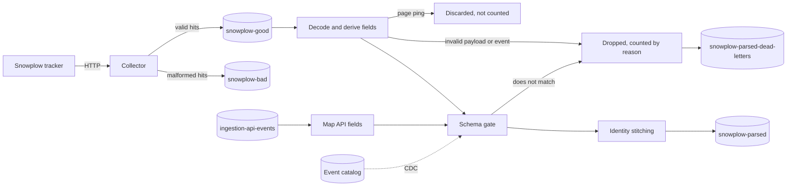

# Event ingestion

## Purpose

Every journey reacts to what a shopper does on the website or app. Event ingestion takes each raw tracker hit from the collector and publishes one clean event per action, with a stable id, a trustworthy timestamp, a name, its attributes, and the person's `canon_id`. Every later stage reads these events and nothing else.

## Scope

In scope:

- Receiving tracker hits at the collector.
- Decoding the collector payload into individual events.
- Reading the person events that the [data ingestion API](../../features/data-ingestion-api.md) accepted, from `ingestion-api-events`.
- Deriving the id, timestamp, name, attributes, and identity fields of each event.
- Applying the [event catalog](../../features/event-catalog.md)'s schema gate.
- Publishing the parsed events.
- Keeping each dropped payload and event, with its drop reason, on a dead-letter topic.
- Counting accepted and dropped events per event name and hour in `event_volume`.

Out of scope:

- Resolving `canon_id`. [Identity stitching](identity/identity-stitching.md) owns that rule. Ingestion calls it and copies its result.
- Deciding what an event means for a journey. [Customer decision](customer-decision.md) owns that.
- The list of event names marketers can pick, and the rules an event must match while its schema gate is on. The [event catalog](../../features/event-catalog.md) owns those.
- Replaying dead letters. An operator does that by hand.

## Terms

| Term | Meaning |
|---|---|
| Tracker hit | One HTTP request from a Snowplow tracker. A POST hit carries one or more events in a JSON body. A GET hit carries one event in its query string. |
| Collector payload | The collector's record of one hit, serialized with Thrift. |
| Parsed event | One event after ingestion, as published on `snowplow-parsed`. |
| `eid` | The Snowplow event id. Becomes `event_id`. |
| True timestamp | `ttm`, the time the tracker says the event happened. |
| Derived timestamp | `collector - (stm - dtm)`: the collector time corrected by the device's clock offset. Snowplow calls it `derived_tstamp`. |
| `event_json` | The event's own attributes, and the data of the entities attached to it, as a JSON object, such as `{"product": {"price": 12990000}}`. Rules refer to them by dotted path, such as `product.price`. An entity's key contains dots, so no rule or catalog path reaches entity data yet ([DEC-KI-44](../../known-issues/components/customer-decision.md#dec-ki-44-rules-cannot-reach-an-entity-key-that-contains-dots)). |
| Entity | A self-describing JSON object a tracker attaches to an event in `co`, or in `cx` as Base64, such as a product or the web page. Snowplow calls it a context. |
| Legacy context | A `basic` context that older apps send in place of a self-describing event. |
| Placeholder id | A value a tracker sends in place of a missing identifier, such as `unknown`. The list is configurable. Default: `unknown`, `undefined`, and `null`. |
| Drop reason | Why ingestion dropped a payload or an event: `payload_not_decoded`, `event_not_decoded`, `invalid_event_id`, `no_timestamp`, or `schema_invalid`. |
| Dead letter | A dropped payload or event, as written to the dead-letter topic: its drop reason and its content. |
| Schema gate | The event catalog's per-event switch. While it is on, an event of that name must match its catalog attributes. See [the event catalog](../../features/event-catalog.md#behavior). |

## Behavior

A shopper views a product. The tracker sends a hit to the collector. A few seconds later `snowplow-parsed` holds this event (fields trimmed):

```json
{
	"event_id": "5f0c1a2e-8a51-4c4e-9d1b-1d2f3e4a5b6c",
	"event_name": "view_product",
	"event_timestamp": 1760346764120,
	"collector_timestamp": 1760346764380,
	"app_id": "auroracy-ecommerce",
	"user_id": "0912345678",
	"domain_userid": "a1b2c3",
	"canon_id": "7e9d0c1b-0000-3000-8000-000000000000",
	"event_json": "{\"product\":{\"id\":\"SKU-1\",\"price\":12990000}}"
}
```



## Algorithm

For each collector payload, decode the Thrift record, then emit one parsed event for each event in its JSON body. A payload with no body is a GET hit: its query string holds one event, with the same parameter names, URL-decoded. `ue_px` and `cx` are Base64 in either the URL-safe or the standard alphabet. In a query string, a `+` the tracker did not escape decodes to a space, so a space in `ue_px` or `cx` counts as `+`. Drop a payload that does not decode with reason `payload_not_decoded`. That includes an empty record, a body without a `data` array, and a hit with neither a body nor a query string. A `data` array with no events gives no events and is not a drop. Drop an event in it that does not decode with reason `event_not_decoded`, and still emit the payload's other events. Discard a page ping (`e=pp`) before anything else. It is not a drop: it is not counted, logged, or written to the dead-letter topic. Derive the fields of every other event in this order:

1. **`event_id`.** Take `eid`. If it is missing or is not a UUID, drop the event with reason `invalid_event_id`.
2. **`event_timestamp`.** Take `ttm`. If `ttm` is missing, compute the derived timestamp `collector - (stm - dtm)`. A collector time that is unset or not positive gives no derived timestamp. If neither can be computed, drop the event with reason `no_timestamp`. The value is epoch milliseconds.
3. **`event_name`.** Use the first rule that gives a value:
   1. `event_json.event_name`.
   2. `view_page` for a page view.
   3. For a structured event (`e=se`), `se_ac`, lowercased. A structured event without `se_ac` is dropped with reason `event_not_decoded`.
   4. `transaction` for a transaction (`e=tr`), and `transaction_item` for a transaction item (`e=ti`).
   5. The vendor and the name of a self-describing event's schema, joined by `/`. `iglu:com.acme/purchase/jsonschema/1-0-0` gives `com.acme/purchase`. The version is not part of the name. The result is lowercased, so `iglu:com.Acme/Purchase/jsonschema/1-0-0` also gives `com.acme/purchase`, the same as the event catalog stores it.
   6. The raw event type.

   Remove trailing backslashes from the result.
4. **`event_json`.** For a structured event, a transaction, or a transaction item, build the object from its tracker fields by the table below. Leave out a field that is absent or empty. A number field holds a JSON number, or the text as sent when it is not a number. For every other event, take the data of the self-describing event. If the event has a legacy `basic` context instead, its data becomes the root object, and each other context whose schema starts with the configured legacy vendor prefix is nested under its schema name.

   Then add the entities attached to the event, for every event type, so the event's own data comes first:

   1. Read the entities from `cx`, or from `co` when `cx` is absent or does not decode. A field that does not decode is logged, as for `ue_px`.
   2. Name each entity by the vendor and the name of its schema, joined by `/` and lowercased, the same as step 3.5. `iglu:com.acme/product/jsonschema/1-0-0` gives `com.acme/product`.
   3. Skip and log an entity whose schema does not give a name, or whose data is not an object. The log line quotes no content.
   4. Skip and log an entity whose name is already a key of `event_json`. So the event's own keys win, and of two entities with one name, the first wins.
   5. Otherwise set `event_json[name]` to the entity's data. An event with no other `event_json` gets an object of its entities.

   The legacy `basic` context and its nested contexts are entities too, so their data also appears under their vendor and name. The `client_session` entity also sets `domain_userid` (step 6). Entities do not change `event_name`, which step 3 derives first. Entity data reaches `event_json` and the published event, but rules and the schema gate cannot address it yet, because a dotted path splits the entity's key ([DEC-KI-44](../../known-issues/components/customer-decision.md#dec-ki-44-rules-cannot-reach-an-entity-key-that-contains-dots)).

   ```mermaid
   flowchart LR
   	own[Event's own data] --> json[event_json]
   	ctx[Entities from cx or co] --> name{Schema gives vendor/name?}
   	name -->|no| skip[Skipped, logged]
   	name -->|yes| taken{Key already in event_json?}
   	taken -->|yes| skip
   	taken -->|no| json
   ```


   | Event type | Tracker field | `event_json` key | Number |
   |---|---|---|---|
   | `se` | `se_ca`, `se_ac`, `se_la`, `se_pr`, `se_va` | `category`, `action`, `label`, `property`, `value` | `value` |
   | `tr` | `tr_id`, `tr_af`, `tr_tt`, `tr_tx`, `tr_sh`, `tr_ci`, `tr_st`, `tr_co`, `tr_cu` | `order_id`, `affiliation`, `total`, `tax`, `shipping`, `city`, `state`, `country`, `currency` | `total`, `tax`, `shipping` |
   | `ti` | `ti_id`, `ti_sk`, `ti_nm`, `ti_ca`, `ti_pr`, `ti_qu`, `ti_cu` | `order_id`, `sku`, `name`, `category`, `price`, `quantity`, `currency` | `price`, `quantity` |

5. **`app_id`.** Take `aid`, trimmed. A missing or blank `aid`, or a placeholder id, gives the default `auroracy-ecommerce`. The comparison ignores case, as in step 7.
6. **Identity fields.** `user_id` is `uid`. `domain_userid` is the `userId` of the mobile `com.snowplowanalytics.snowplow/client_session` context if present, else `duid`. A context of another vendor or name does not count. `network_userid` passes through unchanged.
7. **Normalize `user_id` and `domain_userid`.** Trim each value. A blank value or a placeholder id becomes null. The comparison ignores case, so `" Unknown "` and `NULL` match the default list.
8. **Schema gate.** Find the catalog event whose system name equals `event_name`. If it exists and its schema gate is on, check `event_json` against its attributes by the rules in [the event catalog](../../features/event-catalog.md#behavior). A missing or non-object `event_json` counts as an empty object. Drop an event that does not match with reason `schema_invalid`, and log the first attribute that failed with its catalog type, such as `product.price not number` or `product.price missing (number)`. An event with no catalog entry, or whose gate is off, passes unchecked.
9. **`canon_id`.** Ask [identity stitching](identity/identity-stitching.md) for the person's `canon_id`, from `domain_userid` and `user_id`. With neither, `canon_id` is null.

### API events

Each message of `ingestion-api-events` is one person event that the data ingestion API accepted, in the format of [its contract](../../features/data-ingestion-api.md#behavior). Ingestion reads committed messages only, because the API writes in transactions. It maps each message to a parsed event with the fields a tracker hit with the same values would give, then applies steps 8 and 9 as for a tracker event:

| Parsed event field | From the message |
|---|---|
| `event_id` | `event_id`. Not a UUID: drop with reason `invalid_event_id`. |
| `event_timestamp` | `event_time`, epoch milliseconds. Missing, not an integer, or not positive: drop with reason `no_timestamp`. |
| `event_name` | `event_name`, trimmed, as sent. Missing or blank: drop with reason `event_not_decoded`. |
| `event_json` | `attributes`, or null when absent. Not an object: drop with reason `event_not_decoded`. |
| `app_id` | `app_id`, as in step 5 |
| `user_id` | `user_id`, normalized as in step 7 |
| `domain_userid` | `anonymous_id`, normalized as in step 7 |
| `screen_location`, `product_name` | `screen_location` and `value` of `attributes`, as for a tracker event |
| `collector_timestamp`, `ip`, `user_agent`, `network_userid`, `platform`, `url`, `referrer_url` | Null |

A message that is not a JSON object is dropped with reason `payload_not_decoded`. A dropped message gives a dead letter like a collector payload's, with the message's UTF-8 bytes as the payload.

## Functional requirements

| Id | Requirement |
|---|---|
| ING-FR-01 | The collector must accept tracker hits over HTTP and write valid hits to `snowplow-good` and malformed hits to `snowplow-bad`. |
| ING-FR-02 | Ingestion must emit one parsed event for each event in a collector payload. |
| ING-FR-03 | Ingestion must drop an event whose `eid` is missing or is not a UUID. |
| ING-FR-04 | Ingestion must set `event_timestamp` from `ttm`, or else from the derived timestamp, and must drop an event for which neither exists. |
| ING-FR-05 | Ingestion must derive `event_name` and `event_json` by the rules in [Algorithm](#algorithm). |
| ING-FR-06 | Ingestion must normalize `user_id` and `domain_userid` by the rules in [Algorithm](#algorithm) before it resolves `canon_id`. |
| ING-FR-07 | Every parsed event with a `domain_userid` or a `user_id` must carry the `canon_id` that identity stitching returns for it. |
| ING-FR-08 | Ingestion must publish each parsed event to `snowplow-parsed`, keyed by `canon_id`. |
| ING-FR-09 | A payload that cannot be decoded must not stop ingestion. Ingestion drops it and continues. |
| ING-FR-10 | Ingestion must count every payload and event it drops, by drop reason. |
| ING-FR-11 | Ingestion must log every drop at WARN or below, with the exception class or the field name and never the content of the payload. |
| ING-FR-12 | Ingestion must drop every event whose catalog event has its schema gate on and that does not match the event's attributes, before identity stitching, and must publish every other event as before. |
| ING-FR-13 | Ingestion must write every payload and event it drops, for every drop reason, to the dead-letter topic, with the drop reason, the time of the drop, and its content as [Interfaces](#interfaces) says. A collector payload is written once, however many of its events are dropped, and keeps at most the configured number of bytes. The dead-letter topic is the only place ingestion writes that content. |
| ING-FR-14 | Ingestion must name a structured event by its lowercased `se_ac`, and must drop a structured event without `se_ac` with reason `event_not_decoded`. |
| ING-FR-15 | Ingestion must name a transaction `transaction` and a transaction item `transaction_item`. |
| ING-FR-16 | Ingestion must build the `event_json` of a structured event, a transaction, and a transaction item from its tracker fields by the table in [Algorithm](#algorithm), with number fields as JSON numbers. A number field whose text is not a number keeps that text as a string, so a schema gate on the event rejects it. |
| ING-FR-17 | Ingestion must not publish a page ping, and must discard it before identity stitching without counting it as a drop. |
| ING-FR-18 | Ingestion must add the data of each entity attached to an event, from `cx` or `co`, to `event_json` under the entity's lowercased schema vendor and name joined by `/`. It must not replace a key `event_json` already has, so the event's own keys and the first entity of a name win. |
| ING-FR-19 | Ingestion must skip and log an entity whose schema gives no vendor and name, or whose data is not an object, and must still publish the event. |
| ING-FR-20 | Ingestion must give each dropped `event` record the event's name when it can derive it, by the same rule as a published event, and its payload's collector time. A structured event without `se_ac`, and an event whose fields do not decode that far, has a null name. |
| ING-FR-21 | Ingestion must count, per event name, UTC hour, and outcome, the events it publishes (`accepted`) and the named events it drops (the drop reason), and keep each count and the latest event's time in `event_volume`. An event counts in the hour of its collector time, else of its event time for a published event or its drop time for a dropped one. A drop with no event name, such as a whole payload, is not counted there. |
| ING-FR-22 | Ingestion must read `ingestion-api-events` next to the collector's topic, and must publish each message as the parsed event that [API events](#api-events) gives, through the same schema gate and identity stitching as a tracker event. |

## Non-functional requirements

| Id | Requirement |
|---|---|
| ING-NFR-01 | Delivery to `snowplow-parsed` and to the dead-letter topic is at least once. Consumers deduplicate on `event_id`. A replayed drop is written again with a later drop time. |
| ING-NFR-02 | Timestamps are epoch milliseconds in UTC. |
| ING-NFR-03 | The source topic, the API topic, the dead-letter topic, the most bytes of a payload a dead letter keeps, the legacy context vendor prefix, and the placeholder ids are configurable. Defaults: the pattern `snowplow\.good\.events\..*`, `ingestion-api-events`, `snowplow-parsed-dead-letters`, 524288 bytes (512 KiB), `iglu:com.example.snowplow/`, and `unknown`, `undefined`, `null`. A payload limit that is not a positive integer stops the job at start. A placeholder list with an empty entry, or a legacy prefix that does not start with `iglu:` and end with `/`, stops the job at start. |
| ING-NFR-04 | After a restart, ingestion resumes from its last checkpoint. A new consumer group starts at the latest offset. |
| ING-NFR-05 | Drop logging is rate limited. Each parallel instance logs the first drop of each reason, then at most one line per reason per minute, with the number dropped since its last line for that reason. The counts stay exact. |
| ING-NFR-06 | Per-person order across a login is not required. A login changes `canon_id`, so a person's events from before and after it can land on different partitions of `snowplow-parsed` and be consumed out of order. Consumers must accept events up to 10 minutes out of order. Customer decision counts them (DEC-NFR-04). Journey execution applies their triggers, and when two triggers can complete the same node, the first to arrive completes it ([JEX-NFR-01](journey-execution.md#non-functional-requirements)). Nothing bounds the lag between partitions to 10 minutes. Each consumer's contract says what happens to a later event. |
| ING-NFR-07 | Ingestion reads the event catalog through CDC and keeps it in its checkpoints. A catalog change applies to the events ingestion reads after the change reaches it, usually within seconds. After a restore, the gate applies the catalog saved with the checkpoint until the newer changes arrive. The newer changes arrive after a restore within the CDC restore window of [journey execution](journey-execution.md#non-functional-requirements) (JEX-NFR-10). On a start without saved state, ingestion reads a snapshot of the catalog, and events read before the snapshot arrives pass unchecked. |
| ING-NFR-08 | A consumer that orders events by time takes `collector_timestamp`, and `event_timestamp` when `collector_timestamp` is null. `event_timestamp` comes from the device's `ttm` when the tracker sends one, so a device clock set in the future can push a consumer's watermark ahead of real time. The consumer can then treat the events that follow as late. Nothing bounds `ttm` today. |
| ING-NFR-09 | `event_volume` converges after a restore: each row holds the running total from checkpointed state, and a write never lowers a stored count or time. A count is kept in state 2 days after its last event. An event of an older hour that arrives later starts a new total, and the row keeps the larger of the two, so it can undercount. The job writes each row at most once per batch interval, 10 seconds by default. |

## Interfaces

| Direction | Interface | Contract |
|---|---|---|
| In | HTTP, collector port 8080 | Snowplow tracker protocol |
| In | Kafka `snowplow-good` | Thrift `CollectorPayload` bytes, no key |
| In | Kafka `ingestion-api-events` | JSON person event from the [data ingestion API](../../features/data-ingestion-api.md#behavior), read `read_committed`. A new consumer group starts at the earliest offset. |
| In | CDC of `user_events` and `user_event_fields`, through `user_events_pub` and `user_event_fields_pub` | The event catalog: `event_name` and `enforce_schema`, and each attribute's `field_path`, `data_type`, and `required` |
| Out | Kafka `snowplow-bad` | Malformed hits, written by the collector |
| Out | Kafka `snowplow-parsed` | JSON parsed event, key `canon_id` |
| Out | Kafka `snowplow-parsed-dead-letters` | JSON dead letter, no key |
| Out | Postgres `event_volume` | One row per `event_name`, `bucket_start` (UTC hour), and `outcome`, with `count` and `last_seen_at`. Upserted. In no publication. |

A parsed event has these fields. All are strings unless the table says otherwise.

| Field | Meaning |
|---|---|
| `event_id` | UUID from `eid` |
| `event_name` | See [Algorithm](#algorithm) |
| `event_timestamp` | Integer, epoch milliseconds |
| `collector_timestamp` | Integer, epoch milliseconds. Null when the collector time is unset or not positive. A consumer then falls back to `event_timestamp` (ING-NFR-08). |
| `app_id` | Application id |
| `platform` | Snowplow platform code |
| `user_id`, `domain_userid`, `network_userid` | Identity fields |
| `canon_id` | Stitched person id |
| `event_json` | JSON object, as a string |
| `url`, `referrer_url`, `screen_location`, `product_name` | Page and product fields, when the tracker sends them |
| `ip`, `user_agent` | Request fields |

A dead letter is a `payload` record or an `event` record. It holds personal data in clear text.

- A payload that is dropped whole gives one `payload` record with its drop reason.
- A payload with dropped events gives one `payload` record with a null reason, written with the first dropped event, and one `event` record for each dropped event. Each `event` record refers to its payload by `payload_id`.
- A `schema_invalid` drop gives one `event` record with no payload.

| Field | Meaning |
|---|---|
| `record` | `payload` or `event` |
| `reason` | The drop reason, such as `no_timestamp`. Null on the `payload` record of a payload whose events were dropped one by one. |
| `detail` | The exception class, the field names, or the failed attribute and its catalog type, as in the log line. Never content. |
| `dropped_at` | Integer, epoch milliseconds: when ingestion dropped it |
| `payload_id` | The SHA-256 of the collector payload's bytes, in hex. Null for `schema_invalid` and for an empty record. |
| `payload` | `payload` record only: the collector payload's Thrift bytes in standard Base64, cut to the configured limit |
| `payload_size` | `payload` record only: integer, the payload's size in bytes before any cut |
| `payload_truncated` | `payload` record only: true when `payload` holds only the first bytes. A cut payload cannot be replayed. |
| `event` | `event` record only: a JSON object. The tracker event for `event_not_decoded`, `invalid_event_id`, and `no_timestamp`. The parsed event, before identity stitching, for `schema_invalid`. |
| `event_name` | `event` record only: the event's name (ING-FR-20), or null. Null on every `payload` record. Records written before 2026-11-08 do not have the field. |
| `collector_timestamp` | `event` record only: integer, epoch milliseconds, the payload's collector time, or null when it is unset. Null on every `payload` record. |

Rules address an event's attributes through these names: `event.name`, `page.location`, `page.url`, `page.referrer`, `product.name`, and any dotted path into `event_json`.

## Failure handling

| Case | Behavior |
|---|---|
| Payload does not decode, such as a GET query string with a bad percent escape, or a body without a `data` array | Drop it. Count and log it as `payload_not_decoded`, and write a dead letter. |
| Event in a payload does not decode | Drop it. Count and log it as `event_not_decoded`, and write a dead letter. Publish the payload's other events. |
| Structured event without `se_ac` | Drop it. Count and log it as `event_not_decoded` with the field name `se_ac`, and write a dead letter. |
| Page ping | Discard it. No count, log line, or dead letter. |
| Event without a UUID `eid` | Drop it. Count and log it as `invalid_event_id`, and write a dead letter. |
| Event without a usable timestamp | Drop it. Count and log it as `no_timestamp`, and write a dead letter. |
| Event whose schema gate is on and that misses a required attribute or has a value of the wrong type | Drop it. Count and log it as `schema_invalid`, with the attribute path and its catalog type, and write a dead letter. |
| Dead-letter topic missing or not writable | Ingestion fails and restarts under its restart strategy. Nothing is published until the topic can be written. |
| Entity whose schema does not parse, or whose data is not an object | Skip the entity and log it without its content. Publish the event. Not a drop. |
| Two entities with the same vendor and name, or an entity whose name is already a key of `event_json` | Keep the first value and log the name. Publish the event. Not a drop. |
| Catalog row that does not parse, such as one without an event id | Skip the row and log it. The other rows still apply. |
| Identity field equal to a placeholder id | Treat the field as absent. |
| Event without any identity field | Publish it with a null `canon_id` and a null key. It skips identity stitching. Customer decision accepts only events with a `canon_id`, so no later stage acts on it. |
| Duplicate hit | Publish it again. Consumers deduplicate on `event_id`. |
| Restart | Replay from the last checkpoint. Some events are published twice. |
| API topic missing | Ingestion fails at start and restarts under its restart strategy until the topic exists. |

## Acceptance criteria

- Given an API event with `user_id` `u1`, `anonymous_id` `a1`, and `attributes` `{"order": {...}}`, and a tracker hit with the same `eid`, `ttm`, `aid`, `uid` `u1`, `duid` `a1`, and a self-describing event of the same name and data, then both give the same parsed event. (ING-FR-22)

- Given a hit with `eid` `5f0c1a2e-...` and `ttm` 1760346764120, when it is ingested, then `snowplow-parsed` holds one event with that `event_id` and `event_timestamp`. (ING-FR-02, ING-FR-04)
- Given a hit with no `ttm`, `collector` 1000, `stm` 900, and `dtm` 800, then `event_timestamp` is 900. (ING-FR-04)
- Given a GET hit with no body and the query string `e=pv&eid=5f0c1a2e-...&ttm=1760346764120`, then `snowplow-parsed` holds one event with that `event_id` and `event_name` `view_page`. (ING-FR-02)
- Given a hit whose `eid` is `abc`, then no parsed event is published. (ING-FR-03)
- Given a page view with no `event_json.event_name`, then `event_name` is `view_page`. (ING-FR-05)
- Given a `ue_px` in the standard Base64 alphabet, with `+` and `/`, in a POST body or in a GET query string with or without `%2B`, then `event_name` and `event_json` come from its self-describing event, the same as for the URL-safe alphabet. (ING-FR-05)
- Given a structured event with `se_ca` `Video`, `se_ac` `Play`, `se_la` `intro`, and `se_va` `12.5`, then `event_name` is `play` and `event_json` is `{"category":"Video","action":"Play","label":"intro","value":12.5}`. (ING-FR-14, ING-FR-16)
- Given a structured event without `se_ac`, then nothing is published and the `event_not_decoded` count rises by 1. (ING-FR-14)
- Given a transaction with `tr_id` `ORD-1` and `tr_tt` `150000`, then `event_name` is `transaction` and `event_json` holds `"order_id":"ORD-1"` and `"total":150000`. Given a transaction item with `ti_pr` `75000.5` and `ti_qu` `2`, then `event_name` is `transaction_item` and `event_json` holds `"price":75000.5` and `"quantity":2`. (ING-FR-15, ING-FR-16)
- Given a transaction with `tr_tt` `abc`, then `event_json` holds `"total":"abc"`, and with `transaction` in the catalog with `total` (number) and its schema gate on, nothing is published and the line says `total not number`. (ING-FR-12, ING-FR-16)
- Given a page ping, then nothing is published, no drop count rises, and no dead letter is written. (ING-FR-17)
- Given `uid` `"  undefined "`, then `user_id` is null. (ING-FR-06)
- Given `uid` `" Unknown "` and `duid` `NULL`, then `user_id` and `domain_userid` are null. (ING-FR-06)
- Given the placeholder list `guest`, `uid` `GUEST`, and `duid` `unknown`, then `user_id` is null and `domain_userid` is `unknown`. (ING-FR-06, ING-NFR-03)
- Given one payload with three events whose `eid` is missing or not a UUID, then the `invalid_event_id` count rises by 3, and the log holds one line for them that quotes no field value. (ING-FR-10, ING-FR-11, ING-NFR-05)
- Given two payloads that do not decode, then the `payload_not_decoded` count rises by 2, and ingestion keeps running. (ING-FR-09, ING-FR-10)
- Given a body of `{}`, `{"data":{}}`, or a JSON array, then no event is published, and the `payload_not_decoded` count rises by 1 for each. Given `{"data":[]}`, no count rises. (ING-FR-10)
- Given two hits for the same `domain_userid`, then both events carry the same `canon_id`. (ING-FR-07)
- Given a payload of random bytes, then ingestion keeps running and publishes nothing for it. (ING-FR-09)
- Given `add_to_cart` in the catalog with `product.price` (number, required) and its schema gate on, when an `add_to_cart` arrives with `{"product": {"price": 12990000}}`, then it is published. (ING-FR-12)
- Given the same catalog, when an `add_to_cart` arrives without `product.price`, then nothing is published, the `schema_invalid` count rises by 1, and the log line names `product.price` and `number` and quotes no value. (ING-FR-10, ING-FR-11, ING-FR-12)
- Given the same catalog, when `product.price` is `"12990000"`, then nothing is published and the line says `product.price not number`. (ING-FR-12)
- Given the same catalog with the gate off, or an event name the catalog does not list, then the event is published unchecked. (ING-FR-12)
- Given a payload whose body is not JSON, then the dead-letter topic holds one `payload` record with `reason` `payload_not_decoded` and the payload's bytes in Base64. (ING-FR-13)
- Given one payload with a valid event, two events whose `eid` is not a UUID, and an event with no timestamp, then `snowplow-parsed` holds the valid event, and the dead-letter topic holds one `payload` record and three `event` records, each with its own event and the payload's `payload_id`. The log quotes no field value. (ING-FR-11, ING-FR-13)
- Given a page view whose `eid` is not a UUID, then its `event` record has `event_name` `view_page` and the payload's `collector_timestamp`. (ING-FR-20)
- Given three `add_to_cart` events with collector times in one hour, then `event_volume` holds one `accepted` row for that hour with `count` 3 and the latest time. A restore from a checkpoint taken after the first, followed by a replay of the other two, leaves the row the same. (ING-FR-21, ING-NFR-09)
- Given a whole payload that does not decode, then no `event_volume` row changes. (ING-FR-21)
- Given a payload of 600 KiB that does not decode, with the default limit, then its `payload` record holds the first 512 KiB, `payload_truncated` is true, and `payload_size` is the full size. (ING-FR-13, ING-NFR-03)
- Given `add_to_cart` with its gate on, when an `add_to_cart` arrives without `product.price`, then the dead-letter topic holds one record with `reason` `schema_invalid`, `detail` `product.price missing (number)`, and the parsed event. (ING-FR-13)
- Given a self-describing event `{"sku":"SKU-1"}` with the entity `iglu:com.Acme/Product/jsonschema/1-0-0` `{"sku":"SKU-1"}` in `co`, then `event_json` is `{"sku":"SKU-1","com.acme/product":{"sku":"SKU-1"}}`. (ING-FR-18)
- Given a page view with a `com.acme/product` entity and a `com.snowplowanalytics.snowplow/web_page` entity in Base64 `cx`, then `event_json` holds both, under `com.acme/product` and `com.snowplowanalytics.snowplow/web_page`. (ING-FR-18)
- Given two `com.acme/product` entities, `SKU-1` then `SKU-2`, then `event_json["com.acme/product"]` is the `SKU-1` entity, and the log names `com.acme/product`. (ING-FR-18)
- Given event data that already has the key `com.acme/cart` and a `com.acme/cart` entity, then `event_json` keeps the event's value. (ING-FR-18)
- Given an entity whose schema is `not-a-schema`, then the event is published without it, and the log quotes neither the schema nor the data. (ING-FR-19)
- Given the gate turned on after a checkpoint, when ingestion restores from that checkpoint, then it applies the gate once the change arrives through CDC. (ING-NFR-07)

## Related

- [Identity stitching](identity/identity-stitching.md)
- [Customer decision](customer-decision.md)
- [Event catalog](../../features/event-catalog.md)
- [Known issues](../../known-issues/components/event-ingestion.md)
