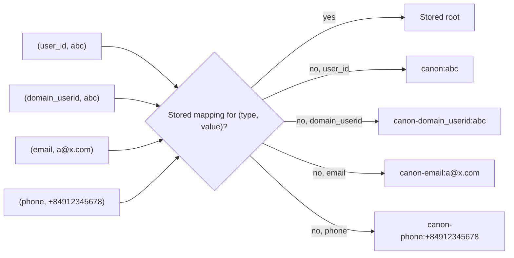

# Identifiers

## Purpose

Identity resolution can link only what it can compare. Today the platform knows two identifiers, `domain_userid` and `user_id`, and compares them as plain strings with no type. Messages need email addresses and phone numbers, customers already send a phone number as `user_id`, and the same string can be a device id in one place and an account id in another. This contract fixes the list of identifier types, the normalized form of each, and which types may link two identity sets. [Decision 0047](../../decisions/0047-email-and-phone-are-guarded-match-keys-from-import-and-the-api.md) settles the sources of email and phone, their match-key rule, the default phone country, and the fixed type list. It stays a draft until the owner answers the [open questions](#open-questions) on hashing and existing `canon_id` values.

## Scope

In scope:

- The identifier types, and where each one comes from.
- The normalized form of each type.
- Which types are match keys, which link identity sets, and which are only stored on a set.

Out of scope:

- Reading identifiers out of a tracker hit. [Event ingestion](../event-ingestion.md) does that, and applies the rules on this page.
- Linking and merging identity sets. [Identity stitching](identity-stitching.md) and the [identity graph](identity-graph.md) do that.
- Delivering a message to an email address or a phone number, and the person's consent to it. The [notification outbox](../notification-outbox.md) and a sender outside this repo do that.

## Terms

The [identity resolution overview](README.md#terms) defines identifier, identity set, and `canon_id`.

| Term | Meaning |
|---|---|
| Identifier type | One row of the [type table](#identifier-types). |
| Normalized value | The value after the rules for its type. |
| Match key | An identifier type that links identity sets. An event that carries match keys from two sets joins the sets. |
| Stored identifier | An identifier of a type that is not a match key. The graph keeps it on the person's set, and it never causes a merge. |
| Placeholder id | A value a tracker sends in place of a missing id, such as `unknown`. [Event ingestion](../event-ingestion.md#terms) defines the list. |

## Behavior

An app sends `uid = 0912345678` when the shopper logs in. The platform reads it as the identifier (`user_id`, `0912345678`). Later the platform learns the phone number `+84 912 345 678` for the same shopper, and reads it as (`phone`, `+84912345678`). The two identifiers have different types, so they are different identifiers, although their digits overlap. Neither of them is equal to a device whose `domain_userid` happens to be `0912345678`.

### Identifier types

| Type | Comes from | Normalized form | Match key | Merge priority |
|---|---|---|---|---|
| `user_id` | The tracker's `uid`, and `user_id` in the [data ingestion API](../../../features/data-ingestion-api.md) | Trimmed. Case is kept. | Yes | 3 |
| `domain_userid` | The tracker's `duid`, or the mobile session context | Trimmed. Case is kept. | Yes | 2 |
| `email` | The email role of an import's type mapping, and `email` on a person event of the [data ingestion API](../../../features/data-ingestion-api.md) | Trimmed and lowercased | Yes, guarded | 1 |
| `phone` | The phone role of an import's type mapping, and `phone` on a person event of the data ingestion API | E.164: `+`, the country code, and the national number, with digits only | Yes, guarded | 1 |
| `network_userid` | The collector's cookie | Not used | No | None |

The merge priority decides which root wins when two identity sets merge, as [identity stitching](identity-stitching.md#merge) describes. A higher number wins.

A guarded match key links sets with one exception: it must never join two sets that each hold a `user_id`. Such a link is refused, and counted as a conflict by type.

The type list is fixed. A customer cannot add a type. A loyalty card number or a CRM id stays an imported attribute.

Trackers do not send email or phone. The profile data feed in `customer_profiles` is not a source.

`profile.cdp_uuid` in `customer_profiles` is not an identifier type. Jobs match it against `user_id` to find a person's profile.

### Normalize an identifier

Apply these steps to every identifier before identity resolution sees it:

1. Trim leading and trailing whitespace.
2. If the value is blank, or equal to a placeholder id with case ignored, the identifier is absent.
3. Apply the normalized form of the type. Lowercase an email address. Remove spaces, dashes, dots, and parentheses from a phone number, and write it in E.164. A number that starts with `+`, or with `00`, the international prefix, already carries its country; replace `00` with `+`. Any other number is a national number of the deployment's default phone country, an ISO 3166 two-letter code: drop one leading `0` and prefix the country code. With no default country set, such a number does not fit.
4. If the value does not fit its type, the identifier is absent, and the drop is counted by type. An email address without exactly one `@` does not fit. A phone number with a letter, or with more than 15 digits, the E.164 maximum, does not fit.

No other rewrite applies. An email address keeps its dots and any `+tag`, because those rules hold for some mail providers and not for others.

Two identifiers are equal only when their types are equal and their normalized values are equal.

### Derived roots

Identity stitching gives an identifier with no stored mapping a root derived from its type and value, as [identity stitching](identity-stitching.md#derive-a-root) describes. A `user_id` derives its root from `canon:` and the value. A `domain_userid` derives it from `canon-domain_userid:` and the value. An `email` derives it from `canon-email:` and the normalized value, and a `phone` from `canon-phone:` and the normalized value. Identifiers of different types with one value therefore derive different roots. Identity stitching does not derive email or phone roots yet; it will when typed identifiers are built.

The `user_id` form is the one used before types were part of an identifier, so every `user_id` keeps its `canon_id`. The platform has never run in production, so no stored `canon_id` of a `domain_userid` had to be kept.

## Functional requirements

| Id | Requirement |
|---|---|
| IDN-FR-01 | Every identifier must carry its type. Identity resolution must never treat two identifiers of different types as equal, whatever their values. |
| IDN-FR-02 | Identifiers of different types with the same value must not join one identity set unless an event links them. |
| IDN-FR-03 | Every component that hands an identifier to identity resolution must first normalize it by the steps in [Normalize an identifier](#normalize-an-identifier). |
| IDN-FR-04 | `user_id` and `domain_userid` must keep the normalization that [event ingestion](../event-ingestion.md) applies today (ING-FR-06). |
| IDN-FR-05 | Only match keys may link identity sets. A stored identifier must never cause a merge. |
| IDN-FR-06 | Normalization must drop an identifier that does not fit its type, and count the drop by type. The event must continue with its other identifiers. |
| IDN-FR-07 | Identity resolution must not use `network_userid` as an identifier. |
| IDN-FR-08 | A link through `email` or `phone` must never join two identity sets that each hold a `user_id`. Identity resolution must refuse it, keep both sets, and count the conflict by type. |
| IDN-FR-09 | A phone number without a country must be read in the deployment's default phone country. With none set, it does not fit its type. |
| IDN-FR-10 | Identity resolution must accept only the types in the [type table](#identifier-types). |

## Non-functional requirements

| Id | Requirement |
|---|---|
| IDN-NFR-01 | Normalization must read no store. Its output depends only on the type, the value, and the configuration. |
| IDN-NFR-02 | Every component that normalizes an identifier, such as event ingestion, the data ingestion API, and `studio`, must give the same output for the same input and configuration. |
| IDN-NFR-03 | The placeholder list applies to every type. Operators can change it, as [event ingestion](../event-ingestion.md#non-functional-requirements) describes (ING-NFR-03). |

## Interfaces

| Direction | Interface | Contract |
|---|---|---|
| In | Parsed event fields | `user_id` and `domain_userid`, read by [event ingestion](../event-ingestion.md). Tracker hits carry no `email` or `phone`. |
| In | Data ingestion API events | `user_id`, `anonymous_id`, and optional `email` and `phone`. See [the data ingestion API](../../../features/data-ingestion-api.md). |
| In | Import identifier observations | `email` and `phone` from the import's email and phone roles, keyed by the customer key. See [data import](../../../features/data-import.md). |
| Out | Identifiers handed to identity resolution | A list of (type, normalized value) pairs. Absent identifiers are left out. |

## Failure handling

| Case | Behavior |
|---|---|
| Blank value or placeholder id | The identifier is absent. Count nothing. |
| Value that does not fit its type | The identifier is absent. Count the drop by type. The event keeps its other identifiers. |
| Email or phone that would join two sets with a `user_id` each | Refuse the link. Keep both sets. Count the conflict by type (IDN-FR-08). |
| Event with no identifier left | Event ingestion publishes the event with a null `canon_id`, as it does today ([event ingestion](../event-ingestion.md#failure-handling)). |

## Acceptance criteria

- Given a `user_id` `abc` on device `d1`, and a device whose `domain_userid` is `abc`, when no event carries both, then the two resolve to different `canon_id` values. (IDN-FR-01, IDN-FR-02)
- Given the email `" Ann.Lee+promo@Example.COM "`, then its normalized value is `ann.lee+promo@example.com`. (IDN-FR-03)
- Given the phone `+84 (912) 345-678`, then its normalized value is `+84912345678`. (IDN-FR-03)
- Given the email `unknown`, then the identifier is absent and nothing is counted. (IDN-FR-03, IDN-NFR-03)
- Given the email `ann.example.com` on an event that also has `domain_userid` `d1`, then the email is dropped, the email drop count rises by 1, and the event resolves from `d1`. (IDN-FR-06)
- Given the phone `+84 abc 345`, then the identifier is absent and the phone drop count rises by 1. (IDN-FR-06)
- Given a stored identifier type, when one event carries a value of it that is already stored on another person's set, then the two sets do not merge. (IDN-FR-05)
- Given an event with only a `network_userid`, then its `canon_id` is null. (IDN-FR-07)
- Given the same email and configuration, when event ingestion and the data ingestion API normalize it, then both give the same value. (IDN-NFR-02)
- Given sets holding `user_id` `u1` and `u2`, when an event carries `u1` and the email `a@x.com`, which the `u2` set already holds, then the sets stay apart and the email conflict count rises by 1. (IDN-FR-08)
- Given an anonymous set on `domain_userid` `d1`, when an event carries `d1` and the email `a@x.com`, which the set of `u1` holds, then the sets merge under the root of `u1`. (IDN-FR-08)
- Given the default phone country `VN`, then `0912345678` normalizes to `+84912345678`. (IDN-FR-09)
- Given no default phone country, then `0912345678` is absent and the phone drop count rises by 1. (IDN-FR-09)
- Given an event with an identifier of type `cardcode`, then identity resolution ignores it. (IDN-FR-10)

## Open questions

[Decision 0047](../../decisions/0047-email-and-phone-are-guarded-match-keys-from-import-and-the-api.md) answered the sources of email and phone, email and phone as match keys, the default country, and customer-defined types on 2026-11-14. Two questions are the owner's:

- **Hashing.** Should the graph store email addresses and phone numbers in clear text, or as hashes? Clear text puts personal data in one more table. The outbox cannot send a message to a hash. [Decision 0042](../../decisions/0042-keep-imported-contact-details-plain-behind-masking-and-tombstones.md) keeps imported contact details plain. Until the owner answers, the graph keeps them plain too.
- **Existing `canon_id` values.** [Derived roots](#derived-roots) keeps every `user_id` root as it is, so no stored `canon_id` is rewritten. The contract records that the platform has never run in production. Does the owner confirm that no existing `canon_id` is rewritten, or should a rewrite be planned?

## Related

- [Identity resolution overview](README.md)
- [Identity stitching](identity-stitching.md)
- [Identity graph](identity-graph.md)
- [Event ingestion](../event-ingestion.md)
- [Data ingestion API](../../../features/data-ingestion-api.md)
- [Notification outbox](../notification-outbox.md)
- [0047. Email and phone are guarded match keys, learned from imports and the API](../../decisions/0047-email-and-phone-are-guarded-match-keys-from-import-and-the-api.md)
- [Tracking integration guide](../../../integration/tracking-guide.md#identity)
- [Known issues](../../../known-issues/components/identity/identifiers.md)
