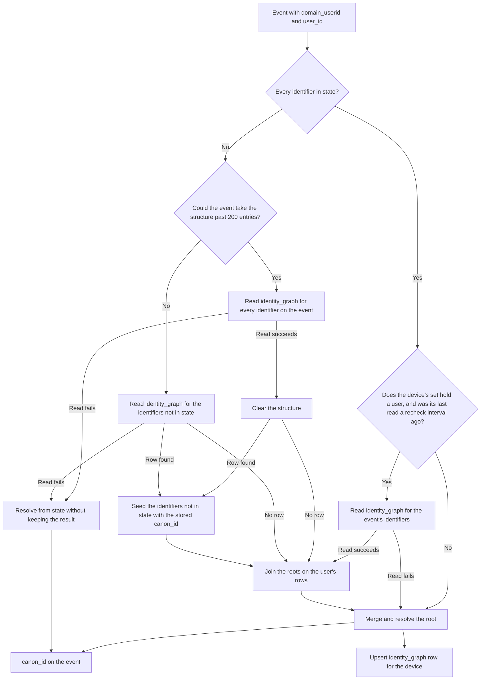

# Identity stitching

## Purpose

A shopper browses on a phone, logs in on a laptop, and buys. Journeys, metrics, and profiles must treat that as one person. Identity stitching links the identifiers a person uses into one set and names the set with one id, `canon_id`. Every later stage keys its state by `canon_id`.

## Scope

In scope:

- Linking `domain_userid` and `user_id` into one identity set.
- Choosing the set's `canon_id`.
- Keeping a durable copy of the device-to-person mapping in `identity_graph`.

Out of scope:

- Parsing the identifiers from the hit. [Event ingestion](../event-ingestion.md) does that. The draft [identifiers](identifiers.md) contract adds identifier types and their normalized forms.
- Announcing a merge to later stages, or moving journey state and metrics recorded under an old `canon_id` to a new one. See [Merges reach the user's devices, not later stages](#merges-reach-the-users-devices-not-later-stages). The draft [identity merges](identity-merges.md) contract proposes to change this.
- `network_userid`, the collector's cookie. It is not used for stitching.

## Terms

| Term | Meaning |
|---|---|
| Identifier | A `domain_userid` or a `user_id` value. |
| `domain_userid` | A first-party cookie or mobile device id. Exists before login. |
| `user_id` | The logged-in account id. |
| Identity set | The identifiers known to belong to one person. |
| Root | The one member of a set that names it. Its value is the set's `canon_id`. |
| Priority | A rank on a root: 3 for a `user_id` root, 2 for a `domain_userid` root, 1 for an `email` or `phone` root ([identifiers](identifiers.md#identifier-types)). The higher rank wins a merge. |
| Seed | To load an identifier into state with a `canon_id` read from `identity_graph`, instead of deriving one. |

## Behavior

Before login, the events of a device get a `canon_id` derived from its `domain_userid`. When the shopper logs in, the device joins the user's set, and every later event from that device gets the user's `canon_id`. Earlier events keep the id they were published with.

An event with a `user_id` and no `domain_userid`, such as one sent from a server, has no device. It takes the root that the user's `identity_graph` rows join into, as [Events without a device](#events-without-a-device) describes. The flowchart covers events with a `domain_userid`.

## Algorithm

The identity sets are a union-find structure with path compression and ranked roots. Events are partitioned by `domain_userid`, else by `user_id`. Each device has one structure in keyed state. An event without a `domain_userid` has no structure. See [Events without a device](#events-without-a-device). An event with neither identifier is not partitioned by any value and skips stitching.

### Derive a root

The structure keys each identifier by its type and value, so a `user_id` and a `domain_userid` with one value are two entries ([identifiers](identifiers.md#derived-roots)). An identifier that is not in the structure and not seeded becomes a set of its own. Its root is the name-based UUID (version 3) of a UTF-8 string: `canon:` followed by the value for a `user_id`, and `canon-domain_userid:` followed by the value for a `domain_userid`. The same identifier always derives the same root, on any machine. The root's priority is 3 for a `user_id` and 2 for a `domain_userid`.

A seeded identifier keeps the `canon_id` from `identity_graph` exactly as stored.

### Read a stored mapping

The resolver reads `identity_graph` when an identifier on the event is not in state, and when a recheck is due, as [Recheck the user's rows](#recheck-the-users-rows) describes. Otherwise state is trusted, so an identifier in state is not read again. One read returns the event's device row and up to 10 of the user's newest rows. The user is the event's `user_id`, else the `user_id` on the device's row.

The resolver seeds only the identifiers that are not in state. For a new `user_id`, it uses the user's newest row. If the user has no row, or the `user_id` is in state, the resolver uses the device's row for a new `domain_userid`. The device's row can hold an earlier anonymous visit or another account, so it never wins over the user's row. When two of the user's rows have the same `updated_at`, the row whose `domain_userid` sorts first is the newest.

The resolver seeds each identifier of the row and of the event that is not in state with the row's `canon_id`. An identifier already in state keeps its set, and the merge then joins the two sets by priority. If state already holds the row's `canon_id` as a member of another set, because an earlier merge joined the two, the seeded identifiers join that set. A seed never splits a set.

Then, when the user's identifier is in state, the resolver joins it with the `canon_id` of each of the user's rows it read, newest first, as a merge by priority. Each such `canon_id` names a set that holds the user, so it is the same person. A user's roots all have priority 3, so the root that sorts first wins, and every device of the user that reads the same rows reaches the same root. The joins stop when the structure has room only for the entries the event may still add.

The resolver reads the primary database, where the durable copy is written, so replication lag cannot hide a row. It reads only the rows written so far. Another device's row reaches the primary when its write batch is written, as [Write the durable copy](#write-the-durable-copy) describes. A lookup before then does not see the row, and does not wait for it. The device's next recheck reads it.

### Recheck the user's rows

A device whose set holds a user, because its root has priority 3, reads `identity_graph` again when its last read was at least one recheck interval ago. The default interval is 1 minute. The read and the joins are those of [Read a stored mapping](#read-a-stored-mapping). Each read that the device keeps restarts the interval. A recheck that fails leaves the device's state as it was, and the event is resolved and stored from it. The interval restarts after a failed recheck too, so an unreachable database adds at most one read per device per interval. An anonymous device never rechecks.

So when another device merges the user into another set, or writes a row that this device's first read missed, this device takes the merged root within one recheck interval and one write batch of the other device's row. Its events in between keep the old root. The recheck interval and the 1 minute default were chosen during the fix for IDS-KI-16 and IDS-KI-17. They are pending owner review.

A read does not hold the events of other devices or users. An event that needs a read waits for it, and the later events of its device, or of its user for events without a device, wait behind it, so each device's events keep their order. At most 100 reads per stitcher subtask run at once. Past that, the stream waits for one of them to finish. A restart reads again for the first waiting event.

A read that fails, or that runs past the lookup timeout, is not taken for "no row". The event is resolved from state, with derived roots for the identifiers state does not hold. Neither the state nor `identity_graph` keeps that result, so the next event from the device reads `identity_graph` again.

### Write the durable copy

Each event with a `domain_userid` upserts that device's row with the event's `canon_id`, unless its read of `identity_graph` failed. An event without a `user_id` keeps the stored `user_id`. Every write sets `updated_at` to the time of the write. Writes are batched. A batch is written when it is full or 200 ms after its first row, whichever comes first. Operators can change both bounds. A batch that fails is written again one row at a time. A row that the database rejects for its data, with an SQLState of class 22 or 23, is skipped and never written. Any other failure is retried up to 3 times. After the third retry fails, the job fails and replays from its last checkpoint. The events for one device in one batch become one upsert with the same result as upserting them in arrival order: the last event's `canon_id`, and the last non-null `user_id`.

### Events without a device

An event with a `user_id` and no `domain_userid` reads `identity_graph` for its `user_id` on every event, and resolves against an empty structure. With rows, the user is seeded from the newest row and joined with the roots on the user's other rows that the read returned, so its `canon_id` is the root that sorts first among them. Without a row, it is the derived root of the `user_id`. The event keeps nothing in state and writes no `identity_graph` row.

The user's devices write the rows, so these events follow the devices. When two of the user's devices hold different `canon_id` values for a while, these events take the root the devices converge on, not whichever device wrote last. A row reaches the primary one write batch after the event that produced it, so an event without a device can miss the newest row for that long. A read that fails gives the derived root of the `user_id`, because there is no state to resolve from.

An event with neither identifier skips stitching. It reads nothing, keeps nothing, and keeps a null `canon_id`. No placeholder value stands in for the missing identifiers, so these events do not all land in one partition.

### Find

`find(x)` follows parent links from `x` to the root and then points `x` straight at the root, so the next lookup is one step.

### Merge

To merge `x` and `y`, find their roots `Rx` and `Ry`. If they are equal, the sets are already merged. Otherwise the root with the higher priority becomes the parent of the other. On equal priority, the root that sorts first as a string becomes the parent.

### Merges reach the user's devices, not later stages

A merge gives every identifier of the losing set the winning root as its `canon_id`, in the structure of the device where the merge happened. The user's other devices take the winning root at their next recheck, as [Recheck the user's rows](#recheck-the-users-rows) describes. Events without a device read it from the device's `identity_graph` row once that row is written. On each device, events after it takes the merge carry the new `canon_id`, and events before keep the one they were published with. The feature publishes nothing about the merge to later stages.

The draft [identity merges](identity-merges.md) contract replaces this behavior when it is accepted, and the draft [identity graph](identity-graph.md) adds merge records, merge history, and limits. See [the identity resolution overview](README.md#what-changes-when-the-drafts-are-accepted).

Later stages key their state by `canon_id`, so state recorded under the old `canon_id` stays there. Nothing moves it to the new `canon_id` or joins the two. For each device that takes the merge, this means:

- Metric series, and their `user_metrics` rows, under the old `canon_id` get no more events from that device. New series start from empty under the new `canon_id`.
- A journey instance is keyed by `canon_id` and campaign. The instance under the old `canon_id` gets no more events from that device, and its watches can still time out. The next trigger from that device under the new `canon_id` starts a new instance, so the person can pass a journey's nodes and get its notifications a second time.

In the [worked example](#worked-example), step 2 merges the phone into the user's set. Metrics and journeys that the phone's anonymous events built under `U(cookie_phone)` stay under `U(cookie_phone)`.

### Resolve an event

1. If the event has a `user_id` and a `domain_userid`, merge them. Return the root of the `user_id`.
2. If it has only a `user_id`, return its root, resolved as [Events without a device](#events-without-a-device) describes.
3. If it has only a `domain_userid`, return its root.
4. If it has neither, return null.

### Bound the structure

A structure holds at most 200 entries, counting identifiers and derived roots. An event adds its identifiers that are not in state and at most two more entries. Those are another identifier of the stored row and the row's `canon_id`, or one derived root per new identifier. If that could take the structure past 200, the resolver reads every identifier on the event, and clears the structure after the read succeeds, so every identifier on the event is seeded or derived again. Each clear writes a warning log line with the device and the number of entries cleared, and adds one to the `identityStructuresCleared` metric. Logging and counting a clear was chosen during the fix for IDS-KI-06. It is pending owner review. A read that fails leaves the structure as it was, and the event is resolved from it. The structure is never cleared during a merge. A shared kiosk, a bot, or a placeholder cookie such as `undefined` would otherwise link thousands of accounts.

### Worked example

Write `U(x)` for the derived root of `x`.

1. An anonymous phone sends `domain_userid = cookie_phone`. The set is `{cookie_phone}` with root `U(cookie_phone)`, priority 2. The event's `canon_id` is `U(cookie_phone)`.
2. The shopper logs in as `usr_1001` on the phone. `usr_1001` derives root `U(usr_1001)` with priority 3. The merge makes `U(usr_1001)` the parent of `U(cookie_phone)`. The event's `canon_id` is `U(usr_1001)`.
3. The shopper logs in as `usr_1001` on a laptop with `domain_userid = cookie_laptop`. The resolver finds the row for `usr_1001` in `identity_graph` and seeds both identifiers with `U(usr_1001)`. The event's `canon_id` is `U(usr_1001)`.

All three identifiers now resolve to `U(usr_1001)`.

## Functional requirements

| Id | Requirement |
|---|---|
| IDS-FR-01 | An identifier with no stored mapping must resolve to its derived root, as defined in [Derive a root](#derive-a-root). |
| IDS-FR-02 | An event with both a `user_id` and a `domain_userid` must merge their sets. A `user_id` root must win over a `domain_userid` root. |
| IDS-FR-03 | Ties between roots of equal priority must go to the root that sorts first as a string. |
| IDS-FR-04 | Resolution must return the root of the `user_id` when the event has one, else the root of the `domain_userid`, else null. |
| IDS-FR-05 | When an identifier on the event is not yet linked in state, the resolver must read `identity_graph` for that identifier and use the stored `canon_id`, even when the event's other identifier is in state. All devices of one `user_id` must resolve to the same `canon_id` within one recheck interval and one write batch of the last merge. |
| IDS-FR-06 | For each event with a `domain_userid`, the feature must upsert one `identity_graph` row for that `domain_userid` with its `canon_id`. An event whose read of `identity_graph` failed writes no row. |
| IDS-FR-07 | The upsert must not replace a stored `user_id` with null. |
| IDS-FR-08 | The upsert must set `updated_at` to the time of the write, so that "newest first" picks the latest mapping. |
| IDS-FR-09 | A failed read of `identity_graph` must not stop the stream. The resolver continues from state alone, and keeps neither the result in state nor a row in `identity_graph`. A failed recheck keeps the device's state as it was and stores the event's resolution. |
| IDS-FR-10 | A device whose set holds a `user_id` must read the user's rows again once its last read is a recheck interval old, and join its set with the roots on them. |

## Non-functional requirements

| Id | Requirement |
|---|---|
| IDS-NFR-01 | Resolution for an identifier already in state must not query Postgres, except for one recheck per device per recheck interval while the device's set holds a user. An event without a `domain_userid` keeps no state, so it queries Postgres on every event. |
| IDS-NFR-02 | A structure holds at most 200 entries. |
| IDS-NFR-03 | Keyed state expires 7 days after its last write. A device's state reads as empty from then on, and its storage is removed within the following hour. |
| IDS-NFR-04 | Lookups must read the primary database, not a replica. A lookup sees only the rows written so far. A row reaches the primary one write batch after the event that produced it: 200 ms by default, and later while the batch is retried. A lookup does not wait for a row that is not written yet. |
| IDS-NFR-05 | A lookup waits a bounded time for a connection and for the read. A read past that time counts as failed. |
| IDS-NFR-06 | A read of `identity_graph` holds only the events of the key that needs it: the event's device, else its user. |

## Interfaces

| Direction | Interface | Contract |
|---|---|---|
| In | Parsed event fields | `domain_userid`, `user_id`, both normalized by [event ingestion](../event-ingestion.md) |
| Out | `canon_id` on the parsed event | UUID string, or null |
| Read and write | `identity_graph` | One row per `domain_userid`: `user_id`, `canon_id`, `created_at`, `updated_at`. See [the data model](../../data-model.md). |

## Failure handling

| Case | Behavior |
|---|---|
| `identity_graph` read fails or times out | Log a warning. Publish the event with a `canon_id` resolved from state, or the derived root of the `user_id` for an event without a `domain_userid`. Keep neither the result in state nor a row in `identity_graph`, so the next event reads again. The stream keeps running. |
| `identity_graph` rejects a row for its data | Skip that row, log it, and count it. The stream keeps running. |
| Structure is full | Read every identifier on the event. If the read succeeds, clear the structure, log a warning, count the clear in `identityStructuresCleared`, then add the event's identifiers. If it fails, resolve from the structure as it was and keep nothing. |
| Two accounts log in on one device | Both join one set. See [Open questions](#open-questions). |
| Restart | State is restored from the checkpoint. Without one, state is rebuilt from `identity_graph` on demand. |

## Acceptance criteria

- Given an empty state and no stored row, when `domain_userid = d1` arrives, then `canon_id` is `U(d1)`. (IDS-FR-01)
- Given `d1` resolved to `U(d1)`, when `d1` arrives with `user_id = u1`, then `canon_id` is `U(u1)`, and a later anonymous event from `d1` also gets `U(u1)`. (IDS-FR-02, IDS-FR-04)
- Given `u1` stitched on device `d1`, when `u1` logs in on device `d2` whose `domain_userid` is already in state, then `d2`'s events get `U(u1)`. (IDS-FR-05)
- Given a stored row `(d1, u1, U(u1))` and a stored anonymous row `(d2, null, U(d2))`, when `d2` logs in as `u1` and `d2` is not in state, then `canon_id` is `U(u1)`. (IDS-FR-05)
- Given a stored row with `user_id = u1` for `d1`, when an anonymous event from `d1` arrives, then the row's `user_id` is still `u1`. (IDS-FR-07)
- Given a stored row for `d1`, when an event from `d1` is written, then the row's `updated_at` is the time of that write. (IDS-FR-08)
- Given `d1` resolved to `U(d1)` in state, when `d1` arrives with `user_id = u2` and the `identity_graph` read throws, then the event is published with `U(u2)`, no `identity_graph` row is written, and a later anonymous event from `d1` still gets `U(d1)`. (IDS-FR-09)
- Given a stored row `(d1, u1, C)` and a read that failed for an event `(d1, u1)`, when the next event `(d1, u1)` arrives and the read succeeds, then its `canon_id` is `C`. (IDS-FR-05, IDS-FR-09)
- Given an event `(null, u2)` that got `U(u2)`, when `u1` and then `u2` log in on a shared device `dS` and its row is written, then the next event `(null, u2)` gets `U(u1)`, the same `canon_id` as `dS`. (IDS-FR-03, IDS-FR-05)
- Given a stored row `(d1, u1, C)`, when an event `(null, u1)` arrives and the read fails, then its `canon_id` is `U(u1)`, no row is written, and the next event `(null, u1)` whose read succeeds gets `C`. (IDS-FR-09)
- Given an event with neither `domain_userid` nor `user_id`, then its `canon_id` is null, it reads no `identity_graph` row, it keeps nothing in state, and it writes no row. (IDS-FR-04)
- Given a database with a primary and a read replica, when the resolver looks up an identifier, then it reads the primary. (IDS-NFR-04)
- Given device `dA` resolved `(dA, u2)` to `U(u2)`, when `u1` and then `u2` log in on a shared device `dS` and its rows are written, then `dA`'s first event a recheck interval after its last read gets `U(u1)`, and so does `dA`'s row. (IDS-FR-05, IDS-FR-10)
- Given device `dB` read `identity_graph` for `u2` before `dS`'s merged row was written, when `dB` sends an event a recheck interval later, then it gets `dS`'s root. (IDS-FR-05, IDS-FR-10)
- Given rows `(dS, u2, U(u1))` and a newer `(dA, u2, U(u2))`, when an event `(null, u2)` arrives, then its `canon_id` is `U(u1)`. (IDS-FR-03, IDS-FR-05)
- Given 200 entries in a structure, when a new identifier arrives, then the structure holds only the new identifier and its root. (IDS-NFR-02)
- Given 199 entries in a structure, or a device that sees a new `user_id` on every event, then the structure never holds more than 200 entries. (IDS-NFR-02)
- Given a full structure that links `u9` to a stored `C`, when `u9` arrives on a new device `dnew`, then the event and later anonymous events from `dnew` get `C`. (IDS-FR-02, IDS-NFR-02)
- Given a full structure that links `u9` to a stored `C`, when `u9` arrives on a new device `dnew` and the read fails, then the event gets `C` and the structure is unchanged. (IDS-FR-09, IDS-NFR-02)
- Given stored rows `(d2x, u2, C2)`, `(d1x, u1, C1)`, and `(dx, u4, C2)`, when device `d` sends `u2`, then `u1`, then `u4`, then no `user_id`, then `u2` and `u1` again, then the events get `C2` and then `C1` every time. (IDS-FR-03, IDS-FR-05)

## Open questions

- Should a device shared by two accounts merge them, or should the second login start a new set? Today they merge. Since the recheck, the merged root also reaches every other device of each account that signed in on the shared device within one recheck interval, so a kiosk can give many people one `canon_id` on all their devices. The 200-entry bound limits how many accounts one structure joins, not how far the joined root spreads. The [identity graph](identity-graph.md#open-questions) contract lists the options.

## Related

- [Identity resolution overview](README.md)
- [Identifiers](identifiers.md)
- [Identity graph](identity-graph.md)
- [Identity merges](identity-merges.md)
- [Event ingestion](../event-ingestion.md)
- [0005. Keep live state in Flink and a durable copy in Postgres](../../decisions/0005-keep-live-state-in-flink.md)
- [0012. Resolve events without a device from the durable copy](../../decisions/0012-resolve-events-without-a-device-from-the-durable-copy.md)
- [0020. Read the identity graph off the stream's thread inside the stitcher](../../decisions/0020-read-the-identity-graph-off-the-streams-thread-inside-the-stitcher.md)
- [0021. Recheck a user's rows to carry merges to the user's devices](../../decisions/0021-recheck-a-users-rows-to-carry-merges-to-the-users-devices.md)
- [Known issues](../../../known-issues/components/identity/identity-stitching.md)
