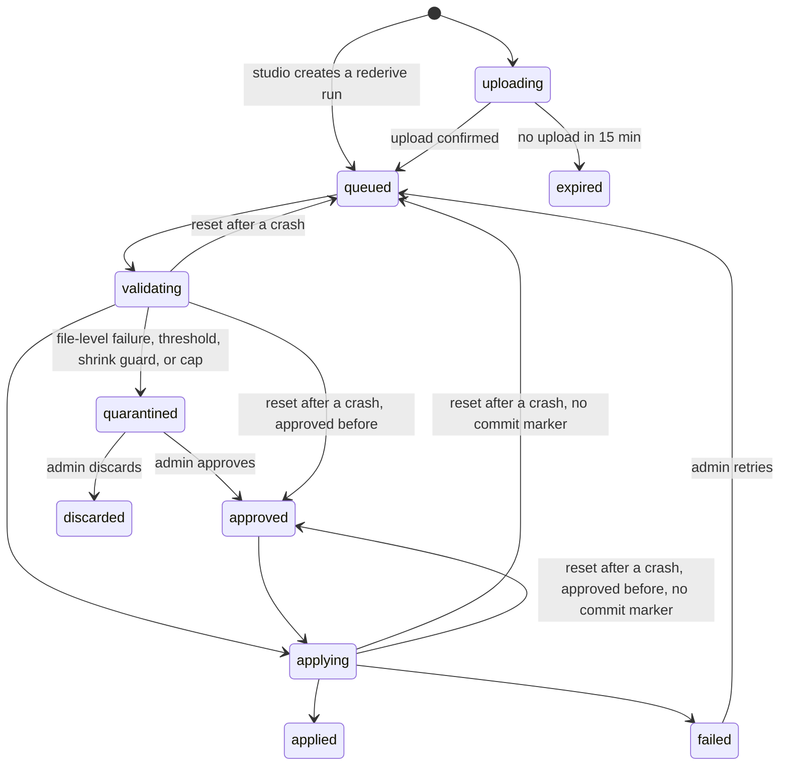

# Import applier

## Purpose

A shop delivers its orders and customer records as files: through the import API, as a batch of records, or as a spreadsheet an admin uploads in studio ([data import](../../features/data-import.md)). The import applier turns each delivery into stored records. It checks the file against the dataset's columns, rejects bad rows, refuses a file that looks broken, and upserts the rest into the import store, so that a file applied twice or after a crash leaves the same rows. It also carries out per-person deletions. The [import metric pass](import-metric-pass.md) reads what it stores.

## Scope

In scope:

- Taking queued runs one at a time per dataset, in completion order.
- Validating a file against the dataset's version, and the reject reasons.
- The reject threshold, the snapshot shrink guard, and the record cap, which quarantine a run.
- Upserting records of both kinds, snapshot removal scoped to the writer, and deleted flags.
- Normalizing emails and phones.
- The run report and the rejects file.
- Re-deriving a dataset's records after a role mapping, delivery mode, or time zone change.
- Deleting a tombstoned person's rows and rewriting the files that hold them.
- Expiring runs whose upload never arrived.

Out of scope:

- Creating a run, checking a source key's scope, and confirming an upload. The [import API](../../features/data-import.md#batch-api) does that.
- Datasets, their versions, and the studio screens. [Data import](../../features/data-import.md) owns them.
- Computing metrics and publishing values to conditions. The [import metric pass](import-metric-pass.md) does that.
- Writing identifiers to the identity graph. That is phase 2 of [data import](../../features/data-import.md#identity), and it waits for #231 and #232.

## Terms

| Term | Meaning |
|---|---|
| Dataset | One kind of row the shop sends, such as `orders` or `customers`, of kind `profile` or `event`. Row in `import_record_types`. See [data import](../../features/data-import.md#datasets). |
| Version | An immutable list of a dataset's columns, role mappings, aliases, delivery mode, time zone, and CSV delimiter. Row in `import_record_type_versions`. |
| Role | Which of the shop's columns plays customer key, record id, event time, updated at, deleted flag, email, or phone. |
| Customer key | The shop's customer id. It must equal, byte for byte, the `user_id` the trackers send. |
| Run | One delivered file and its journey through validation and apply. Row in `import_runs`. |
| Writer | Who delivered a run: the source key id for the API, or `studio` for an upload. Stored on the run and on every row it last wrote. |
| Applier lock | A session-level advisory lock on the main Postgres. The applier instance that holds it is the only one running. |
| Drop zone | The `imports/` prefix of the deployment's S3 bucket, which holds files as delivered for 30 days. |
| Import store | The second Postgres cluster that holds accepted records. Only the applier writes it. |
| Reject | A row the applier refused, with a reason. |
| Quarantine | A run held before apply, until an admin approves or discards it. |
| Tombstone | The HMAC-SHA-256 of a deleted person's customer key under the tombstone key, a deployment secret that never rotates. Row in `person_tombstones`. |
| Commit marker | A row in `import_run_commits` that the applier writes in the same transaction as a run's records, with the run's counts. It proves the run's records are in the store. |
| Ordered type | A snapshot type, or an incremental type that maps no `updated_at`. Later runs of an ordered type wait behind a held run. |

## Behavior

A shop's key, scoped to `orders`, delivers `orders-2026-11-07.csv.gz` at 01:40. The import API creates run `run-8f2c` at `uploading`, the shop uploads the file, and the API moves the run to `queued` when the upload is confirmed. At 01:50 the applier starts, takes `run-8f2c`, and validates its 48,210 rows against `orders` version 3. Twelve rows have an `event_time` that does not parse, under the 5% threshold, so the run applies. 31,004 orders are new, 17,194 replace stored orders whose values changed, and the twelve go to `rejects/run-8f2c.ndjson.gz`. The run ends at `applied`. The metric pass at 03:00 includes it.

### Run states

A run is a state machine in `import_runs`. Each transition is one conditional row update from the state it leaves, so two actors that race cannot both make it. Each transition has one owner:

| Transition | Owner |
|---|---|
| Create at `uploading`, `uploading` to `queued` | The import API |
| Create a `rederive` run at `queued` | Studio, when it saves a version that re-derives |
| `uploading` to `expired` | The applier |
| `queued` to `validating` to `quarantined` or `applying`, `approved` to `applying`, `applying` to `applied` or `failed`, and the recovery resets in [Take a run](#1-take-a-run) | The applier |
| `quarantined` to `approved` or `discarded`, `failed` to `queued` | Studio, on an admin's action |

The `approved` state carries the admin's decision to the applier, and studio also stamps `approved_by` and `approved_at` on the run. The applier then applies the run without the threshold, shrink guard, or cap checks. A file-level failure cannot be approved, because the applier cannot read the file. Studio offers only **Discard** for it, and for a quarantined re-derive.

A run that a quarantine or a failure stops holds the queue of an ordered type. Later runs of that type wait at `queued` until the held run is applied or discarded, because applying a later run first would let an older file overwrite newer values, or let a snapshot remove rows it should not. An incremental type that maps `updated_at` does not wait. Its later runs apply around the held run, and when the held run applies later, `updated_at` keeps the newer values. Runs of other types never wait.

## Algorithm

### 1. Take a run

The applier starts every 10 minutes, drains the queue, and exits.

1. Take the applier lock. If another instance holds it, exit. If the connection that holds the lock drops, stop at once, because another instance may then take it.
2. Recover. A run found at `validating` goes back to `approved` when it has `approved_at`, and to `queued` otherwise, because validating writes nothing. A run found at `applying` whose commit marker exists moves to `applied`, with the counts from the marker. One found at `applying` with no marker goes back to `approved` or `queued` by the same rule. The lock proves that no other instance is working on either.
3. Apply every tombstone at state `requested`, by [Delete a person](#7-delete-a-person).
4. Delete `pii_access_log` rows older than 365 days.
5. Move every run still at `uploading` whose `created_at` is more than 15 minutes ago to `expired`. With a 10-minute interval, a run expires 15 to 25 minutes after it is created.
6. For each dataset, take its oldest run at `queued` or `approved` by `confirmed_at`. For an ordered type, skip the type while an earlier run of it is at `quarantined` or `failed`.
7. Process runs of different datasets one after another or side by side. Never process two runs of one dataset at once.

### 2. Read the file

1. Read the dataset's version that is current now, and record it on the run.
2. Read the file from the drop zone. Check its byte size and its SHA-256 against `stored_sha256` on the run. A mismatch is a file-level failure.
3. Decompress gzip when the file starts with the gzip header.
4. Read the format the run names: CSV with the version's delimiter, or NDJSON. Studio converts an XLSX upload to CSV before it queues the run.

File-level failures apply nothing and quarantine the run with the reason:

| Failure | Reason |
|---|---|
| The size or the checksum differs from the run's | `checksum_mismatch` |
| The bytes are not valid UTF-8 | `encoding_invalid` |
| A CSV file does not parse by RFC 4180, or an NDJSON line is not a JSON object | `format_invalid` |
| A header for a required role is missing | `role_missing:<role>` |
| A header names no column of the version and none of its aliases | `column_unknown:<header>` |

A header matches a column when it equals the column's name or one of its aliases, exactly. For NDJSON, each top-level key plays the role of a header.

- A CSV record ends at CRLF or LF. A line with no character at all is skipped. A record with a field count other than the header's is `format_invalid`.
- A CSV record or an NDJSON line longer than 1 MiB (1,048,576 characters) is `format_invalid`, so an unterminated quote or a file without line ends fails the run instead of exhausting the applier's memory.
- A UTF-8 byte order mark at the start of the file is skipped.
- Two headers, or two keys of one NDJSON object, that match the same column are `format_invalid`, because the row has no single value for it. A duplicate key in an NDJSON object is `format_invalid` too.
- A blank NDJSON line is skipped. An NDJSON file is `role_missing:<role>` when no line holds a key for a required role.
- A file with checksum or size that differs fails as `checksum_mismatch`, whatever else fails in it, because the bytes are not the file delivered.

### 3. Validate each row

The applier parses each row into the version's types at this boundary. Nothing after this step checks a type again.

| Check | Reject reason |
|---|---|
| The customer key is empty, or equals a placeholder id of [event ingestion](event-ingestion.md), compared as event ingestion compares them | `customer_key_missing` |
| The customer key's tombstone is in `person_tombstones` | `deleted_person` |
| An `event` row's record id is blank | `record_id_missing` |
| An `event` row's record id repeats an earlier row of the file. Every row with that id after the first is rejected. | `record_id_duplicate` |
| A `profile` row's customer key repeats an earlier row of the file. Every repeat is rejected. | `customer_key_duplicate` |
| The event time does not parse | `event_time_invalid` |
| The event time is more than 1 day after the run started, or more than 3 years before it | `event_time_out_of_range` |
| A typed column holds a value of another type | `type_mismatch:<column>` |

The applier stores the customer key exactly as delivered. It does not trim it, change its case, or reformat it.

A datetime value is an ISO-8601 date-time, with `T` or a space between date and time, or a bare date, which means the start of its day. A value with an offset keeps it. A value without one is read in the version's time zone. In NDJSON a datetime is a JSON string. The stored form is ISO-8601 with seconds and the offset, such as `2026-11-07T08:00:00+07:00`. A `number` is a finite JSON number, or in CSV a decimal with a `.` separator and no thousands separator. A `boolean` is `true` or `false`, in any case, as a JSON boolean or a string, and CSV also accepts `1` and `0`. A `string` column in NDJSON takes a JSON string only. A `json` column in CSV holds JSON text. An empty CSV cell, or a missing or `null` NDJSON key, means no value, which is valid for every column that plays no required role.

A row gets the first reason in the table's order. A record id or a customer key counts as seen once a row reaches its duplicate check, even when a later check rejects that row.

Emails and phones are normalized, not rejected:

- **Email.** Trim, then lowercase. A value without exactly one `@`, or with nothing on either side of it, fails.
- **Phone.** Trim, then format as E.164, reading a number without a country code in the deployment's default phone country. A value that cannot form a valid E.164 number fails.

A value that fails is dropped and counted by type, and its row stays, as IDN-FR-06 requires of identifiers.

### 4. Decide whether to apply

A run at `approved` skips this step. Otherwise the applier quarantines the run, records the reason on it, and applies nothing, when any of these holds:

1. **Reject threshold.** More than 5% of the file's rows are rejected.
2. **Snapshot shrink guard.** The dataset is a snapshot, the run's writer is a source key, and the file holds fewer valid rows than 80% of the valid rows of the type's last applied snapshot from any source key. A type with no applied snapshot from a source key has no guard. A change of source key keeps the guard, so a new key's first truncated file is still caught.
3. **Record cap.** `import_records` would hold more than the record cap after the run's new records, 5 million by default.

The run report names each condition that held. A [re-derive](#8-re-derive) skips the threshold and the shrink guard, and keeps the cap.

### 5. Apply

The applier writes a run's records and its commit marker, with the run's counts, in one transaction on the import store. The metric pass reads the store in one repeatable-read snapshot, so it sees a run's records all or none.

For an `event` dataset, each valid row upserts on (`record_type_id`, `record_id`):

- A new record id inserts a row.
- A stored record id is replaced, unless the type maps `updated_at` and the stored `updated_at` is later than the row's. Then the stored row stays, and the row counts as unchanged. An equal `updated_at` replaces, so a replay converges.
- A row whose values all equal the stored row's counts as unchanged. When its writer equals the stored row's, it is not rewritten. When the writer differs, the stored row takes the run's `writer` and `run_id` and keeps its values.

For a `profile` dataset, each valid row upserts on (`record_type_id`, `customer_key`) by the same rules. When the stored row changes, or changes writer, the customer's rows in `import_identifiers` for that type are replaced with the row's normalized emails and phones, with the same `writer` and `run_id`.

A row belongs to the writer that last delivered it. The newest delivery wins, whoever wrote the stored row, unless `updated_at` says otherwise. So a studio correction to a customer lasts until the shop delivers that customer again. To make a correction last, the shop fixes it in its own system.

Then, by delivery mode:

- **Incremental.** A row whose deleted flag is true removes the stored row with its key instead of upserting it, whoever wrote that row. When the type maps `updated_at` and the stored row's is later than the row's, the stored row stays. A removed profile also removes its identifiers.
- **Snapshot.** After the upserts, remove every stored row of the type whose key no row of the file holds, valid or rejected, unless its `writer` is `studio`. A rejected row whose key the applier can read protects its stored row. A reject with no readable key, such as `customer_key_missing`, names no row, so it protects nothing. A type has one source key at a time, so this also removes rows that an earlier source key of the type delivered and the current one no longer sends. The deleted flag has no meaning in a snapshot file, and the applier ignores it.
- **Studio upload to a snapshot type.** Applies as incremental. It removes nothing except by a deleted flag.

A rejected row never removes a stored row.

After the import store commits, the applier moves the run to `applied` in `import_runs` with its counts. On a restart, recovery in [Take a run](#1-take-a-run) moves a run whose commit marker exists to `applied` without applying it again.

### 6. Report

The run report holds:

- Rows read, and rejects counted by reason.
- New, updated, unchanged, and removed rows.
- Emails and phones dropped by normalization, by type.
- Emails and phones in the run that another customer key already holds in `import_identifiers`, counted as shared.
- The customer key match rate, which is the share of the file's distinct customer keys that `identity_graph` holds as a `user_id`.
- Each quarantine condition that held, and each file-level failure.
- Up to 100 sample rejected rows, each with its line number and reason. Their values stay in the rejects file.

The report goes to `reports/<run_id>.json` in the drop zone without row values, and its counts go on the run's `counts`. The counts are `rows_read`, `valid`, `rejected`, `rejected_by_reason` by reason, `contacts_dropped` and `contacts_shared` by `email` and `phone`, `distinct_customer_keys`, `match_rate` from 0 to 1 when the file has a valid row, and `new_records`, the valid event rows whose record id the store lacks. The report adds `quarantine_conditions` (`reject_threshold`, `snapshot_shrink`, `record_cap`), `file_failures`, and `sample_rejects`, each with its `line` and `reason`. The run's `reason` joins the conditions or the failures with `, `. The rejected rows with their values go to `rejects/<run_id>.ndjson.gz`, which only admins may download. Studio reads the sample rows' values from the rejects file and masks every PII value in them for every role, as [data import](../../features/data-import.md#privacy) requires.

### 7. Delete a person

For each tombstone at state `requested`:

1. Write the tombstone to `imports/tombstones/<tombstone>` in the drop zone, an empty object that no lifecycle rule deletes.
2. Delete every row of `import_records`, `import_profiles`, and `import_identifiers` whose customer key's tombstone equals it, in one transaction.
3. Rewrite every file in `incoming/` and `rejects/` of the last 30 days that holds a row with that customer key, without those rows. Record each rewritten `incoming/` file's new SHA-256 in its run's `stored_sha256`. The bucket keeps no older version.
4. In every `pii_access_log` row whose `customer_key` has that tombstone, set `customer_key_hash` to the tombstone and `customer_key` to null.
5. Move the tombstone to `done`.

Every later run, replay, and re-derive rejects the key as `deleted_person`. The next metric pass deletes the person's `customer_attributes` rows and skips the tombstone from then on.

After a restore of either Postgres cluster, the applier first adds every tombstone in `imports/tombstones/` that `person_tombstones` lacks, at `requested`. It then runs these steps for every tombstone, `done` ones included. Last, it reads each applied run's file in the drop zone and records its SHA-256 in `stored_sha256` again, because a file rewritten after the backup no longer matches the restored value. All of this happens before it takes a run.

### 8. Re-derive

A new version that changes a role mapping, the delivery mode, or the time zone triggers a re-derive of the type, when every applied run of the type still has its file in the drop zone. Studio checks that before it saves. In the same transaction as the version, it creates a run with source `rederive`, state `queued`, and no file. The run holds the type's queue like any run, so it applies after every run confirmed before it.

1. Check each applied run's file against its `stored_sha256` before reading it.
2. In one transaction on the import store, delete every row of the type, then apply each applied run of the type again, in its original `confirmed_at` order, with the new version and each run's own writer. Tombstoned keys are rejected. Write one commit marker, for the `rederive` run.
3. Count rejected rows. They do not quarantine the run. The threshold and the shrink guard do not apply, because each run passed them once.
4. Apply the record cap to the result.

When a file fails at file level under the new version, the transaction rolls back. An example is `role_missing:<role>`, when an old file lacks a newly mapped header. A result that breaks the cap rolls back too. The stored rows stay as the old version derived them, and the `rederive` run is quarantined with the failing run and its reason. Studio offers only **Discard**. After a discard, the new version applies to new deliveries only, and the dataset's page says that stored rows predate it.

When a file is gone at save time, studio creates no `rederive` run, and the new version applies only to new deliveries. Studio says which before the admin saves the version ([data import](../../features/data-import.md#versions)). A file gone when the run starts is a file-level failure, handled as above.

### Worked example

`customers` is a snapshot type. The shop's key `sk_12` last delivered a snapshot of 100,000 valid rows. An admin also uploaded five corrections as `studio`.

- `sk_12` delivers 99,500 valid rows. That is above 80,000, so the run applies. The 500 customers left out are removed. The five `studio` rows stay, except a correction whose customer the file holds. That row takes the file's values and the writer `sk_12`.
- The next night `sk_12` delivers a truncated export of 60,000 rows. That is under 80,000 of 99,500, so the run is quarantined, nothing is removed, and later `customers` runs wait.
- The admin discards it. The following night's full export applies normally.
- The shop moves to a new key, `sk_20`. The admin revokes `sk_12`'s scope and grants `sk_20`. `sk_20`'s first snapshot of 99,400 rows is guarded against 99,500, applies, and takes over every row it holds. Rows only `sk_12` had delivered are removed with it.

## Functional requirements

| Id | Requirement |
|---|---|
| IAP-FR-01 | The applier must process at most one run of a dataset at a time, and must take a type's runs in the order their uploads were confirmed, except that runs may pass a held run as IAP-FR-02 allows. |
| IAP-FR-02 | A run at `quarantined` or `failed` must hold later runs of an ordered type at `queued` until it is applied or discarded. Later runs of an incremental type that maps `updated_at`, and runs of other types, must not wait. |
| IAP-FR-03 | Each run transition must be a conditional update from the state it leaves, made only by the owner in [Run states](#run-states). |
| IAP-FR-04 | A run at `uploading` whose `created_at` is more than 15 minutes ago must move to `expired` at the applier's next start. |
| IAP-FR-05 | A file-level failure in [Read the file](#2-read-the-file) must quarantine the run with its reason, and must apply nothing. |
| IAP-FR-06 | The applier must validate each row against the version recorded on the run, and must reject a row by the checks in [Validate each row](#3-validate-each-row) with the reason listed there. A rejected row must not stop the run. |
| IAP-FR-07 | The applier must store and compare the customer key exactly as delivered. |
| IAP-FR-08 | The applier must normalize emails and phones by the rules in [Validate each row](#3-validate-each-row), must drop and count a value that fails, and must keep the row. |
| IAP-FR-09 | The applier must quarantine a run that breaks the reject threshold, the snapshot shrink guard, or the record cap, and must apply nothing from it. |
| IAP-FR-10 | The shrink guard must compare a source key's snapshot with the type's last applied snapshot from any source key, and must not apply to a studio upload. (the lead's default) |
| IAP-FR-11 | A run at `approved` must apply without the checks of IAP-FR-09. |
| IAP-FR-12 | Event records must upsert on (`record_type_id`, `record_id`), and profile records on (`record_type_id`, `customer_key`). When the type maps `updated_at`, a stored row with a later `updated_at` must stay. |
| IAP-FR-13 | A snapshot run must remove exactly the stored rows of its type whose key no row of the file holds, valid or rejected, and whose `writer` is not `studio`. A studio upload to a snapshot type must apply as incremental. (the lead's default) |
| IAP-FR-14 | In an incremental run, a row whose deleted flag is true must remove the stored row with its key, unless the type maps `updated_at` and the stored row's is later. |
| IAP-FR-15 | A run's records and its commit marker, with its counts, must commit in one transaction on the import store. A run whose commit marker exists must end at `applied` with the marker's counts, and must not be applied again. |
| IAP-FR-16 | A rejected row must never remove or change a stored row. |
| IAP-FR-17 | The run report must hold every count in [Report](#6-report). The report in the drop zone and the run's `counts` must hold no row value. |
| IAP-FR-18 | The applier must reject a row whose customer key's tombstone is in `person_tombstones` as `deleted_person`, in every run, replay, and re-derive. |
| IAP-FR-19 | For a tombstone at `requested`, the applier must run every step of [Delete a person](#7-delete-a-person) and only then move the tombstone to `done`. |
| IAP-FR-22 | After a restore of either Postgres cluster, the applier must restore missing tombstones from the drop zone and re-apply every tombstone before it takes a run. (the lead's default) |
| IAP-FR-20 | A re-derive must replace every row of the type with the result of applying each applied run of the type again, in `confirmed_at` order, with the new version and each run's writer, in one transaction. It must skip the threshold and the shrink guard and keep the cap. A file-level failure or a cap breach must roll it back and quarantine the `rederive` run. (the lead's default) |
| IAP-FR-23 | Only the instance that holds the applier lock may run. It must stop when the lock's connection drops. (the lead's default) |
| IAP-FR-24 | Before it takes a run, the lock holder must reset every run at `validating`, and every run at `applying` without a commit marker, to `approved` when the run has `approved_at` and to `queued` otherwise. (the lead's default) |
| IAP-FR-25 | A row whose values equal the stored row's must not be rewritten when the writer is the same. When the writer differs, the stored row must take the run's `writer` and `run_id`. (the lead's default) |
| IAP-FR-21 | The applier must write nothing to the main Postgres except `import_runs`, the state of `person_tombstones`, and `pii_access_log` by [Delete a person](#7-delete-a-person) and the 365-day deletion. |

## Non-functional requirements

| Id | Requirement |
|---|---|
| IAP-NFR-01 | A file of up to 512 MiB, compressed or not, must apply with 1 vCPU and 2 GiB of memory. The applier must stream the file and must not hold it whole in memory. |
| IAP-NFR-02 | A queued run must start within 10 minutes when no earlier run of its type holds the queue. The interval is configurable, default 10 minutes. |
| IAP-NFR-03 | The reject threshold, the shrink guard ratio, the record cap, the history limit, and the future limit must be configurable. Defaults: 5%, 80%, 5,000,000 records, 3 years, and 1 day. |
| IAP-NFR-04 | The applier's logs must carry run ids, counts, and reasons, and must never carry a row value or a customer key. |
| IAP-NFR-05 | A tombstone must reach `done` within 24 hours of its request. |
| IAP-NFR-06 | The import store must hold no replication slot. |
| IAP-NFR-07 | The import store must run on a node that holds neither the main Postgres nor Kafka, with a volume of at least 10 GiB. (the lead's default) |

## Interfaces

| Direction | Interface | Contract |
|---|---|---|
| In | S3 `imports/incoming/<app_id or studio>/<record_type>/<yyyy-mm-dd>/<run_id>.<ext>` | Delivered files |
| Out | S3 `imports/rejects/<run_id>.ndjson.gz` | Rejected rows with values. Admin only. Deleted after 14 days. |
| Out | S3 `imports/reports/<run_id>.json` | The run report without row values |
| Read and write | `import_runs` | `id`, `record_type_id`, `version`, `source` (`api`, `drop`, `studio`, or `rederive`), `writer`, `format`, `byte_size`, `file_key`, `sha256`, `stored_sha256`, `state`, `reason`, `counts`, `first_pass_id`, `created_at`, `confirmed_at`, `approved_by`, `approved_at`, `started_at`, `finished_at` |
| Read | `import_record_types`, `import_record_type_versions` | The dataset and its version |
| Read and write | `person_tombstones` | `customer_key_hash`, `state` (`requested` or `done`). Studio creates rows. The applier moves them to `done`, and adds rows after a restore. |
| Write | `pii_access_log` | Replaces a deleted person's key with the tombstone. Deletes rows older than 365 days. |
| Write | S3 `imports/tombstones/<tombstone>` | One empty object per tombstone. No lifecycle rule. |
| Read | `identity_graph` | `user_id`, for the match rate |
| Write | Import store `import_records` | `record_type_id`, `record_id`, `customer_key`, `event_time`, `updated_at`, `data` (`jsonb`), `writer`, `run_id`. Key (`record_type_id`, `record_id`). Index (`record_type_id`, `customer_key`, `event_time`). |
| Write | Import store `import_profiles` | `record_type_id`, `customer_key`, `data` (`jsonb`), `writer`, `run_id`. Key (`record_type_id`, `customer_key`). |
| Write | Import store `import_identifiers` | `record_type_id`, `customer_key`, `type` (`email` or `phone`), `value`, normalized, `writer`, `run_id` |
| Write | Import store `import_run_commits` | `run_id`, `record_type_id`, `counts`, `committed_at`. Key `run_id`. |

`sha256` is the file as delivered. `stored_sha256` is the file in the drop zone now, which differs after a deletion rewrites it. `source` is `drop` for a file through `POST /v1/imports`, `api` for a batch through `POST /v1/records/{record_type}`, `studio` for an upload, and `rederive` for a re-derive. The [data model](../data-model.md) lists the columns.

- `format` is `csv`, `ndjson`, `csv.gz`, or `ndjson.gz`. `byte_size` is the delivered size.
- `format`, `byte_size`, `file_key`, `sha256`, and `stored_sha256` are null for a `rederive` run, which has no file.
- `created_at` starts the 15-minute expiry. `confirmed_at` is when the upload was confirmed, or when studio queued the run, and orders the queue.
- `reason` holds the file-level failure, the quarantine conditions, or the error class of a failure.
- `approved_by` and `approved_at` record an admin's approval, so a reset after a crash keeps it.
- The commit marker's `counts` equal the run's, so recovery can move the run to `applied` with them.

## Failure handling

| Case | Behavior |
|---|---|
| The applier crashes while validating or applying | The import store transaction rolls back. The run stays at `validating` or `applying`. The next instance takes the lock, resets the run to `queued` or `approved`, and applies it again from the start of the file, reaching the same rows. |
| Two applier instances start together | One takes the lock. The other exits and changes nothing. |
| The applier crashes after the import store commit and before `applied` | On the next start the commit marker exists, so the run moves to `applied` with the marker's counts, without being applied again. |
| An error other than a crash, such as the import store refusing a write | Roll back, move the run to `failed` with the error's class as its reason, and hold the queue of an ordered type. An admin retries it. |
| The same file arrives twice | The import API returns the earlier run with `duplicate: true` and creates no run. A file that reaches the applier twice anyway converges, because every write is keyed. |
| Two files hold the same order | One row. The later run's values win, or the later `updated_at` when the type maps one. |
| The main Postgres is unreachable | The applier exits without taking a run. Runs stay queued for the next start. |
| A file is missing from the drop zone when a run starts | File-level failure `checksum_mismatch`. |
| A re-derive finds a file gone or failing under the new version | It rolls back and is quarantined. After a discard, the new version applies to new deliveries only. |

## Acceptance criteria

- Given two runs of `orders` queued at 01:40 and 01:45, when the applier starts, then it applies the 01:40 run before it takes the 01:45 run. (IAP-FR-01)
- Given a quarantined `customers` snapshot run and a later queued `customers` run, then the later run stays at `queued`, and a queued `orders` run applies. (IAP-FR-02)
- Given `orders`, incremental with `updated_at`, and a quarantined `orders` run, then a later `orders` run applies. When the admin approves the held run, then each order keeps the values with the later `updated_at`. (IAP-FR-01, IAP-FR-02)
- Given a run that studio moves to `discarded` while the applier reads it, then the applier's update from `quarantined` changes nothing. (IAP-FR-03)
- Given a run created at 01:00 with no upload, when the applier starts at 01:10, then the run is still `uploading`. When it starts at 01:20, then the run is `expired`. (IAP-FR-04)
- Given a file whose header lacks the customer key column, then the run is quarantined with `role_missing:customer_key`, and no row changes. (IAP-FR-05)
- Given a row whose `event_time` is `yesterday`, then it is rejected as `event_time_invalid`, and the other rows apply. (IAP-FR-06)
- Given two rows with the record id `o-17` in one file, then the second is rejected as `record_id_duplicate`. (IAP-FR-06)
- Given the customer key `0912345678 ` with a trailing space, then the stored key keeps the space, and the match rate does not count it as `0912345678`. (IAP-FR-07)
- Given the email ` Ann@Example.COM ` and the phone `0912 345 678` with the default country VN, then `ann@example.com` and `+84912345678` are stored. Given the phone `12`, then it is dropped and counted, and the row is stored. (IAP-FR-08)
- Given a file of 1,000 rows with 60 rejects, then the run is quarantined and no row changes. When an admin approves it, then the 940 valid rows apply. (IAP-FR-09, IAP-FR-11)
- Given the [worked example](#worked-example), then each step ends as it says. (IAP-FR-10, IAP-FR-13, IAP-FR-25)
- Given a `studio` correction for `c-9` in snapshot type `customers`, when `sk_12`'s next snapshot holds `c-9` with other values, then the stored row holds `sk_12`'s values and the writer `sk_12`. When a later snapshot leaves `c-9` out, then the row is removed. Given a `studio` correction for `c-10`, which no snapshot holds, then it stays. (IAP-FR-13, IAP-FR-25)
- Given a studio upload of five rows to snapshot type `customers`, then no other row is removed. (IAP-FR-13)
- Given a stored order with `updated_at` 10:00, when a run delivers the same order with `updated_at` 09:00, then the stored order keeps the 10:00 values. (IAP-FR-12)
- Given an incremental run with a row for `o-17` whose deleted flag is true, then `o-17` is gone from `import_records`. (IAP-FR-14)
- Given a crash between two batches of upserts, when the applier starts again, then the stored rows equal those of a single clean run. (IAP-FR-15)
- Given a crash after the import store commit, when the applier starts again, then the run is `applied` with the counts it committed, and no row is written twice. (IAP-FR-15)
- Given an applier instance that holds the lock, when a second instance starts, then the second exits and no run changes state. (IAP-FR-23)
- Given a run left at `validating` by a crash, and an approved run left at `applying` with no commit marker, when the next instance starts, then the first is `queued` and the second is `approved` before any run is taken, and both then apply. (IAP-FR-24)
- Given a snapshot run in which the row for customer `c-9` is rejected as `type_mismatch:age`, then the stored `c-9` profile stays. (IAP-FR-13, IAP-FR-16)
- Given a snapshot run with one row rejected as `customer_key_missing`, then that reject protects no stored row, and every stored row whose key the file lacks is removed. (IAP-FR-13)
- Given any run, then `reports/<run_id>.json` and `counts` hold no customer key and no column value. (IAP-FR-17)
- Given a tombstone for `0912345678`, when an old run that holds that key is applied again, then the row is rejected as `deleted_person`. (IAP-FR-18)
- Given a tombstone at `requested` for a key in two runs of the last 30 days, then the key's rows are gone from all three tables, both files are rewritten without the key, both runs carry new `stored_sha256` values, `imports/tombstones/` holds the tombstone, and the tombstone is `done`. (IAP-FR-19)
- Given a main Postgres restored from before a `done` tombstone, when the applier starts, then `person_tombstones` holds the tombstone again, and no row of that key is in the import store. (IAP-FR-22)
- Given an `orders` type whose event time mapping changes, and every applied run's file still in the drop zone, then studio creates a `rederive` run at `queued`, and the stored rows end equal to those of applying every run again with the new version. (IAP-FR-20)
- Given a re-derive whose new customer key mapping names a header one old file lacks, then the stored rows are unchanged, and the `rederive` run is quarantined with that file's run and `role_missing:customer_key`. (IAP-FR-20)
- Given any run, then the applier wrote no main Postgres table but `import_runs`, `person_tombstones`, and `pii_access_log`. (IAP-FR-21)
- Given a 512 MiB CSV file, then the applier applies it within 2 GiB of memory. (IAP-NFR-01)
- Given a run confirmed at 01:41 with no earlier run of its type queued, then the applier takes it by 01:51. (IAP-NFR-02)
- Given a reject threshold set to 10%, then a file with 6% rejects applies. Given no setting, then the defaults in IAP-NFR-03 hold. (IAP-NFR-03)
- Given a run with rejects of every reason, then no applier log line holds a customer key or a column value, and each line that names the run holds its id. (IAP-NFR-04)
- Given a tombstone requested at 10:00, then it is `done` by 10:00 the next day. (IAP-NFR-05)
- Given the import store after a run, then `pg_replication_slots` on it is empty. (IAP-NFR-06)
- Given the deployed import store, then its pod runs on a compute node, not on the node of the main Postgres or Kafka, and its volume is at least 10 GiB. (IAP-NFR-07)

## Open questions

None.

## Related

- [Data import](../../features/data-import.md)
- [Import metric pass](import-metric-pass.md)
- [Identifiers](identity/identifiers.md)
- [0040. Import through a batch path and a separate store](../decisions/0040-import-through-a-batch-path-and-a-separate-store.md)
- [0042. Keep imported contact details in plain form behind masking and tombstones](../decisions/0042-keep-imported-contact-details-plain-behind-masking-and-tombstones.md)
- [Known issues](../../known-issues/components/import-applier.md)
