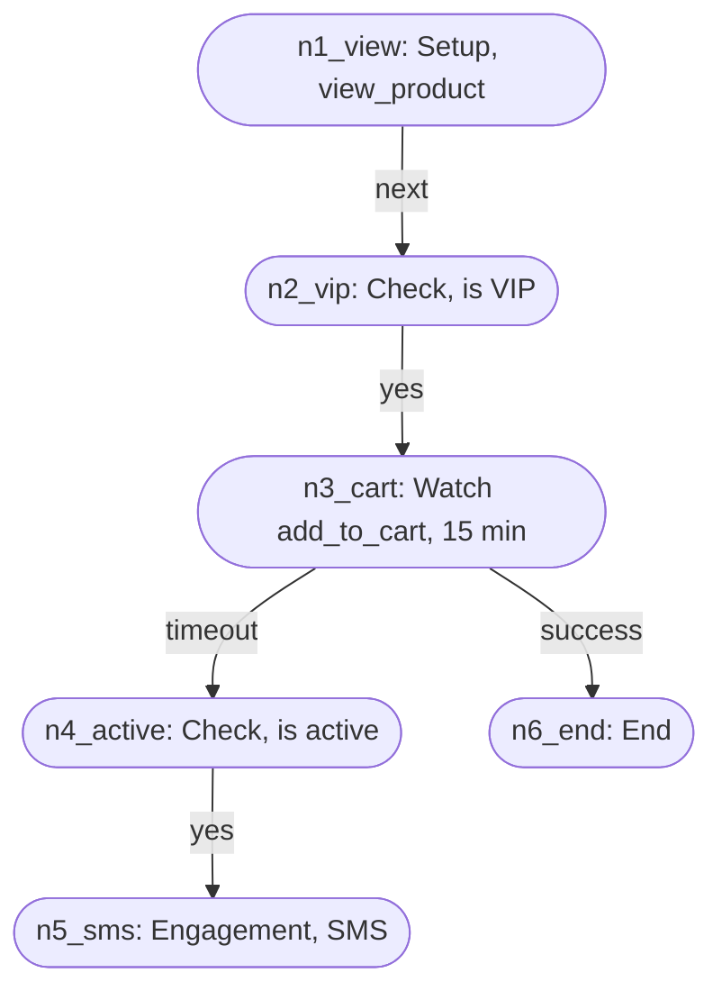

# Journey execution

## Purpose

A journey is a tree of nodes that a marketer draws in the [journey builder](../../features/journey-builder.md). Journey execution is the state machine that runs it. For each person in each campaign, it records which nodes the person has completed and on which branch, completes the nodes that follow automatically, and starts the timers of watch nodes. Each completed node is published once, for the [notification outbox](notification-outbox.md) and for the per-node counts in the builder.

## Scope

In scope:

- The transition rules: when a node completes, and on which branch.
- Which trigger completes a node when triggers arrive out of order, including triggers that arrive before their parent.
- Watch node timers.
- Asking customer decision to check each segment a person reaches.
- Recording completed nodes in `user_campaign_state_transitions`. The counts in `campaign_node_stats` are computed from those rows when read.

Out of scope:

- Deciding whether an event satisfies a node. [Customer decision](customer-decision.md) does that and emits triggers.
- Sending messages. The [notification outbox](notification-outbox.md) does that.

## Terms

| Term | Meaning |
|---|---|
| Journey instance, entry | One person's pass through one campaign, from its setup node. Key: `canon_id`, `campaign_id`, and the entry id. See [decision 0033](../decisions/0033-a-journey-instance-is-one-entry.md). |
| Journey key | `canon_id` + U+001F + `campaign_id`. The key of every trigger and of the engine's state, so one subtask owns all of a person's entries in a campaign. |
| Entry id | The id that a setup trigger carries: `first`, the `event_id` at which the person entered a segment, or a business event's `event_id`. |
| Re-entry setting | A segment entry trigger's rule for a new entry: `never`, `always`, or `after` a period since the last entry started. |
| Trigger | A message that a node was satisfied on a branch at an event time. From customer decision or from a watch timer. |
| Branch | The outcome a node completed on: `next`, `yes`, `no`, `success`, `timeout`, or a multi-branch key. |
| Parent branch | The branch of the parent that a child hangs off. Saved as `parent_branch`. |
| Completed node | A node that a journey instance has passed, with its branch, event time, and context. A node completes at most once per instance. |
| Automatic node | An `engagement` or `end` node. It completes on `next` as soon as its parent completes. |
| Buffered trigger | A trigger held until its node arrives and its parent completes, or until the watermark passes it. |
| Graph-load allowance | How long, in event time, a trigger waits for its node to arrive after the watermark passes the trigger. |
| Graph version | The version of a campaign's graph, saved as `graph_version` on each `campaign_nodes` row. A publish writes a higher version than any before it. A resume writes the published graph again at its version. Each trigger carries the version of the graph it was decided against. |
| Watch limit | The time a watch node waits for its event. Default 15 minutes. |
| Deadline | The parent's completion time plus the watch limit. |
| Watermark | The event time up to which the engine assumes it has seen every trigger. It trails the newest trigger by the allowed out-of-orderness. Campaign graph changes do not move it, and it holds while no trigger arrives. |

## Behavior

Each node type completes this way:

| Node | Completes when | Branches |
|---|---|---|
| Setup | A trigger arrives for it | `next` |
| Check | A trigger arrives for it | `yes`, or a multi-branch key |
| Watch, waiting for an event | A `success` trigger arrives before the deadline | `success` |
| Watch, timeout | The deadline passes first | `timeout` |
| Watch, `DelayPath` | The deadline passes | `next` |
| Engagement, End | Its parent completes on the branch it hangs off | `next` |
| Condition split | A trigger arrives for it | `yes` |

A condition split is a check on the person only. It completes only on `yes`, when its conditions hold, and never on `no`, so its `no` children never start. The owner decided this on 2026-10-17. Customer decision checks its conditions when the person reaches it, and again each time an event changes one of its metrics. The owner decided this on 2026-10-18. A person who already meets them when the split's parent completes moves on at once, at the parent's completion time. See [Segment checks](#segment-checks).

A child completes only if its parent completed on the child's parent branch, at an event time no later than the child's trigger. The first trigger to complete a node wins. Later triggers for that node are ignored.

### Arrival order decides, event time bounds

The engine applies a trigger as soon as it arrives, if it can. It does not wait for the watermark. So when two triggers that can complete the same node arrive out of order, the one that arrives first completes the node, even if the other has an earlier event time. [Decision 0011](../decisions/0011-the-first-trigger-to-arrive-completes-a-node.md) records why.

A trigger that cannot apply yet, such as a child whose parent's trigger has not arrived, waits in the buffer until the watermark passes its event time. That is the late window, 10 minutes of event time by default. If the missing trigger arrives in the window, the waiting trigger applies. If it does not, the waiting trigger is dropped as unreachable. The journey does not end. The person stays at the last node they completed, and any later trigger that can apply moves them on.

Event time still decides these rules:

- **The parent check.** A child completes only on a trigger at or after its parent's completion time (JEX-FR-03). A trigger before it waits in the buffer, and is dropped as unreachable when the watermark passes it.
- **Watch deadlines.** A deadline is the parent's completion time plus the watch limit. A `success` after the deadline never completes the watch (JEX-FR-09). The timer that fires the timeout runs on processing time, as [Watch timers](#watch-timers) describes.
- **The buffer order.** Triggers that wait, for a parent or for the graph, are retried earliest event time first. When a parent completes, the earliest waiting trigger for each child gets the first chance to complete it.
- **The watermark.** A trigger at or before the watermark when it arrives is dropped as late, except a watch deadline trigger (JEX-NFR-05) and a condition split trigger at its parent's completion time (JEX-FR-16), which are never late. A condition split trigger from before its parent's completion is not dropped either: it sends the segment check again (JEX-FR-16). The watermark also releases the buffer.
- **The recorded time.** A completed node records its trigger's event time, not the time the trigger arrived.

In practice, a marketer sees a difference only when one person's events reach the engine out of order, for example when a tracker sends a batch of events late, or when a watch's timeout reaches the engine before its `success`. Then:

- A node can record a later event's time than the person's first qualifying event.
- A child event that happened between the two does not move the person on. The person moves on at the next qualifying event at or after the parent's recorded time.
- A watch can take its `timeout` branch although a `success` happened before the deadline, if the `success` arrives after the timeout.

In each case the node still completes once, on one branch, and the per-node counts in the builder count it once.

### Worked example

The campaign "abandoned cart recovery with timeout routing":

**In order.** At 10:00 a trigger for `n1_view` on `next` arrives, and `n1_view` completes. At 10:01 `n2_vip` completes on `yes`. Its watch child `n3_cart` gets a deadline of 10:16. At 10:05 a `success` trigger for `n3_cart` arrives, so `n3_cart` completes on `success`. `n6_end` completes automatically on `next`. At 10:16 the timer fires a `timeout` for `n3_cart`, which is ignored, because the node already completed.

**Out of order.** The trigger for `n2_vip` at 10:01 reaches the engine before the trigger for `n1_view` at 10:00. `n1_view` has not completed, so the engine buffers the `n2_vip` trigger. When the `n1_view` trigger arrives, `n1_view` completes, the engine retries the buffer, and `n2_vip` completes. The records show the same result as the in-order case.

**Out of order, same node.** Two `view_product` events at 10:00 and 10:02 give two triggers for `n1_view`, and the 10:02 trigger arrives first. `n1_view` completes at 10:02, and the 10:00 trigger is ignored. A trigger for `n2_vip` at 10:01 is earlier than its parent's completion, so it waits, and is dropped as unreachable when the watermark passes 10:01. The next trigger for `n2_vip` at or after 10:02 completes it. In order, `n1_view` would have completed at 10:00 and `n2_vip` at 10:01.

**Timeout.** No `add_to_cart` arrives. At 10:16 the timer emits `timeout` for `n3_cart` with event time 10:16. `n3_cart` completes on `timeout`. A check trigger for `n4_active` then completes it on `yes`, and `n5_sms` completes automatically, which makes the outbox send the SMS.

## Algorithm

### Open an entry

Run keyed by journey key. A setup trigger names its entry by its entry id:

1. If an entry with that id exists, apply the trigger to it by [Apply a trigger](#apply-a-trigger). A replay finds its node completed and changes nothing.
2. Otherwise, check whether a new entry is allowed. A setup trigger of kind `event` allows one entry, `first`. A business event allows one entry per business event. A segment entry follows its re-entry setting: `never` allows one entry, `always` allows a new one each time, and `after` allows a new one when the newest entry started at least that long before the trigger's event time.
3. If it is allowed, open the entry and apply the trigger to it. If not, drop the trigger and count it.

A trigger for any node below the setup node carries no entry id. Apply it to each of the journey key's entries, separately, by [Apply a trigger](#apply-a-trigger). An entry whose parent of that node has not completed buffers it, as usual.

### Apply a trigger

Run for each trigger and entry when the trigger arrives. The trigger does not wait for the watermark:

1. If the trigger was decided against an older graph version than the live graph's, drop it as unreachable. A later publish replaced that graph, and the trigger's node may have been deleted, or deleted and published again under the same id (JEX-FR-17).
2. If the campaign graph, or the trigger's node in it, has not arrived, or the trigger was decided against a newer graph version than the live graph's, buffer the trigger until its graph and node arrive, for at most the graph-load allowance after the watermark passes it.
3. If the node has already completed, ignore the trigger.
4. If the node has a parent:
   1. If the parent has not completed, or completed at a later event time than the trigger, buffer the trigger. A condition split trigger from before its parent's completion, on the split's parent branch, is the exception: see [Segment checks](#segment-checks).
   2. If the parent completed on a branch other than the node's parent branch, drop the trigger.
   3. If the node is a watch and the trigger is `success` with an event time after the deadline, ignore the trigger. The deadline's timeout completes the node. The deadline uses the watch limit that the parent listed when it completed, the same limit its timer uses. A watch that a later save added after its parent completed has no timer, and its deadline uses its own limit.
5. Complete the node on the trigger's branch, or `next` if it has none. Its context is the parent's context with the trigger's context merged over it. The trigger's keys win.
6. Walk the node's children breadth first. Complete each automatic child on `next`, with its parent's event time and context, and continue from it. For each condition split child that has not completed, send a [segment check](#segment-checks).
7. Retry the buffered triggers of this entry in event-time order. Repeat until a pass completes nothing.
8. Publish every node completed in steps 5 and 6. For each completed node, list its watch children with the graph's version, so that the timer flow can start their timers.

### Release the buffer

A buffered trigger waits until the watermark passes its event time. Then the engine retries it once more and, if it still cannot apply, drops it as unreachable. A trigger whose event time is at or before the watermark when it arrives is dropped as late. Customer decision and the watch timers share one watermark. If customer decision falls behind by more than the allowed out-of-orderness while timeouts keep arriving, the engine drops its triggers as late when it catches up. See [decision 0008](../decisions/0008-one-trigger-watermark-for-both-producers.md). A watch deadline trigger, `timeout` or a `DelayPath` watch's `next`, is never late. After the timer flow was down past a deadline, its trigger arrives behind the watermark, and the engine still applies it (JEX-NFR-05). A trigger for a condition split at exactly its parent's completion time is never late either, as [Segment checks](#segment-checks) describes. A trigger that would push the buffer over its limits is dropped as over limit. The engine counts each kind of drop.

A trigger buffered because its campaign graph, or its node, has not arrived waits for the node instead, even after the watermark passes it. So does a trigger decided against a newer graph version than the live graph's. Each time a campaign's graph changes, the engine retries the campaign's buffered triggers in event-time order. A trigger decided against an older graph version than the new graph's is dropped as unreachable. A trigger whose node, or a node above it, is not in the graph keeps waiting, and so does one decided against a newer version. A trigger that the watermark has passed and that still cannot apply is dropped as unreachable.

### Apply a campaign save

A save reaches the engine as one `campaign_nodes` row per node, after a delete row for each node of the previous save. Each row carries `campaign_node_count`, the number of nodes in its save. On a fresh start, the snapshot delivers the rows of each campaign in any order. The engine applies a save as one change, so that no trigger meets part of a save. [Decision 0013](../decisions/0013-apply-a-campaign-save-as-one-change.md) explains the choice.

1. A delete row takes the campaign's graph down. Until the next save is complete, the campaign has no graph, and its triggers wait for it. A buffered trigger with a graph version keeps waiting too. When the next graph goes live, the trigger applies if the graph has the trigger's version, and is dropped as unreachable if the graph is newer. A trigger without a version cannot be told apart, so the first delete row drops, as unreachable, every buffered trigger without a version for a node of the graph it takes down. A buffered trigger for a node the graph does not hold keeps waiting for the save that adds it. These rules were chosen during the fix, pending owner review.
2. An inserted row joins the campaign's load. When the load holds `campaign_node_count` rows, it becomes the campaign's graph, and the engine retries the campaign's buffered triggers. A node that is not loaded, such as a watch whose limit is invalid, still counts.
3. An updated row replaces its node in the live graph at once. While the graph is down, it joins the load like an inserted row.

A node that a save adds under a parent that a journey instance already completed does not start for that instance. An automatic child does not complete, and a watch child gets no timer. The instance's later triggers apply against the new graph.

A graph's version is the highest `graph_version` among the rows it was built from. A save writes one version on every row. Customer decision reads `campaign_nodes` through its own slot, so it can apply a publish before or after the engine does. A trigger it decides against the new graph before the engine applies the publish waits for that graph. A trigger it decides against the old graph after the engine applied the publish is dropped as unreachable, and the person moves on at the next qualifying trigger. So is a trigger in flight across a publish, such as the timeout of a watch started before it. A resume keeps the version, so a pause and resume drops none of these. This was chosen during the fix, pending owner review.

The wait for a node is bounded. When the watermark passes a trigger's event time plus the graph-load allowance, and its node, or a node above it, is still missing, the engine drops the trigger as unreachable. This covers a node or a campaign deleted while triggers for it were buffered: a watch node's timeout from the timer flow, and a trigger that waits for a deleted parent. The allowance must cover the time a campaign's rows take to reach the engine after a save, or from the snapshot on a fresh start. While triggers arrive live, the watermark trails real time by the allowed out-of-orderness, so a trigger waits that long plus the allowance before it is dropped. On a start, a backlog of triggers moves the watermark faster than real time while the snapshot loads, so the engine also waits until the allowance has run in real time since its first record after the start. This rule was chosen during the fix, pending owner review.

### Watch timers

1. When a node completes and has watch children, compute each child's deadline: the node's event time plus the child's watch limit. The limit is a number above zero with a unit: seconds, minutes, hours, or days. A missing number is 15, and a missing unit is minutes. A watch node whose limit is invalid is not loaded, so it gets no timer.
2. Set a timer for the deadline. A deadline already past fires at once.
3. When the timer fires, emit a trigger for the watch node on `timeout`, or on `next` for a `DelayPath` watch, with event time equal to the deadline. The trigger carries the graph version that the completed node listed for the watch.
4. Remove the timer's watch when it fires. A watch is kept once per journey instance and watch node, so a replayed transition replaces it.

The timer runs on processing time and fires when the wall clock reaches the deadline. A `success` with an event time before the deadline that reaches the engine after the timeout loses, so a `success` within the last seconds of pipeline latency can lose to the timeout. A `success` at exactly the deadline and the timeout go to whichever reaches the engine first.

The engine applies a timeout trigger like any other, even when the watermark has passed the deadline. If the watch node already completed on `success`, the timeout is ignored.

### Segment checks

A condition split is checked when the person reaches it, so a person who already meets its condition does not wait for a metric change. [Decision 0015](../decisions/0015-check-a-segment-when-a-person-reaches-it.md) records the design.

1. When a node completes, the engine sends a segment check for each condition split child on the completed branch that has not completed. The check goes to `journey-engine-segment-checks`, keyed by `canon_id`. It carries the `event_id`, `event_name`, and event time of the trigger that completed the parent.
2. [Customer decision](customer-decision.md#segment-checks) evaluates the condition split against the person's metrics as of that event time. If the condition holds, it emits a `yes` trigger for the condition split with the check's `event_id`, `event_name`, and event time. If not, it emits nothing, and the person waits until a change to one of the split's metrics makes the condition hold.
3. The engine applies that trigger like any other. Its event time equals the parent's completion time, so it passes the parent check.

The check and its answer take a round trip through two jobs, and the watermark can pass the parent's completion time meanwhile, for example when the parent completed on a trigger that waited for its graph. So a trigger for a condition split whose event time equals its parent's completion time is never late, like a watch deadline trigger. Its parent has completed, so it applies at once. The trigger has no field that marks it as an answer: a trigger at that time from a metric change, caused by the event that completed the parent, is applied the same way, and the result is the same.

A metric change can reach customer decision after the check, when the event that caused it happened before the parent's completion but arrived late. The check then failed without it, and the change's own `yes` trigger is earlier than the parent's completion, so it cannot complete the condition split (JEX-FR-03). When such a trigger arrives after the parent completed on the split's parent branch, the engine sends the segment check again, at the parent's completion time, and the trigger completes nothing. It does so even when the trigger is at or before the watermark, instead of dropping it as late, so the event's lateness does not matter. If the condition split has completed, the trigger is ignored, or dropped as late when it is behind the watermark. Customer decision counted the change before it sent the trigger, so the second check sees it. A trigger that waited in the buffer while the parent completed asks for no second check, because the first check already saw its change. This rule was chosen during the fix, pending owner review.

A check sent twice, after a replay of either job, can produce two `yes` triggers. The second is ignored, because the condition split has completed. A condition split that a save adds under a parent that already completed gets no check.

## Functional requirements

| Id | Requirement |
|---|---|
| JEX-FR-01 | A node must complete at most once per entry. |
| JEX-FR-02 | A child must complete only after its parent completed on the child's parent branch. |
| JEX-FR-03 | A child must not complete on a trigger whose event time is earlier than its parent's completion. |
| JEX-FR-04 | A trigger that arrives before its parent completes must be buffered and applied when the parent completes, if the watermark has not passed it. |
| JEX-FR-05 | When a node completes, every automatic node below it on the completed branch must complete on `next` in the same step. |
| JEX-FR-06 | A completed node's context must be its parent's context with the trigger's context merged over it. |
| JEX-FR-07 | Every watch child of a completed node must get a timer at the deadline. |
| JEX-FR-08 | A watch timer must emit `timeout`, or `next` for a `DelayPath` watch, with event time equal to the deadline. |
| JEX-FR-09 | A `success` trigger with an event time after the deadline must not complete the watch node. |
| JEX-FR-10 | The engine must publish each completed node to `user_campaign_state_transitions` once, keyed by (`canon_id`, `campaign_id`, entry id, `node_id`, `branch`). |
| JEX-FR-11 | `campaign_node_stats` must count the entries that completed each node, on every branch. A person with two entries counts twice. |
| JEX-FR-12 | A change to a campaign's nodes must apply to the next trigger, without a restart. A deleted node no longer completes. This holds after a restore from a checkpoint or savepoint within the CDC restore window (JEX-NFR-10). |
| JEX-FR-13 | Late, unreachable, and over-limit triggers must be counted by kind. A trigger dropped for a wrong branch must also be counted. |
| JEX-FR-14 | A trigger that arrives before its campaign graph, or before its node in the graph, must wait for the node, even after the watermark passes it, and must then be applied in event-time order. The wait must end when the watermark passes the trigger's event time plus the graph-load allowance, but not before the allowance has run in real time since the engine started. A trigger whose node, or a node above it, is still missing then must be dropped as unreachable and counted. |
| JEX-FR-15 | The engine must apply each save of a campaign's nodes as one change. No trigger may apply against part of a save. |
| JEX-FR-16 | When a node completes, the engine must send a segment check for each condition split child on the completed branch that has not completed, with the event time of the parent's completion. A condition split trigger at its parent's completion time must apply even when the watermark has passed it. A condition split trigger from before its parent's completion that arrives after the parent completed must send the check again at the parent's completion time, even when the watermark has passed the trigger. |
| JEX-FR-17 | A trigger must apply only against the graph version it was decided against. A trigger decided against an older version than the live graph's must be dropped as unreachable and counted. A trigger decided against a newer version must wait for it, as for a graph that has not arrived. A trigger without a version applies against the live graph. |
| JEX-FR-18 | A setup trigger must open a new entry only when [Open an entry](#open-an-entry) allows it, and must apply to the existing entry when one has its entry id. A refused setup trigger must be counted. |
| JEX-FR-19 | A trigger for a node below the setup node must apply to each of the journey key's entries, separately. |

## Non-functional requirements

The defaults are configurable. [Configuration](../../operations/configuration.md#journey-execution) names each setting.

| Id | Requirement |
|---|---|
| JEX-NFR-01 | Triggers up to 10 minutes out of order are accepted, not dropped as late. A trigger applies as soon as it can, so among triggers that can complete the same node, the first to arrive completes it. Triggers that wait in the buffer are retried in event-time order. See [decision 0011](../decisions/0011-the-first-trigger-to-arrive-completes-a-node.md). |
| JEX-NFR-02 | The buffer holds at most 1000 triggers and 4 MiB per entry. |
| JEX-NFR-03 | Journey state expires 90 days after its last read or write. |
| JEX-NFR-04 | Delivery is at least once. A replayed trigger must not complete a node twice or write a second row. See [decision 0006](../decisions/0006-at-least-once-delivery-with-idempotent-writes.md). |
| JEX-NFR-05 | A watch timeout must not be lost when the job is down past the deadline. It fires when the job recovers, with event time equal to the deadline. A transition written while the timer flow is down gets its timer when the timer flow restores from a checkpoint or savepoint within the CDC restore window (JEX-NFR-10). |
| JEX-NFR-06 | Timer state must be bounded: one pending timer per entry and watch node, removed when it fires. |
| JEX-NFR-07 | The engine takes no database locks. One subtask owns each journey instance. See [decision 0001](../decisions/0001-run-the-journey-engine-in-flink.md) and [decision 0002](../decisions/0002-key-every-write-by-its-owner.md). |
| JEX-NFR-08 | Late drops must be counted where an alert can read them, and operations must alert on them. A customer decision backlog older than the allowed out-of-orderness is lost, and the alert is how operations learn of it. |
| JEX-NFR-09 | A trigger waits for its node for a graph-load allowance of 5 minutes of event time after the watermark passes it, and after a start for at least 5 minutes of real time. |
| JEX-NFR-10 | The CDC restore window. A job restored from a checkpoint or savepoint must read every change its CDC tables received after it, as long as no run of the job has completed more than 10 checkpoints after it. A stop with a savepoint counts as a checkpoint. A run restored after a failure counts from 0 again. At the default checkpoint interval of 30 seconds the window is about 5 minutes, and for the timer flow, at 60 seconds, about 10 minutes. The count is a setting with a default of 10. The window is short so that the WAL a running slot holds stays under the database's cap on slot WAL at peak writes ([decision 0039](../decisions/0039-shorten-the-cdc-restore-window.md)). Past the window, the restored job skips the changes made between its checkpoint and the newest position its slot still holds. After a start without saved state, the window holds only once 10 checkpoints have completed after the source finished reading its snapshot. A checkpoint taken during the snapshot holds no log position, so when its turn to be confirmed comes, the source confirms its current position instead. |
| JEX-NFR-11 | A journey key holds at most 20 entries. Opening one more drops the oldest entry and counts it. Proposed. |

## Interfaces

| Direction | Interface | Contract |
|---|---|---|
| In | Kafka `journey-engine-matched-events` | Trigger, see [customer decision](customer-decision.md#interfaces). Key: journey key. Carries `graph_version` from schema version 4, and `entry_id` on a setup trigger. |
| In | CDC `campaign_nodes` | The campaign graph, one save at a time. Each row carries `campaign_node_count` and `graph_version`. |
| Out | `user_campaign_state_transitions` | One row per completed node. CDC feeds the outbox and the timer flow. |
| Out | Kafka `journey-engine-matched-events` | Timeout triggers from the timer flow, in the trigger format, with the `graph_version` that the transition listed for the watch. |
| Out | Kafka `journey-engine-segment-checks` | Segment check, see [customer decision](customer-decision.md#interfaces). Key: `canon_id`. |
| Read model | `campaign_node_stats` | Users per node, read by the builder. A view computed from `user_campaign_state_transitions` when it is read; the engine writes nothing to it. |

A transition row holds the journey key and the entry id, `node_id`, `branch`, `node_type`, the event time, the merged context, the engagement action for an engagement node, the watch children, and the `event_id` of the trigger. Each watch child carries its watch limit, the branch its deadline completes it on, and the graph version. The timer flow starts the timer from these, so it does not read the watch's row. See [the data model](../data-model.md).

## Failure handling

| Case | Behavior |
|---|---|
| Trigger without `canon_id`, `campaign_id`, `node_id`, or event time | Drop it, log it, and count it. Logging and counting it was chosen during the fix, pending owner review. |
| Trigger message that is not a JSON object, or has a field of the wrong type | Drop it, log the kind of error but not the message, and count it with the triggers above. This was chosen during the fix, pending owner review. |
| Graph or node not yet loaded | Buffer the trigger until the node arrives, even past the watermark. |
| Node row without a `campaign_node_count` above 0 | Do not load the row, and log it. Its save never goes live. |
| Node row without a `graph_version` | Do not load the row, and log it. Its save never goes live. |
| Trigger decided against an older graph version than the live graph's | Drop it as unreachable and count it. |
| Trigger decided against a newer graph version than the live graph's | Buffer it until that graph goes live, as when its graph has not arrived. |
| Trigger without a `graph_version`, written before its producer set one | Apply it against the live graph. A delete row drops it from the buffer if the graph it takes down holds its node. |
| Delete row outside a save | Take the campaign's graph down until the next save. |
| Graph or node still missing when the watermark passes the trigger's event time plus the graph-load allowance, and the allowance has run in real time since the start | Drop it as unreachable and count it. |
| Trigger for a node that completed | Ignore it. |
| `success` trigger for a watch after its deadline | Ignore it. The timeout completes the watch. |
| Watch node whose limit is not a number above zero, has another unit, or is too large to compute | Do not load the node, and log it. Its parent lists no timer for it, and triggers for it are dropped as unreachable. |
| Node row that customer decision cannot parse either, such as an unknown `node_type` or a condition that is not valid | Do not load the node, and log it, as customer decision does. A node below it has no path to the root, so its triggers are dropped as unreachable. Its parent lists no timer for it. This was chosen during the fix, pending owner review. |
| Transition row with an unknown `node_type`, or watch children the engine did not write | The outbox and the timer flow do not read it, and log it. This was chosen during the fix, pending owner review. |
| Trigger on the wrong branch of the parent | Drop it and count it. |
| Child saved without `parent_branch` | It hangs off no branch, so it never completes. A trigger for it is dropped as on the wrong branch and counted. The saved format gives every child a parent branch. This rule was chosen during the fix, pending owner review. |
| Watermark passes a buffered trigger | Drop it as unreachable and count it. |
| Trigger at or before the watermark when it arrives | Drop it as late and count it. |
| Watch deadline trigger at or before the watermark | Apply it. |
| Condition split trigger at its parent's completion time, at or before the watermark | Apply it. |
| Condition split trigger from before its parent's completion, arriving after the parent completed, at or before the watermark or not | Send the segment check again at the parent's completion time. Complete nothing. |
| Customer decision backlog older than the allowed out-of-orderness | Drop it as late, count it, and alert. |
| Restart | Restore state from the checkpoint. A replayed trigger is ignored because its node completed. |
| Restore from an older checkpoint or savepoint, such as a rollback to the savepoint taken before a deploy | Within the CDC restore window (JEX-NFR-10), the engine and the timer flow read every change made after it again. Past the window, they skip the changes up to the position the slot still holds. |
| Timer flow starts without its saved CDC log position | It reads every transition again and keeps a watch for each watch child they list. A deadline already past fires at once. The engine ignores the timeout of a watch that completed, and a watch still pending completes on `timeout`. |

## Acceptance criteria

- Given the worked example, when `n1_view`, `n2_vip`, and `n3_cart` on `success` arrive in order, then `user_campaign_state_transitions` holds `n1_view`/`next`, `n2_vip`/`yes`, `n3_cart`/`success`, and `n6_end`/`next`. (JEX-FR-02, JEX-FR-05)
- Given the `n2_vip` trigger arrives before the `n1_view` trigger, then the records equal the in-order case. (JEX-FR-04)
- Given `n2_vip` completed at 10:01 and no `add_to_cart`, then at 10:16 `n3_cart` completes on `timeout`. (JEX-FR-07, JEX-FR-08)
- Given `n3_cart` completed on `success`, when its timeout fires, then no new row is written. (JEX-FR-01)
- Given a `success` trigger for `n3_cart` with event time 10:20, then `n3_cart` completes on `timeout`, not `success`. (JEX-FR-09)
- Given the same trigger delivered twice, then one row exists. (JEX-NFR-04)
- Given a condition split under `n1_view` with an engagement on its `yes` branch, when `n1_view` has completed and a `yes` trigger for it arrives, then it completes on `yes` and the engagement completes on `next`. (JEX-FR-05)
- Given a condition split with the behavior condition `purchase` `COUNT >= 2` under `n1_view` with an engagement on its `yes` branch, and a person with two purchases, when `n1_view` completes at 10:00, then the condition split completes on `yes` at 10:00 and the engagement completes on `next`, with no further event. (JEX-FR-16)
- Given the same condition split and a person with one purchase, when `n1_view` completes at 10:00, then the condition split does not complete. When a second purchase at 11:00 arrives, then the condition split completes on `yes` at 11:00. (JEX-FR-16)
- Given `n1_view` completed at 10:00 and the watermark at 10:20, when a `yes` trigger for the condition split at 10:00 arrives, then the condition split completes on `yes`. When instead a `yes` trigger for the condition split at 10:02 arrives, then it is dropped as late. (JEX-FR-16)
- Given the same condition split, one purchase at 08:00, and `n1_view` completed at 10:00, when a purchase at 09:00 reaches customer decision after the segment check, then the condition split completes on `yes` at 10:00. This holds also when the watermark is at 09:50 when the purchase's trigger arrives. (JEX-FR-16)
- Given the condition split completed on its segment check, when the same check is delivered again, then no new row is written. (JEX-FR-01, JEX-NFR-04)
- Given a child with parent branch `timeout` and a parent that completed on `success`, when a trigger for the child arrives, then the child does not complete. (JEX-FR-02)
- Given the job is stopped from 10:10 to 10:30, then the `n3_cart` timeout still fires, with event time 10:16. (JEX-NFR-05)
- Given the engine stopped with a savepoint, a new version restored from it, `n2_vip` deleted from the campaign, and the new version stopped after 5 checkpoints, when the engine restores from the first savepoint, then a trigger for `n2_vip` does not complete it. (JEX-FR-12, JEX-NFR-10)
- Given the timer flow stopped with a savepoint before `n2_vip` completed at 10:01, and a new version that restored from it and stopped after 5 checkpoints, when the timer flow restores from the first savepoint, then the `n3_cart` timeout still fires, with event time 10:16. (JEX-NFR-05, JEX-NFR-10)
- Given triggers for `n1_view` at 10:01 and `n2_vip` at 10:03 arrive before the campaign graph, and the watermark passes 10:03, when the graph arrives, then `n1_view` and `n2_vip` complete with those event times. (JEX-FR-14)
- Given the graph holds `n1_view` but not yet `n2_vip`, and `n1_view` completed at 10:01, when a trigger for `n2_vip` at 10:02 arrives, the watermark passes 10:02, and then a save adds the `n2_vip` node, then `n2_vip` completes at 10:02. (JEX-FR-14)
- Given `n2_vip` completed at 10:01, a trigger for `n4_active` at 10:05 is buffered, and then a save removes `n3_cart`, when its `timeout` trigger at 10:16 arrives and the watermark passes 10:16 plus the graph-load allowance, then both triggers are dropped as unreachable and counted, and the buffer holds neither. (JEX-FR-14)
- Given triggers for `n2_vip` at 10:03 and at 10:02 are buffered, when `n1_view` completes at 10:01, then `n2_vip` completes at 10:02. (JEX-NFR-01)
- Given triggers for `n1_view` at 10:02 and at 10:00 arrive in that order, then `n1_view` completes at 10:02, and the 10:00 trigger writes no row. (JEX-NFR-01)
- Given `n1_view` completed at 10:02, when a trigger for `n2_vip` at 10:01 arrives and the watermark passes 10:01, then `n2_vip` does not complete, and the trigger is dropped as unreachable and counted. (JEX-FR-03, JEX-NFR-01)
- Given `n2_vip` completed at 10:01, when the `n3_cart` timeout at 10:16 arrives before a `success` trigger for `n3_cart` at 10:15, then `n3_cart` completes on `timeout`, not `success`. (JEX-NFR-01)
- Given a trigger for `n2_vip` at 10:01 waits and no trigger for `n1_view` arrives before the watermark passes 10:01, then the `n2_vip` trigger is dropped as unreachable, and later triggers for `n1_view` at 10:20 and `n2_vip` at 10:21 complete both nodes. (JEX-NFR-01)
- Given a trigger for `n1_view` waits for its graph, when a fresh start delivers the row of `n1_view` before the row of an engagement child `n5_sms`, then `n1_view` and `n5_sms` both complete. (JEX-FR-05, JEX-FR-15)
- Given a trigger for `n2_vip` waits for its graph, when the row of `n2_vip` arrives before the row of its watch child `n3_cart`, then the `n2_vip` transition lists `n3_cart`, so its timer starts. (JEX-FR-07, JEX-FR-15)
- Given a marketer saves the campaign, when a trigger for `n1_view` arrives between the rows of the save, then `n1_view` completes against the whole saved graph. (JEX-FR-15)
- Given the campaign at version 1 and `n1_view` completed at 10:00, when the campaign is deleted, a trigger for `n2_vip` decided against version 1 arrives, and the campaign is published again under the same ids at version 2, then `n2_vip` does not complete, and the trigger is dropped as unreachable and counted. (JEX-FR-12, JEX-FR-17)
- Given the same campaign with the watch `n3_cart` under `n1_view`, when it is deleted and published again at version 2 and the `n3_cart` timeout decided against version 1 arrives, then `n3_cart` does not complete. (JEX-FR-12, JEX-FR-17)
- Given the campaign live at version 1, when a trigger for `n2_vip` decided against version 2 arrives before `n1_view` completes, the engine then reads the publish of version 2, and `n1_view` completes, then `n2_vip` completes. (JEX-FR-17)
- Given the campaign live at version 1, when a trigger for `n1_view` decided against version 2 arrives and version 2 adds an engagement under `n1_view`, then `n1_view` and the engagement complete against version 2. (JEX-FR-17)
- Given a trigger for `n2_vip` buffered at version 1, when the campaign is paused and resumed, which writes version 1 again, and `n1_view` completes, then `n2_vip` completes. (JEX-FR-17)
- Given a trigger without a `graph_version`, when it arrives for a live graph at any version, then it applies. (JEX-FR-17)
- Given `n1_view` completed, when a save adds an engagement child under `n1_view`, then that child does not complete for this entry. (JEX-FR-15)
- Given a price drop campaign, when setup triggers arrive with entry ids `be-1` and then `be-2` for one person, then the person has two entries, and each completes the setup node once. (JEX-FR-18)
- Given the setup trigger with entry id `be-1` replayed, then no third entry opens and nothing completes again. (JEX-FR-18, JEX-NFR-04)
- Given a segment entry trigger with re-entry after 30 days and an entry that started 10 days ago, when a new setup trigger arrives, then no entry opens and the refusal is counted. After 30 days, one opens. (JEX-FR-18)
- Given a campaign triggered by a person event, when a second setup trigger arrives, then no second entry opens. (JEX-FR-18)
- Given two entries waiting at a watch for `purchase`, when a `success` trigger arrives, then both watches complete on `success`. (JEX-FR-19)
- Given two entries, then `user_campaign_state_transitions` holds a row per entry for the setup node, and `campaign_node_stats` counts 2. (JEX-FR-10, JEX-FR-11)

## Open questions

- When does a check take its `no` branch? See the same question in [customer decision](customer-decision.md#open-questions). A condition split does not wait on this answer: it never takes `no`.
- Should a campaign that starts on a person event allow more than one entry, for use cases such as "remind at most twice, 3 days apart" (UC-02)? Entries answer this for segment and business-event triggers ([decision 0033](../decisions/0033-a-journey-instance-is-one-entry.md)). A person-event trigger still allows one entry.

## Related

- [Customer decision](customer-decision.md)
- [Notification outbox](notification-outbox.md)
- [Journey builder](../../features/journey-builder.md)
- [0001. Run the journey engine in Flink](../decisions/0001-run-the-journey-engine-in-flink.md)
- [0008. One trigger watermark for both producers](../decisions/0008-one-trigger-watermark-for-both-producers.md)
- [0011. The first trigger to arrive completes a node](../decisions/0011-the-first-trigger-to-arrive-completes-a-node.md)
- [0013. Apply a campaign save as one change](../decisions/0013-apply-a-campaign-save-as-one-change.md)
- [Known issues](../../known-issues/components/journey-execution.md)
- [0015. Check a segment when a person reaches it](../decisions/0015-check-a-segment-when-a-person-reaches-it.md)
- [0022. Version each published graph and drop triggers decided against an older one](../decisions/0022-version-each-published-graph.md)
- [0033. A journey instance is one entry](../decisions/0033-a-journey-instance-is-one-entry.md)
