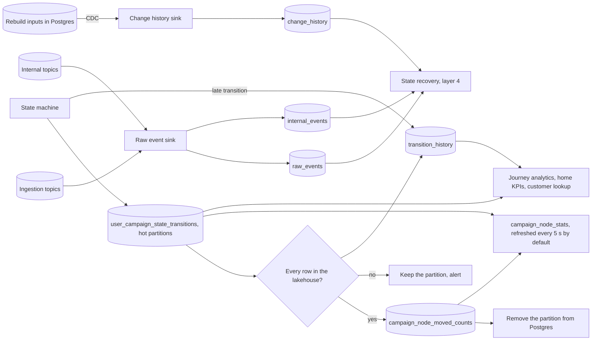

# Lakehouse sink

## Purpose

The pipeline's inputs and its journey history grow without a bound, and Postgres and Kafka hold only the recent part ([decision 0053](../decisions/0053-store-raw-events-transition-history-and-imports-in-an-iceberg-lakehouse.md)). The lakehouse sink copies every raw event, every record of the internal topics, every change to the Postgres tables a rebuild reads, and every transition into lakehouse tables on object storage. [State recovery](state-recovery.md) rebuilds Flink state from them, and journey analytics read older transitions from the lakehouse instead of the table the state machine writes. Nobody on the decision path reads it.

## Scope

In scope:

- The raw events table: every record of the ingestion topics, unchanged.
- The internal events table: every record of the internal topics the jobs with state read, unchanged.
- The change history table: every change to the configuration and profile tables a rebuild reads.
- The transitions history table: every row of `user_campaign_state_transitions`, including the rows of partitions that left Postgres, and the transitions written straight to it.
- The partition lifecycle of `user_campaign_state_transitions`: creating partitions ahead of time, and removing one only after the lakehouse holds all of its rows and Postgres holds its count per node.
- Replay safety, completeness checks, retention, and table maintenance for these tables.
- The boundary between the hot partitions and the history, which every reader that combines both stores uses.

Out of scope:

- The imported records tables. The [import applier](import-applier.md) writes them and the [import metric pass](import-metric-pass.md) reads them. Their privacy rules are in the import applier.
- The queries that analytics run. [Home overview](../../features/home-overview.md) and [journey builder](../../features/journey-builder.md#node-analytics) define them.
- Rebuilding state from these tables. [State recovery](state-recovery.md) does that.
- The deployment of the sink and the query engine.

## Terms

| Term | Meaning |
|---|---|
| Lakehouse | Data files on object storage, read and written as tables in an open table format, with atomic commits and snapshots. [Decision 0053](../decisions/0053-store-raw-events-transition-history-and-imports-in-an-iceberg-lakehouse.md) names the format. Every lakehouse table, the import tables included, is in one managed catalog, S3 Tables (LKH-NFR-08). |
| Catalog | The service that names each table and holds a pointer to its current snapshot. A commit swaps the pointer atomically. |
| Snapshot | One committed version of a table. A reader sees one snapshot at a time. |
| Raw event | One record of an ingestion topic, as the topic holds it: its topic, partition, offset, key, value, and the topic's timestamp. |
| Ingestion topics | `snowplow-good`, `snowplow-bad`, `ingestion-api-events`, and `business-events`. |
| Internal topics | The topics a job with state reads that a job of the platform writes: `snowplow-parsed`, `customer-profile-mutations`, `journey-engine-matched-events`, `journey-engine-segment-checks`, `segment-membership-changes`, `current-member-entries`, and `business-event-matches`. |
| Rebuild inputs in Postgres | The tables a job with state reads through CDC or by lookup: `campaign_nodes` with its `graph_version`, `user_metric_definitions`, `segments`, the event catalog's `user_events` and `user_event_fields`, `customer_attributes`, and `customer_profiles`. |
| Change | One committed insert, update, or delete of one row of a rebuild input in Postgres, as CDC reads it, or one row of a CDC snapshot. |
| Entry start | The event time at which a journey entry opened. The engine carries it on every transition of the entry ([journey execution](journey-execution.md#store-transitions)). |
| Hot partition | A partition of `user_campaign_state_transitions`, by entry start, that is still in Postgres. |
| Transition key | (`canon_id`, `campaign_id`, `entry_id`, `node_id`, `branch`). See [journey execution](journey-execution.md#terms). |
| Move | Copy a hot partition's rows to the transitions history table, check them, write the partition's count per node to Postgres, and then remove the partition. |
| Moved counts | The count of entries per node of a partition that left Postgres, in `campaign_node_moved_counts`, one row per (`campaign_id`, `node_id`) and partition. `campaign_node_stats` adds them to its count over the hot partitions ([JEX-FR-25](journey-execution.md#functional-requirements)). |
| Move boundary | The lower bound of the oldest hot partition. Every partition below it has left Postgres. |
| Closed partition | A hot partition that a move has closed to inserts. It stays readable in Postgres until the move removes it. |
| Late transition | A transition whose entry start falls below the move boundary or in a closed partition, so its partition left Postgres or is leaving. |
| Snapshot expiry | Removing old snapshots, and the data files that only they reference. |

## Behavior

At 10:00:05 the collector writes a tracker hit to `snowplow-good` partition 2 at offset 88,410. Within one commit interval, the raw events table holds one row for (`snowplow-good`, 2, 88410) with the hit's bytes. If the sink restarts and reads the offset again, the table still holds one row.

At 10:00:07 the state machine completes `n1_view` for an entry that opened at 09:58. The transition row is in `user_campaign_state_transitions`, in the partition of its entry start, 09:58. Analytics read it from Postgres. 90 days later the partition's whole range is older than the Postgres retention. The move copies the partition, finds the same row count and key set in the lakehouse, writes the partition's count per node to `campaign_node_moved_counts`, and only then removes the partition from Postgres. From then on analytics read the row from `transition_history`, and `campaign_node_stats` counts it from the moved counts.

An entry lives at most 90 days from its start, so no live entry has a transition after its partition moves. A late transition comes only from a replay after a restore, or from an entry that completes a node at the exact 90-day edge, in its last moments, while a move has its partition closed. A partition moves only once every entry in it has expired (JEX-NFR-12), so the second case is rare. The state machine writes it straight to `transition_history`. The outbox and the timer flow never see it.

## Algorithm

### Write raw events

1. Read every ingestion topic and every internal topic from its saved offsets.
2. For each record, write a row keyed by (`topic`, `partition`, `offset`): to `raw_events` for an ingestion topic, to `internal_events` for an internal topic.
3. Commit to the table when the job completes a checkpoint, so that a commit holds exactly the records read up to that checkpoint.
4. On a restart, resume from the checkpoint's offsets. A record already committed has the same key, so it is not written again.

### Write changes

The owner decided on 2026-11-17 that a rebuild reads its Postgres inputs as they were at each event, from history kept in the lakehouse (#118, #119).

1. Read every rebuild input in Postgres through CDC, from its saved log position.
2. For each change, write a row to `change_history` with the table's name, the row's primary key, the operation, the row after the change (none for a delete), the change's log position, and its commit time.
3. A CDC snapshot, read when the source starts without a saved position, writes a row only for a Postgres row whose newest version in `change_history` differs from it. A delete that happened while the source was stopped shows as a key the snapshot no longer holds, and is written as a delete at the snapshot's time. This snapshot rule is the lead's default, pending owner review.
4. Commit at checkpoints, as raw events do. A change already committed has the same key, so it is not written again.

### Expire by age

1. Once a day, the lead's default pending owner review, delete from `raw_events` and `internal_events` every record whose topic timestamp is older than 13 months, and expire the snapshots that still reference it (LKH-FR-08).
2. Delete from `change_history` every change whose commit time is older than 13 months, the same rule as raw events. A row whose last change is older than that has no change left in the history.

No other deletion reaches these three tables. A person's deletion request does not (LKH-FR-16).

### Partition lifecycle

The partitions are cut by entry start ([JEX-FR-20](journey-execution.md#functional-requirements)). A replay cannot change an entry's start, so every row of one transition key falls in one partition.

1. Keep partitions of `user_campaign_state_transitions` created for the next 2 months of entry starts, so that an early transition, such as one from a device with a wrong clock, always finds its partition (LKH-FR-11).
2. Move a hot partition only by [Move a hot partition](#move-a-hot-partition), and only when [journey execution](journey-execution.md#functional-requirements) allows it (JEX-FR-24).
3. A transition whose entry start falls below the move boundary goes straight to `transition_history` (LKH-FR-12). It is never written to Postgres.

### Move a hot partition

1. Pick the oldest hot partition whose whole range is older than the Postgres retention of 90 days (JEX-NFR-12), and that no reader of the hot table still needs (JEX-FR-24).
2. Copy its rows to the transitions history table, keyed by the transition key alone. A row whose key the table already holds is not written again.
3. Close the partition to inserts. From then on, a transition for its range is a late transition and goes straight to `transition_history` (LKH-FR-12).
4. Copy again, for the rows written between steps 2 and 3. Then count the partition's rows and compare its set of transition keys with the history's. Every key of the partition must be in the history. No insert can land in the partition after this check, because step 3 closed it.
5. If they match, write the partition's count per node to `campaign_node_moved_counts`: for each (`campaign_id`, `node_id`) with a transition in the partition, the number of distinct (`canon_id`, `entry_id`) pairs, keyed by `partition_start`, the lower bound of the partition's range of entry starts (LKH-FR-23). The partition is closed, so the counts are final. If they do not match, keep the partition closed, count the mismatch, and alert.
6. If they match, remove the partition from Postgres as one unit, never row by row. Steps 5 and 6 commit together, so that no refresh of `campaign_node_stats` sees both the partition and its moved counts.

A move run twice converges. Steps 2 and 4 write nothing new. Steps 5 and 6 commit together, so a rerun finds either the partition with no counts, and runs the move again, or no partition. The upsert keeps a rerun from writing a second count row. Removing the oldest partition raises the move boundary in the same step.

### Read across both stores

The owner decided on 2026-11-17 that analytics read recent ranges from Postgres, seconds fresh, and history from the lakehouse through a serverless query engine, Athena, with no engine running between queries (#111). [Decision 0058](../decisions/0058-read-recent-analytics-from-postgres-and-history-from-the-lakehouse.md) records it. Customer lookup reads a person's transitions the same way (#125). The two paths must agree at the boundary.

A recent range, one that starts no more than 90 days ago, reads Postgres only and never the lakehouse. It may leave out a late transition, which is rare because an entry lives at most 90 days from its start. The owner decided this on 2026-11-18, in the review of PR #173 (LKH-FR-22). A range that starts earlier, such as All time, and a person's whole history read both stores:

1. Read the hot rows from `user_campaign_state_transitions`, and the move boundary from the hot partitions, in one Postgres snapshot.
2. Read from `transition_history` the rows whose entry start is below that boundary, and the rows of the partitions that step 1 saw closed.
3. Combine the two, keeping one row per transition key. A closed partition's rows can be in both reads, and a late transition of a closed partition is only in the second.

A move between steps 1 and 2 changes nothing. The moved rows are at or above the boundary read in step 1, so step 2 skips them unless step 1 saw their partition closed, and then step 3 keeps one copy. A late transition below the boundary is only in step 2.

## Functional requirements

| Id | Requirement |
|---|---|
| LKH-FR-01 | The sink must write every record of every ingestion topic to `raw_events`, with its topic, partition, offset, key, value, and topic timestamp, unchanged. |
| LKH-FR-02 | `raw_events` must hold at most one row per (`topic`, `partition`, `offset`). A replay after a restart must write no second row. The sink must not generate ids. |
| LKH-FR-03 | A commit to a lakehouse table must make a whole set of rows visible at once. A reader must never see part of a commit. |
| LKH-FR-04 | Every row written to `user_campaign_state_transitions` must reach `transition_history`, with every column the transitions table holds. A row reaches it only by the move, so the history lags the hot table by up to 90 days. The owner confirmed this on 2026-11-18, in the review of PR #173. |
| LKH-FR-05 | `transition_history` must hold at most one row per transition key: (`canon_id`, `campaign_id`, `entry_id`, `node_id`, `branch`). A replay or a second move must write no second row. |
| LKH-FR-06 | A hot partition must leave Postgres only after `transition_history` holds every row of it, checked by row count and key set. A partition that fails the check must stay in Postgres. |
| LKH-FR-07 | A partition must leave Postgres as one unit. Removing it must not delete rows one by one, so that it writes no per-row WAL and publishes no row change on any CDC publication. |
| LKH-FR-08 | When a row is deleted from a lakehouse table, the deletion must also expire every snapshot that still references the row, and remove the data files that only those snapshots reference. |
| LKH-FR-09 | The sink must not be on the decision path. A sink that is down or behind must not delay any job that writes Postgres or Kafka. |
| LKH-FR-10 | The sink must expose, per table, the newest committed position: the topic offsets for `raw_events`, and the newest event time for `transition_history`. |
| LKH-FR-11 | The sink must create each partition of `user_campaign_state_transitions` before any transition can fall in it, and must be the only component that creates or removes one. At every moment, partitions must exist for every entry start up to 2 months after the current time. The owner decided the 2 months on 2026-11-17 (#128). |
| LKH-FR-12 | A transition whose entry start falls below the move boundary, or in a closed partition, must be written straight to `transition_history`, once per transition key, and never to Postgres. The owner decided this on 2026-11-17 (#128). |
| LKH-FR-13 | The sink must write every record of every internal topic to `internal_events`, with the same columns and key as `raw_events`, unchanged and at most once per (`topic`, `partition`, `offset`). The owner decided this on 2026-11-17 (#119). |
| LKH-FR-14 | The sink must write every change to `campaign_nodes`, `user_metric_definitions`, `segments`, `user_events`, and `user_event_fields` to `change_history`, through CDC, at most once per (`table_name`, `row_key`, `change_lsn`), so that a rebuild can read each table as it was at any commit time. The owner decided this on 2026-11-17 (#118), and confirmed the event catalog tables on 2026-11-18. |
| LKH-FR-15 | The sink must write every change to `customer_attributes` and `customer_profiles` to `change_history` by the same rules as LKH-FR-14. The owner decided this on 2026-11-17 (#119). |
| LKH-FR-16 | A person's deletion must not reach `raw_events`, `internal_events`, or `change_history`. They are kept as received, so that a rebuild stays exact. The owner decided this for `raw_events` on 2026-11-17 (#127), and for the other two the same day, during the review of PR #173. |
| LKH-FR-17 | Every reader that combines the hot table and `transition_history` must split them at the move boundary and the closed partitions read in the same Postgres snapshot as its hot rows, by [Read across both stores](#read-across-both-stores), so that it reads each transition once. The owner decided on 2026-11-17 that the two read paths must agree (#111). |
| LKH-FR-18 | Rows of simulator runs must stay in `transition_history`. Simulator clean-up must not delete from it. Analytics leave out `sim_` campaigns instead. The owner decided this on 2026-11-17 (#124). |
| LKH-FR-19 | Every lakehouse table must be partitioned by day of its main time column: `raw_events` and `internal_events` by `topic_timestamp`, `change_history` by `committed_at`, `transition_history` by `entry_started_at`, and the import tables as the [import applier](import-applier.md#interfaces) names. The owner decided this on 2026-11-17, during the review of PR #173 (#115). |
| LKH-FR-20 | A write that spans several lakehouse tables must commit them one table at a time, and write its completion marker last, to a marker table. A reader must trust only rows that a committed marker covers, and must skip the rest. The owner decided this on 2026-11-17, during the review of PR #173 (#115). |
| LKH-FR-21 | A move must close its partition to inserts before its final check (step 3 of [Move a hot partition](#move-a-hot-partition)), so that no transition lands in the partition between the check and its removal. |
| LKH-FR-22 | A range that starts no more than 90 days ago must read Postgres only, with no lakehouse query. It may leave out late transitions. A range that starts earlier must read both stores by LKH-FR-17. The owner decided this on 2026-11-18, in the review of PR #173. |
| LKH-FR-23 | Before a partition leaves Postgres, the move must write to `campaign_node_moved_counts` one row per (`campaign_id`, `node_id`) with a transition in the partition, keyed by `partition_start`, the lower bound of the partition's range of entry starts, with the number of distinct (`canon_id`, `entry_id`) pairs with a transition of the node in it. The write must be an upsert, so that a move run twice writes the same rows. The counts and the removal must become visible together, so that no reader sees the partition and its moved counts at once. `campaign_node_stats` adds the rows to its count over the hot partitions ([JEX-FR-25](journey-execution.md#functional-requirements)). The owner decided on 2026-11-18, after the review of PR #173, that a materialized view unifies the hot and moved counts. The moved counts are the lead's reading of that choice. |

## Non-functional requirements

| Id | Requirement |
|---|---|
| LKH-NFR-01 | `raw_events` and `internal_events` must keep every record for 13 months after its topic timestamp, and must then delete it by [Expire by age](#expire-by-age). The owner decided this on 2026-11-17 (#126). A rebuild is exact only for state whose inputs fall within the 13 months ([REC-NFR-06](state-recovery.md#non-functional-requirements)). |
| LKH-NFR-02 | The sink must keep up with the target load of [platform capacity](../capacity.md#non-functional-requirements): 500 events per second sustained, 2,000 per second for 10 minutes, and 1,000 per second for 1 hour, with its consumer lag back to normal after each burst. |
| LKH-NFR-03 | The sink must commit raw events at least once per checkpoint of its job. The lag from the topic to a committed row must stay under the commit interval plus one checkpoint duration. |
| LKH-NFR-04 | Every lakehouse table with a time column must be partitioned by day of its main time column (LKH-FR-19), and compacted by the catalog's built-in maintenance (LKH-NFR-08), so that a read of one day of one table opens only the files of that day's partition. |
| LKH-NFR-05 | The lakehouse must write nothing to the main Postgres's WAL except the removal of a hot partition, which is a catalog change, not a row change, and that partition's moved counts (LKH-FR-23), one row per campaign and node in it, never proportional to its rows. |
| LKH-NFR-06 | Every object of every lakehouse table must be encrypted at rest on the server with a customer-managed KMS key, as [data import](../../features/data-import.md#non-functional-requirements) requires of imported data (DIM-NFR-08). The owner decided this on 2026-11-17. |
| LKH-NFR-07 | `change_history` must keep every change for 13 months after its commit time, and must then delete it by [Expire by age](#expire-by-age), the rule of LKH-NFR-01. The owner decided this on 2026-11-17, during the review of PR #173 (#127). A row's value from before its oldest kept change is not in the history, so a rebuild cannot read it from there ([REC-NFR-06](state-recovery.md#non-functional-requirements)). |
| LKH-NFR-08 | Every lakehouse table, the import tables included, must be in one catalog, S3 Tables, which compacts tables with its built-in maintenance. The owner decided this on 2026-11-17 (#115). |
| LKH-NFR-09 | Personal data in `raw_events`, `internal_events`, and `change_history` outlives a person's deletion request for up to 13 months, the retention of LKH-NFR-01 and LKH-NFR-07. This is a stated limit, not a defect. [Data import](../../features/data-import.md#privacy) states the same limit (DIM-NFR-10). The owner decided this on 2026-11-17 (#126, #127). |

## Interfaces

| Direction | Interface | Contract |
|---|---|---|
| In | Kafka `snowplow-good`, `snowplow-bad` | Collector records, no key. See [event ingestion](event-ingestion.md). |
| In | Kafka `ingestion-api-events`, `business-events` | The data ingestion API's records. See [data ingestion API](../../features/data-ingestion-api.md). |
| In | Kafka internal topics | The records the jobs with state read. See [Terms](#terms) and the [overview's topic list](../overview.md#kafka-topics). |
| In | CDC of the rebuild inputs in Postgres | Every change, through a publication of the sink's own. See [the data model](../data-model.md#publications-for-cdc). |
| In | `user_campaign_state_transitions` | Completed nodes. See [journey execution](journey-execution.md#interfaces) and [the data model](../data-model.md). |
| In | Late transitions from the state machine | Transitions below the move boundary or in a closed partition, in the columns of `user_campaign_state_transitions` (LKH-FR-12). |
| Out | Lakehouse `raw_events` | `topic`, `partition`, `offset`, `key`, `value` (bytes), `topic_timestamp`, `ingested_at`. Key (`topic`, `partition`, `offset`). |
| Out | Lakehouse `internal_events` | The columns of `raw_events`, for the internal topics. Key (`topic`, `partition`, `offset`). |
| Out | Lakehouse `change_history` | `table_name`, `row_key`, `operation`, `row` (the row after the change, none for a delete), `change_lsn`, `committed_at`. Key (`table_name`, `row_key`, `change_lsn`). |
| Out | Lakehouse `transition_history` | Every column of `user_campaign_state_transitions`, `entry_started_at` included. Key: the transition key. |
| Write | Partitions of `user_campaign_state_transitions` | Created ahead of time, and removed after a move (LKH-FR-11). |
| Write | `campaign_node_moved_counts` | One row per (`campaign_id`, `node_id`) of each partition the move removes, keyed by `partition_start`, with its count of distinct (`canon_id`, `entry_id`) pairs (LKH-FR-23). |
| Read by | [State recovery](state-recovery.md) | `raw_events`, `internal_events`, and `change_history`, for a rebuild |
| Read by | [Home overview](../../features/home-overview.md), [journey builder](../../features/journey-builder.md#node-analytics), [customer lookup](../../features/customer-lookup.md) | `transition_history` below the move boundary, through Athena (LKH-FR-17) |
| Read by | `campaign_node_stats`, for the [journey builder](../../features/journey-builder.md#journey-pages) | `campaign_node_moved_counts`, added to the count over the hot partitions (JEX-FR-25) |

The table names are the target names. Their namespace is chosen with the deployment. Each table is partitioned by day of its main time column (LKH-FR-19).

## Failure handling

| Case | Behavior |
|---|---|
| The sink restarts | It resumes from its last checkpoint. Records committed before it are not written again (LKH-FR-02). |
| A commit fails | The job fails the checkpoint and retries. Nothing from the failed commit is visible. |
| Object storage or the catalog is unreachable | The sink stops committing and its consumer lag grows. No other job waits on it (LKH-FR-09). Kafka keeps the records for its retention ([CAP-NFR-10](../capacity.md#non-functional-requirements)), so an outage shorter than that loses nothing. |
| An outage longer than Kafka's retention | Records past the retention are lost from `raw_events`. The sink counts the gap by offset and alerts. |
| A move finds a mismatch | The partition stays in Postgres, the mismatch is counted, and an operator is alerted (LKH-FR-06). |
| A transition arrives for a partition that already left Postgres | It is a late transition. Write it straight to `transition_history` (LKH-FR-12). The outbox and the timer flow never see it. |
| A CDC slot of the change history sink is lost | The sink starts again with a snapshot (step 3 of [Write changes](#write-changes)). Changes between the lost position and the snapshot that the snapshot no longer shows, such as a row updated twice, are missing, and a rebuild over that time is not exact. The sink counts the gap and alerts, the lead's default pending owner review. |
| A record that is not valid in its topic's format | Write it unchanged. Validation is event ingestion's job, and the raw table keeps what the topic held. |

## Acceptance criteria

- Given a record at (`snowplow-good`, 2, 88410), when the sink commits, then `raw_events` holds one row with that key and the record's bytes. (LKH-FR-01)
- Given the sink restarted from a checkpoint before offset 88410 and read it again, then `raw_events` still holds one row for it. (LKH-FR-02)
- Given a commit of 1,000 rows, when a reader reads during the commit, then it sees 0 or 1,000 of them. (LKH-FR-03)
- Given a transition row written to `user_campaign_state_transitions`, then `transition_history` holds a row with the same key and the same column values. (LKH-FR-04)
- Given a move run twice for the same partition, then `transition_history` holds each row once. (LKH-FR-05)
- Given a move that has closed its partition, when a transition for that partition's range arrives before the removal, then `transition_history` holds it, the partition does not, and a reader during the move counts it once. (LKH-FR-21, LKH-FR-12, LKH-FR-17)
- Given analytics for Last 30 days, then no Athena query runs, and a late transition in the range is not counted. Given All time, then both stores are read. (LKH-FR-22)
- Given a partition in which 3 entries completed `n1_view` and 2 completed `n2_vip`, when the move runs twice, then `campaign_node_moved_counts` holds one row per node for that partition, with 3 and 2, and `campaign_node_stats` counts both after its next refresh. (LKH-FR-23)
- Given a refresh of `campaign_node_stats` at any moment of a move, then it counts each entry of the partition once: from the partition before the removal, and from `campaign_node_moved_counts` after it. (LKH-FR-23)
- Given a hot partition of 10,000 rows and a history range of 9,999, when the move runs, then the partition stays in Postgres and the mismatch is counted. (LKH-FR-06)
- Given a partition that left Postgres, then no row change for it appeared on `outbox_transitions_pub`, and the WAL written by the removal is not proportional to its rows. (LKH-FR-07, LKH-NFR-05)
- Given a row deleted from `transition_history`, when the deletion completes, then no kept snapshot references a file that holds it. (LKH-FR-08)
- Given an entry whose start falls in a partition that left Postgres, when it completes a node, then `transition_history` holds the row, no hot partition holds it, and the outbox publishes nothing for it. (LKH-FR-12)
- Given a record at (`journey-engine-matched-events`, 4, 1200), when the sink commits and then restarts before that offset, then `internal_events` holds one row for it. (LKH-FR-13)
- Given a campaign published at version 3 at 10:00 and at version 4 at 11:00, then `change_history` reads version 3 as the graph at 10:30 and version 4 at 11:30. (LKH-FR-14)
- Given a `customer_attributes` row updated by the 03:00 pass, then `change_history` holds the row before and after, each with its commit time. (LKH-FR-15)
- Given a deletion request for a person with records in `raw_events`, when the deletion completes, then those records are still in `raw_events`. (LKH-FR-16)
- Given a node with 3 completions in a moved partition and 2 in a hot one, when a move of a third partition runs between the hot read and the history read, then analytics count 5. (LKH-FR-17)
- Given a simulator run cleaned up after its partition moved, then `transition_history` still holds its rows, and the home KPIs do not count them. (LKH-FR-18)
- Given the sink has committed offset 88410 of (`snowplow-good`, 2), then its newest committed position for that partition reads 88410. (LKH-FR-10)
- Given the clock reaches the start of a partition's range, then that partition already exists, and a transition with that time inserts without error. (LKH-FR-11)
- Given a record in `raw_events` with a topic timestamp 12 months and 29 days old, then it is in the table. Given one 13 months and 2 days old, then neither the table nor a kept snapshot holds it. (LKH-NFR-01)
- Given the clock at 2026-11-17, then partitions of `user_campaign_state_transitions` exist for every entry start up to 2027-01-17, and a transition with entry start 2026-12-20 inserts without error. (LKH-FR-11)
- Given a deletion request for a person with rows in `internal_events` and `change_history`, when the deletion completes, then those rows are unchanged, and each is gone 13 months after its time. (LKH-FR-16, LKH-NFR-09)
- Given `raw_events`, then each data file holds records of one day of `topic_timestamp`, and a read of 2026-11-17 opens no file of another day. (LKH-FR-19, LKH-NFR-04)
- Given a write to two tables that has committed the first and not yet its marker, when a reader reads, then it returns none of the write's rows. Given the marker committed, then it returns all of them. (LKH-FR-20)
- Given a `segments` row changed 12 months ago and 14 months ago, then `change_history` holds the change of 12 months ago and not the one of 14 months ago. (LKH-NFR-07)
- Given any lakehouse table, the import tables included, then the S3 Tables catalog lists it. (LKH-NFR-08)
- Given a person's deletion request on 2026-11-17 and their raw events from 2026-11-01, then the raw events are in `raw_events` until 2027-12-01 and gone by 2027-12-03. (LKH-NFR-09)
- Given the sink running at the sustained load, then a record's lag from the topic to a committed row stays under the commit interval plus one checkpoint duration. (LKH-NFR-03)
- Given any object of `raw_events` or `transition_history`, then its encryption reads server-side with the deployment's customer-managed KMS key. (LKH-NFR-06)
- Given one day of one table after compaction, then a read of that day opens no more files than the bound the layout sets. (LKH-NFR-04)
- Given the sink stopped for one hour, then the state machine's transition write rate and customer decision's lag are unchanged. (LKH-FR-09)
- Given the target load test, then the sink's lag returns to normal after each burst, as the other consumers' must. (LKH-NFR-02)

## Open questions

The owner decided the storage questions on 2026-11-17 (#111, #114, #115, #124, #126, #127, #128), and answered the parts left open in PR #173 the same day: the partitioning of every table and the multi-table commit (LKH-FR-19, LKH-FR-20), how far ahead partitions exist (LKH-FR-11), and deletion in `internal_events` and `change_history` (LKH-FR-16). One part follows from those answers and stays open:

- **A Postgres input's value at the start of the rebuild window.** `change_history` keeps 13 months (LKH-NFR-07), so it holds no value for a row from before the row's oldest kept change. A row with no change in the window could be read from its current Postgres value, which has not changed since. A row first changed inside the window has no earlier value anywhere. Whether a rebuild accepts that gap, or the history keeps each change's before-image, is undecided. Until then, REC-NFR-06 applies to these inputs too.

## Related

- [0053. Store raw events, transition history, and imports in an Iceberg lakehouse](../decisions/0053-store-raw-events-transition-history-and-imports-in-an-iceberg-lakehouse.md)
- [0052. Keep hot state in Flink and a redesigned projection in Postgres](../decisions/0052-keep-hot-state-in-flink-and-a-redesigned-projection-in-postgres.md)
- [0054. Recover Flink state in four layers](../decisions/0054-recover-flink-state-in-four-layers.md)
- [State recovery](state-recovery.md)
- [Journey execution](journey-execution.md)
- [0059. Compute node stats as a materialized view over the hot and moved counts](../decisions/0059-compute-node-stats-as-a-materialized-view-over-hot-and-moved-counts.md)
- [Known issues](../../known-issues/components/lakehouse.md)
