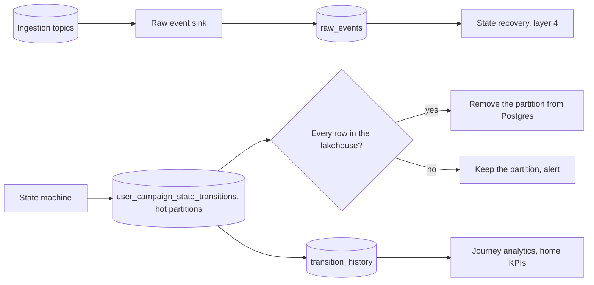

# Lakehouse sink

## Purpose

The pipeline's inputs and its journey history grow without a bound, and Postgres and Kafka hold only the recent part ([decision 0053](../decisions/0053-store-raw-events-transition-history-and-imports-in-an-iceberg-lakehouse.md)). The lakehouse sink copies every raw event and every transition into Iceberg tables on object storage. [State recovery](state-recovery.md) rebuilds Flink state from the raw events, and journey analytics read transition history from the lakehouse instead of the table the state machine writes. Nobody on the decision path reads it.

## Scope

In scope:

- The raw events table: every record of the ingestion topics, unchanged.
- The transitions history table: every row of `user_campaign_state_transitions`, including the rows of partitions that left Postgres.
- The rule that a partition of `user_campaign_state_transitions` leaves Postgres only after the lakehouse holds all of its rows.
- Replay safety, completeness checks, and table maintenance for these tables.

Out of scope:

- The imported records tables. The [import applier](import-applier.md) writes them and the [import metric pass](import-metric-pass.md) reads them, under the same catalog.
- The queries that analytics run. [Home overview](../../features/home-overview.md) and [journey builder](../../features/journey-builder.md#node-analytics) define them.
- Rebuilding state from the raw events. [State recovery](state-recovery.md) does that.
- Choosing the catalog, the query engine, and the deployment. Those are [open questions](#open-questions).

## Terms

| Term | Meaning |
|---|---|
| Lakehouse | Data files on object storage, read and written as Iceberg tables through one catalog. |
| Catalog | The service that names each table and holds a pointer to its current snapshot. A commit swaps the pointer atomically. |
| Snapshot | One committed version of a table. A reader sees one snapshot at a time. |
| Raw event | One record of an ingestion topic, as the topic holds it: its topic, partition, offset, key, value, and the topic's timestamp. |
| Ingestion topics | `snowplow-good`, `snowplow-bad`, `ingestion-api-events`, and `business-events`. |
| Hot partition | A time partition of `user_campaign_state_transitions` that is still in Postgres. |
| Move | Copy a hot partition's rows to the transitions history table, check them, and then remove the partition from Postgres. |
| Snapshot expiry | Removing old snapshots, and the data files that only they reference. |

## Behavior

At 10:00:05 the collector writes a tracker hit to `snowplow-good` partition 2 at offset 88,410. Within one commit interval, the raw events table holds one row for (`snowplow-good`, 2, 88410) with the hit's bytes. If the sink restarts and reads the offset again, the table still holds one row.

At 10:00:07 the state machine completes `n1_view` for one entry. The transition row is in `user_campaign_state_transitions`, in the partition of its event time. It reaches the transitions history table by the path the [open question](#open-questions) on freshness decides. Weeks later, once the partition is older than the Postgres retention, the move copies the partition, finds the same row count and key set in the lakehouse, and only then removes the partition from Postgres.

## Algorithm

### Write raw events

1. Read every ingestion topic from its saved offsets.
2. For each record, write a row keyed by (`topic`, `partition`, `offset`).
3. Commit to the table when the job completes a checkpoint, so that a commit holds exactly the records read up to that checkpoint.
4. On a restart, resume from the checkpoint's offsets. A record already committed has the same key, so it is not written again.

### Move a hot partition

1. Pick the oldest hot partition whose whole time range is older than the Postgres retention.
2. Copy its rows to the transitions history table, keyed by the transitions table's key and event time. A row the table already holds is not written again.
3. Count the partition's rows and the history rows in the same range, and compare the key sets.
4. If they match, remove the partition from Postgres as one unit, never row by row. If not, keep it, count the mismatch, and alert.

A move run twice converges. Step 2 writes nothing new, and step 4 finds the partition gone.

## Functional requirements

| Id | Requirement |
|---|---|
| LKH-FR-01 | The sink must write every record of every ingestion topic to `raw_events`, with its topic, partition, offset, key, value, and topic timestamp, unchanged. |
| LKH-FR-02 | `raw_events` must hold at most one row per (`topic`, `partition`, `offset`). A replay after a restart must write no second row. The sink must not generate ids. |
| LKH-FR-03 | A commit to a lakehouse table must make a whole set of rows visible at once. A reader must never see part of a commit. |
| LKH-FR-04 | Every row written to `user_campaign_state_transitions` must reach `transition_history`, with every column the transitions table holds. |
| LKH-FR-05 | `transition_history` must hold at most one row per transition key: (`canon_id`, `campaign_id`, `entry_id`, `node_id`, `branch`). A replay or a second move must write no second row. |
| LKH-FR-06 | A hot partition must leave Postgres only after `transition_history` holds every row of it, checked by row count and key set. A partition that fails the check must stay in Postgres. |
| LKH-FR-07 | A partition must leave Postgres as one unit. Removing it must not delete rows one by one, so that it writes no per-row WAL and publishes no row change on any CDC publication. |
| LKH-FR-08 | Once [state recovery](state-recovery.md) or [data import](../../features/data-import.md#privacy) deletes a row from a lakehouse table, no snapshot that still references the deleted data may be kept longer than the bound of DIM-NFR-08. Snapshot expiry must remove the files that only those snapshots reference. |
| LKH-FR-09 | The sink must not be on the decision path. A sink that is down or behind must not delay any job that writes Postgres or Kafka. |
| LKH-FR-10 | The sink must expose, per table, the newest committed position: the topic offsets for `raw_events`, and the newest event time for `transition_history`. |

## Non-functional requirements

| Id | Requirement |
|---|---|
| LKH-NFR-01 | `raw_events` must keep every record at least as long as [state recovery](state-recovery.md) needs to rebuild the longest-lived state. The bound is an [open question](#open-questions). |
| LKH-NFR-02 | The sink must keep up with the target load of [platform capacity](../capacity.md#non-functional-requirements): 500 events per second sustained, and 2,000 per second for 10 minutes, with its consumer lag back to normal after the burst. |
| LKH-NFR-03 | The sink must commit raw events at least once per checkpoint of its job. The lag from the topic to a committed row must stay under the commit interval plus one checkpoint duration. |
| LKH-NFR-04 | The tables must be compacted so that a read of one day of one table opens a bounded number of files. The bound and the schedule follow the table layout, an [open question](#open-questions). |
| LKH-NFR-05 | The lakehouse must write nothing to the main Postgres's WAL except the removal of a hot partition, which is a catalog change, not a row change. |

## Interfaces

| Direction | Interface | Contract |
|---|---|---|
| In | Kafka `snowplow-good`, `snowplow-bad` | Collector records, no key. See [event ingestion](event-ingestion.md). |
| In | Kafka `ingestion-api-events`, `business-events` | The data ingestion API's records. See [data ingestion API](../../features/data-ingestion-api.md). |
| In | `user_campaign_state_transitions` | Completed nodes. See [journey execution](journey-execution.md#interfaces) and [the data model](../data-model.md). |
| Out | Lakehouse `raw_events` | `topic`, `partition`, `offset`, `key`, `value` (bytes), `topic_timestamp`, `ingested_at`. Key (`topic`, `partition`, `offset`). |
| Out | Lakehouse `transition_history` | Every column of `user_campaign_state_transitions`. Key (`canon_id`, `campaign_id`, `entry_id`, `node_id`, `branch`). |
| Read by | [State recovery](state-recovery.md) | `raw_events`, for a rebuild |
| Read by | [Home overview](../../features/home-overview.md), [journey builder](../../features/journey-builder.md#node-analytics) | `transition_history`, for analytics |

The table names are the target names. The catalog's namespace for them, and their partitioning, are open.

## Failure handling

| Case | Behavior |
|---|---|
| The sink restarts | It resumes from its last checkpoint. Records committed before it are not written again (LKH-FR-02). |
| A commit fails | The job fails the checkpoint and retries. Nothing from the failed commit is visible. |
| Object storage or the catalog is unreachable | The sink stops committing and its consumer lag grows. No other job waits on it (LKH-FR-09). Kafka keeps the records for its retention ([CAP-NFR-10](../capacity.md#non-functional-requirements)), so an outage shorter than that loses nothing. |
| An outage longer than Kafka's retention | Records past the retention are lost from `raw_events`. The sink counts the gap by offset and alerts. |
| A move finds a mismatch | The partition stays in Postgres, the mismatch is counted, and an operator is alerted (LKH-FR-06). |
| A transition arrives for a partition that already left Postgres | See the [open question](#open-questions) on late transitions. It must not be lost. |
| A record that is not valid in its topic's format | Write it unchanged. Validation is event ingestion's job, and the raw table keeps what the topic held. |

## Acceptance criteria

- Given a record at (`snowplow-good`, 2, 88410), when the sink commits, then `raw_events` holds one row with that key and the record's bytes. (LKH-FR-01)
- Given the sink restarted from a checkpoint before offset 88410 and read it again, then `raw_events` still holds one row for it. (LKH-FR-02)
- Given a commit of 1,000 rows, when a reader reads during the commit, then it sees 0 or 1,000 of them. (LKH-FR-03)
- Given a transition row written to `user_campaign_state_transitions`, then `transition_history` holds a row with the same key and the same column values. (LKH-FR-04)
- Given a move run twice for the same partition, then `transition_history` holds each row once. (LKH-FR-05)
- Given a hot partition of 10,000 rows and a history range of 9,999, when the move runs, then the partition stays in Postgres and the mismatch is counted. (LKH-FR-06)
- Given a partition that left Postgres, then no row change for it appeared on `outbox_transitions_pub`, and the WAL written by the removal is not proportional to its rows. (LKH-FR-07, LKH-NFR-05)
- Given a person's rows deleted from a lakehouse table, when the bound of DIM-NFR-08 has passed, then no kept snapshot references a file that holds them. (LKH-FR-08)
- Given the sink stopped for one hour, then the state machine's transition write rate and customer decision's lag are unchanged. (LKH-FR-09)
- Given the target load test, then the sink's lag returns to normal after the burst, as the other consumers' must. (LKH-NFR-02)

## Open questions

- **Who reads lakehouse analytics, and how fresh.** Studio dashboards that expect seconds, or analysts who accept minutes? The answer decides whether transitions reach `transition_history` by a stream, at checkpoint commits, or only by the move, and which query engine studio uses. Until it is answered, analytics keep reading the hot table.
- **The query engine.** It follows from the readers and the freshness.
- **The catalog, table layout, and partitioning.** Glue or S3 Tables against a REST catalog. How each table is partitioned, and the compaction bound of LKH-NFR-04.
- **Postgres retention of transitions.** How long a hot partition stays before it moves. It must at least cover the longest watch limit, so that a timer flow that starts without its saved position still finds the parent transition of every pending watch ([journey execution](journey-execution.md#open-questions)).
- **Late transitions.** A transition whose event time falls in a partition that already left Postgres, such as a watch timeout after a long timer outage. Does it go to a default partition, or straight to `transition_history`?
- **Raw event retention.** How long `raw_events` keeps records (LKH-NFR-01). The longest-lived state sets the floor: journey state lives 90 days after its last change (JEX-NFR-03), and segment flags never expire.
- **Personal data in raw events.** Raw events hold tracked identifiers. Whether a person's deletion must reach `raw_events`, and how a rebuild then treats the gap, is undecided.

## Related

- [0053. Store raw events, transition history, and imports in an Iceberg lakehouse](../decisions/0053-store-raw-events-transition-history-and-imports-in-an-iceberg-lakehouse.md)
- [0052. Keep hot state in Flink and a redesigned projection in Postgres](../decisions/0052-keep-hot-state-in-flink-and-a-redesigned-projection-in-postgres.md)
- [0054. Recover Flink state in four layers](../decisions/0054-recover-flink-state-in-four-layers.md)
- [State recovery](state-recovery.md)
- [Journey execution](journey-execution.md)
- [Known issues](../../known-issues/components/lakehouse.md)
