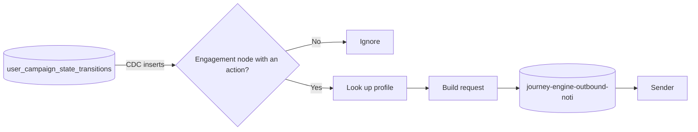

# Notification outbox

## Purpose

The marketer puts a message on an engagement node, for example a push titled "Still thinking about it?". When [journey execution](journey-execution.md) completes that node for a person, the outbox publishes a notification request on `journey-engine-outbound-noti`. The request holds everything a sender needs: the channel, the content, the person's contact profile, and the journey context for template variables. A sender outside this repo delivers it.

## Scope

In scope:

- Reading completed engagement nodes from `user_campaign_state_transitions`.
- Adding the person's profile.
- Publishing the notification request.

Out of scope:

- Delivering the message, rendering templates, retries at the channel, and opt-outs. A sender outside this repository owns those. It consumes `journey-engine-outbound-noti`.
- Watch timers. They run in the same job but belong to [journey execution](journey-execution.md#watch-timers).

## Terms

| Term | Meaning |
|---|---|
| Engagement node | A node that sends a message on a channel. |
| Action | The engagement node's channel and content, saved in `action_json`. |
| Notification request | The message this feature publishes. |
| Execution id | The id of one notification request and its idempotency key: campaign, node, `canon_id`, and entry id. The same transition always gives the same execution id, and two entries of one person give two. See [decision 0033](../decisions/0033-a-journey-instance-is-one-entry.md). |
| Sender | The service that consumes requests and delivers them. Not in this repo. |

## Behavior



Example. `n5_sms` completes for `canon_id` `7e9d...` in `CAMP-0001`. The outbox reads the person's profile, then publishes:

```json
{
	"schema_version": "1.0",
	"metadata": {
		"campaign_id": "CAMP-0001",
		"node_id": "n5_sms",
		"execution_id": "CAMP-0001_n5_sms_7e9d..._first",
		"generated_at": "2026-10-13T09:13:02Z"
	},
	"channel": "sms",
	"content": {
		"body": "Your cart is waiting. Free shipping if you check out in 2 hours."
	},
	"profile": {
		"user_id": "0912345678",
		"domain_user_id": "a1b2c3",
		"customer_name": "Nguyen Van A",
		"first_name": "A",
		"pronoun": "anh",
		"gender": "male",
		"phone": "0912345678",
		"email": "a@example.com"
	},
	"context": {
		"event.name": "add_to_cart",
		"product.price": "12990000"
	}
}
```

## Functional requirements

| Id | Requirement |
|---|---|
| OUT-FR-01 | The outbox must publish one request for each new transition whose node type is `engagement` and whose action is present. |
| OUT-FR-02 | The request must carry the channel and the content from the node's action: title, body, subject, URL, template id, and payload, as the channel uses them. For a `webhook` channel, the content must also carry the node's HTTP method: `GET`, `POST`, `PUT`, `PATCH`, or `DELETE`, in uppercase. A webhook node without a method publishes `POST`. A webhook node with any other method has an action that does not parse. |
| OUT-FR-03 | The request must carry the person's profile, matched on `cdp_uuid` by the `user_id`, else by the `user_id` of the newest `identity_graph` row of the person's `canon_id` that has one, else no profile. A blank `user_id` is none. No profile is an empty profile. The customer decision job looks profiles up by the same rule. |
| OUT-FR-04 | The request must carry the transition's context, so that a sender can render template variables without a lookup. |
| OUT-FR-05 | `execution_id` must be the same for every publish of the same transition, so that a sender can deduplicate. It is derived from the transition's campaign, node, and `canon_id`, never from a random value or the publish time. |
| OUT-FR-06 | `generated_at` must be the transition's event time, in ISO 8601 UTC. |
| OUT-FR-07 | Null fields must be left out of the request. |
| OUT-FR-08 | A failed profile lookup must not stop the outbox. The request is published without contact fields. Its `profile` keeps the transition's `user_id` and `domain_user_id`, so that a `web_push` sender can still reach the browser. This was chosen while fixing the code, and is pending owner review. |

## Non-functional requirements

| Id | Requirement |
|---|---|
| OUT-NFR-01 | Delivery is at least once. A replay publishes the requests since the last checkpoint again. A start without the CDC source's saved log position reads a snapshot of `user_campaign_state_transitions` and publishes a request again for every engagement transition in it, however old. The sender must deduplicate on `execution_id` across all the requests it has ever received, not within a time window. This holds only while a node completes at most once per person. If a journey may ever run again for the same person (see the open question in [journey execution](journey-execution.md#open-questions)), the key must change. |
| OUT-NFR-02 | The outbox and the timer flow can be switched on and off separately. |
| OUT-NFR-03 | Profile lookups may read a replica. |

## Interfaces

| Direction | Interface | Contract |
|---|---|---|
| In | CDC `user_campaign_state_transitions` | New transition rows, through publication `outbox_transitions_pub` |
| In | `customer_profiles` | Profile, by `cdp_uuid`. Owned by another system. |
| In | `identity_graph` | The `user_id` of the person's `canon_id`, for a transition without one |
| Out | Kafka `journey-engine-outbound-noti` | Notification request, no key |

The channels are `push`, `web_push`, `sms`, `email`, `facebook`, `whatsapp`, and `webhook`. Studio offers no Zalo for now, as the owner decided on 2026-11-08. An action saved earlier with `zalo` still produces a request with `channel` `zalo`. The [journey builder](../../features/journey-builder.md#node-types) defines the content fields of each.

The request's `content` holds the action's `title`, `body`, `subject`, `url`, `template_id`, and `payload`. A field the action leaves empty is left out. `payload` is the JSON value the marketer saved, unchanged.

The request carries no fixed destination. The sender reaches the person through `profile`, for example `profile.phone` for SMS. The owner decided this on 2026-10-18: a fixed number on the node would bypass the person's consent and send one message to that number for every person who reaches the node. The [journey builder](../../features/journey-builder.md#node-types) has no phone field. An action saved by an older build may still hold a `phone`, and the request leaves it out.

A webhook request's `content` also holds `method`. The node saves it in any case, and the request carries it in uppercase:

```json
{
	"channel": "webhook",
	"content": {
		"url": "https://example.com/webhook",
		"payload": {"event": "campaign_triggered"},
		"method": "PUT"
	}
}
```

The request's `context` is the transition's context, as a JSON object.

## Failure handling

| Case | Behavior |
|---|---|
| Transition is not an engagement node | Ignore it. |
| Engagement node without an action | Ignore it. |
| Action does not parse, for example a webhook with method `FETCH` | Log it and publish nothing. |
| Profile lookup fails or times out | Publish without contact fields. `profile` holds only the transition's `user_id` and `domain_user_id`, which keeps `web_push` deliverable. |
| Request cannot be built after the profile lookup | Log it and publish nothing. Failing would restart the job on the same transition after every replay. |
| Transition context is not a JSON object | Log it and publish without `context`. |
| Restart from a checkpoint or savepoint | The CDC source resumes from its saved log position. Requests since that checkpoint may publish again. The sender deduplicates. This holds within the CDC restore window of [journey execution](journey-execution.md#non-functional-requirements) (JEX-NFR-10): 10 completed checkpoints of any one run after the restored one, about 10 minutes at the default interval. Past it, the transitions written between the checkpoint and the position the slot still holds are skipped. The run that read them published their requests, but the restored timer flow starts no watch for them. |
| Start without the CDC source's saved log position | The source reads a snapshot of the whole table. Every engagement transition in it publishes again. The sender deduplicates on `execution_id` across all history. A change to the job graph keeps the source's saved position. |

## Acceptance criteria

- Given a new `engagement` transition with an SMS action, then one request with `channel` `sms` and the action's body is published. (OUT-FR-01, OUT-FR-02)
- Given a new `end` transition, then nothing is published. (OUT-FR-01)
- Given a webhook action with method `put`, then the request's content has `method` `PUT`. Given one without a method, then `method` is `POST`. (OUT-FR-02)
- Given a webhook action with method `FETCH`, then nothing is published. (OUT-FR-02)
- Given an SMS action saved by an older build with a `phone`, then the request's content has no `phone`, and its `profile` holds the person's phone. (OUT-FR-02, OUT-FR-03)
- Given a transition with a `user_id`, then the profile is the one whose `cdp_uuid` is that `user_id`. (OUT-FR-03)
- Given a transition without a `user_id`, whose `canon_id` has a `user_id` in `identity_graph`, then the profile is the one whose `cdp_uuid` is that `user_id`. (OUT-FR-03)
- Given a transition without a `user_id`, whose `canon_id` has none in `identity_graph`, then the request carries an empty profile. (OUT-FR-03)
- Given a profile without an email, then the request's `profile` has no `email` key. (OUT-FR-07)
- Given the same transition read twice, then both requests have the same `execution_id`. (OUT-FR-05)
- Given the job starts without its saved log position, then a request is published again for every past engagement transition, each with the `execution_id` it had before. (OUT-NFR-01)
- Given the profile database is down, then a request is published without contact fields: its `profile` holds only `user_id` and `domain_user_id`. (OUT-FR-08)
- Given a transition with context `{"product.price": "12990000"}`, then the request's `context` holds it. (OUT-FR-04)

## Open questions

- Should a request whose profile lookup failed keep the transition's `user_id` and `domain_user_id`? OUT-FR-08 says yes, so that `web_push` stays deliverable. The alternative is to leave out `profile`. This was chosen while fixing the code, and is pending owner review.
- Should `generated_at` be the event time of the transition or the time the request is published?
- Which content fields does each channel require, and should the outbox reject an action that lacks them?

## Related

- [Journey execution](journey-execution.md)
- [Journey builder](../../features/journey-builder.md)
- [0006. At-least-once delivery with idempotent writes](../decisions/0006-at-least-once-delivery-with-idempotent-writes.md)
- [Known issues](../../known-issues/components/notification-outbox.md)
