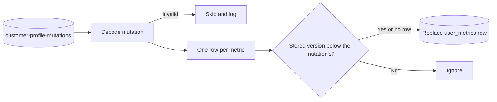

# Profile writer

## Purpose

[Customer decision](customer-decision.md) keeps each person's metric series in Flink state, which expires and is lost on a fresh start. The profile writer copies every change into the `user_metrics` table. The decision job reads the table when its state has no entry for a series, and analysts query it with SQL. The table may lag the live state by seconds. It is not on the decision path. See [decision 0005](../decisions/0005-keep-live-state-in-flink.md).

The writer also stores the current members of each segment in `segment_members`, from the membership changes customer decision publishes, so that studio can show a segment's size. See [Segment membership](#segment-membership).

## Scope

In scope:

- Reading mutations from `customer-profile-mutations`.
- Replacing each stored series with the one in the mutation, in order.
- Reading membership changes from `segment-membership-changes`, and keeping `segment_members` equal to the current tracked members.

Out of scope:

- Computing metrics. Customer decision does that.
- Profile attributes such as name and city. Those live in `customer_profiles`, which another system owns.
- Deciding membership. Customer decision does that. Customers known only from imports are stored by the [segment membership pass](segment-membership-pass.md), in another table.

## Terms

| Term | Meaning |
|---|---|
| Mutation | A message with the full series that one event changed for one person. See [customer decision](customer-decision.md#interfaces). |
| Series | A person's buckets for one metric, with its series clock. See [customer decision](customer-decision.md#buckets). |
| Behavior version | A per-person counter on each mutation that only increases. It orders mutations. |
| Row | One `user_metrics` row per `canon_id` and `metric_id`. |
| Membership change | A message that one person entered or exited one segment. See [customer decision](customer-decision.md#interfaces). |
| Member row | One `segment_members` row per `segment_id` and `canon_id`, for a person who is in the segment. |

## Behavior

A mutation for `customer-42` with behavior version 18 carries the series for `m_purchase_count` and `m_view_product_count`. The writer replaces the two rows for `customer-42`, and stores 18 as each row's `last_behavior_version`. If the same mutation arrives again, the rows do not change. If a mutation with version 17 arrives after it, the writer ignores it.

## Algorithm

For each metric in a mutation:

1. Build a row: `canon_id`, `metric_id`, the series clock, and the buckets, exactly as the mutation carries them.
2. Write the row with an upsert on (`canon_id`, `metric_id`). Replace the stored row only if its `last_behavior_version` is lower than the mutation's behavior version, or no row exists.

### Segment membership

This sink comes online once customer decision publishes membership changes. Studio shows segment size only after it runs on the cluster.

The writer reads `segment-membership-changes`, which is keyed by `canon_id`. All of one person's changes share a partition, so the writer reads one person's changes in the order customer decision published them. Inside the job, the writer keys the stream by `canon_id` before its sink, so one subtask writes every row of a person ([decision 0002](../decisions/0002-key-every-write-by-its-owner.md)). For each change, in order:

1. **`entered`.** Upsert the row (`segment_id`, `canon_id`) with `since` set to the change's `event_time`. Write nothing when the row exists with that `since`, so a repeated change from [customer decision](customer-decision.md#track-segment-membership) costs no WAL.
2. **`exited`.** Delete the row (`segment_id`, `canon_id`). Deleting a row that does not exist changes nothing.

A deleted segment's rows go the same way. Customer decision publishes `exited` for each of its members when it reads the delete, as [customer decision](customer-decision.md#track-segment-membership) says, and the writer deletes each row.

A replay delivers the same changes in the same order for each person and segment, so the table converges on the same rows. The writer generates no id.

The writer reads the changes no faster than the cap of PRW-NFR-06, so a backlog, such as the rollout of flags, waits in the topic and not in the database.

## Functional requirements

| Id | Requirement |
|---|---|
| PRW-FR-01 | The writer must store each metric of a mutation as one row keyed by `canon_id` and `metric_id`. |
| PRW-FR-02 | The row must hold the mutation's whole series, replacing the stored series. |
| PRW-FR-03 | The writer must not replace a row whose `last_behavior_version` is equal to or higher than the mutation's. |
| PRW-FR-04 | The row must store the series clock and every bucket unchanged, including the summaries the writer cannot read. |
| PRW-FR-05 | Writing the same mutation twice must leave the same row as writing it once. The writer must not generate ids. |
| PRW-FR-06 | A mutation that does not decode, or a row that the database rejects, must not stop the writer. The writer logs it and continues. |
| PRW-FR-07 | Two mutations for the same row in one batch must not fail the batch. The batch writes the row that writing them one after the other would leave. |
| PRW-FR-08 | Once customer decision publishes membership changes, the writer must keep one `segment_members` row per person and segment for each person whose latest change for that segment is `entered`, and no row for one whose latest change is `exited`. |
| PRW-FR-09 | The writer must key membership changes by `canon_id` before the sink, and must apply one person's changes for one segment in the order it reads them. Two changes for the same row in one batch must leave the row that applying them one after the other would leave. |
| PRW-FR-10 | Applying the same membership changes again, in the same order, must leave the same rows. An `exited` change for a row that does not exist must not fail. |
| PRW-FR-11 | The writer must be the only writer of `segment_members`. |
| PRW-FR-12 | The membership sink must run on the cluster before customer decision publishes membership changes, so that it reads the rollout of flags from the topic. An `entered` change for a row that already holds its `since` must write nothing and take no row lock. That rules out an upsert that locks the row when it changes nothing. Skip the row after a read, or use an update that matches no row when `since` is unchanged. |

## Non-functional requirements

| Id | Requirement |
|---|---|
| PRW-NFR-01 | The writer reads the topic at least once. Without a savepoint it starts from the earliest offset, so the table converges on the latest state. |
| PRW-NFR-02 | Rows lag the mutations by at most one flush: 100 rows or 500 ms, whichever comes first. |
| PRW-NFR-03 | A failed batch is retried 3 times. |
| PRW-NFR-04 | The `customer-profile-mutations` topic is transport, not storage. Its retention can be short. |
| PRW-NFR-05 | `segment_members` joins no CDC publication. Rows lag the membership changes by at most one flush, as PRW-NFR-02 says for `user_metrics`, except while PRW-NFR-06 holds a backlog back. |
| PRW-NFR-06 | The membership sink writes at most 1,000 rows a second, about 1 MB/s of WAL, and the limit is configurable. It paces the backlog after the first rollout of flags. This is the lead's default, pending owner review. See [decision 0038](../decisions/0038-store-segment-membership-and-evaluate-every-segment.md#why). |

## Interfaces

| Direction | Interface | Contract |
|---|---|---|
| In | Kafka `customer-profile-mutations` | Mutation, key `canon_id`. See [customer decision](customer-decision.md#interfaces). |
| Out | `user_metrics` | One row per (`canon_id`, `metric_id`): `series_clock`, `buckets` as JSON in the mutation's shape, `last_behavior_version`, `updated_at`. See [the data model](../data-model.md). |
| In | Kafka `segment-membership-changes` | Membership change: `canon_id`, `segment_id`, `entered` or `exited`, the `event_id` that caused it, and the event time. Key `canon_id`. See [customer decision](customer-decision.md#interfaces). |
| Out | `segment_members` | One row per current member: `segment_id`, `canon_id`, and `since`, the event time of the `entered` change. Primary key (`segment_id`, `canon_id`). See [the data model](../data-model.md). |

The writer ignores mutation fields it does not know, so customer decision can add a field before the writer is upgraded.

The table has no event context JSON. Each row holds at most the buckets that customer decision allows a series (DEC-NFR-02).

## Failure handling

| Case | Behavior |
|---|---|
| Mutation does not decode | Skip it and log it. |
| Mutation has a field the writer does not know | Ignore the field and write the rows. |
| Metric has no `valueType`, or one the writer does not know | Skip that row and log it. |
| A bucket without `size`, `start`, or `count`, or with a `size` the writer does not know | Skip that row and log it. |
| A row the database rejects for its data | Skip that row, log it, and count it. The writer keeps running. |
| Older behavior version | Ignore the row. |
| Duplicate mutation | Ignore the row, because its version is not higher. |
| Restart | Replay from the last checkpoint, or from the earliest offset without one. |
| Membership change does not decode, has no `canon_id` or `segment_id`, has a change other than `entered` or `exited`, or is an `entered` change with no `event_time` | Skip it and log it. |
| Membership change the database rejects, such as a `segment_id` that is not a segment id | Skip it, log it, and count it. The writer keeps running. |
| Duplicate membership change | Apply it again. The row ends as it was. |
| `exited` for a row that does not exist | Do nothing. |

## Acceptance criteria

- Given an empty table, when a mutation with version 18 and two metrics arrives, then two rows exist with `last_behavior_version` 18. (PRW-FR-01)
- Given a row at version 18, when the same mutation arrives again, then the row is unchanged. (PRW-FR-03, PRW-FR-05)
- Given a row at version 18, when a mutation with version 17 arrives, then the row is unchanged. (PRW-FR-03)
- Given a series of 3 buckets, one with a `distinct` summary, then the row's `buckets` equal the mutation's, summary included. (PRW-FR-04)
- Given versions 19 and 20 for the same row in one batch, then the batch succeeds and the row holds version 20. (PRW-FR-07)
- Given versions 20 and 19 for the same row in one batch, in that order, then the batch succeeds and the row holds version 20. (PRW-FR-03, PRW-FR-07)
- Given a mutation with a field the writer does not know, then the writer stores its rows. (PRW-FR-06)
- Given a message that is not JSON, then the writer keeps running. (PRW-FR-06)
- Given a mutation whose metric_id has no definition, then the writer skips that row, counts it, and keeps writing the others. (PRW-FR-06)
- Given an empty `segment_members`, when an `entered` change for `customer-42` and `SEG-3f9a0c1d7e2b4a65` arrives, then one row exists for the pair with `since` equal to the change's `event_time`. When an `exited` change for the pair follows, then no row exists. (PRW-FR-08)
- Given `entered` and then `exited` for the same pair in one batch, then the batch succeeds and no row exists. Given `exited` and then `entered`, then the row exists. (PRW-FR-09)
- Given the changes `entered`, `exited`, `entered` for a pair, when the writer restores from a checkpoint taken after the first and reads the last two again, then the table holds the row once, with the last change's `since`. (PRW-FR-10)
- Given an `exited` change for a pair with no row, then the writer keeps running and writes nothing. (PRW-FR-10)
- Given a row with `since` 10:00 and an `entered` change for the pair with `event_time` 10:00, then the writer writes nothing. With `event_time` 11:00, it sets `since` to 11:00. (PRW-FR-12)
- Given the sink running on the cluster and customer decision rolled out with flags, when the rollout's changes arrive, then the sink reads every one of them, and each segment's `segment_members` count equals the number of its flags that are in. (PRW-FR-12, PRW-FR-08)

## Related

- [Customer decision](customer-decision.md)
- [Segment membership pass](segment-membership-pass.md)
- [0038. Store segment membership and evaluate every segment](../decisions/0038-store-segment-membership-and-evaluate-every-segment.md)
- [0002. Key every write by its owner](../decisions/0002-key-every-write-by-its-owner.md)
- [0005. Keep live state in Flink and a durable copy in Postgres](../decisions/0005-keep-live-state-in-flink.md)
- [0028. Store metrics as tiered time buckets](../decisions/0028-store-metrics-as-tiered-time-buckets.md)
- [0006. At-least-once delivery with idempotent writes](../decisions/0006-at-least-once-delivery-with-idempotent-writes.md)
- [Known issues](../../known-issues/components/profile-writer.md)
