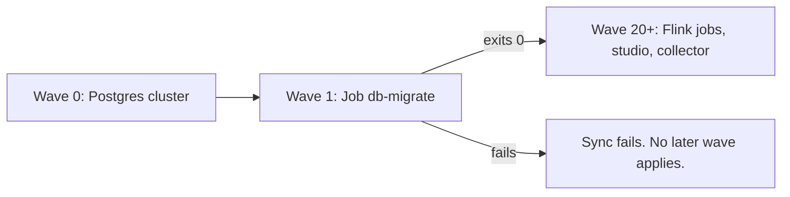

# Schema migrations

## Purpose

Studio and the Flink jobs read and write the main Postgres database, `auroracy` on the cluster `cdp-pg`. This component brings that database's schema to the version the release needs, on every rollout, before any app of the release starts. A developer ships a schema change by adding a migration file to the release. Nobody runs DDL by hand, and every object stays owned by the role the apps use.

## Scope

In scope:

- The schema of the main Postgres database: tables, views, indexes, sequences, functions, and publications in schema `public`.
- When migrations run, in what order, and as which role.
- The rules each migration must follow so that the previous release keeps working while the new one rolls out.

Out of scope:

- The import store `cdp-import-pg`. It keeps its own DDL ([decision 0040](../decisions/0040-import-through-a-batch-path-and-a-separate-store.md)).
- `customer_profiles`. Another system owns it in production, and the AWS Free Plan environment creates it separately ([AWS Free Plan](../../operations/aws-free-plan.md), AFP-FR-22).
- Data the apps write. A migration may move data only as part of a schema change.
- Replication slots. Each CDC source creates its own ([data model](../data-model.md#publications-for-cdc)).

## Terms

| Term | Meaning |
|---|---|
| Migration | One SQL file in `infra/db/migrations` with a version and a description, applied once to a database. |
| Version | The four-digit number in a migration's name. Migrations apply in increasing version. |
| History | The table `flyway_schema_history`. One row per applied migration, with its version, checksum, and result. |
| Baseline | A history row of type `BASELINE` at version 1. It marks a database that held the version 1 schema before the history existed. |
| Checksum | A number computed from a migration's content and stored in its history row when it applies. |
| Run | One execution of every pending migration, by the Job `db-migrate`. |
| Pending | A migration whose version is above the highest version in the history. |
| Apps' role | `cdp`, the database role studio and the Flink jobs connect as. |
| Expand | A change the previous release's code tolerates: a new table, a new nullable column, a new column with a constant default, a new index. |
| Contract | A change that breaks code reading the old shape: a dropped or renamed column or table, a type change, `NOT NULL` on an existing column. |
| Readable schema | The commented SQL in `infra/db` that describes the current schema in one file. Tests and the local reset read it. |

## Behavior

A developer adds the column `campaigns.archived_at` in release R2. They add `V0007__campaigns_archived_at.sql` with one statement, `ALTER TABLE campaigns ADD COLUMN archived_at timestamptz;`, list it in the package, and add the same column to the readable schema.

The merge to the deploy branch starts an Argo CD sync:

1. Wave 0 applies the Postgres cluster. Nothing changes there.
2. Wave 1 creates the Job `db-migrate` again. It connects as `cdp`, checks that `cdp` owns every object, validates the checksums of versions 1 to 6, applies version 7 in one transaction, and exits 0. The history gains a row for version 7.
3. Argo CD sees the Job complete and applies the later waves. From wave 20 on, the Flink jobs and studio roll to R2.

While the jobs roll, R1 pods still run. They never read `archived_at`, so they work. If version 7 had failed, the Job would exit non-zero, the sync would fail at wave 1, and R1 would keep running on the unchanged schema.

## Algorithm

The input is the database and the migration files in the ConfigMap `db-migrations`.

1. Connect as the apps' role. Retry the connection every 10 seconds, up to 30 times.
2. Set `lock_timeout` to 5 seconds and `statement_timeout` to 15 minutes on the session.
3. Check ownership. If any table, view, materialized view, sequence, or function in `public`, or any publication, is owned by a role other than the apps' role, fail. The error names each object, its kind, and its owner.
4. Read the history:
   - If there is no history table and no table in `public`, create the history. Every migration is pending.
   - If there is no history table but `public` holds tables, create the history with a baseline at version 1. Migrations above version 1 are pending.
   - If the history table exists, migrations above its highest version are pending.
5. Validate. For each migration in the history, the file of that version must exist and its checksum must match. A mismatch, or an applied version with no file, fails the run before anything applies.
6. Apply each pending migration in increasing version. A migration whose statements can all run in a transaction runs in one transaction. A migration whose statements cannot run in a transaction runs without one. Write a history row for each.
7. Stop at the first failure and fail the run. A migration that ran in a transaction leaves no change.

The same files bring an empty database and a baselined one to the same schema. The [acceptance criteria](#acceptance-criteria) check it.

Example. The live database was created before migrations, and the release holds versions 1 and 2. Step 4 finds tables and no history, writes a baseline at version 1, and step 6 applies version 2 only. A new cluster with the same release applies versions 1 and 2.

## Functional requirements

| Id | Requirement |
|---|---|
| MIG-FR-01 | Every sync of the deploy branch must start a run after the Postgres cluster is applied and before any app of the release is applied. |
| MIG-FR-02 | A failed run must fail the sync. No app of the release may be applied after a failed run. |
| MIG-FR-03 | A migration's name must be `V<NNNN>__<snake_case>.sql`, four digits and a lowercase description. No two migrations may share a version. |
| MIG-FR-04 | A run must apply pending migrations in increasing version, each at most once, and record each in the history. A migration whose version is below the highest applied version must not apply. |
| MIG-FR-05 | On a database with no history table and no tables, a run must apply every migration from version 1. On a database with no history table that holds the version 1 schema, a run must write a baseline at version 1 and apply only the later migrations. |
| MIG-FR-06 | A run with nothing pending must change neither the schema nor the history. |
| MIG-FR-07 | Migrations are forward only. A migration already on the deploy branch must never be edited, renamed, or deleted. A change to the schema is a new migration. There are no undo migrations. The one exception is a reviewed fix of a migration whose version has no successful row in the history, because it failed. |
| MIG-FR-08 | A run must fail, before it applies anything, when an applied migration's checksum differs from its file. |
| MIG-FR-09 | A run must connect as the apps' role, so that role owns every object a migration creates. |
| MIG-FR-10 | Before every run, including one with nothing pending, the run must fail if a table, view, materialized view, sequence, or function in `public`, or a publication, is owned by another role. The error must name each such object and its owner. |
| MIG-FR-11 | Every migration session must have `lock_timeout` 5 seconds and `statement_timeout` 15 minutes. A transactional migration may raise `statement_timeout` for its own transaction only, and must not raise `lock_timeout`. A non-transactional migration (MIG-FR-12) may raise either for its own statements, and must set both back before it ends. No migration may change a timeout that a later migration in the same run sees. |
| MIG-FR-12 | A migration that holds `CREATE INDEX CONCURRENTLY` or another statement that cannot run in a transaction must hold only such statements, plus the `SET` statements that raise and restore its timeouts (MIG-FR-11). It declares that it runs without a transaction in a script configuration file beside it, and runs without one. Its `lock_timeout` must cover the longest transaction the apps hold open, because the build waits for every older transaction. Every other migration runs in one transaction. |
| MIG-FR-13 | Every migration must keep the previous release's apps working while both releases run. A contract change ships only in a release after the one that stopped reading the old shape. |
| MIG-FR-14 | The readable schema and the migrations must build the same schema from an empty database. A change to one changes the other in the same commit. |
| MIG-FR-15 | A table that a CDC source reads must join its publication and get `REPLICA IDENTITY FULL` in a migration. |
| MIG-FR-16 | The run must read every file in `infra/db/migrations` and no other migration. A file in the folder that the ConfigMap `db-migrations` does not package fails CI. |

## Non-functional requirements

| Id | Requirement |
|---|---|
| MIG-NFR-01 | A migration must write at most about 1 GB of WAL, sized before it ships. Every CDC slot holds the WAL the database writes, and [decision 0039](../decisions/0039-shorten-the-cdc-restore-window.md) caps a slot at 8 GB, above which Postgres invalidates it and CDC stops. A larger change is split across migrations or releases, or planned with the owner. |
| MIG-NFR-02 | No credential may appear in a manifest, a command line, or the run's log. The run reads the database name, user, and password from the cluster's application secret `cdp-pg-app`. |
| MIG-NFR-03 | The run requests 50m CPU and 256 MiB of memory, with a 384 MiB memory limit. It runs at most 30 minutes and at most 3 attempts. |
| MIG-NFR-04 | The run waits for the database at most 5 minutes: 30 attempts, 10 seconds apart. |
| MIG-NFR-05 | The runner's image is pinned by digest. |
| MIG-NFR-06 | The run runs as a non-root user with a read-only root filesystem and no added capabilities. |
| MIG-NFR-07 | The ConfigMap `db-migrations` must stay under the 1 MiB ConfigMap limit. |

## Interfaces

| Interface | Kind | Contract |
|---|---|---|
| `infra/db/migrations` | Folder | One file per migration, named as MIG-FR-03 says, plus the ownership check that runs before each run. |
| `db-migrations` | ConfigMap, name suffixed with a hash of its content | The runner's settings and every file in `infra/db/migrations`. A new hash makes the Job mount the new files. |
| `db-migrate` | Job, Argo CD `Sync` hook, sync wave 1 | One run per sync. Exit 0 lets the sync continue. Any other result fails it. The last run's Job and log stay until the next sync. |
| `flyway_schema_history` | Table in `public`, owned by the apps' role | One row per applied migration: `installed_rank`, `version`, `description`, `type` (`SQL` or `BASELINE`), `script`, `checksum`, `installed_by`, `installed_on`, `execution_time`, `success`. On the database created before migrations, the first row is the baseline: version `1`, type `BASELINE`, description `schema before Flyway`. Only the run writes it. |
| `cdp-pg-app` | Secret | Keys `dbname`, `username`, and `password` of the apps' role. |

The tables themselves are listed in [the data model](../data-model.md).

## Failure handling

- **A migration fails.** A transactional migration rolls back. The Job retries, up to 3 attempts, then fails, and the sync fails. The apps keep the previous release. The failed migration stays pending, so every later sync fails on it too. A migration that never applied on the live database, meaning the history has no successful row for its version, may be edited in a reviewed fix. MIG-FR-07 holds for every version with a successful row.
- **A concurrent index build fails.** It leaves an `INVALID` index and a history row with `success = false`, which CI observes, and every later run fails until both are gone. An operator drops the index and deletes the failed row. After a transient cause the same file runs on the next sync. A wrong file is fixed first.
- **A lock is not granted within 5 seconds.** The statement fails, as above. The next attempt or the next sync tries again.
- **An object owned by another role.** The run fails before it applies anything and names each object. A superuser runs `ALTER ... OWNER TO cdp` on each, over stdin, and the operator syncs again.
- **An edited applied migration.** Validation fails before anything applies. Revert the edit and add a new migration.
- **The database is not up.** The run retries the connection for 5 minutes, then fails.
- **Two syncs at once.** Argo CD runs one sync of an application at a time. The runner also takes a lock in the database, so a second run waits for the first.

## Acceptance criteria

`infra/db/test-migrations.sh` runs in CI as the check `db-migrations`. It uses the Job's own image and command against an empty Postgres 16. The `validate-deploy` workflow checks the rendered manifests.

| Given, when, then | Requirement | Proved by |
|---|---|---|
| Given an empty database, when a run starts, then every migration applies in order with no baseline, and the history ends at the highest version. | MIG-FR-04, MIG-FR-05 | `test-migrations.sh`, "an empty database runs V0001 to V<latest>" |
| Given that run, then every table, view, sequence, and publication is owned by `cdp`. | MIG-FR-09 | `test-migrations.sh`, same case |
| Given a migrated database, when a second run starts, then the history does not change. | MIG-FR-06 | `test-migrations.sh`, same case |
| Given an empty database, when the readable schema is applied to one copy and the migrations to another, then `pg_dump --schema-only` of the two is equal. | MIG-FR-14 | `test-migrations.sh`, "migrations match schema.sql" |
| Given a database holding the version 1 schema and no history, when a run starts, then the history starts with a baseline at 1, the later migrations apply, and the schema equals the readable schema. | MIG-FR-05 | `test-migrations.sh`, "a pre-Flyway database is baselined at 1" |
| Given `journey_drafts` and `journey_publishes` created by `postgres`, when a run starts, then it fails with `objects not owned by cdp: table journey_drafts (owner postgres), table journey_publishes (owner postgres)`. After a superuser hands both to `cdp`, a run succeeds. | MIG-FR-10 | `test-migrations.sh`, "objects owned by another role fail the run" |
| Given an applied version 1, when its file gains a line, then validation and a run both fail. | MIG-FR-08 | `test-migrations.sh`, "a checksum mismatch fails validate and migrate" |
| Given a run, then each migration's session has `lock_timeout` 5s and `statement_timeout` 15min, and a migration that raises `statement_timeout` with `SET LOCAL` leaves the next migration at 15min. | MIG-FR-11 | `test-migrations.sh`, "lock_timeout 5s and statement_timeout 15min" |
| Given a concurrent index migration that raises `lock_timeout` and sets it back, when a 12 second transaction is open, then the build waits past 5 seconds, applies, and the next migration in the run sees 5s. | MIG-FR-11, MIG-FR-12 | `test-migrations.sh`, "a concurrent index with its own lock_timeout" |
| Given a pull request, when a migration on its base branch is edited, renamed, or deleted, then CI fails. | MIG-FR-07 | `test-migrations.sh` with `BASE_REF`, lint |
| Given a migration that builds an index concurrently, then it applies without waiting on the runner's own lock. Given one that fails, then an `INVALID` index remains, and after the index and any failed history row are dropped, a fixed file applies. | MIG-FR-12, MIG-FR-07 | `test-migrations.sh`, concurrent index case |
| Given a migration named outside the pattern, two migrations with one version, or a file with CR bytes, then CI fails. | MIG-FR-03 | `test-migrations.sh`, lint |
| Given a file in `infra/db/migrations` that the ConfigMap does not list, then CI fails. | MIG-FR-16 | `test-migrations.sh`, lint |
| Given the runner's image without a digest, then CI fails. | MIG-NFR-05 | `test-migrations.sh`, lint |
| Given the rendered manifests, then the Job `db-migrate` mounts the generated `db-migrations-<hash>` ConfigMap holding version 1, is a `Sync` hook, and its wave is below the lowest app wave. | MIG-FR-01, MIG-FR-16 | `validate-deploy`, "Check the migration Job's wiring" |

These requirements have no automated check. A reviewer checks them on each migration. They are MIG-FR-02 (Argo CD's hook behavior), MIG-FR-13, MIG-FR-15, MIG-NFR-01, MIG-NFR-02, MIG-NFR-03, MIG-NFR-04, MIG-NFR-06, and MIG-NFR-07.

## Open questions

- Should the `GRANT SELECT ON cdc_heartbeat TO pg_monitor` that the AWS Free Plan environment runs separately become a migration?

## Related

- [Decision 0043](../decisions/0043-apply-schema-changes-as-migrations-on-every-sync.md) says why Flyway, a `Sync` hook in wave 1, the baseline, and the readable schema
- [Decision 0039](../decisions/0039-shorten-the-cdc-restore-window.md) sets the 8 GB slot cap
- [Data model](../data-model.md)
- [Deployment: schema migrations on every sync](../../operations/deployment.md#schema-migrations-on-every-sync)
- The [known issues](../../known-issues/components/schema-migrations.md) for the current implementation
- The `db-migration` skill in `.agents/skills/` for writing a migration
