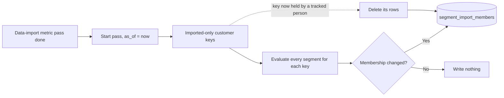

# Segment membership pass

## Purpose

Data import brings customers who exist only as imported rows. Each is a customer key with attributes in `customer_attributes` and no tracked person. They send no events, so [customer decision](customer-decision.md#track-segment-membership) never evaluates them. Once a night, the segment membership pass evaluates every segment for each of these customers and stores who is a member in `segment_import_members`. [Segments](../../features/segments.md) adds those rows to a segment's size. The nightly pass starts no journey.

The same job has a second duty that runs every minute. When a marketer publishes a segment-entry journey with **Also include current members**, the job sends each tracked member of the segment at publish time to customer decision, at most 1,000 a second, so that they enter the journey once. See [Current members at publish](#current-members-at-publish).

## Scope

In scope:

- Choosing the customer keys that no tracked person holds.
- Evaluating every segment for each of them, with the condition language of customer decision.
- Keeping `segment_import_members` equal to the result, writing only the rows that change.
- Pacing its writes so that replication slots and the database disk keep room.
- Recording each run in `segment_membership_passes`.
- Sending the tracked members of a segment at publish time on `current-member-entries`, when a publish asks for it, at a capped rate.

Out of scope:

- Tracked people. Customer decision evaluates them at their events, and the [profile writer](profile-writer.md#segment-membership) stores them in `segment_members`.
- Computing imported attributes. The data-import metric pass writes `customer_attributes`. See [the import metric pass](import-metric-pass.md).
- Starting journeys. Imported data does not trigger a journey by itself, and the nightly pass never starts a segment-entry journey. The owner decided on 2026-11-08 that a first evaluation records the flag and starts no journey, and that the nightly pass never starts segment-entry journeys. So an imported-only customer does not enter at their first tracked event. Once tracked, they enter a segment-entry journey in one of two ways. One is a publish with **Also include current members** while they are a member. The other is a later change from out of the segment to in. An imported-only customer is not sent as a current member, because they have no tracked identity to message. Customer decision decides whether a current member enters.
- Showing size. [Segments](../../features/segments.md) reads the table.

## Terms

| Term | Meaning |
|---|---|
| Customer key | A shop's customer id, as imported. It equals, byte for byte, the `user_id` the trackers send for that customer. |
| Tracked person | A person that `identity_graph` holds a `user_id` for. |
| Imported-only customer | A customer key that has a row in `customer_attributes` and that no `identity_graph` row holds as a `user_id`. |
| `as_of` | The time the pass starts. Every evaluation in one pass uses it as the time of evaluation. |
| Scheduled time | The time each night at which the pass starts to wait for the metric pass. It is configurable. |
| Tonight's metric pass | The `import_metric_passes` row with the latest `as_of` in the 24 hours up to and including the scheduled time. |
| Run record | One `segment_membership_passes` row per pass. |
| Member | An imported-only customer for whom every group of a segment's conditions passes at `as_of`. |

The [customer decision](customer-decision.md#condition-language) contract defines segments' groups, conditions, and their types.

## Behavior

The data-import metric pass finishes at 03:20 and publishes `orders.spend_90d = 7200000` for customer key `0912345678`, whom no tracker has sent. The segment membership pass starts at 03:21, so `as_of` is 03:21. It evaluates "Big spenders" (`orders.spend_90d >= 5000000`) and "Hanoi cart builders" (`city IN [Hanoi]` and `add_to_cart` `COUNT >= 3` over 7 days) for the key:

- "Big spenders" passes. The key was not a member last night, so the pass inserts (`SEG-8c2e51a09b7d3f46`, `0912345678`, 03:21).
- "Hanoi cart builders" fails, because a behavior condition sees no events, so `COUNT` is 0.

Two weeks later the customer logs in on the website, and `identity_graph` gains `user_id` `0912345678`. Customer decision now counts that person at their events. Their first event records a flag for each segment and starts no journey, so a campaign that starts on "Big spenders" does not start for them then. That night the pass deletes every row of the key from `segment_import_members`.

## Algorithm

1. **Wait for imported attributes.** At the scheduled time, find tonight's metric pass. Start once its `state` is `done`. If tonight's metric pass has `failed`, does not exist, or has not reached `done` by the fallback time, start at the fallback time on the attributes already published. The last finished metric pass is the row with the latest `as_of` whose `state` is `done`.
2. **Open the run record.** Set `as_of` to the start time. If a run record is still `running`, a pass crashed, so set it to `failed`. Insert this pass's run record with `state` `running`, `fallback` true when it started at the fallback time, and the id of the metric pass it reads. That is tonight's metric pass when it reached `done`, else the last finished one, or none.
3. **Fix the inputs.** Read every segment from `segments` once. Every evaluation in this pass uses these rows. A segment whose `conditions_json` does not parse is skipped. Log it, add its id to the run record's skipped segments, and keep its rows from the last pass unchanged. This is the lead's default, pending owner review.
4. **Choose the keys.** Take every customer key in `customer_attributes` that no `identity_graph` row holds as a `user_id`.
5. **Evaluate.** For each key and each segment that parsed, evaluate the segment's groups as customer decision evaluates them for a person:
	- A profile condition reads the key's profile fields as customer decision reads them for a `user_id` equal to the key.
	- A behavior condition reads an empty snapshot, as for a tracked person with no events. So `COUNT >= 1` fails and `COUNT <= 0` passes.
	- A condition that compares a date with the time of evaluation uses `as_of`, where customer decision uses the event's time.
6. **Write the changes.** For every segment that parsed, make `segment_import_members` hold exactly one row for each (segment, key) that is a member:
	- Insert a row for a new member, with `since` = `as_of`.
	- Keep an existing member's row unchanged, `since` included.
	- Delete the row of a key that is no longer a member, that a tracked person now holds, or that is gone from `customer_attributes`, and every row of a segment that no longer exists.
7. **Pace the writes.** Before each batch of writes, read the same WAL and disk limits as the data-import metric pass, and pause while either is below that pass's threshold. Resume when both are back above it. Count each pause and its length in the run record.
8. **Close the run record.** Set `state` to `done`, with `finished_at`, the rows inserted, and the rows deleted. A pass that stops on an error sets `failed`.

The nightly pass emits no message and no trigger.

### Current members at publish

The owner decided on 2026-11-08 that a segment-entry journey can include the segment's current members, off by default and chosen per journey. A publish with **Also include current members** inserts a row in `current_member_entries` in its transaction, with the campaign id, its graph version, the segment id, the publish time as `requested_at`, and `state` `pending` ([CMP-FR-20](../../features/campaign-management.md#functional-requirements)).

**One sender at a time.** The 1,000-a-second cap holds for the whole duty, not per row, so at most one run sends at a time, for one row (SMP-FR-17). A run holds a lease on its row, recorded as `lease_owner` and `lease_until`, and renews it after every page. A lease is live while `lease_until` is in the future. A row that is `running` with a lapsed lease belongs to a run that crashed or hung, and the next run may take it over and resume from `cursor`. A run that finds a live lease on any row sends nothing and ends. So a segment of 1,000,000 members, which sends for about 17 minutes, gets nothing from the runs that start in those minutes.

**Two schedules, one governor.** The nightly pass and this duty run from the same image as two separate schedules. The nightly pass runs once a night, and the duty every minute. Neither waits for the other, so a publish never waits behind the nightly pass. Both read the same WAL and disk thresholds, and both pause while either is low. Each limits its own writes, the nightly pass by the governor's pace and the duty by its cap. A pending row starts within 2 minutes of its publish when no other row is sending and the governor is clear. Otherwise it starts within 2 minutes of the earlier rows finishing and the governor clearing (SMP-NFR-05). Rows start oldest first.

Every minute, the duty runs these steps:

1. **Claim a row.** If any row holds a live lease, end. Otherwise take the oldest row that is `pending`, or `running` with a lapsed lease. In one atomic step, set `state` to `running`, `lease_owner` to this run's id, and `lease_until` to 2 minutes from now, on condition that no row holds a live lease. Two runs that claim at the same moment cannot both succeed. A run whose claim fails ends.
2. **Read a page of members.** Read up to 1,000 `segment_members` rows of the segment whose `since` is at or before `requested_at`, ordered by `canon_id`, after the row's `cursor`. These are the members at publish time who are still members. A member who left since publish has no row and is skipped. A person who entered after publish has a later `since`, is skipped here, and enters through their own entry.
3. **Check the campaign.** If the campaign is no longer `active`, or its graph version changed, set `state` to `cancelled` and stop.
4. **Send the page.** For each row, publish one message on `current-member-entries`, keyed by `canon_id`, with the campaign id, the segment id, the graph version, and `entry_time`, the time the job sends it. Send at most 1,000 messages a second.
5. **Pace and record.** Before each page, read the WAL and disk limits of the nightly pass's governor, and pause while either is low. While paused, keep renewing the lease. After each page, store the last `canon_id` in `cursor`, add the page to `sent`, and set `lease_until` to 2 minutes from now. Each of these writes holds only while `state` is `running` and `lease_owner` is this run. If the write changes no row, another run took the row over or the campaign was paused, so stop without sending more.
6. **Finish.** When a page comes back empty, set `state` to `done` with `finished_at`, on the same condition.

A crash resumes from `cursor` once the lease lapses, within 2 minutes. The page after the cursor may be sent twice. Customer decision gives every message of one publish the same entry id, so a repeated message opens no second entry. Studio inserts a row, and studio's pause sets an unfinished row to `cancelled` ([CMP-FR-20](../../features/campaign-management.md#functional-requirements)). Every write by the job is conditional on `running` and its own lease, so a pause always wins, even when a resume follows before the next page.

## Functional requirements

| Id | Requirement |
|---|---|
| SMP-FR-01 | The pass must run once a night. It must start once tonight's metric pass reaches `done`, or at the fallback time on the attributes already published if tonight's metric pass failed, does not exist, or has not reached `done`. |
| SMP-FR-02 | The pass must evaluate every segment for every imported-only customer, and for no other customer key. |
| SMP-FR-03 | The pass must evaluate conditions by the [condition language](customer-decision.md#condition-language) of customer decision, with an empty snapshot for behavior conditions and `as_of` as the time of evaluation. For the same profile fields and an empty snapshot, a segment must give the same result as in customer decision. |
| SMP-FR-04 | After a pass completes, `segment_import_members` must hold exactly the (segment, customer key) pairs that are members at its `as_of`, for every segment that parsed. |
| SMP-FR-05 | The pass must write only rows whose membership changed. An unchanged member's row, and its `since`, must not be rewritten. |
| SMP-FR-06 | The pass must delete every row of a customer key once a tracked person holds it. |
| SMP-FR-07 | The nightly pass must emit no trigger and no membership change, and must start no journey. |
| SMP-FR-08 | The pass must be the only writer of `segment_import_members`. |
| SMP-FR-09 | Running the pass again, after a crash at any point or after a completed pass, must leave the table that one complete pass leaves. |
| SMP-FR-10 | The pass must pause its writes while free replication-slot WAL or free database disk is below the thresholds of the data-import metric pass's WAL governor, and must resume once both are back above them. |
| SMP-FR-11 | Each pass must write one run record with its `as_of`, its state, whether it started at the fallback time, the id of the metric pass whose attributes it read, its start and finish times, the rows it inserted and deleted, the ids of the segments it skipped, and the number and total length of its pauses. A pass on the fallback path must name the last finished metric pass. |
| SMP-FR-12 | A segment whose `conditions_json` does not parse must be skipped and logged, and its rows from the last pass must stay unchanged. The pass must go on with the other segments. This is the lead's default, pending owner review. |
| SMP-FR-13 | For each `current_member_entries` row, the job must send one message on `current-member-entries` for each `segment_members` row of the segment whose `since` is at or before `requested_at`, and for no other person. It must send no imported-only member. The owner decided this on 2026-11-08. |
| SMP-FR-14 | The job must send at most 1,000 current-member messages a second, and must pause them under the same WAL and disk thresholds as SMP-FR-10. |
| SMP-FR-15 | After a crash, the job must resume a row from its stored cursor, and must finish with every member at publish time sent at least once. |
| SMP-FR-16 | The job must stop a row, with `state` `cancelled`, once its campaign is no longer `active` or its graph version changed. |
| SMP-FR-17 | At most one run of the current-member duty may send at a time, across all rows. A run must claim a row in one atomic step that succeeds only if no row holds a live lease, and must end without sending when any row holds one. |
| SMP-FR-18 | A run must hold a lease on its row with `lease_owner` and `lease_until`, renewed after every page and while paused, at most 2 minutes ahead. Another run may take over a `running` row only after its lease lapses. Every write a run makes to the row must hold only while the row is `running` and the run holds the lease. A run whose write changes no row must stop sending. |
| SMP-FR-19 | The nightly pass and the current-member duty must run as separate schedules that do not wait for each other. Both must pause under the same WAL and disk thresholds. |

## Non-functional requirements

| Id | Requirement |
|---|---|
| SMP-NFR-01 | A night with no change to `customer_attributes`, `segments`, or `identity_graph`, and no date condition that crosses `as_of`, writes no row. |
| SMP-NFR-02 | The pass writes under the same WAL governor thresholds as the data-import metric pass. Both are configurable. [Configuration](../../operations/configuration.md) names the settings. |
| SMP-NFR-03 | `segment_import_members` and `segment_membership_passes` join no CDC publication. |
| SMP-NFR-04 | The fallback time is configurable. |
| SMP-NFR-05 | The rate of SMP-FR-14 is configurable, 1,000 a second by default, the same default as the membership sink's cap. A pending row starts within 2 minutes of its publish when no other row is sending and the governor is clear, and within 2 minutes of both otherwise. The nightly pass never delays it except through the shared governor. |
| SMP-NFR-06 | `current_member_entries` joins no CDC publication. |

## Interfaces

| Direction | Interface | Contract |
|---|---|---|
| In | `segments` | Every segment's `id` and `conditions_json`, read once at the start of a pass |
| In | `customer_attributes` | The customer keys, and the imported attributes that profile conditions name. See [data import](../../features/data-import.md). |
| In | `identity_graph` | Whether a tracked person holds a customer key as its `user_id` |
| In | `customer_profiles` | Built-in profile fields, matched on `cdp_uuid` by the customer key, as customer decision matches them by `user_id` |
| In | `import_metric_passes` | One row per nightly metric pass, with `id`, `as_of`, `state` (`running`, `done`, or `failed`), and `finished_at`. The pass waits for tonight's row to reach `done`. See [the import metric pass](import-metric-pass.md#5-end). |
| In | `current_member_entries` | One row per publish with **Also include current members**, inserted by studio: `campaign_id`, `graph_version`, `segment_id`, `requested_at`, and `state`. |
| In | `segment_members` | The segment's tracked members, with `since`. Written by the [profile writer](profile-writer.md#segment-membership). |
| In | `campaigns` | Whether the campaign is still `active`, and its graph version |
| Out | `current_member_entries` | Progress of a row: `state` (`pending`, `running`, `done`, or `cancelled`), `cursor`, `sent`, `finished_at`, and the lease, `lease_owner` and `lease_until` |
| Out | Kafka `current-member-entries` | One message per member: `schema_version` 1, `canon_id`, `campaign_id`, `segment_id`, `graph_version`, and `entry_time`. Key `canon_id`. Read by [customer decision](customer-decision.md#current-members-at-publish). |
| Out | `segment_import_members` | One row per member: `segment_id`, `customer_key`, `since`, the `as_of` of the pass that first found the key a member. Primary key (`segment_id`, `customer_key`). See [the data model](../data-model.md). |
| Out | `segment_membership_passes` | One run record per pass: `as_of` (primary key), `state` (`running`, `done`, or `failed`), `fallback`, `metric_pass_id`, `started_at`, `finished_at`, `rows_inserted`, `rows_deleted`, `skipped_segments`, `pauses`, and `paused_seconds`. Written only by the pass. |

## Failure handling

| Case | Behavior |
|---|---|
| The data-import metric pass failed, or has not finished by the fallback time | Run at the fallback time on the attributes already published. |
| The pass crashes partway | Some rows reflect the new pass and the rest the last one. The next run converges, by SMP-FR-09. |
| WAL or disk below the governor's threshold, or the disk reading is missing | Pause, as the metric pass's governor does, and resume when it clears. |
| A customer key that a tracked person now holds | Delete its rows. Customer decision counts the person at their next event. |
| A customer key gone from `customer_attributes`, such as a deleted person | Delete its rows. |
| A segment deleted since the last pass | Delete its rows. |
| A segment whose `conditions_json` does not parse | Skip it, log it, record its id in the run record, and keep its rows. |
| A run record left `running` by a crashed pass | The next pass sets it to `failed` before it inserts its own. |
| The job crashes while it sends current members | The row's lease lapses within 2 minutes. The next run takes the row over and resumes from its cursor. Repeated messages open no second entry. |
| A run is still sending when the next minute's run starts | The new run sees the live lease, sends nothing, and ends. |
| A run hangs, and its lease lapses while it still runs | Another run takes the row over. The hung run's next write changes no row, so it stops sending. |
| The campaign is paused while its members are being sent | The pause sets the row to `cancelled`. The run's next write changes no row, so it stops, even if a resume follows. Customer decision drops what was already sent and not yet applied. |
| The campaign is deleted, or published again, while its members are being sent | Set the row to `cancelled` at the next page. |
| WAL or disk low while current members are being sent | Pause, and resume when it clears. |

## Acceptance criteria

- Given a customer key with a `customer_attributes` row `orders.spend_90d = 7200000`, no tracked person, and the segment `orders.spend_90d >= 5000000`, when the pass runs, then `segment_import_members` holds the pair with `since` = `as_of`. Without the row, it holds no pair for the key. (SMP-FR-02, SMP-FR-04)
- Given an imported-only customer in Hanoi and a segment `city IN [Hanoi]` and `add_to_cart` `COUNT >= 1` over 7 days, when the pass runs, then the key is not a member. With `add_to_cart` `COUNT <= 0` instead, it is. (SMP-FR-03)
- Given a datetime condition that compares with the time of evaluation, when the pass runs, then it compares with `as_of`, and a second run with the same `as_of` gives the same result. (SMP-FR-03, SMP-FR-09)
- Given a member from last night whose attributes did not change, when the pass runs, then its row and its `since` are unchanged, and the pass writes no row for it. (SMP-FR-05, SMP-NFR-01)
- Given a member customer key that `identity_graph` now holds as a `user_id`, when the pass runs, then every row of the key is deleted. (SMP-FR-06)
- Given a nightly pass that adds a member, then no message reaches `journey-engine-matched-events`, `segment-membership-changes`, or `current-member-entries`. (SMP-FR-07)
- Given a segment with 3 `segment_members` rows whose `since` is before `requested_at`, 1 whose `since` is after it, and 2 `segment_import_members` rows, when the row runs, then exactly 3 messages reach `current-member-entries`, one per earlier member, each keyed by its `canon_id`, and the row ends `done` with `sent` 3. (SMP-FR-13)
- Given a segment with 5,000 members, when the row runs, then no second carries more than 1,000 messages. Given WAL below the governor's threshold, then sending pauses. (SMP-FR-14)
- Given a crash after the first page of 1,000, when the job runs again, then it resumes after that page's last `canon_id`, and every member is sent at least once. (SMP-FR-15)
- Given a campaign paused after its first page, when the next page is due, then the row is `cancelled` and nothing more is sent. Given a pause and a resume between two pages, then the row is still `cancelled` and nothing more is sent. (SMP-FR-16, CMP-FR-20)
- Given a row of a 300,000-member segment still sending, with a live lease, when the next minute's run starts, then the new run sends nothing for that row or any other, and the messages on `current-member-entries` stay at or under 1,000 in every second. (SMP-FR-17, SMP-FR-14)
- Given two runs that try to claim a pending row at the same moment, then exactly one claims it. (SMP-FR-17)
- Given a `running` row whose lease lapsed after a crash, when the next run starts, then it takes the row over and resumes after the row's cursor. Given a hung run that wakes after the takeover, then its next write changes no row, and it sends nothing more. (SMP-FR-18, SMP-FR-15)
- Given the nightly pass running at 03:30 and a publish with **Also include current members** at 03:31, with the governor clear, then the row starts sending by 03:33, while the nightly pass still runs. Given WAL below the threshold, then both pause. (SMP-FR-19, SMP-NFR-05)
- Given a pass that crashed after writing half its changes, when it runs again, then the table equals the table after one complete pass. (SMP-FR-09)
- Given a falling free slot WAL below the governor's threshold, when the pass is writing, then it pauses, and it resumes when the WAL rises above it. Given a missing disk reading, then it pauses. (SMP-FR-10)
- Given a failed data-import metric pass, when the fallback time comes, then the pass runs on the attributes already published. (SMP-FR-01)
- Given a scheduled time of 03:00 and `import_metric_passes` rows with `as_of` 03:00 yesterday (`done`) and 03:00 today (`running`), when today's row reaches `done` at 03:20, then the pass starts and its run record names today's row. (SMP-FR-01, SMP-FR-11)
- Given today's metric pass `failed` and yesterday's `done`, when the fallback time comes, then the run record has `fallback` true and names yesterday's metric pass. (SMP-FR-11)
- Given a pass that inserts 4 rows, deletes 1, and pauses twice, then its run record is `done` with those counts. Given a run record left `running` by a crash, when the next pass starts, then the old record is `failed`. (SMP-FR-11)
- Given two segments with rows from last night, one of which now has `conditions_json` that does not parse, when the pass runs, then the broken segment's rows are unchanged, its id is in the run record's skipped segments, and the other segment's rows are updated. (SMP-FR-12)
- Given a deleted segment with rows in the table, when the pass runs, then its rows are deleted. (SMP-FR-04)

## Open questions

- How is an imported-only customer keyed once identity phase 2 gives a customer key a `canon_id` before any tracked event? Until then the pass keys membership by customer key.

## Related

- [Customer decision](customer-decision.md)
- [Profile writer](profile-writer.md)
- [Segments](../../features/segments.md)
- [Data import](../../features/data-import.md)
- [Import metric pass](import-metric-pass.md)
- [0038. Store segment membership and evaluate every segment](../decisions/0038-store-segment-membership-and-evaluate-every-segment.md)
- [0002. Key every write by its owner](../decisions/0002-key-every-write-by-its-owner.md)
- [Known issues](../../known-issues/components/segment-membership-pass.md)
