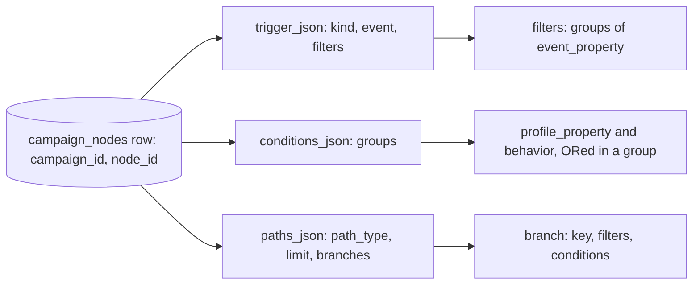
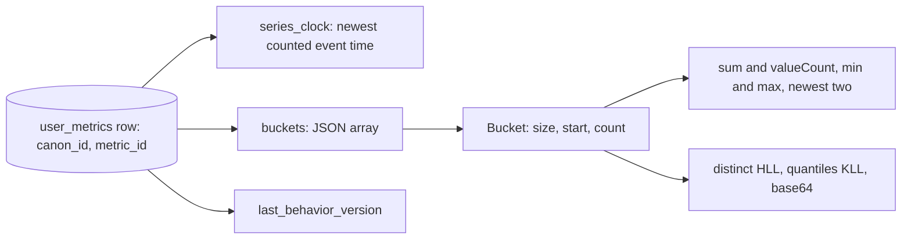

# Data model

Postgres database `auroracy`. Versioned migrations in [infra/db/migrations/](../../../infra/db/migrations/) build and change the schema of a deployed database, on every sync ([decision 0043](decisions/0043-apply-schema-changes-as-migrations-on-every-sync.md), [schema migrations](components/schema-migrations.md)). [infra/db/schema.sql](../../../infra/db/schema.sql) is the same schema in one commented file, and CI fails when the two differ. `ensureDbInitialized` in `shared/lib/db.ts` creates and changes no table. It checks that the tables `studio` reads exist.

This page lists each table, what it is for, and who reads and writes it. For columns, read `schema.sql`. To see which migrations a deployed database has, read its `flyway_schema_history`.

## Tables

| Table | Purpose | Key | Written by | Read by |
|---|---|---|---|---|
| `system_users` | Staff accounts and roles for `studio`, managed by the identity provider. No passwords: staff sign in through OIDC. A first sign-in creates the row from its provider account, `oidc_issuer` and `oidc_subject`, and every sign-in writes `role` and `email` from the ID token. The email is not unique. Campaigns name the row as their owner. Sign-out raises `session_epoch`, which ends every session cookie signed below it. `preview` ([decision 0037](decisions/0037-one-studio-retire-the-classic-studio.md)), `boolean NOT NULL DEFAULT false`, opens routes at stage `preview` to an editor. An admin sets it with SQL, because studio has no staff-management screen. | `id`, unique (`oidc_issuer`, `oidc_subject`) | `studio` | `studio` |
| `system_user_id_tokens` | The ID token of each staff user's latest sign-in, with the session epoch it was issued at. Kept only for a provider that sends `id_token_hint` at sign-out. Sign-out reads and deletes the row. | `user_id`, which references `system_users` with `ON DELETE CASCADE` | `studio`, at sign-in and sign-out | `studio`, at sign-out |
| `ingestion_source_keys` | Source keys of the [data ingestion API](../features/data-ingestion-api.md): `app_id`, the SHA-256 `key_hash` (never the key), `key_hint` for display, `created_by`, `created_at`, and `revoked_at`, null while the key is active. At most one key per `app_id` is not revoked. | `id`, unique `key_hash`, unique `app_id` where `revoked_at` is null | `studio` | `studio` |
| `user_events` | Event catalog: one row per event name. `enforce_schema` is the event's schema gate, off by default. `kind` is `person` or `business`, `person` by default. `item_key` is the attribute path that names a business event's item, and is null for a person event. | `id`, unique `event_name` | `studio` | `EventParseJob` (CDC), `studio` |
| `user_event_fields` | Event catalog: attributes, as dotted paths. `required` marks an attribute every event must send while the gate is on, off by default. | `id` | `studio` | `EventParseJob` (CDC), `studio` |
| `campaigns` | Campaign header, status, and the journey tree in `root` | `id` | `studio` | `CustomerDecisionJob` (CDC), `studio` |
| `campaign_nodes` | One row per journey node. Its rule sits in `trigger_json`, `conditions_json`, and `paths_json`, in the [saved format](../features/journey-builder.md#saved-format). `campaign_node_count` on each row is the number of nodes in the save that wrote it. `graph_version` is the version of the graph that the save wrote: a publish takes the next value of the sequence `campaign_graph_version_seq`, and a resume keeps the version of the rows it replaces. | (`campaign_id`, `node_id`) | `studio` | `CustomerDecisionJob`, `StateMachineJob` (CDC) |
| `user_metric_definitions` | Metric definitions, `processing_mode`, `retention_ms`, `user_event_id`, `created_by`, the staff user whose save created the definition: the segment's saver, or the journey's owner. Null for a definition created before 2026-11-08 or whose user was deleted. And, planned, `archived_at` (`timestamptz`), null unless staff archived the definition ([CMP-KI-01](../known-issues/features/campaign-management.md#cmp-ki-01-a-metric-definition-has-no-archived-state)) | `id` | `studio` | `CustomerDecisionJob` (CDC), `studio` |
| `event_volume` | Per `event_name`, UTC hour `bucket_start`, and `outcome` (`accepted` or a drop reason): `count` and `last_seen_at`. Upserted with the larger count and time, so a replay never lowers a row. In no publication. | `event_name`, `bucket_start`, `outcome`; index on `bucket_start` | `EventParseJob` | `studio` |
| `journey_drafts` | [Decision 0036](decisions/0036-store-journey-drafts-on-the-server-outside-cdc.md). One row per unpublished journey: `id`, the future campaign id, `owner_id` referencing `system_users`, so a user who owns drafts cannot be deleted, `name`, `description`, `root` in the same JSON as `campaigns.root`, `origin` (`blank`, `template:<key>`, `ai`, `duplicate:<id>`, or `browser`), `version`, an integer that each save raises and checks, `created_at`, and `updated_at`. Publish deletes the row. In no CDC publication. | `id` | `studio`, through the draft actions and publish | `studio` |
| `journey_publishes` | [Decision 0036](decisions/0036-store-journey-drafts-on-the-server-outside-cdc.md). One row per publish from a draft: `campaign_id`, referencing `campaigns` and deleted with it, `draft_id` (unique, and the old draft id when a collision published the draft under a new id), `root_hash`, the SHA-256 of the published `root` in its stored text form, and `published_at`. Publish reads it to tell a retry of its own publish from a collision. In no CDC publication. | `campaign_id` | `studio`, in the publish transaction | `studio` |
| `segments` | Saved segments: `name`, `description`, and `conditions_json`, the condition groups with the `metric_id` of each behavior condition. `id` is `SEG-` and 16 hexadecimal digits. `created_by` references `system_users` and becomes null when that user is deleted. Campaigns name a segment by id inside `campaign_nodes` JSON, with no foreign key. `studio` refuses a delete while a campaign uses it. See [segments](../features/segments.md). | `id` | `studio` | `CustomerDecisionJob` (CDC, once [DEC-KI-41](../known-issues/components/customer-decision.md) lands), the segment membership pass, `studio` |
| `segment_members` | [Decision 0038](decisions/0038-store-segment-membership-and-evaluate-every-segment.md). One row per current member of a segment who is a tracked person: `segment_id`, `canon_id`, and `since`, the time of the entering event. Inserted on `entered`, or `since` moved when it differs, and deleted on `exited` from `segment-membership-changes`, so a replay converges. An `entered` change for a row that already holds its `since` writes nothing. No foreign key to `segments`: a deleted segment's rows leave through the `exited` changes customer decision publishes, so the writer stays the only writer. In no CDC publication. | (`segment_id`, `canon_id`) | `CustomerProfileWriterJob`, keyed by `canon_id` | `studio`, for segment size |
| `segment_import_members` | Planned, [decision 0038](decisions/0038-store-segment-membership-and-evaluate-every-segment.md). One row per current member of a segment who is known only from imports: `segment_id`, `customer_key`, and `since`. Written only where membership changed. A key's rows are deleted once it maps to a tracked person. In no CDC publication. | (`segment_id`, `customer_key`) | The [segment membership pass](components/segment-membership-pass.md), a nightly batch job from the `event-processor` image | `studio`, for segment size |
| `current_member_entries` | Planned, [decision 0038](decisions/0038-store-segment-membership-and-evaluate-every-segment.md). One row per publish with **Also include current members**: `campaign_id`, `graph_version`, `segment_id`, `requested_at`, `state`, `cursor`, `sent`, `finished_at`, and the lease, `lease_owner` and `lease_until`. Studio inserts it in the publish transaction and cancels it on pause. The [segment membership pass](components/segment-membership-pass.md#current-members-at-publish) updates its progress only while it holds the lease and the row is `running`. In no CDC publication. | (`campaign_id`, `graph_version`) | `studio` inserts and cancels, the segment membership pass updates under its lease | The segment membership pass, `studio` |
| `segment_membership_passes` | Planned, [decision 0038](decisions/0038-store-segment-membership-and-evaluate-every-segment.md). One run record per nightly [segment membership pass](components/segment-membership-pass.md#interfaces): `as_of`, `state`, `fallback`, `metric_pass_id`, the times, the rows inserted and deleted, the skipped segments, and the pauses. In no CDC publication. | `as_of` | The segment membership pass | Operators |
| `user_metrics` | Each person's series per metric: `series_clock`, and `buckets` as a JSON array in the shape of the [mutation](components/customer-decision.md#interfaces) | (`canon_id`, `metric_id`) | `CustomerProfileWriterJob` | `CustomerDecisionJob` on a state miss |
| `identity_graph` | Device to person mapping. The index on (`canon_id`, `updated_at`) serves the profile lookup of a person without a `user_id`. The index `idx_ig_canon` on `canon_id` lists every identity of a person, devices with no `user_id` included, for studio v2's [customer lookup](../features/customer-lookup.md). | `domain_userid` | `EventParseJob` | `EventParseJob`, `CustomerDecisionJob`, `CampaignOutboxJob` |
| `user_campaign_state_transitions` | Completed journey nodes, one row per node per entry. `entry_id` names the entry of the person's journey in the campaign: `first`, or the entry id of the setup trigger that opened it ([decision 0033](decisions/0033-a-journey-instance-is-one-entry.md)). `children` lists the node's watch children, each with its `node_id`, its watch limit in `limit_millis`, the branch its deadline completes it on in `deadline_branch`, and the `graph_version` of the graph the node completed against. The index on (`campaign_id`, `node_id`, `canon_id`, `entry_id`) serves `campaign_node_stats`. Studio v2 computes journey analytics from the rows on read ([decision 0035](decisions/0035-compute-journey-analytics-from-transitions-on-read.md)) through three more indexes: `idx_ucst_node_reach` on (`campaign_id`, `node_id`, `branch`, `event_timestamp`) for each node's reach and a journey's entries in a range, `idx_ucst_type_event_time` on (`node_type`, `event_timestamp`) for the home KPIs, and `idx_ucst_type_written` on (`node_type`, `transitioned_at`) including `event_timestamp` and `branch` for engine lag. `transitioned_at` is the time the row was written, filled by the database. Next to `event_timestamp` it shows how far the engine runs behind. | (`canon_id`, `campaign_id`, `entry_id`, `node_id`, `branch`) | `StateMachineJob` | `CampaignOutboxJob` (CDC), `campaign_node_stats` |
| `campaign_node_stats` | Entries per node, for the builder, in the column `user_count`. A view that counts the distinct (`canon_id`, `entry_id`) per (`campaign_id`, `node_id`) in `user_campaign_state_transitions`, on every branch. A person with two entries counts twice. See [decision 0009](decisions/0009-compute-node-stats-as-a-view.md). | (`campaign_id`, `node_id`) | Nothing, it is computed on read | `studio` |
| `cdc_heartbeat` | One row per CDC replication slot, with the time of its last heartbeat. Every CDC publication covers it. | `slot_name` | Each CDC source, its own slot's row every 30 seconds | Nothing. Debezium drops its changes before they reach a job. |
| `flyway_schema_history` | One row per applied migration: `version`, `description`, `type` (`SQL`, or `BASELINE` for the database created before migrations), `script`, `checksum`, `installed_by`, `installed_on`, `execution_time`, and `success`. The database created before migrations starts with a baseline row at version 1, so it ran only `V0002` onward. Created by the migration runner, not by `schema.sql`. In no CDC publication. | `installed_rank` | The Job `db-migrate`, as `cdp` | The Job `db-migrate`, operators |
| `import_record_types` | Datasets of [data import](../features/data-import.md#datasets): `name`, `display_name`, `kind` (`profile` or `event`), `current_version`, `created_by`, `created_at`. `name` follows the system name rule. | `id`, unique `name` | `studio` | `studio`, import applier, import metric pass |
| `import_record_type_versions` | Immutable versions: `columns` (`jsonb`: name, display name, type, PII flag, aliases), `roles` (`jsonb`), `delivery_mode`, `time_zone`, `delimiter`, `created_by`, `created_at` | (`record_type_id`, `version`) | `studio` | `studio`, import applier, import metric pass |
| `import_metric_definitions` | Imported metric definitions: `name`, `display_name`, `function`, `column`, `filters` (`jsonb`), `window_days`, null for no window, `archived_at` (`timestamptz`), null while the metric is not archived and set to the time staff archived it, `created_by`, `created_at`. `column` is null exactly for `COUNT`, `FIRST_TIME`, and `LAST_TIME`. Not in any publication, and apart from `user_metric_definitions`. | `id`, unique (`record_type_id`, `name`) | `studio` | `studio`, import metric pass |
| `import_source_scopes` | The datasets each source key may import | (`source_key_id`, `record_type_id`) | `studio` | `studio` (import API) |
| `import_runs` | One row per delivered file: `record_type_id`, `version`, `source` (`api`, `drop`, `studio`, or `rederive`), `writer`, `format`, `byte_size`, `file_key`, `sha256` as delivered, `stored_sha256` as stored now, `state`, `reason`, `counts` (`jsonb`, no row values), `first_pass_id`, `created_at`, `confirmed_at`, `approved_by`, `approved_at`, `started_at`, `finished_at`. The file columns are null for a `rederive` run. See the [run states](components/import-applier.md#run-states). | `id` | `studio` (import API and admin actions), import applier, import metric pass (`first_pass_id` only) | `studio` |
| `import_metric_passes` | One row per nightly pass: `as_of` (unique), `state`, `reason`, `retry_requested_at` (stamped by `studio`), `last_run_finished_at`, `counts`, `changed_rows`, `wal_bytes` (the pass's own WAL), `pauses` (`jsonb`), `started_at`, `finished_at` | `id`, unique `as_of` | Import metric pass, `studio` stamps `retry_requested_at` only | `studio` |
| `customer_attributes` | Planned. One row per customer and imported source: `attributes` (`jsonb`), `attributes_hash`, `pass_id`, `updated_at`. Default replica identity, in no publication. | (`customer_key`, `source_id`) | Import metric pass only | `CustomerDecisionJob`, the segment runtime's nightly pass, `studio` |
| `pii_access_log` | One row per reveal, rejects download, or deletion request of imported PII: `staff_id`, `at`, `action` (`reveal`, `rejects_download`, or `deletion_request`), `route`, `customer_key` (`reveal` only, nulled when the person is deleted), `customer_key_hash`, `run_id`, `fields`. A check holds each action to its shape. Kept 365 days. See [data import](../features/data-import.md#privacy). | `id` | `studio` writes rows, import applier nulls deleted keys and deletes old rows | `studio` |
| `person_tombstones` | Deleted people: `customer_key_hash` (HMAC-SHA-256 under the tombstone key, never the key), `requested_by`, `requested_at`, `state` (`requested` or `done`). Mirrored to the drop zone. | `customer_key_hash` | `studio` creates, import applier moves to `done` and restores | Import applier, import metric pass, `studio` |

`customer_profiles` is read by `CustomerDecisionJob` and `CampaignOutboxJob`, matching on `cdp_uuid` by the person's `user_id`, else the newest `user_id` that `identity_graph` holds for their `canon_id`, but no schema file defines it. It is likely provided by another system in the deployed environment. Locally, profile lookups return nothing.

### `campaign_nodes` row

A row splits the node's rule by role, as [decision 0029](decisions/0029-model-a-rule-as-a-trigger-and-person-conditions.md) records. Each JSON column is null when the node has no such part.

### `user_metrics` row

One row holds a person's whole series for one metric. `buckets` is a JSON array in the shape of the [mutation](components/customer-decision.md#interfaces). A bucket carries `count` and only the fields its metric's function needs.

## Import store

The import store is a second Postgres cluster, `cdp-import-pg`, planned, on a compute node ([decision 0040](decisions/0040-import-through-a-batch-path-and-a-separate-store.md)). It holds no replication slot, so `max_wal_size` bounds its WAL. Its tables come from their own DDL file, which [decision 0040](decisions/0040-import-through-a-batch-path-and-a-separate-store.md) allows by amending [decision 0019](decisions/0019-keep-schema-sql-the-only-ddl-source.md) to one DDL file per cluster. Only the [import applier](components/import-applier.md) writes it. The [import metric pass](components/import-metric-pass.md) and `studio`'s metric preview read it.

| Table | Purpose | Key |
|---|---|---|
| `import_records` | Records of `event` datasets: `customer_key`, `event_time`, `updated_at`, `data` (`jsonb`), `writer`, `run_id`. Index (`record_type_id`, `customer_key`, `event_time`). | (`record_type_id`, `record_id`) |
| `import_profiles` | Rows of `profile` datasets: `data` (`jsonb`), `writer`, `run_id` | (`record_type_id`, `customer_key`) |
| `import_identifiers` | Normalized emails and phones of profile rows: `type`, `value`, `writer`, `run_id` | None. Replaced per (`record_type_id`, `customer_key`). |
| `import_run_commits` | One row per applied run, written in the run's transaction: `record_type_id`, `counts`, `committed_at` | `run_id` |

At the Free Plan record cap of 5 million records the store needs about 3.9 GB, WAL included (estimate in [decision 0040](decisions/0040-import-through-a-batch-path-and-a-separate-store.md#why)), on a 10 GiB volume.

## Publications for CDC

| Publication | Table | Slot | Reader |
|---|---|---|---|
| `campaigns_pub` | `campaigns` | `flink_decision_campaigns_slot` | `CustomerDecisionJob` |
| `campaign_nodes_pub` | `campaign_nodes` | `flink_decision_campaign_nodes_slot` | `CustomerDecisionJob` |
| `campaign_nodes_pub` | `campaign_nodes` | `flink_state_machine_nodes_slot` | `StateMachineJob` |
| `metric_defs_pub` | `user_metric_definitions` | `flink_decision_metric_defs_slot` | `CustomerDecisionJob` |
| `segments_pub` | `segments` | `flink_decision_segments_slot` | `CustomerDecisionJob` |
| `outbox_transitions_pub` | `user_campaign_state_transitions` | `flink_outbox_transitions_slot` | `CampaignOutboxJob` |
| `user_events_pub` | `user_events` | `flink_event_parse_catalog_events_slot` | `EventParseJob` |
| `user_event_fields_pub` | `user_event_fields` | `flink_event_parse_catalog_fields_slot` | `EventParseJob` |

Every publication also covers `cdc_heartbeat`. Each source reads only its own table, and Debezium drops the changes to `cdc_heartbeat` that the slot streams.

Each slot outlives its job. Each source confirms to its slot the log position of the checkpoint 10 completed checkpoints back in its run, not the latest one. The slot therefore keeps every change after each of the last 10 checkpoints, and after the checkpoint or savepoint the run started from until the run completes 10 more. A job restored from any of them resumes from the position saved there without a gap. This is the CDC restore window of [journey execution](components/journey-execution.md#non-functional-requirements) (JEX-NFR-10). A job restored from an older one resumes at the slot's newer position and skips the changes in between. After a start without saved state, the window holds only once 10 checkpoints have completed after the source finished reading its snapshot. A checkpoint taken during the snapshot holds no log position, so when its turn to be confirmed comes, the source confirms its current position instead. A slot keeps Postgres from removing WAL until its job confirms it. While its job runs, a slot holds the WAL that the whole database wrote over the last 10 checkpoints, about 5 minutes at the default interval. Postgres invalidates a slot that holds more than its cap on slot WAL, so the count is sized from the peak write rate ([decision 0039](decisions/0039-shorten-the-cdc-restore-window.md)). A stopped job confirms nothing, so its slot holds every WAL segment written since. A running job keeps confirming while its table is quiet. On Postgres 15 and later a slot streams nothing for a transaction that changes no table of its publication, so every 30 seconds each source upserts its slot's row in `cdc_heartbeat`. The write reaches the slot, and Debezium moves the position that a later checkpoint confirms. Drop the slot of a job you remove for good.

A job that starts without its CDC source's saved position reads a new snapshot of the table, whether or not the slot exists. For rule tables this rebuilds the rule set. For `user_campaign_state_transitions`, snapshot rows look like inserts, so the outbox publishes every old notification again and the timer flow restarts old watches. The sender deduplicates across all history, as the [outbox contract](components/notification-outbox.md#non-functional-requirements) requires. The outbox job's source has a fixed operator id, so a change to the job graph keeps its saved position.

Each source runs on one subtask, and so does every operator between it and the broadcast that sends a rule table's changes to every subtask, so no change overtakes an earlier one. The source reads the snapshot in chunks of the primary key. For each chunk, it creates a temporary slot named after the job's slot with `_0` appended, such as `flink_outbox_transitions_slot_0`, reads from it the changes made while it read the chunk, and drops it. A start without saved state therefore needs one more free slot and WAL sender in Postgres per CDC source, 14 in all with the 7 in the table. A source that dies while it reads a chunk leaves its temporary slot behind until it reads another chunk. Drop any temporary slot still there once the snapshot is read.

## Applying the schema

A deployed database gets its schema from the Job `db-migrate`, which runs every pending migration as `cdp` on each Argo CD sync, before any app rolls. An empty database runs every file from `V0001`. The database created before migrations was baselined at version 1. The [schema migrations](components/schema-migrations.md) contract has the rules.

`cdp` owns every table, view, sequence, function, and publication in `public`. A run fails, and names the object, when another role owns one, for example a table created by hand as `postgres`.

Locally, `pnpm db:reset` runs `infra/local/init-db.sh`, which applies `schema.sql`, not the migrations. `schema.sql` drops the tables listed at its top and then creates every table with `CREATE TABLE IF NOT EXISTS`. `user_metric_definitions` and `user_metrics` are not dropped, so on an existing database `db:reset` does not change their columns. Drop them first when the schema changes. `schema.sql` also drops the input table `user_events_log` and the functions of the old Postgres journey engine, a `user_metrics` table that still has the occurrence arrays of the old series model, and `max_retention_value` from `user_metric_definitions`. Dropping `user_campaign_state_transitions` also drops the `campaign_node_stats` view. `schema.sql` then drops the `campaign_node_stats` table and its trigger function that databases created before the view still hold, and creates the view again. None of these upgrade steps is in the migrations, because no database the migrations reach holds those old objects.

## Seed data

The repo ships no seed data and no staff user. Each staff user's first sign-in through the OIDC provider creates their row. Create campaigns and the event catalog in `studio`.

## Changing the schema

Follow the `db-migration` skill in [.agents/skills/db-migration/](../../../.agents/skills/db-migration/SKILL.md). In one commit:

1. Add a migration `infra/db/migrations/V<NNNN>__<snake_case>.sql` with the next free version, and list it in `infra/db/kustomization.yaml`. Never edit a migration that is already on the deploy branch.
2. Make the same change to `infra/db/schema.sql`. CI fails when the two build different schemas.
3. Change the matching `DSL.name(...)` fields in `event-processor/.../shared/db/repositories/` and the queries in `studio` and `shared/`. If `studio` reads a new table, add it to the tables that `ensureDbInitialized` in `shared/lib/db.ts` checks.
4. Update the table above and the contract that owns the table. A table of the import store changes in its own DDL file, not in the migrations.
