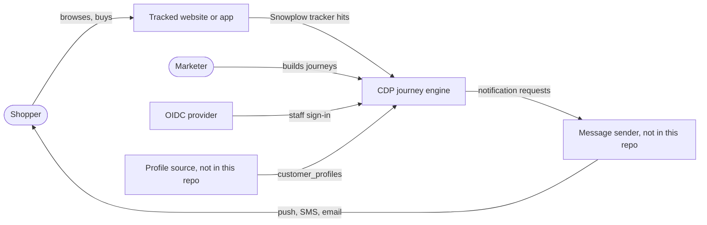
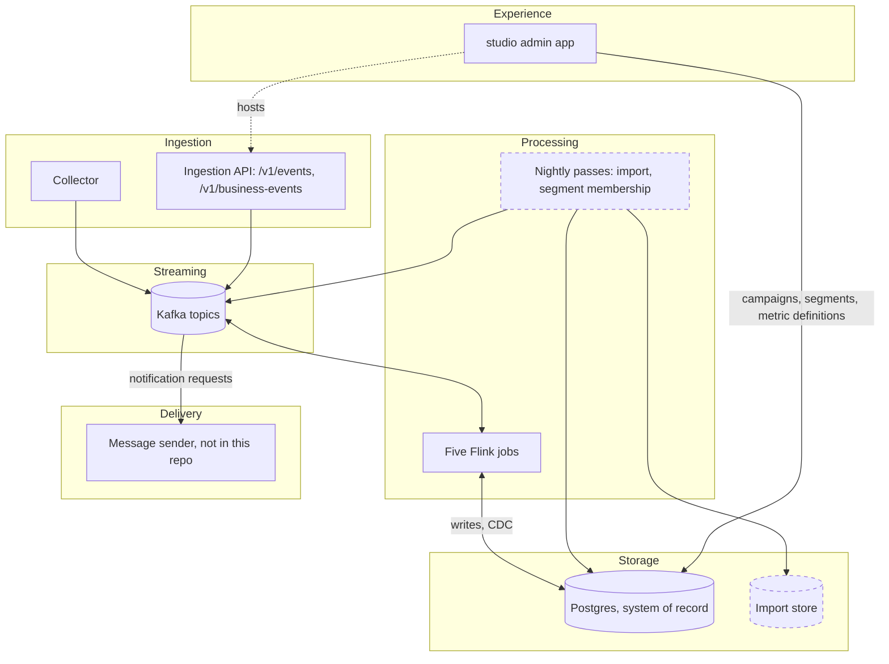
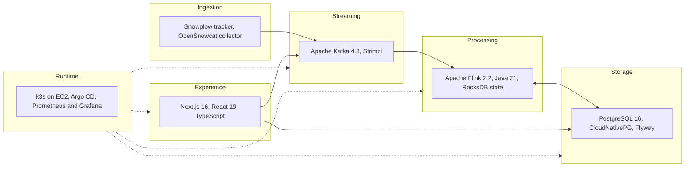
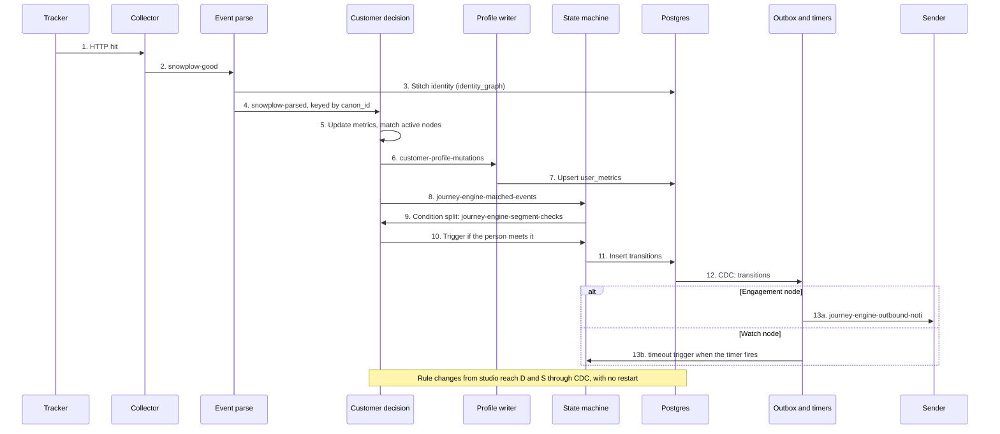
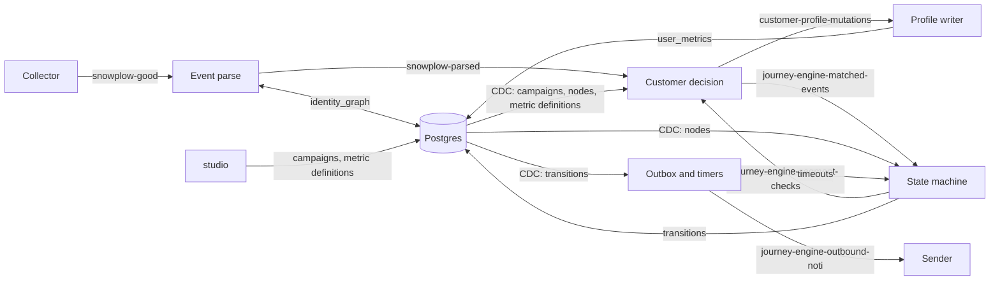
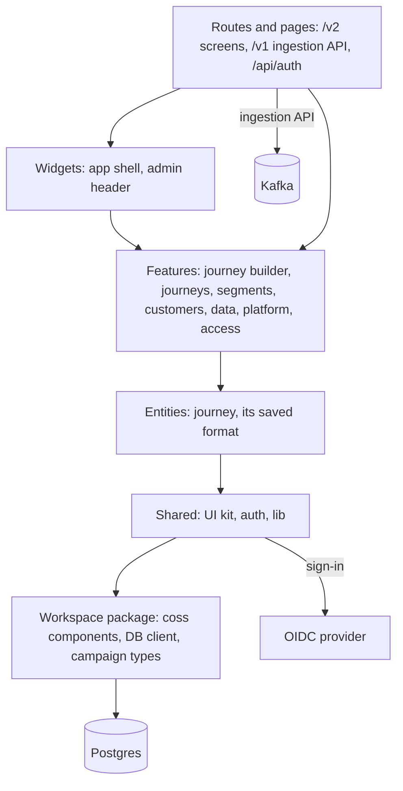
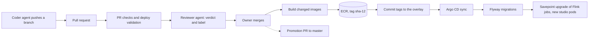

# About the architecture

The platform turns shopper behavior into marketing messages within seconds. It is a chain of five Flink jobs connected by Kafka topics. Postgres is the system of record for campaigns, metric definitions, and journey progress. Marketers edit campaigns in `studio`, which writes Postgres, and the jobs pick up each change through change data capture (CDC), without a restart.

This page is the map. Each component's and feature's contract holds its rules and algorithms, and each design decision holds its reasoning.

## Context

## Layers

The engine has six layers. Each layer talks only to the one next to it, except Postgres, which every layer above storage reads. Dashed boxes are planned.

| Layer | Holds | Detail |
|---|---|---|
| Ingestion | The OpenSnowcat collector for tracker hits, and the HTTP API that studio serves for server-side events | [Event ingestion](components/event-ingestion.md), [data ingestion API](../features/data-ingestion-api.md) |
| Streaming | Kafka. Every hop between jobs is a topic | [Kafka topics](#kafka-topics) |
| Processing | The five Flink jobs, which hold live state, and the planned nightly batch passes, which skip Flink | [Data flow](#data-flow), [components](#components) |
| Storage | Postgres, read by the jobs through CDC, and the planned import store with no replication slot | [Data model](data-model.md), [decision 0040](decisions/0040-import-through-a-batch-path-and-a-separate-store.md) |
| Experience | studio, where staff build journeys and manage data | [Admin app layers](#admin-app-layers) |
| Delivery | The sender that turns notification requests into push, SMS, and email | [Notification outbox](components/notification-outbox.md) |

Where the layers run is in [the AWS Free Plan environment](../operations/aws-free-plan.md#deployment-layers).

## Tech stack

### Overview

### Detail

| Layer | Technology | Version | Used for |
|---|---|---|---|
| Ingestion | Snowplow JavaScript tracker | | Behavior events from the website or app |
| | OpenSnowcat collector (Kafka sink) | 1.2.1 | Receives tracker hits and writes `snowplow-good` and `snowplow-bad` |
| | studio route handlers, kafkajs | kafkajs 2.2 | The data ingestion API at `/v1/events` and `/v1/business-events` |
| Streaming | Apache Kafka in KRaft mode | 4.3.2 | Every hop between jobs |
| | Strimzi operator | 1.3.1 | Runs the broker and creates the topics from Git |
| Processing | Apache Flink, DataStream API | 2.2.0 | The five jobs |
| | Java, Maven, Spotless, Checkstyle | 21 | Build and style gates |
| | Flink Kafka, JDBC, and Postgres CDC connectors | | Read and write topics, write Postgres, read rule tables through CDC (Debezium) |
| | RocksDB state backend, S3 checkpoints | | Keyed state that survives restarts and upgrades |
| | Flink Kubernetes Operator | 1.16.1 | Runs each job as a `FlinkDeployment`, upgrades through savepoints |
| Storage | PostgreSQL with logical replication | 16.15 | System of record, CDC source |
| | jOOQ | 3.20.18 | Typed SQL in the jobs |
| | node-postgres (`pg`) | 8.11 | SQL in studio |
| | CloudNativePG operator | chart 0.29.1 | Runs the Postgres cluster |
| | Flyway | 13.11.1 | Applies migrations on every sync |
| Experience | Next.js (App Router, server actions, standalone output) | 16.3 canary | studio |
| | React, TypeScript | 19.2, 5 | UI code |
| | Tailwind CSS, Base UI, coss components | 4, 1.5 | Styling and accessible primitives |
| | React Flow (`@xyflow/react`) | 12.10 | The journey builder canvas |
| | openid-client, jose | 6.8, 6.2 | Staff sign-in through OIDC and the session cookie |
| | Jest | 30 | Unit tests |
| Runtime | Terraform | | AWS resources |
| | k3s, Traefik ingress, cert-manager with Let's Encrypt | cert-manager 1.21.3 | Cluster, routing, TLS |
| | Argo CD | | Syncs the cluster from the deploy branch |
| | kube-prometheus-stack | chart 92.22.0 | Metrics, alerts, dashboards |
| | Amazon Cognito | | Sign-in for studio and the operator tools |
| | GitHub Actions, Amazon ECR | | Checks, image builds, rollouts |
| Tooling | Python traffic simulator, kafka-python | Python 3.11 | Smoke, load, and bench runs |

## Event lifecycle, step by step

One tracker hit, from the browser to a message. Each step names the topic or table it writes.

## Data flow

One event goes through these stages:

1. **Collect and parse.** The collector writes the tracker hit to Kafka. The event parse job decodes it, stitches the person's identity, and publishes a clean event keyed by `canon_id`.
2. **Decide.** The customer decision job updates the person's metrics and checks the event against every active journey node. It emits a trigger for each node the event satisfies, and the changed metrics for the profile writer.
3. **Advance.** The state machine applies each trigger to the person's journey as it arrives, and records each completed node. Triggers that wait, for a parent or for the campaign graph, are retried in event-time order. When a person reaches a condition split, the state machine asks customer decision to check it, and customer decision answers with a trigger if the person meets it.
4. **Act.** The outbox reads completed nodes. For an engagement node it publishes a notification request. For a watch node it starts a timer, and an expired timer sends a `timeout` trigger back to the state machine.

## Components

| Component | Runs as | Job or app | Contracts |
|---|---|---|---|
| Collector | Container | OpenSnowcat collector | [Event ingestion](components/event-ingestion.md) |
| Event parse | Flink | `EventParseJob` | [Event ingestion](components/event-ingestion.md), [identity stitching](components/identity/identity-stitching.md) |
| Customer decision | Flink | `CustomerDecisionJob` | [Customer decision](components/customer-decision.md) |
| Profile writer | Flink | `CustomerProfileWriterJob` | [Profile writer](components/profile-writer.md) |
| State machine | Flink | `StateMachineJob` | [Journey execution](components/journey-execution.md) |
| Outbox and timers | Flink | `CampaignOutboxJob` | [Notification outbox](components/notification-outbox.md), [journey execution](components/journey-execution.md#watch-timers) |
| Business event fan-out | Flink, planned | None yet | [Business event fan-out](components/business-event-fan-out.md) |
| Import applier | Kubernetes CronJob, planned. No Flink. | None yet | [Import applier](components/import-applier.md) |
| Import metric pass | Kubernetes CronJob, planned. No Flink. | None yet | [Import metric pass](components/import-metric-pass.md) |
| Import store | Second Postgres cluster, `cdp-import-pg`, planned. No replication slot. | None yet | [Import applier](components/import-applier.md), [decision 0040](decisions/0040-import-through-a-batch-path-and-a-separate-store.md) |
| Segment membership pass | Kubernetes CronJob, nightly, planned | None yet | [Segment membership pass](components/segment-membership-pass.md) |
| Admin app | Next.js | `studio` | [Journey builder](../features/journey-builder.md), [campaign management](../features/campaign-management.md), [AI journey generation](../features/ai-journey-generation.md), [event catalog](../features/event-catalog.md), [segments](../features/segments.md), [admin authentication](../features/admin-authentication.md) |

## Admin app layers

studio is one Next.js app. Its code is split into layers, and a layer imports only from the layers below it.

| Layer | Holds | Rule |
|---|---|---|
| Routes and pages | One folder per URL. Server actions and route handlers | Compose the layers below. No business logic |
| Widgets | Large blocks reused across pages | May use features |
| Features | One slice per user task, each with its model and its UI | Today some slices import each other. Shared parts belong in entities |
| Entities | Domain objects shared by features. The journey and the saved format, whose branch names the jobs read | No imports from features or widgets |
| Shared | UI kit, auth session, formatting, testing helpers | No domain logic |
| Workspace package | Components, DB client, and types shared with other packages | |

Nothing checks the import direction yet. The rule holds by review.

## CI/CD

Every change goes through a pull request into `deploy/aws-free-plan`. GitHub Actions checks it, an agent reviews it, and after the merge GitHub Actions builds the changed images and pins their tags in Git. Argo CD then rolls them out to the cluster. A promotion PR copies the deploy branch to `master`.

Each step's workflow and checks are in [the AWS Free Plan environment](../operations/aws-free-plan.md#cicd).

## Kafka topics

| Topic | Producer | Consumers | Key |
|---|---|---|---|
| `snowplow-good`, `snowplow-bad` | Collector | Event parse | None |
| `snowplow-parsed` | Event parse | Customer decision | `canon_id` |
| `snowplow-parsed-dead-letters` | Event parse | Operators, by hand | None |
| `customer-profile-mutations` | Customer decision | Profile writer | `canon_id` |
| `journey-engine-matched-events` | Customer decision, outbox timers | State machine | `canon_id` + U+001F + `campaign_id` |
| `journey-engine-segment-checks` | State machine | Customer decision | `canon_id` |
| `journey-engine-outbound-noti` | Outbox | Sender, not in this repo | None |
| `business-events`, planned | Data ingestion API | Business event fan-out | Event name + U+001F + item key |
| `segment-membership-changes`, planned | Customer decision | Profile writer, business event fan-out | `canon_id` |
| `current-member-entries`, planned | Segment membership pass | Customer decision | `canon_id` |
| `business-event-matches`, planned | Business event fan-out | Customer decision | `canon_id` |

The component contracts define each message. [Configuration](../operations/configuration.md) lists the variables that rename the topics.

## Quality attributes

| Attribute | How the architecture meets it |
|---|---|
| Latency | Every decision reads Flink state, not Postgres. Postgres is read only on a state miss. |
| Consistency per person | Each job keys by `canon_id` or by journey, so one subtask owns each person's state and each journey. |
| Correctness under replay | Every sink is at-least-once and every write is idempotent. |
| Rule changes without restarts | Rules arrive by CDC and broadcast state. |
| Bounded state | Every keyed state has a size limit and a TTL. |
| Out-of-order events | Metrics and journeys accept events with a bounded out-of-orderness. Metrics use event time. A journey node completes on the first trigger to arrive, and its parent check and watch deadlines use event time. |
| Capacity | [Platform capacity](capacity.md) sets the target load, how to size for it, and the load test that proves it. |

## Design decisions

| Decision | In short |
|---|---|
| [0001. Run the journey engine in Flink](decisions/0001-run-the-journey-engine-in-flink.md) | A Postgres trigger with advisory locks deadlocked and did not scale. A keyed Flink job replaced it. |
| [0002. Key every stateful write by its owner](decisions/0002-key-every-write-by-its-owner.md) | One subtask writes each row. Locks are a last resort. |
| [0003. Load rules through CDC and broadcast state](decisions/0003-load-rules-through-cdc-and-broadcast-state.md) | Every subtask sees the same rule version, restored with each checkpoint. |
| [0004. Compute metrics and decisions in one keyed job](decisions/0004-compute-metrics-and-decisions-in-one-keyed-job.md) | A rule always sees the metrics after the current event. |
| [0005. Keep live state in Flink and a durable copy in Postgres](decisions/0005-keep-live-state-in-flink.md) | Postgres is a lagging projection, off the decision path. |
| [0006. At-least-once delivery with idempotent writes](decisions/0006-at-least-once-delivery-with-idempotent-writes.md) | Replays are safe because every write converges. |
| [0040. Import through a batch path and a separate store](decisions/0040-import-through-a-batch-path-and-a-separate-store.md) | Imported records skip Flink and land in a second Postgres cluster with no replication slot. A nightly pass publishes only changed rows to the main Postgres, under a WAL governor. |
| [0007. Staff sign in through OpenID Connect](decisions/0007-staff-sign-in-through-oidc.md) | No stored passwords. [0024](decisions/0024-create-staff-at-first-sign-in-with-the-providers-role.md) leaves who gets in, and with which role, to the identity provider. |

## Scaling limits

- Every task manager holds every rule, so memory grows with the number of journey nodes. Thousands of nodes are cheap. Hundreds of thousands could exhaust it.
- Each transition is a Postgres write and a WAL record that CDC streams back. A loaded primary delays CDC, and a delayed CDC stream delays notifications and timers.
- One deployment serves one customer. Nothing carries a tenant, so a second customer needs a second environment. [Decision 0027](decisions/0027-multi-tenancy.md) proposes options.
- Per-person state is bounded. A person keeps at most 128 metrics, and each series at most one bucket per minute, hour, or day of its retention period, however active the person is. See [decision 0028](decisions/0028-store-metrics-as-tiered-time-buckets.md).

## Related

- [Data model](data-model.md)
- [Known issues](../known-issues/README.md)
- [Configuration](../operations/configuration.md)
