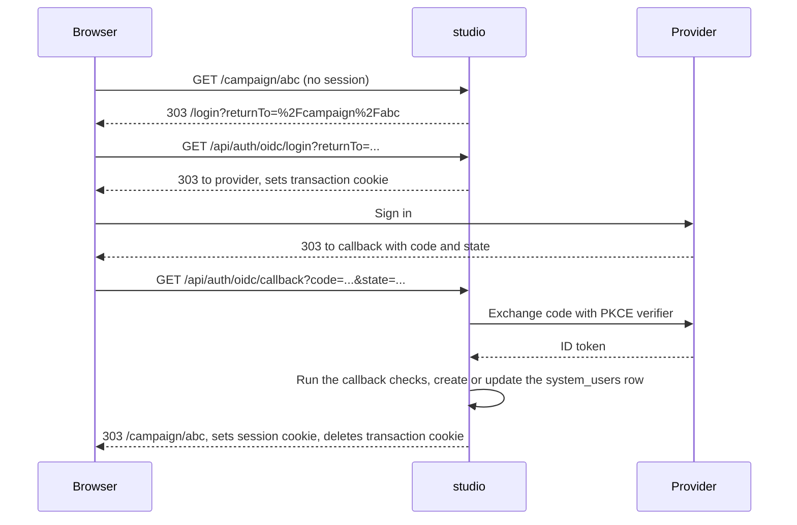

# Admin authentication

## Purpose

Staff sign in to `studio` through an OpenID Connect (OIDC) provider such as Microsoft Entra, Okta, or Keycloak. The provider decides who gets in and with which role. A signed session cookie then grants access to every page, API route, and server action, and the `/admin` pages also require the `admin` role. There is no password login. [Decision 0007](../architecture/decisions/0007-staff-sign-in-through-oidc.md) explains the choice of OIDC.

The owner decided these rules on 2026-10-20, recorded in [decision 0024](../architecture/decisions/0024-create-staff-at-first-sign-in-with-the-providers-role.md):

- A staff user is created at their first sign-in. Admins no longer add users by hand. The owner decided this on 2026-10-20.
- The role comes from a roles or groups claim in the provider's ID token, mapped to Studio roles by configuration, and is read again at every sign-in. The owner decided this on 2026-10-20.
- A token that gives no role Studio recognizes is refused with `not_authorized`. The provider's app assignment decides who gets in. The owner decided this on 2026-10-20.
- Authentication and authorization are delegated to the identity provider. Studio keeps no user administration: no list of staff, no delete, no forced sign-out. Access is revoked at the provider. The owner decided this on 2026-10-20.
- There is no legacy data to support. `system_users` exists only in the shape the schema defines. The owner decided this on 2026-10-20.

The other rules in decision 0024 were chosen during the fix: the configuration format, the highest role winning, and an open session lasting until it expires after the provider revokes access. They are pending owner review. [Decision 0010](../architecture/decisions/0010-link-staff-to-provider-accounts-and-end-sessions-server-side.md) records the owner's 2026-10-17 decisions on the session epoch and the provider sign-out, which still hold. [Decision 0018](../architecture/decisions/0018-offer-several-providers-and-name-the-claim-that-proves-an-email.md) adds several providers and the opt-in `id_token_hint` at sign-out. Those rules were chosen during an earlier fix and are pending owner review.

## Scope

In scope:

- The sign-in flow, the callback checks, and the error messages.
- The session cookie and the sign-out.
- Where the session and the role are checked.

Out of scope:

- Managing staff: who gets in, their roles, and revoking access. The provider does that. `studio` has no user administration.
- Registering the client at the provider. [Configuration](../operations/configuration.md#studio) describes it.

## Terms

| Term | Meaning |
|---|---|
| Provider | An OIDC identity provider. A deployment has one or more, each with an id and a display name. With one provider configured by the unprefixed settings, its id is `default` and its name is `SSO`. |
| Staff user | A row in `system_users`, created at the person's first sign-in: a provider account, a role, a session epoch, and the email from the ID token. Campaigns name it as their owner. |
| Provider account | The pair of the ID token's `iss` and `sub` claims. It names one person at the provider and stays the same when their email changes. Sign-in finds a staff user only by it. |
| Role | `admin` or `editor`. Both build and publish campaigns. Only `admin` opens `/admin`. The provider's role claim decides it at every sign-in. |
| Role claim | The ID token claim, set per provider, that holds the person's roles or groups at the provider, such as `roles` or `groups`. The role map, also set per provider, turns its values into Studio roles. [Configuration](../operations/configuration.md#studio) names the settings. |
| Transaction | The short-lived state of one sign-in attempt: `state`, `nonce`, the PKCE code verifier, the return path, and the provider's id. Stored in the transaction cookie. |
| Session | The signed-in state, stored in the session cookie: the user's id, email, session epoch, and the id of the provider they signed in at. The role is not stored in it. |
| Session epoch | A counter on each staff user. A session cookie carries the user's epoch at sign-in, and a cookie below the user's current epoch is no longer valid. Raising the epoch ends every session of that user, in every browser. |
| Return path | The in-app path the user wanted before sign-in. |
| Proxy | The request filter that runs before every page and route. |
| Landing page | Where staff land after sign-in without a usable return path. It is `/campaign` until cutover, `/v2` from cutover until the prefix drops, then `/`. The [studio shell](studio-shell.md#cutover-and-redirects) defines cutover and the prefix drop. |
| Preview flag | The column `system_users.preview`, false by default. It opens routes at stage `preview` to a staff user, as the [studio shell](studio-shell.md#preview-access) says. It is not a role. |

## Behavior

Example. The deployment maps the Keycloak group `/studio/editors` to `editor` and `/studio/admins` to `admin`, through the role claim `groups`. A Keycloak admin puts Lan in `/studio/editors`. Lan opens `/campaign`, is sent to `/login`, clicks **Sign in with SSO**, and signs in at the company's Keycloak. Keycloak returns an ID token with Lan's `sub`, `email: "Lan.Nguyen@example.com"`, and `groups: ["/studio/editors"]`. No `system_users` row has Keycloak's `iss` and Lan's `sub`, so the app creates one with the role `editor` and the email `lan.nguyen@example.com`, sets the session cookie, and returns Lan to `/campaign`. When the Keycloak admin later moves Lan to `/studio/admins`, her next sign-in finds her row by the same `iss` and `sub` and makes her an `admin`. Lan's colleague Minh signs in at the same Keycloak in neither group, so the app sends Minh to `/login?error=not_authorized` and writes nothing.

### Routes

| Method and path | Public | What it does |
|---|---|---|
| `GET /login` | Yes | Shows the sign-in page, with one sign-in link per provider and an error message when `?error=` is set. Redirects to the landing page if the user has a valid session. |
| `GET /api/auth/oidc/login` | Yes | Starts the flow at the provider named by `?provider=`. Sets the transaction cookie and redirects to the provider. |
| `GET /api/auth/oidc/callback` | Yes | Finishes the flow. Runs the checks, creates or updates the user, sets the session cookie. |
| `POST /api/auth/logout` | Yes | Ends every session of the user, deletes the session cookie, and redirects to the provider's end-session endpoint, or to `/login`. A `GET` gets `405`. |

### Sign in

1. The proxy sends a visitor without a valid session from a page such as `/campaign/abc` to `/login?returnTo=%2Fcampaign%2Fabc`. The return path is the path plus the query string. Only `GET` requests carry it.
2. `/login` shows one **Sign in with** link per provider, labeled with the provider's name, in the configured order. Each links to `/api/auth/oidc/login` with `provider` set to the provider's id and the same `returnTo`. A deployment with one provider configured by the unprefixed settings shows **Sign in with SSO**. If the configuration is missing, the page shows **Sign in with SSO** without a provider, and the login route reports `server_error`.
3. The login route sanitizes the return path and picks the provider named by `provider`. Without that parameter, it picks the only provider if there is one. With several providers and no known `provider`, it redirects with `303` to `/login` with the `returnTo`, so the user can choose. It then loads the provider's configuration from `<issuer>/.well-known/openid-configuration`, and creates a PKCE code verifier and its `S256` challenge, a `state`, and a `nonce`. It stores the transaction, with the provider's id, in the transaction cookie and redirects with `303` to the provider's authorization endpoint, with `redirect_uri`, `scope`, `code_challenge`, `code_challenge_method=S256`, `state`, and `nonce`. It uses the default query response mode, because a top-level `GET` carries a `SameSite=Lax` cookie and `form_post` would not.
4. The provider redirects the browser to the callback with `code` and `state`, or with `error` and `state`.
5. The callback runs these checks in order. The first that fails ends the request with a `303` to `/login?error=<code>`:

   | Step | Check | Error code |
   |---|---|---|
   | 1 | A transaction cookie is present, untampered, signed with the current key, at most 10 minutes old, and names a configured provider. The remaining steps use that provider. | `transaction_expired` |
   | 2 | The `state` parameter is present and equals the transaction's `state`, compared in constant time. | `state_mismatch` |
   | 3 | The query has no `error` parameter. The app logs `error` and `error_description` but does not show them. | `idp_error` |
   | 4 | The code exchange succeeds with the PKCE verifier, and the ID token's issuer, audience, expiry, and nonce are valid. | `token_exchange_failed` |
   | 5 | The ID token's `email` claim is a non-empty string. | `email_missing` |
   | 6 | A value of the provider's role claim maps to `admin` or `editor`. The claim is one string or a list of strings. A claim of any other type, or with no mapped value, gives no role. When several values map, the highest role wins: `admin`, then `editor`. | `not_authorized` |
   | 7 | The write to `system_users` does not fail. The row with the token's provider account gets the mapped role and the trimmed, lowercased email. If no row has the account, the write creates one with them. | `server_error` |

   Steps 5 and 6 fail before any write, so a refused sign-in creates and changes nothing. No step looks a row up by email.

   If the provider's configuration cannot be loaded, the routes redirect with `idp_unavailable`. If the app's own configuration is missing, they redirect with `server_error`.
6. On success, the callback sets the session cookie, with the provider's id, and redirects with `303` to the return path. For a provider that sends `id_token_hint` at sign-out, it first stores the ID token in `system_user_id_tokens`, with the session epoch, replacing the user's earlier one. If that write fails, the app logs it and the sign-in still succeeds.

Every callback response, success or failure, deletes the transaction cookie and sets `Cache-Control: no-store`.

### Error messages on `/login`

`/login` shows the message for its `error` code. An unknown code shows the `server_error` message. The page never prints the raw query value.

| Code | Message |
|---|---|
| `transaction_expired` | Your sign-in took too long or was started in another tab. Sign in again. |
| `state_mismatch` | The sign-in response did not match this browser's request. Sign in again. |
| `idp_error` | The identity provider cancelled or refused the sign-in. |
| `idp_unavailable` | The identity provider could not be reached. Try again later or contact an admin. |
| `token_exchange_failed` | The identity provider did not complete the sign-in. Try again. |
| `email_missing` | The identity provider did not send an email address. Ask an admin to check the OIDC scopes. |
| `not_authorized` | Your account has no Salarose role. Ask the admin of your identity provider to assign you one. |
| `server_error` | Sign-in failed because of a server error. Try again. |

For `not_authorized`, the page shows the heading **Not authorized** instead of the sign-in heading, with the message and the sign-in links, so the user can try another account.

### The sign-in page

`/login` is a centered card on the Salarose horizon background, and the browser tab reads "Sign in". The card shows the Salarose mark, the workspace name as an eyebrow, the heading **Salarose**, and the subtitle "Sign in with your company account to build real-time customer journeys." For `not_authorized`, the heading is **Not authorized** and the subtitle does not show. Below them are one **Sign in with** link per provider, labeled with the provider's name and shown as a button, in the configured order, and the area for the error message. The first provider's button is the primary button, and the others are secondary. The horizon background is a change of look only: it carries no text and no control. The links, the headings, the subtitle, the order of the providers, and the messages of [Error messages](#error-messages-on-login) stay exactly as this contract states them (AUTH-FR-04). `/login` never moves, because each provider has it registered as the post-logout redirect.
 

### Return path rules

A return path is used only if all of these hold. Otherwise the app uses the landing page.

- It starts with `/`.
- It does not start with `//` or `/\`.
- It does not start with `/login` or `/api/`.
- It is at most 2048 characters.
- It has no control character or space: code points 0 to 32, and 127. Browsers drop tabs and newlines, so `/<tab>/evil.example` would otherwise become `//evil.example`, a link to another site.

### Sign out

The **Logout** button posts to `/api/auth/logout`. If the session cookie is valid and its epoch is not below the user's, the route raises the user's session epoch. That ends every session of the user, including copies of the cookie in other browsers. The route then deletes the session cookie and redirects with `303`. The provider is the one the session cookie names, even if the cookie's epoch is old. With no valid cookie, the route uses the only provider if there is one.

- If the provider's discovered configuration has an `end_session_endpoint`, to that endpoint (RP-initiated logout), with `client_id`, and with `post_logout_redirect_uri` and `logout_uri` both set to `/login` on the origin of the configured redirect URL. Standard providers read `post_logout_redirect_uri`. Cognito reads only `logout_uri`. The provider ends its own session and sends the user to `/login`. Some providers then ask the user to confirm the sign-out.
- If the provider sends `id_token_hint`, and `system_user_id_tokens` holds an ID token for the user at the cookie's epoch, the request also carries that token as `id_token_hint`. The route reads and deletes the row before it raises the epoch. If the read fails, the app logs it and the request has only `client_id`.
- Otherwise to `/login`, and the provider session stays open. That happens when the provider publishes no `end_session_endpoint`, when its configuration cannot be loaded, when there is no provider to use, or when the app's configuration is missing.

The route works with or without a session, and without the OIDC configuration.

Only sign-out raises the epoch. A role change at sign-in does not, because every check reads the role from `system_users`, so the new role applies to every session of the user from the next request.

### Roles from the provider

Each provider names one role claim and a role map. Every sign-in reads the claim and writes the mapped role to the user's row, so the provider is the only place to assign or change a role.

- A promotion or a demotion at the provider takes effect at the user's next sign-in. From then, every session of the user has the new role.
- Access is revoked at the provider. When the provider takes away the person's role or app assignment, their next sign-in fails with `not_authorized`, and the row keeps its last role. A session already open keeps that role until it expires, after 12 hours by default ([AUTH-NFR-02](#non-functional-requirements)). The app does not ask the provider between sign-ins, and has no forced sign-out of another user. A shorter `SESSION_MAX_AGE_SECONDS` shortens that window.
- A token with a provider account no row has gets a new row, whatever its email. It never signs in as an existing row. One person who signs in at two providers has two rows, each with its own role.
- The role map takes only `admin` and `editor`. A provider's `viewer` role or group is not mapped, so those people are refused with `not_authorized`. Studio has no read-only role. The owner decided this on 2026-10-20.

### Proxy

The proxy checks only the session cookie's signature, audience, issuer, and expiry. It does not query the database, so it cannot see the session epoch, a deleted user, or a changed role. It handles each request in this order:

1. If the path is `/login`, `/api/auth/oidc/login`, `/api/auth/oidc/callback`, or `/api/auth/logout`, let it through. The proxy does not redirect `/login` to the landing page. The page does that after a database check, so a valid cookie for a deleted user cannot loop.
2. If the session cookie is missing or invalid and the path starts with `/api/`, return `401` with `{ "error": "Unauthorized" }`.
3. If the session cookie is missing or invalid on any other path, redirect with `303` to `/login`, with `returnTo` for `GET` requests. If an invalid cookie was present, the response deletes it.
4. If the path is `/` and the landing page is not `/`, redirect to the landing page. From cutover until classic removal the redirect uses status 307, and from classic removal 308, as the [studio shell](studio-shell.md#cutover-and-redirects) says.
5. Otherwise let the request through.

The proxy runs on every path except `/favicon.ico`, `/_next/image`, and paths under `/_next/static/`. Each exclusion matches the whole path or a full directory, so a path that only starts like one, such as `/favicon.icoX`, still runs the proxy. The proxy is a first filter only. A matcher change can silently drop a route from it.

### Where the session is checked

Every page, route handler, and server action checks the session itself, after the proxy. The check loads the user from `system_users` on every call, so the role and the preview flag are always current. It treats the user as signed out if the row is gone, the role is not `admin` or `editor`, or the cookie's epoch is below the user's session epoch.

| Capability | Required |
|---|---|
| Campaign pages, the journey builder, and their actions | Any session |
| Routes and controls at stage `preview` | `admin`, or a session whose user's preview flag is true, within the route's role ([SHL-FR-22](studio-shell.md#functional-requirements)) |
| `/account` | Any session |
| `/settings` | `admin` |
| `POST /api/generate-journey` | Any session. `401` without one. |
| Metric definition reads and writes used by the builder | Any session |
| Event catalog reads used by the builder | Any session |
| `/admin` pages | `admin`. An editor is sent to `/campaign`. `/admin` opens the event catalog. |
| Event catalog changes and catalog pages | `admin` |
| Source key pages, creating and revoking keys | `admin` |
| `POST /v1/business-events` | No session. A source key, checked by the route. See the [data ingestion API](data-ingestion-api.md). |

### Preview flag

An admin with database access grants preview access by setting `system_users.preview` to true with the SQL statement in the operations docs, and revokes it by setting it to false. Studio offers no action that sets the flag, because AUTH-FR-20 forbids staff management in studio. Sign-in never writes it. Each session check reads the flag with the role, so a change applies at the user's next request, with no restart and no new sign-in. The [studio shell](studio-shell.md#preview-access) says what the flag opens.

## Functional requirements

| Id | Requirement |
|---|---|
| AUTH-FR-01 | Sign-in must use the OIDC authorization code flow with PKCE `S256`, `state`, and `nonce`, and must read the provider's endpoints by discovery. No code is specific to one provider. |
| AUTH-FR-02 | The callback must run the checks in [Sign in](#sign-in) in order and redirect with the first failing check's error code. |
| AUTH-FR-03 | A sign-in must find the `system_users` row only by the token's provider account, never by email. If the token's role claim maps to no role, the sign-in must fail with `not_authorized` and write nothing. Otherwise, if no row has the account, it must create one with the mapped role and the trimmed, lowercased email. If a row has the account, it must write the mapped role and the email to it. A retried or concurrent first sign-in must leave one row. Sign-in is the only way to create a staff user. |
| AUTH-FR-04 | `/login` must show the heading **Salarose** and the subtitle of [The sign-in page](#the-sign-in-page), or the heading **Not authorized** and no subtitle for `not_authorized`. It must show the message for each error code exactly as written in [Error messages](#error-messages-on-login), and must never print the raw query value. The page's background is decoration only and must carry no text or control. |
| AUTH-FR-05 | The app must apply the [return path rules](#return-path-rules) to every return path. |
| AUTH-FR-06 | The proxy must handle requests in the order in [Proxy](#proxy). |
| AUTH-FR-07 | Every page, route handler, and server action must check the session, and the role where the table in [Where the session is checked](#where-the-session-is-checked) requires it. Every exported server action counts, including ones no page calls. |
| AUTH-FR-08 | The role and the preview flag must be read from `system_users` on every check, not from the cookie. |
| AUTH-FR-09 | Logout must accept only `POST`, raise the user's session epoch when the session cookie is valid, delete the session cookie, and work without a session. |
| AUTH-FR-10 | Absolute URLs and the `redirect_uri` must be built from the configured redirect URL, not from the request URL. The app runs behind an ingress, where the request URL can carry an internal host. |
| AUTH-FR-11 | The app must log each failure with its error code, and must never log the authorization code, tokens, the code verifier, or cookie values. |
| AUTH-FR-12 | A row must sign in only with its provider account. A sign-in with another account must never sign in as the row, whatever its email, and must leave the row unchanged. |
| AUTH-FR-13 | Every session check that loads the user must reject a cookie whose epoch is below the user's session epoch. Only sign-out raises the epoch. |
| AUTH-FR-14 | Logout must redirect to the session's provider's `end_session_endpoint`, with `client_id`, and with `post_logout_redirect_uri` and `logout_uri` both `/login` on the configured origin, when discovery returns that endpoint. Otherwise it must redirect to `/login`. |
| AUTH-FR-15 | Retired in version 2.0. It covered the link reset and the email change, which went with the email link. |
| AUTH-FR-16 | A deployment may configure several providers. Each provider has its own issuer, client, scopes, role claim, role map, and sign-out settings. The login page must offer each one, and a sign-in must finish at the provider it started at. Each provider account has its own row. |
| AUTH-FR-17 | For a provider set to send `id_token_hint`, the callback must store the ID token with the session epoch, and logout must send it only if it was stored at the cookie's epoch, then delete it. For any other provider, the app must not store the ID token. No ID token is ever stored in a cookie. |
| AUTH-FR-18 | Retired in version 2.0. It covered the admin link to a provider account, which sign-in no longer needs. |
| AUTH-FR-19 | Each provider must have a role claim and a role map from claim values to `admin` or `editor`. A missing or invalid setting, including a map to any other role, must fail the configuration, so every sign-in fails with `server_error` and the log names the setting. The claim may be one string or a list of strings. When several values map, the highest role wins: `admin`, then `editor`. |
| AUTH-FR-20 | The app must offer no user administration: no action lists, deletes, or signs out another staff user, or sets a role or the preview flag. The one exception is the read-only list of staff with preview access on `/settings` ([SHL-FR-20](studio-shell.md#functional-requirements)), which shows emails and roles and offers no action on them. Access is revoked at the provider, and an open session lasts until it expires. |

## Non-functional requirements

| Id | Requirement |
|---|---|
| AUTH-NFR-01 | Both cookies are JWTs signed with HS256, with issuer `campaign-admin`. The session cookie has audience `campaign-admin:session`. The transaction cookie has audience `campaign-admin:oidc-tx`. A cookie with the other audience must fail. |
| AUTH-NFR-02 | The session lasts 12 hours by default, configurable from 300 to 604800 seconds. The cookie's `Max-Age` equals the token's expiry. There is no sliding renewal. |
| AUTH-NFR-03 | The transaction cookie lasts 600 seconds and is scoped to `/api/auth/oidc`. |
| AUTH-NFR-04 | Both cookies are `HttpOnly` and `SameSite=Lax`. They are `Secure` when the configured redirect URL uses `https:`. |
| AUTH-NFR-05 | The signing secret is at least 32 characters. Changing it signs everyone out. |
| AUTH-NFR-06 | Session code never ships to the browser. |
| AUTH-NFR-07 | The app builds without any authentication settings. They are read on first use. |

## Interfaces

| Direction | Interface | Contract |
|---|---|---|
| HTTP | The routes in [Routes](#routes) | As described |
| Cookie | `cdp_admin_session` | Claims `iss`, `aud`, `sub` (user id), `email`, `epoch` (the user's session epoch at sign-in), `idp` (the provider's id), `iat`, `exp`. Path `/`. A cookie without `epoch` or `idp` is invalid. |
| Cookie | `cdp_admin_oidc_tx` | Claims `iss`, `aud`, `state`, `nonce`, `cv` (code verifier), `rt` (return path), `idp` (the provider's id), `iat`, `exp`. Path `/api/auth/oidc`. |
| Read and write | `system_user_id_tokens` | For a provider that sends `id_token_hint`: the callback upserts `user_id`, `session_epoch`, and `id_token`, and logout deletes the row at the cookie's epoch and reads its `id_token`. See [the data model](../architecture/data-model.md). |
| Read and write | `system_users` | Sign-in writes by (`oidc_issuer`, `oidc_subject`): it creates a row with `id`, `email`, `role`, `oidc_issuer`, and `oidc_subject`, or writes `email` and `role` to the row that has the account, and reads back `id`, `email`, and `session_epoch`. Session checks read `id`, `email`, `role`, `session_epoch`, and `preview`. Sign-out raises `session_epoch`. No action writes `preview`, and sign-in leaves it unchanged. See [the data model](../architecture/data-model.md). |
| Out | Provider | Discovery, authorization, token, and end-session endpoints |

The provider must issue an ID token with an `email` claim and the configured role claim, at the top level of the token. A provider that cannot put the person's roles or groups in the ID token cannot be used.

## Failure handling

| Case | Behavior |
|---|---|
| Provider unreachable | Redirect with `idp_unavailable`. The next sign-in tries discovery again. At sign-out, redirect to `/login`, and the provider session stays open. |
| App configuration missing | Redirect with `server_error`, using a relative location. Logout still works. |
| A second sign-in tab | Its transaction replaces the first tab's. The first tab's callback fails with `state_mismatch`. |
| Valid cookie for a deleted user | Pages and actions treat the user as signed out. |
| Database unreachable at sign-out | The cookie is deleted and the failure is logged. Other copies of the cookie stay valid until they expire. |
| The provider account of a person changes, for example after a provider switch or an issuer change | The person's next sign-in creates a new row. The old row keeps its campaigns. |
| The token has no role claim, or no value of it maps | `not_authorized`. Nothing is written. |
| The role settings are missing or invalid | Every sign-in fails with `server_error`, and the log names the setting. Logout still works. |
| The provider takes a person's role away while their session is open | The session keeps the last role until it expires. The next sign-in fails with `not_authorized`. |
| A sign-in that started at a provider removed from the configuration before the callback | `transaction_expired`. The user signs in again. |
| The ID token cannot be stored at sign-in, or read at sign-out | The app logs it. Sign-in succeeds. The sign-out redirect carries only `client_id`. |

## Acceptance criteria

Session token:

- Given a session token signed by the app, then verifying it returns the same user id, email, and epoch. (AUTH-NFR-01)
- Given a session token without an `epoch` or an `idp` claim, then verification fails. (AUTH-NFR-01)
- Given a token with one changed character in its payload, a token signed with another key, a token one second past expiry, an unsigned token with `alg: "none"`, an empty value, or `"admin1"`, then verification fails. (AUTH-NFR-01)
- Given a transaction token presented as a session, or the reverse, then verification fails. (AUTH-NFR-01)
- Given a transaction token 601 seconds old, then verification fails. (AUTH-NFR-03)

Return path:

- Given `/campaign/abc?x=1`, then it is used unchanged. (AUTH-FR-05)
- Given `null`, `""`, `campaign`, `//evil.example`, `/\evil.example`, `https://evil.example`, `/login`, `/api/auth/oidc/login`, a path with a tab or newline after the first `/`, or a path over 2048 characters, then the app uses the landing page, which is `/campaign` before cutover, `/v2` from cutover, and `/` after the prefix drops. (AUTH-FR-05)

Callback:

- Given no transaction, then the result is `transaction_expired`. (AUTH-FR-02)
- Given a different or missing `state`, then the result is `state_mismatch`. (AUTH-FR-02)
- Given a matching `state` and `error=access_denied`, then the result is `idp_error`. (AUTH-FR-02)
- Given no `email` claim, then the result is `email_missing`. (AUTH-FR-02)
- Given a role claim `roles` mapped from `studio-editor` to `editor`, and a token with `email: " Lan.Nguyen@Example.com "` and `roles: ["studio-editor"]` for a provider account no row has, then a row is created with that `iss` and `sub`, the role `editor`, and the email `lan.nguyen@example.com`, and the sign-in succeeds for it. (AUTH-FR-03)
- Given a token whose role claim is missing, empty, not a string or a list of strings, holds only unmapped values, or holds a mapped value under another claim, then the result is `not_authorized` and nothing is written. (AUTH-FR-03)
- Given a row with the token's provider account and the role `editor`, and a token with `roles: ["studio-admin"]` and another email, then the same row now has the role `admin` and the new email. (AUTH-FR-03)
- Given a row with the role `admin`, and a token for its provider account whose role claim no longer maps, then the result is `not_authorized` and the row is unchanged. (AUTH-FR-03)
- Given `roles: ["studio-editor", "studio-admin"]`, or `roles: "studio-admin"`, then the role is `admin`. (AUTH-FR-19)
- Given a row with the token's email and another `sub`, then the sign-in creates a second row and leaves the first unchanged. (AUTH-FR-12)
- Given a write that throws, then the result is `server_error`. (AUTH-FR-02)

Providers:

- Given a role map that is not JSON, is a list or an empty object, has an empty claim value, or names `viewer`, `Admin`, or a number, or a missing role claim or role map, then the configuration fails and names the setting. Given `OIDC_PROVIDERS`, then each provider reads `OIDC_<ID>_ROLE_CLAIM` and `OIDC_<ID>_ROLE_MAP`, and the unprefixed forms fail. (AUTH-FR-19)
- Given providers `keycloak` and `entra`, when the user follows `/api/auth/oidc/login?provider=entra`, then the response redirects to the Entra authorization endpoint with Entra's client id, and the transaction names `entra`. (AUTH-FR-16)
- Given several providers, when the login route gets no `provider` or an unknown one, then it redirects to `/login` with the `returnTo` and sets no cookie. Given one provider and no `provider`, then it starts the sign-in at that provider. (AUTH-FR-16)
- Given a transaction for `entra`, when the callback succeeds, then it used Entra's configuration and role map, and the session cookie's `idp` is `entra`. Given a transaction for a provider no longer configured, then the result is `transaction_expired`. (AUTH-FR-16)

Session checks:

- Given a valid cookie for a user who no longer exists, then the user is treated as signed out. (AUTH-FR-08)
- Given a user demoted to `editor` after sign-in, then the next check returns `editor`. (AUTH-FR-08)
- Given a signed-in editor whose preview flag an admin sets to true with the documented statement, then her next check returns the flag as true, with no new sign-in. Given her next sign-in, the flag stays true. (AUTH-FR-08, SHL-FR-22)
- Given a cookie signed at epoch 2 for a user whose session epoch is now 3, then the user is treated as signed out. (AUTH-FR-13)
- Given a signed-in user with a copy of their cookie in a second browser, when they sign out in the first, then the second is treated as signed out. (AUTH-FR-09, AUTH-FR-13)
- Given sign-out when the database cannot raise the epoch, then the response still deletes the cookie and redirects. (AUTH-FR-09)
- Given an editor, when they open `/admin`, then they are sent to `/campaign`. (AUTH-FR-07)
- Given no cookie, when a page is opened, then the user is sent to `/login`. (AUTH-FR-07)
- Given an editor, when they call an admin-only action directly, then it returns an error and writes nothing. (AUTH-FR-07)
- Given the server actions, then none lists, deletes, or signs out another staff user, or sets a role or the preview flag. The `/settings` preview list offers no action on a staff user. (AUTH-FR-20)

Proxy:

- Given `GET /campaign/abc` with no cookie, then the response redirects to `/login?returnTo=%2Fcampaign%2Fabc`. (AUTH-FR-06)
- Given `GET /campaign` with a tampered cookie, then the response redirects to `/login` and deletes the cookie. (AUTH-FR-06)
- Given `POST /campaign/abc` with no cookie, then the response is `303` to `/login` with no `returnTo`. (AUTH-FR-06)
- Given a request that reaches the app on an internal host, when the proxy redirects, then the location uses the origin of the configured redirect URL. (AUTH-FR-10)
- Given `POST /api/generate-journey` with no cookie, then the response is `401` with `{ "error": "Unauthorized" }`. (AUTH-FR-06)
- Given `GET /login` or `GET /api/auth/oidc/callback` with no cookie, or `GET /login` with a valid cookie, then the proxy lets it through. (AUTH-FR-06)
- Given `GET /login` with a valid cookie for an existing user, then the page redirects to the landing page. (AUTH-FR-06)
- Given `GET /` with a valid cookie, then the response redirects to `/campaign` before cutover and to `/v2` from cutover. After the prefix drops, the proxy lets it through to Home. (AUTH-FR-06)
- Given `/favicon.icoX`, `/favicon_ico`, `/_next/staticX`, or `/_next/imageX`, then the proxy runs. Given `/favicon.ico`, `/_next/image`, or a file under `/_next/static/`, then it does not. (AUTH-FR-06)

Sign out:

- Given a provider with an `end_session_endpoint`, when the user signs out, then the response is `303` to that endpoint with `client_id`, and with `post_logout_redirect_uri` and `logout_uri` set to `/login` on the configured origin, and it deletes the session cookie. (AUTH-FR-14)
- Given a provider without an `end_session_endpoint`, a provider that cannot be reached, or no OIDC configuration, when the user signs out, then the response is `303` to `/login` and deletes the session cookie. (AUTH-FR-09, AUTH-FR-14)
- Given providers `keycloak` and `entra` and a session cookie for `entra`, when the user signs out, then the response redirects to Entra's `end_session_endpoint` with Entra's client id. Given a cookie that names no provider, then the response is `303` to `/login` and the user's epoch still rises. (AUTH-FR-14, AUTH-FR-16)
- Given a provider set to send `id_token_hint` and an ID token stored at the cookie's epoch, when the user signs out, then the redirect carries `id_token_hint`, `client_id`, `post_logout_redirect_uri`, and `logout_uri`, the row is deleted, and the epoch rises. Given a token stored at another epoch, then the redirect has no `id_token_hint` and the row stays. Given a provider not set to send it, then the stored row is not read. (AUTH-FR-17)
- Given a provider set to send `id_token_hint`, when a sign-in succeeds, then the ID token is stored with the user's session epoch. Given a provider not set to send it, then nothing is stored. Given a failed write, then the sign-in still succeeds. (AUTH-FR-17)

Sign-in page:

- Given the redesigned `/login` with no error, then the page shows the heading **Salarose** and the subtitle word for word. Given each error code of [Error messages](#error-messages-on-login), then the page shows that message word for word, and for `not_authorized` the heading **Not authorized** and no subtitle. Given providers `keycloak` and `entra` in that order, the buttons follow that order. Given the page with its background image hidden, every link and message is still there. (AUTH-FR-04)

Manual check, once per provider: sign in with an account the provider gives a mapped role, sign in with one it gives none, and sign out. After the sign-out, the provider's **Sign in with** link must ask for the provider's credentials again, unless the provider has no `end_session_endpoint`.

## Related

- [0007. Staff sign in through OpenID Connect](../architecture/decisions/0007-staff-sign-in-through-oidc.md)
- [0010. Link staff to provider accounts and end sessions server-side](../architecture/decisions/0010-link-staff-to-provider-accounts-and-end-sessions-server-side.md)
- [0018. Offer several providers, and name the claim that proves an email](../architecture/decisions/0018-offer-several-providers-and-name-the-claim-that-proves-an-email.md)
- [0024. Create staff at their first sign-in, with the role the provider gives](../architecture/decisions/0024-create-staff-at-first-sign-in-with-the-providers-role.md)
- [0037. One studio: retire the classic studio](../architecture/decisions/0037-one-studio-retire-the-classic-studio.md)
- [Studio shell](studio-shell.md)
- [Configuration](../operations/configuration.md#studio)
- [Known issues](../known-issues/features/admin-authentication.md)
