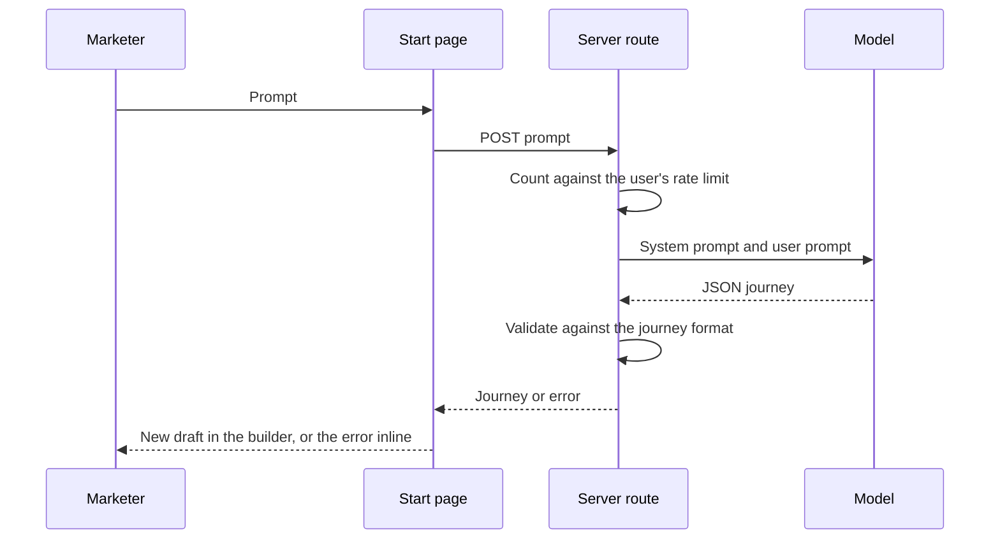

# AI journey generation

## Purpose

Drawing a journey from nothing takes time. The **Describe it** choice on `/journeys/new` turns a sentence such as "send a push to users who view a product but don't buy within a day" into a starting graph. Success creates a draft that the marketer then edits like any other. The feature is a prototype, so this contract is a draft.

Until cutover, the classic builder's **AI Generate** modal also stays, and replaces its canvas with the generated journey.

## Scope

In scope:

- The **Describe it** choice on `/journeys/new`, the model call, and turning the reply into a draft.

Out of scope:

- Storing, editing, and publishing the draft. The [journey builder](journey-builder.md) owns `/journeys/new` and the draft.

## Terms

| Term | Meaning |
|---|---|
| Prompt | The marketer's sentence. |
| Model | An OpenAI-compatible chat completion endpoint. |
| Generated journey | The model's reply, a journey tree in the builder's [saved format](journey-builder.md#saved-format). |
| Rate limit | How many requests one signed-in user may send to the model in a period. |

## Behavior

1. The marketer types a prompt into **Describe it** on `/journeys/new`, or picks one of its three example prompts, and confirms. **Describe it** is hidden when the deployment has no model configured.
2. The server checks that the prompt is text of at most 2,000 characters.
3. The server counts the request against the user's [rate limit](#rate-limit). Over the limit, it returns an error that says when to try again, and does not call the model.
4. The server sends the prompt to the model with a system prompt that describes the journey format, and asks for a JSON object with a low temperature. It waits at most 60 seconds for the reply.

   The system prompt describes every node type, path type, and channel that step 5 accepts: setup, check with yes, no, yes and no, or named branches, condition split, watch with success, timeout, both, or a delay, engagement on every channel the builder offers, and end. It also describes triggers, filters, and conditions:

   - A "contains" comparison is `LIKE` with the value wrapped in `%`, as in `%iphone%`.
   - A condition split has only a Yes path, because a condition split never takes No.
   - A behavior condition counts occurrences of one event, with `COUNT`, or their absence, with `INACTION = 0`, over a window in `SECONDS`, `MINUTES`, `HOURS`, `DAYS`, `WEEKS`, or `MONTHS`. The model sees no event catalog, so it names the event by its name, and publish refuses a name that is not in the catalog. For the same reason the prompt offers no measure that needs an event attribute.
5. The server validates the reply against the journey format. On top of the builder's [saved format](journey-builder.md#saved-format), every check and every watch other than a delay must have a trigger, a filter must test only an attribute of its event, a condition must be a `profile_property` or a `behavior` condition, no group may be empty, and every engagement must use a channel the builder offers. The saved format already rejects a condition split with a multi-branch path.
6. The studio creates a draft that holds the generated journey, with `origin` `ai`, owned by the marketer, and opens it in the builder.

When a step fails, the server logs the detail and returns a fixed error message. The browser never sees the model provider's error text. `/journeys/new` shows the message inline, and no draft is created. A rate-limit refusal shows the same way.

### Rate limit

Each signed-in user may send at most 10 requests to the model in any 60 seconds and at most 100 in any 24 hours. Both numbers are configurable. Both windows slide. A request counts against the first limit until it is 60 seconds old, and against the second until it is 24 hours old.

- The user is the one in the session. The request body cannot name another user.
- A request counts once it passes the session, prompt, and configuration checks, before the model call. A model call that fails, times out, or returns an invalid journey still counts, so the cost stays bounded.
- A request without a session gets `401` and counts for no one. A request refused with `429` does not count.
- Over either limit, the server returns `429` with a `Retry-After` header. The header gives the seconds, rounded up, until enough of the user's requests leave the window to let one more in. Over both limits, it gives the longer wait.
- The counts live in each server process's memory. Each replica of the app keeps its own counts, so with several replicas a user can send up to the limit to each one. A restart or a deploy clears the counts. The owner accepted both on 2026-10-17 for this prototype.
- The server forgets a user's counts 24 hours after their last counted request, so memory grows only with the users active in the last day.

## Functional requirements

| Id | Requirement |
|---|---|
| AIG-FR-01 | The route must require a staff session. |
| AIG-FR-02 | The route must validate the whole reply against the journey format, not only the root node, and must return an error for an invalid reply. |
| AIG-FR-03 | The generated journey must put event attributes in trigger filters, and profile fields in conditions. |
| AIG-FR-04 | The generated journey must use only node types, path types, and channels that the builder supports. The example prompts must name only channels the builder offers, so none names Zalo. |
| AIG-FR-05 | The root node must be a setup node. |
| AIG-FR-06 | If the model is not configured, fails, or the user is over the rate limit, `/journeys/new` must show the error inline and must create no draft. On success it must create a draft with `origin` `ai` that holds the generated journey. |

## Non-functional requirements

| Id | Requirement |
|---|---|
| AIG-NFR-01 | The model endpoint, key, and model name come from the environment. The route never sends the key to the browser. |
| AIG-NFR-02 | Calls must be rate limited per user, by default to 10 a minute and 100 a day, as [Rate limit](#rate-limit) describes. |
| AIG-NFR-03 | The route reads and writes no database table. The journey builder's draft action writes the new draft to `journey_drafts` after the route answers. |

## Interfaces

| Direction | Interface | Contract |
|---|---|---|
| UI | `/journeys/new`, **Describe it** | The prompt box, shown only when a model is configured. The path carries `/v2` until the prefix drops. |
| In | `POST /api/generate-journey` | Body `{ "prompt": string }`. Returns a journey tree or `{ "error": string }`. `401` without a session, `400` for a missing, blank, or too long prompt, `503` when the model or the rate limit is not configured, `429` with a `Retry-After` header in seconds when the user is over the rate limit, `502` when the model fails or its reply is not a valid journey, `504` when the model does not answer in time. |
| Out | Model endpoint | OpenAI-compatible chat completion, JSON object response |

## Acceptance criteria

- Given no session, when the route is called, then it returns `401`. (AIG-FR-01)
- Given a reply whose second node has an unknown type, then `/journeys/new` shows an error inline and `journey_drafts` gains no row. (AIG-FR-02, AIG-FR-06)
- Given a valid reply, then a draft with `origin` `ai`, owned by the marketer and holding the generated journey, opens in the builder. (AIG-FR-06)
- Given a user over the rate limit, when they use **Describe it**, then `/journeys/new` shows the message inline and `journey_drafts` gains no row. (AIG-FR-06, AIG-NFR-02)
- Given the prompt "send a push to women in Hanoi who view a product", then `gender` and `city` appear in the setup node's conditions as `profile_property` conditions, not in its trigger filters. (AIG-FR-03)
- Given a reply with a condition split on a multi-branch path, when the route validates it, then it returns `502` and no draft is created. (AIG-FR-04, AIG-FR-06)
- Given a journey that uses each node type, path type, and channel the way the system prompt describes, when the route validates it, then it accepts it. (AIG-FR-04)
- Given the three example prompts on **Describe it**, then each names push or SMS and none names Zalo. (AIG-FR-04)
- Given a user who sent 10 requests in the last minute, when they send another, then the route returns `429` with a `Retry-After` header and does not call the model. (AIG-NFR-02)
- Given a user who sent 100 requests in the last 24 hours, when they send another, then the route returns `429`. (AIG-NFR-02)
- Given 10 requests whose model calls failed, when the same user sends an 11th within the minute, then the route returns `429`. (AIG-NFR-02)
- Given one user at the limit, when another user sends a request, then the route calls the model. (AIG-NFR-02)
- Given no session and a user at the limit, when the route is called, then it returns `401`, not `429`. (AIG-FR-01, AIG-NFR-02)

## Related

- [Journey builder](journey-builder.md)
- [Known issues](../known-issues/features/ai-journey-generation.md)
