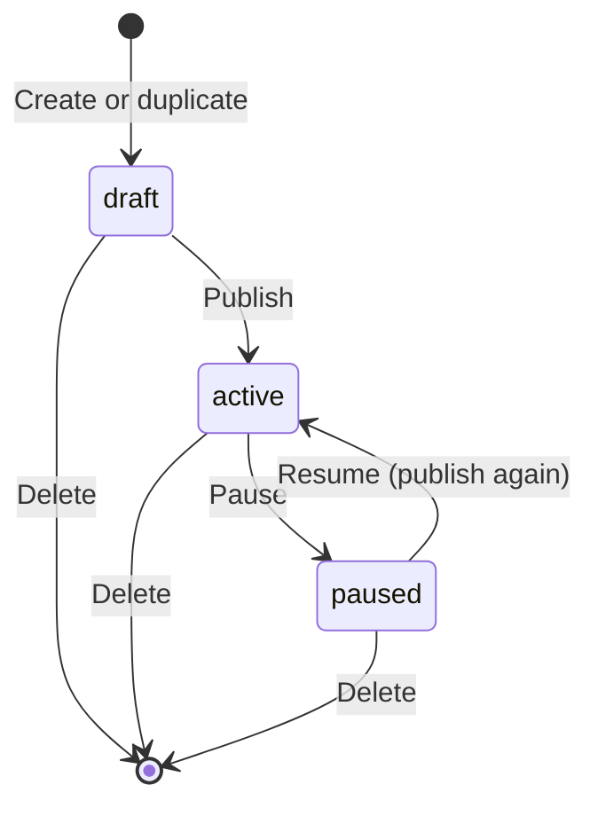
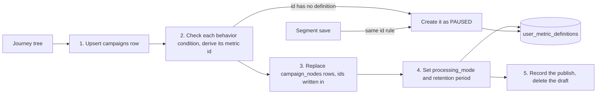

# Campaign management

## Purpose

The journey list at `/journeys` and each journey's page at `/journeys/[id]` control a campaign's lifecycle. A draft is kept on the server, in `journey_drafts`, for the user who owns it. Publishing it writes the journey to Postgres, creates the metrics it needs, and turns those metrics on, so the Flink jobs start matching events within seconds. Pausing stops matching without losing the journey.

Paths in this contract are the final ones. Until the `/v2` prefix drops, each carries it, as the [studio shell](studio-shell.md) says. Until cutover, the classic `/campaign` page also stays live, as [The classic campaign list until cutover](#the-classic-campaign-list-until-cutover) says.

## Scope

In scope:

- The lifecycle controls on the journey list and on a journey's page.
- The lifecycle actions: publish, pause, resume, delete, and duplicate.
- Publishing a journey: the campaign row, the node rows, the metric definitions, and the publish record.
- Turning metrics on and off with the campaigns that use them.
- Archiving and unarchiving metric definitions on **Data > Metrics** at `/data/metrics`.

Out of scope:

- Editing a journey, saving drafts, the retry and collision rule of a publish, and the list's columns and filters. The [journey builder](journey-builder.md) owns them.
- Evaluating the published rules. [Customer decision](../architecture/components/customer-decision.md) owns that.

## Terms

| Term | Meaning |
|---|---|
| Campaign | One journey with a status, an owner, and a name. |
| Status | `draft`, `active`, or `paused`. |
| Publish | Write the campaign, its node rows, its metric definitions, and the record of the draft it came from, in one transaction. |
| Draft | A journey that is not published yet. It is one row of `journey_drafts`, owned by one staff user, with the id the campaign will have. |
| Duplicate | Copy a published campaign into a new draft owned by the user who duplicated it. |
| Owner | The staff user who created the campaign. See [admin authentication](admin-authentication.md) for staff users. |
| Processing mode | `LIVE` or `PAUSED` on a metric definition. Customer decision computes only `LIVE` metrics. |
| Archived | A metric definition that staff took out of use. It stays `PAUSED`, keeps its stored values, and no condition picker offers it. Metrics are never deleted. |

## Behavior

| Status | Stored in | Editable | Runtime sees it |
|---|---|---|---|
| `draft` | `journey_drafts` | Yes, by its owner | No |
| `active` | Postgres | No. Duplicate it to edit. | Yes |
| `paused` | Postgres | No | The rows stay. Matching and metric updates stop. |

`campaigns` stores only `active` and `paused`. A draft is a row of `journey_drafts`, never a row of `campaigns`. A campaign is active only when its stored status is exactly `active`. A row with any other status, such as `live`, written by hand, is neither: the runtime does not match it, no metric counts it as a reference from an active campaign, the list leaves it out, and pause and resume refuse it.



The journey list shows the rows that [JBD-FR-18](journey-builder.md#functional-requirements) names: every published journey under **All**, and the viewer's own journeys and drafts under **Mine**. An admin's **Mine** also holds the campaigns that have no owner, marked "No owner", so that an admin can pause, resume, or delete them. The lifecycle controls on each row and on a journey's page follow CMP-FR-07. A control the viewer may not use is absent, not disabled. Each action ends in a toast, and pause and resume update the row in place.

### The classic campaign list until cutover

Until cutover, the classic `/campaign` page keeps its behavior. This section goes when the classic studio is removed ([decision 0037](../architecture/decisions/0037-one-studio-retire-the-classic-studio.md)). The page shows the campaigns the signed-in user owns, and for an admin, the campaigns with no owner. It also shows the drafts that the signed-in user saved in this browser.

The browser keeps one list of drafts for each signed-in user. Another user who signs in on the same browser does not see them and cannot open them. Signing out does not delete them, so they are back when the same user signs in again. Drafts saved before the browser kept them per user name no user, so no list shows them, and they stay in browser storage untouched. A stored draft without the fields of a campaign is skipped. Each card shows the trigger event, the number of check, watch, and segment steps, whether it has delays or multi-branch paths, and the first engagement channel. The [journey builder](journey-builder.md#moving-browser-drafts-to-the-server) moves these drafts to the server, and the classic list stops showing the moved ones.

### Publish

Publishing a draft and resuming both publish, in one transaction. Publishing a draft reads the tree from the draft's row in `journey_drafts`, never from the browser, and the caller must own the draft. Before it writes, it chooses between publish, already published, and collision by the [journey builder's retry and collision table](journey-builder.md#publish). Until cutover, the classic builder's activate publishes the tree it sends, and does not read `journey_drafts` or `journey_publishes`.

1. Upsert the `campaigns` row, with the full tree in `root` and the status `active`. Publishing inserts the row under the draft's id, with the caller as the owner. If a row with that id exists and another user owns it, the publish fails and that row stays as it was. Resume checks that the caller is the owner or an admin, and keeps the stored tree.
2. For each behavior condition in the journey, check that its event is in the catalog, that its measure is one of the [metric functions](../architecture/components/customer-decision.md#metric-functions), that it has an attribute exactly when the measure reads one, and that its window is above 0 in a unit customer decision [accepts](../architecture/components/customer-decision.md#metric-functions). Derive its metric id, as [Metric definitions](#metric-definitions) describes. If no definition has that id, create one as `PAUSED`. If the definition with that id is archived, refuse the publish, write nothing, and name the archived metric and the condition that derives it (the lead's default, see [Open questions](#open-questions)). Write the metric id into the condition in the node row.
3. Replace the campaign's `campaign_nodes` rows with the rows from the [saved format](journey-builder.md#saved-format). The server builds the rows from the tree in `root` and writes the campaign's own id, the number of rows, and the graph version into each one. Activate takes a new graph version, above every version before it. Resume keeps the version of the rows it replaces, because it writes the published tree again. The [journey execution](../architecture/components/journey-execution.md#apply-a-campaign-save) contract says why. It deletes every old row before it inserts any new one. It does not take node rows from the browser.
4. Set each metric definition's `processing_mode` to `LIVE` if a behavior condition of an active campaign or of any [segment](segments.md) names it, and to `PAUSED` otherwise. An archived definition is the exception: it stays `PAUSED`. Step 2 and the segment save refuse any condition that derives one, so no active campaign or segment names it. Set its retention period to the longest window among those conditions. A definition that no active campaign names keeps its retention period.
5. For a publish from a draft, insert a `journey_publishes` row with `campaign_id`, `draft_id`, `root_hash`, which is the hash of the stored root, and `published_at`. `draft_id` is the id of the draft that was read. For **Publish as a new journey** it is the draft's old id, and `campaign_id` is the new one. Then delete the draft's row from `journey_drafts`. Resume publishes no draft, so it writes no `journey_publishes` row. [The data model](../architecture/data-model.md) lists the columns.
6. If the publish carries **Also include current members** and the setup node starts on entering a segment, insert a `current_member_entries` row with the campaign id, the graph version from step 3, the segment id, `requested_at` set to now, and `state` `pending`. The [segment membership pass](../architecture/components/segment-membership-pass.md#current-members-at-publish) sends those members. Pause sets every `pending` or `running` row of the campaign to `cancelled` in its transaction. Resume never inserts one, so members who were not sent before a pause are not sent after it. The owner decided the option on 2026-11-08.



A segment save derives its metric ids by the same rule, so a campaign and a segment that count the same thing name one definition. A segment save and a segment delete then set `processing_mode` and the retention period as step 4 does, in their own transaction. A segment's metrics stay `LIVE` while the segment exists, whether or not a campaign uses it, so that its size and its members' flags count every event. This is the lead's default, pending owner review.

If any step fails, the transaction rolls back and the UI shows the error.

An error shown in the UI is either a reason the request was refused, such as the ones in [Failure handling](#failure-handling), or a fixed message that names the action that failed. The server logs any other failure, such as a database error, and never sends its text to the browser, because it can name tables, columns, and values from the row.

Transactions that read the metric references of campaigns, from publish, pause, resume, or delete, run one at a time from that read until they commit. So each one sees the references that the ones before it committed. Step 4 logs and skips a stored node row whose conditions do not parse.

Publish parses the tree it publishes, and resume parses the stored one, before step 1 writes anything. A tree is malformed when its root is not a setup node, a setup node sits below the root, two nodes share an id, a setup, check, or watch has no trigger, a node other than the setup node has a trigger of kind `segment_entry` or `business_event`, an entry trigger, an audience, or a `segment_membership` condition names a segment that does not exist, a business trigger names an event that is not a catalog business event or has an audience that breaks [JBD-FR-16](journey-builder.md#functional-requirements), a multi-branch check has no branches or a branch key that breaks the [saved format](journey-builder.md#saved-format), a segment has no behavior condition or has a multi-branch path, a group is empty, a filter or condition has an unknown type, a filter or condition uses an operator that [customer decision](../architecture/components/customer-decision.md#condition-language) does not accept, a behavior condition breaks step 2 or its threshold is not a number, a watch's time limit is not above zero, or the tree is more than 200 levels deep.

Pause sets the status to `paused` and runs step 4 again. Pause takes only an `active` campaign, and resume only a `paused` one. Delete removes the campaign and its node rows and runs step 4 in the same transaction. Pause and delete check that the caller is the owner or an admin, as resume does. The users per node of a campaign, which the classic builder shows, are returned only to its owner or an admin. Anyone else gets no counts. This rule covers the classic builder. Studio v2's journey analytics and Journey tab show the numbers of every published journey to every staff user, as the [journey builder](journey-builder.md#journey-pages) says.

Before delete asks for confirmation, its dialog names the journey and says how many people are waiting in it, such as "23 people are in this journey. They will leave it." The number is the count of distinct people who have an entry with a waiting step, as the journey builder's [node analytics](journey-builder.md#node-analytics) defines one, over all time (CMP-FR-19). A person with two waiting entries counts once, so the copy can say "people". Deleting a draft removes its row from `journey_drafts`. Only its owner may delete it, after a confirmation.

Duplicate copies a published campaign's stored tree into a new row of `journey_drafts`, named "Copy of" and the campaign's name, with `origin` `duplicate:<id>`, owned by the user who duplicated it. Any staff user may duplicate any published campaign, from the journey list or from its page. A new draft takes a new random id: `CAMP-` and 16 hexadecimal digits. Ids in the older form `CAMP-####` keep working. Until cutover, the classic builder's **Clone** stays as it is, and copies a campaign into a browser draft for its owner or an admin.

### Metric definitions

A metric definition is what customer decision counts for one kind of behavior condition: a catalog event, a function, optionally an attribute, and filters on the event. Publish derives every definition from the behavior conditions of the journeys it publishes. Staff do not create, edit, or delete definitions. They can only archive and unarchive one, as [Archive](#archive) says. [Decision 0029](../architecture/decisions/0029-model-a-rule-as-a-trigger-and-person-conditions.md) explains why.

A behavior condition's metric id is `m_` followed by the first 16 hexadecimal digits of the SHA-256 of a JSON object with the condition's `event`, `measure`, `attribute`, and `filters`, with its keys sorted at every level and no whitespace. A condition with no attribute or no filters leaves that key out, and `filters` with no groups counts as no filters. `filters` is hashed in its saved group shape, `{ "groups": [ { "conditions": [ ... ] } ] }`, each entry with its `type`, `field`, `op`, and `value`. `measure` is in upper case. Every string is trimmed, and every value keeps its JSON type, so `500000` and `"500000"` hash differently. Groups, the entries of a group, and the items of an `IN` list keep their order, and a different order is a different id. For example, `SUM` of `product.price` on `add_to_cart`, filtered to `product.category` `IN` `["phones", "tablets"]` or `product.price` `>` `500000` in one group, has the id `m_514afd5c430cce3b`, the hash of:

```json
{"attribute":"product.price","event":"add_to_cart","filters":{"groups":[{"conditions":[{"field":"product.category","op":"IN","type":"event_property","value":["phones","tablets"]},{"field":"product.price","op":">","type":"event_property","value":500000}]}]},"measure":"SUM"}
```
 So two conditions that count the same thing name one definition, and two that count different things never share one. The window, the operator, and the threshold are not part of the id, so "at least 3 in 7 days" and "at most 1 in 30 days" on one event and measure share a series.

A new definition gets the condition's event, function, attribute, and filters, a name made from its function and event, such as `COUNT add_to_cart`, and default properties that check that each catalog attribute with a default value has that value. An event counts only when it matches both the default properties and the filters. Publish never changes a definition that exists, except its `processing_mode` and its retention period.

Each definition has a value type, which sets what it stores for each occurrence:

| Attribute | Value type |
|---|---|
| None | `PRESENCE`, no value |
| A catalog number type | `NUMBER` |
| Catalog type `boolean` | `BOOLEAN` |
| Any other catalog type, or not in the catalog | `STRING` |

## Functional requirements

| Id | Requirement |
|---|---|
| CMP-FR-01 | Publishing must write the campaign, its node rows, and its metric definitions in one transaction, and must roll back all of them on any failure. A publish from a draft must, in the same transaction, insert its `journey_publishes` row (`campaign_id`, `draft_id`, `root_hash`, `published_at`) and delete the draft. |
| CMP-FR-02 | Publishing must reject a behavior condition that breaks the checks in step 2 of [Publish](#publish), and must show the reason. |
| CMP-FR-03 | A metric definition that is not archived must be `LIVE` exactly when a behavior condition of at least one active campaign, or of any segment, names it. An archived definition must stay `PAUSED` (CMP-FR-21), and a publish whose condition derives an archived definition's id must be refused, write nothing, and name the archived metric (the lead's default). The segment half is the lead's default, pending owner review. |
| CMP-FR-04 | Pause must stop matching for the campaign without deleting its rows. |
| CMP-FR-05 | Resume must republish the campaign and set it to `active`. The control must be labelled as a resume. |
| CMP-FR-06 | Delete must ask for confirmation, then remove the campaign and its node rows. |
| CMP-FR-07 | Only the campaign's owner or an admin may pause, resume, or delete it. |
| CMP-FR-08 | The journey list must show the rows of [JBD-FR-18](journey-builder.md#functional-requirements). Its lifecycle controls, and those on a journey's page, must follow CMP-FR-07, and a control the viewer may not use must be absent. An admin's **Mine** must also show the campaigns with no owner, marked as such. |
| CMP-FR-09 | Duplicate must be reachable from the journey list and from a published journey's page, for every staff user. The copy must be a new draft owned by the user who duplicated it, with `origin` `duplicate:<id>`. |
| CMP-FR-11 | Behavior conditions with the same event, measure, attribute, and filters must name the same metric definition. Conditions that differ in any of them must name different definitions. |
| CMP-FR-12 | A metric definition with an attribute must have the value type of that attribute's catalog type. |
| CMP-FR-13 | A derived metric definition's filters must be the behavior condition's filters, unchanged. |
| CMP-FR-14 | Publishing must not change a metric definition that exists, except its `processing_mode` and its retention period. |
| CMP-FR-15 | Each behavior condition in a node row must carry the metric id that publish derived for it. |
| CMP-FR-16 | A metric definition's retention period must be the longest window among the behavior conditions that keep it `LIVE` under CMP-FR-03. |
| CMP-FR-17 | `studio` must not offer a way to create, edit, or delete a metric definition by hand. Archive and unarchive, by CMP-FR-21, are the only changes staff make. This holds for `user_metric_definitions`. Imported metric definitions in `import_metric_definitions` are hand-made by design and live apart ([data import](data-import.md#imported-metrics)). |
| CMP-FR-18 | Publishing must reject a journey whose triggers, audiences, or `segment_membership` conditions break the malformed-tree checks in [Publish](#publish), and must name the node. |
| CMP-FR-19 | Delete must say how many distinct people have an entry with a waiting step in the journey before it asks for confirmation. |
| CMP-FR-20 | A publish from a draft with **Also include current members** on a segment-entry journey must insert one `current_member_entries` row in its transaction. Resume, a repeated publish, and a publish without the option must insert none. A pause must set the campaign's `pending` and `running` rows to `cancelled` in its transaction. |
| CMP-FR-21 | Staff must be able to archive a metric definition only while no active or paused campaign and no segment names it, and the refusal must name each use. An archived definition must stay `PAUSED`, must keep its rows in `user_metrics`, and must not be offered by any condition picker. Unarchive must make it pickable again. No action, including a campaign or segment delete, may delete a definition. |
| CMP-FR-22 | `/data/metrics` must list every metric definition with its event, function, attribute, filters, retention period, state, uses, customers with a value, the creator from the definition's `created_by`, or "Unknown" when it is null, and the journey whose publish created it. Archived definitions must be hidden until the viewer asks for them. |
| CMP-FR-23 | `/data/metrics` must show, above the list, tiles for live metrics, "Paused or archived" with its paused and archived counts, and "Not updating", the dataset metrics whose latest `done` pass is more than a day old. The list must filter by source kind (event or dataset), by state (live, paused, not updating, archived), and by use (used or unused), must search by name and source, must order live metrics first, and must say how many of the total it shows, such as "Showing 12 of 14 metrics, live first". A metric's details must show its definition, its uses, and a "Spread of values" panel: for a dataset metric, the customers with a value, the lowest, the median, and the highest as of the last `done` pass; for an event metric, "Not available", with the reason that each use counts over its own window. |

### Archive

Studio lists every metric definition on **Data > Metrics** at `/data/metrics`, beside the imported metrics of [data import](data-import.md#imported-metrics). The page calls these event metrics. Each one shows its event, function, attribute, filters, retention period, state, the campaigns and segments that use it, the customers with a value, and the journey whose publish created it. A state is live, paused, or archived.

A definition is in use while a behavior condition of an active or paused campaign, or of any segment, names it. Archive is refused while it is in use, and the refusal names each use. An archived definition stays `PAUSED`: customer decision does not count it, its stored series in `user_metrics` stay as they were, and the journey builder's and the segment editor's pickers do not offer it. **Unarchive** clears the archive, and the definition is `LIVE` again as soon as a condition names it, by CMP-FR-03. Studio keeps no history of a metric's values. Nothing deletes a definition, including deleting the campaigns and segments that used it.

## Non-functional requirements

| Id | Requirement |
|---|---|
| CMP-NFR-01 | A published change reaches the runtime through CDC within seconds, without a restart. |
| CMP-NFR-02 | Every action requires a session. See [admin authentication](admin-authentication.md). |

## Interfaces

| Direction | Interface | Contract |
|---|---|---|
| UI | `/journeys` | Journey list, with each row's lifecycle actions |
| UI | `/journeys/[id]` | A published journey's header actions: pause or resume, duplicate to edit, and delete |
| UI | `/campaign` | Classic campaign list and lifecycle buttons, until cutover |
| UI | `/data/metrics` | Every metric definition, with archive and unarchive |
| Read | `journey_drafts` | The draft that a publish reads |
| Write | `journey_drafts` | Insert on duplicate. Delete on publish and on a draft's delete. |
| Write | `journey_publishes` | One row for each publish from a draft |
| Write | `campaigns` | Upsert, status update, delete |
| Write | `campaign_nodes` | Replace on publish. Deleted with the campaign. |
| Write | `user_metric_definitions` | Create, set `processing_mode` and the retention period, archive, and unarchive. Never delete. |
| Write | Browser storage | Classic drafts, one list for each signed-in user, until cutover |
| Read | `user_campaign_state_transitions` | The waiting count in the delete dialog |
| Read | `campaign_node_stats` | Users per node in the classic builder, for the owner or an admin |

See [the data model](../architecture/data-model.md).

## Failure handling

| Case | Behavior |
|---|---|
| A behavior condition names an event that is not in the catalog | Roll back and name the node and the event. |
| Database unavailable, or any other failure that is not a refusal | Roll back, log the detail, and show a fixed message that names the action. The draft stays in `journey_drafts` unchanged. |
| Delete is refused or fails | Show the reason. The campaign stays in the list. |
| Caller does not own the campaign | Reject the action. |
| Pause a campaign that is not `active`, or resume one that is not `paused` | Reject it and name the stored status. The campaign and its node rows do not change. |
| A stored campaign row has a status other than `active` or `paused`, a journey whose top is not a setup node, or a field of the wrong type | Log it and leave it out of the list. |
| Publish a draft whose id a campaign already has, other than as the journey builder's retry | Reject the publish as a [collision](journey-builder.md#publish). That campaign and its node rows stay as they were. |
| Classic activate with an id that another user's campaign has, until cutover | Reject the publish. That campaign and its node rows stay as they were. |
| The journey sent to publish is malformed | Reject the publish and name the part of the tree that is wrong. |
| The stored journey of a campaign being resumed is malformed | Reject the resume, keep the campaign paused, and name the part of the tree that is wrong. |
| A stored node row's conditions do not parse | Log the campaign and node, and skip the row. |

## Acceptance criteria

- Given a draft with the behavior condition "`add_to_cart` `COUNT` >= 3 in 7 days", when it is activated, then `campaigns`, `campaign_nodes`, and a `LIVE` metric definition exist, and the node row's condition names that definition's id. (CMP-FR-01, CMP-FR-03, CMP-FR-15)
- Given a behavior condition on an event that is not in the catalog, when it is activated, then nothing is written and the UI names the node and the event. (CMP-FR-01, CMP-FR-02)
- Given a behavior condition with the measure `SUM` and no attribute, when it is activated, then nothing is written and the UI shows the reason. (CMP-FR-02)
- Given the only active campaign that uses a metric, when it is paused, then the metric is `PAUSED`. (CMP-FR-03)
- Given a metric used only by a condition split of an active campaign, then the metric is `LIVE`. (CMP-FR-03)
- Given a publish that uses a metric and a pause of another campaign that run at the same time, when both commit, then the metric is `LIVE`. (CMP-FR-03)
- Given two campaigns with "`add_to_cart` `COUNT` >= 3 in 7 days" and "`add_to_cart` `COUNT` = 0 in 30 days", with no filters, then both conditions name one definition. A third with `SUM` of `product.price` names another. (CMP-FR-11)
- Given behavior conditions on `add_to_cart` `COUNT` whose filters differ, then they name different definitions. (CMP-FR-11, CMP-FR-13)
- Given a behavior condition on `SUM` of `product.price`, a catalog `number`, when it is published, then the definition's value type is `NUMBER`. (CMP-FR-12)
- Given a catalog event whose attribute `screen_location` has the default value `checkout`, when a journey publishes a new metric on it, then the definition's default properties are the condition `screen_location = checkout`. (CMP-FR-13)
- Given a metric that exists, when another campaign publishes a condition that names it, then its name, filters, and default properties do not change. (CMP-FR-14)
- Given active campaigns whose conditions name one metric with windows of 7 and 30 days, then its retention period is 30 days. When the 30-day campaign is paused, it becomes 7 days. (CMP-FR-16)
- Given the campaign list page and `/data/metrics`, then neither offers a control to create, edit, or delete a metric definition. (CMP-FR-17)
- Given a metric that only the paused campaign "Win back" names, when a marketer archives it, then the archive is refused and names "Win back". When "Win back" is deleted and they archive it again, then it is archived, stays `PAUSED`, keeps its `user_metrics` rows, and the journey builder's behavior picker does not offer it. When they unarchive it, then the picker offers it again. (CMP-FR-21)
- Given a campaign whose deletion leaves a metric with no use, then the metric definition still exists. (CMP-FR-21)
- Given an archived definition for "`add_to_cart` `COUNT` >= 3 in 7 days", when a draft with that condition is published, then the publish is refused, names the archived metric, and writes no row, and the definition stays `PAUSED`. (CMP-FR-03, CMP-FR-21)
- Given 10 live, 2 paused, and 2 archived metrics, of which 6 dataset metrics last updated by a pass two days old, then the tiles read 10 live with 6 not updating, and "Paused or archived" 4, "2 paused event metrics · 2 archived". Given the use filter Unused, then only metrics with no use show. With no filter, live metrics come first. (CMP-FR-23)
- Given the dataset metric `orders.spend_90d` and the last pass on 8 Nov, when a staff user opens its details, then "Spread of values" shows 41,200 customers, lowest 59,000, median 1,450,000, and highest 98,000,000 as of that pass. Given an event metric, then the panel reads "Not available" with its reason. (CMP-FR-23)
- Given 3 live, 1 paused, and 2 archived definitions, when a staff user opens `/data/metrics`, then 4 event metrics show, each with its uses and creator. When they choose to see archived metrics, then 6 show. (CMP-FR-22)
- Given an active campaign whose only use of a metric is through a segment it tests, then the metric is `LIVE`. (CMP-FR-03)
- Given a segment that no campaign uses, when it is saved with the behavior condition "`add_to_cart` `COUNT` >= 3 in 7 days", then that metric is `LIVE`. When the segment is deleted, and no active campaign names the metric, then the metric is `PAUSED`. (CMP-FR-03)
- Given a journey whose condition names a segment id that does not exist, when it is activated, then nothing is written and the UI names the node. (CMP-FR-18)
- Given an editor who does not own a campaign, when they delete it by id, then the campaign remains. (CMP-FR-07)
- Given an editor who does not own a campaign, when they pause or resume it by id, then its status and node rows do not change. (CMP-FR-07)
- Given an editor who does not own a campaign, when they activate a draft with that campaign's id, then the activation fails and the campaign, its tree, and its node rows do not change. (CMP-FR-07)
- Given an editor who does not own a campaign, when they read its users per node by id, then they get no counts. An admin gets the counts. (CMP-FR-07)
- Given a resume request that also sends node rows, then the stored rows are the ones built from the campaign's own tree, under its own id. (CMP-FR-05)
- Given a paused campaign, then its button reads as a resume and sets it to `active`. (CMP-FR-05)
- Given an active campaign, when a resume request for it arrives, then it is refused and its node rows do not change. Given a paused campaign, a pause request is refused. (CMP-FR-04, CMP-FR-05)
- Given an active campaign whose stored status is changed by hand to `live`, then the metrics only it references turn `PAUSED` at the next publish, pause, resume, or delete, the runtime stops matching it, and the list does not show it. (CMP-FR-03)
- Given a paused campaign whose stored tree has a check with no outcome, when it is resumed, then it stays paused, its node rows do not change, and the error names the part of the tree that is wrong. (CMP-FR-05)
- Given a campaign with no owner, then an admin's **Mine** shows it marked as having no owner, and an editor's **Mine** does not show it. (CMP-FR-08)
- Given an editor and an active journey another user owns, then its row menu and its page offer **Duplicate** and no **Pause**, **Resume**, or **Delete**. Given the owner, then all four show. (CMP-FR-07, CMP-FR-08)
- Given a draft in `journey_drafts` that one user owns, then another user's list does not show it. (CMP-FR-08)
- Given a draft with the behavior condition "`add_to_cart` `COUNT` >= 3 in 7 days", when it is published, then one transaction writes `campaigns`, `campaign_nodes`, the metric definition, and a `journey_publishes` row with that `campaign_id`, `draft_id`, `root_hash`, and `published_at`, and deletes the draft row. When any step fails, none of them is written and the draft row stays. (CMP-FR-01)
- Given a paused campaign, when it is resumed, then `journey_publishes` gains no row. (CMP-FR-01, CMP-FR-05)
- Given an editor who does not own an active journey, when she duplicates it from the journey list or from its page, then `journey_drafts` gains a row named "Copy of" the journey's name, with a new id, `origin` `duplicate:<id>`, the campaign's tree, and her as owner. The original does not change. (CMP-FR-09)
- Given a draft that starts on entering a segment, when it is published with **Also include current members**, then one `current_member_entries` row exists with the campaign id, the new graph version, the segment id, and `state` `pending`. When the campaign is paused, then the row is `cancelled`. When it is resumed, then no second row is written, and the row stays `cancelled`. (CMP-FR-20)
- Given an active journey with 24 entries that have a waiting step, two of them for the same person, when the owner chooses **Delete**, then the dialog says "23 people are in this journey. They will leave it." before it asks for confirmation. (CMP-FR-06, CMP-FR-19)

## Open questions

- When a publish or a segment save derives the id of an archived definition, should it unarchive the definition, or refuse with a message that names the archived metric? Pickers hide archived definitions, but a condition built from an event and a measure can still derive one. The contract refuses (CMP-FR-03, the lead's default) until the owner decides.

## Related

- [Journey builder](journey-builder.md)
- [0029. Model a rule as a trigger and person conditions](../architecture/decisions/0029-model-a-rule-as-a-trigger-and-person-conditions.md)
- [Customer decision](../architecture/components/customer-decision.md)
- [Journey execution](../architecture/components/journey-execution.md)
- [0036. Store journey drafts on the server, outside CDC](../architecture/decisions/0036-store-journey-drafts-on-the-server-outside-cdc.md)
- [0037. One studio: retire the classic studio](../architecture/decisions/0037-one-studio-retire-the-classic-studio.md)
- [Known issues](../known-issues/features/campaign-management.md)
