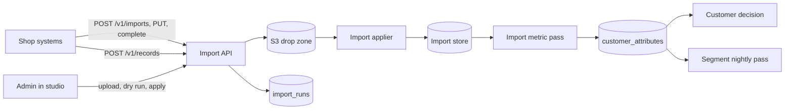

# Data import

## Purpose

A shop knows things about its customers that the website tracker never sees: every order, refund, and in-store purchase, and a customer record with a loyalty tier, an email address, and a phone number. Data import lets the shop push that data once a day, through an API or a spreadsheet in studio. Marketers then define metrics over it, such as "spend in the last 90 days", and use those metrics and the imported profile columns as conditions in journeys and segments. A segment that names imported fields also reaches customers who were never tracked.

## Scope

In scope:

- Datasets: their kinds, columns, roles, delivery modes, and versions.
- Source key scopes for imports, and one writer per snapshot dataset.
- The batch API: `POST /v1/imports`, `POST /v1/imports/{run_id}/complete`, `POST /v1/records/{record_type}`, and `GET /v1/imports/{run_id}`.
- Spreadsheet upload in studio, with a dry run.
- Imported metric definitions.
- The studio screens at `/data/datasets`, `/data/metrics`, `/data/imports`, `/data/privacy`, and the delivery section of `/data/sources`.
- Imported attributes in customer lookup.
- Privacy: masking, reveal, the access log, and per-person deletion.

Out of scope:

- Validating and storing records. The [import applier](../architecture/components/import-applier.md) does that.
- Computing metrics and publishing values. The [import metric pass](../architecture/components/import-metric-pass.md) does that.
- Evaluating imported fields in conditions. [Customer decision](../architecture/components/customer-decision.md#condition-language) does that for tracked people, and the segment runtime's nightly pass for imported-only customers ([SEG-FR-13](segments.md#functional-requirements)).
- The profile field picker of the condition editor. The [journey builder](journey-builder.md#conditions) owns it, and [segments](segments.md) use it.
- Route stages, the sidebar, and the route table. The [studio shell](studio-shell.md) owns them.
- Starting a journey from imported data. An import changes what conditions see. It starts nothing.
- Reference tables such as `products` or `categories`. A shop that wants "bought from Shoes" puts `category` on each order-line row. The owner decided this on 2026-11-08.
- Pull connectors, freshness under a day, a standard commerce schema, imported records on the customer timeline, and probabilistic matching.
- More than one shop per deployment ([decision 0027](../architecture/decisions/0027-multi-tenancy.md)).

## Terms

| Term | Meaning |
|---|---|
| Dataset | One kind of row the shop sends, such as `customers`, `orders`, or `order_lines`. Row in `import_record_types`. |
| Kind | `profile`, one row per customer, or `event`, one row per record. |
| Column | One field of a dataset, with a name, a display name, a type, a PII flag, and aliases. |
| Role | Which column plays customer key, record id, event time, updated at, deleted flag, email, or phone. |
| Customer key | The shop's customer id. It must equal, byte for byte, the `user_id` the trackers send. |
| Version | An immutable list of a dataset's columns, roles, aliases, delivery mode, time zone, and CSV delimiter. |
| Delivery mode | `incremental`: a file holds new and changed rows. `snapshot`: a file holds every current row of its writer. |
| Writer | A source key, or `studio` for uploads. A stored row belongs to the writer that last delivered it. A snapshot never removes a `studio` row. |
| Run | One delivered file. Row in `import_runs`. The [import applier](../architecture/components/import-applier.md#run-states) defines its states. |
| Imported metric | A function over one event dataset's records, such as `SUM` of `total` over 90 days. Row in `import_metric_definitions`. |
| Imported field | A value a condition can name as `<source>.<name>`, such as `orders.spend_90d` or `customers.loyalty_tier`. |
| Match rate | The share of a run's distinct customer keys that `identity_graph` holds as a `user_id`. |
| PII column | A column that holds personal data. Email and phone columns always are. An admin can flag any other column. |
| Reveal | An admin's request for one clear PII value of one customer. The server writes a `pii_access_log` row, then returns the value. |
| Tombstone key | A deployment secret, created once and never rotated, that keys the tombstone hash. |
| Tombstone | The HMAC-SHA-256 of a deleted person's customer key under the tombstone key. Row in `person_tombstones`. |

The [glossary](../product/glossary.md) defines terms shared across features, such as imported-only customer.

## Behavior

An admin opens `/data/datasets` and creates `orders`, kind `event`, delivery mode `incremental`. They drop a sample CSV file. Studio infers the columns `order_id`, `customer_id`, `created_at`, `total`, `status`, and `channel`, with their types. The admin maps `customer_id` to customer key, `order_id` to record id, and `created_at` to event time, and saves version 1.

On `/data/sources` the admin grants the shop's source key `orders`. The shop's nightly job calls `POST /v1/imports` at 01:40, uploads the file to the URL it gets back, and calls `complete`. The applier applies the run within 10 minutes, before the 03:00 pass.

A marketer opens `/data/metrics` and defines `spend_90d`: `SUM` of `total`, where `status = 'completed'`, over 90 days. The preview shows 41,200 customers with a value, a median of 1,450,000, and a maximum of 98,000,000. After the next nightly pass, the condition editor offers **Orders > Spend, last 90 days**, and a segment "Big spenders" on `orders.spend_90d >= 5000000` reaches tracked and imported-only customers alike.



### Datasets

A dataset has a system name, a display name, and a kind. The kind cannot change. A system name, of a dataset, a column, or a metric, is lowercase letters, digits, and underscores, and starts with a letter. Unlike a catalog event's name, it holds no `.` or `/`, because an imported field splits at its first `.`. A header that does not fit the rule maps to its column through an alias.

| Kind | One row per | Natural key | Applied as | Example |
|---|---|---|---|---|
| `profile` | Customer | The customer key | Upsert. The newest delivery wins, or the newest `updated_at` when the type maps one. | `customers`, `loyalty_members` |
| `event` | Record | The record id | Upsert by record id, so a re-sent or corrected order replaces the stored one | `orders`, `order_lines`, `refunds` |

Each kind has a fixed set of roles:

| Role | `profile` | `event` | Meaning |
|---|---|---|---|
| Customer key | Required | Required | The shop's customer id |
| Record id | No | Required | Unique per record within the type |
| Event time | No | Required | When the record happened |
| Updated at | Optional | Optional | Orders two versions of one row that arrive out of order |
| Deleted flag | Optional | Optional | A `boolean` column. True removes the row in incremental mode. |
| Email | Optional, repeatable | No | An identifier column |
| Phone | Optional, repeatable | No | An identifier column |

Every other column is an attribute, typed as one of the catalog's five types: `string`, `number`, `boolean`, `datetime`, and `json`. Email and phone columns are PII. An admin can flag any other column as PII, such as `address`.

A dataset also has a delivery mode, a time zone for datetimes without an offset, the reporting time zone by default, and for CSV a delimiter, comma or semicolon. A column may list aliases, for exports whose header names the shop cannot change.

A customer key is never trimmed or reformatted. If a shop's trackers send a phone number as `user_id`, the customer key must map to the phone column, not to the CRM id. The match rate on every run shows a wrong mapping: 3% on a first run means the key maps to the wrong column.

### Versions

A dataset has numbered versions. Each version is immutable. A run is validated against the version that is current when it starts, and records it.

| Change | Allowed | Effect |
|---|---|---|
| Add a column | Always | New version. Stored records lack the value until a delivery carries it. |
| Change a display name or the PII flag | Always | No new version. A new PII flag masks at once. |
| Rename, retype, or delete a column | Refused while an imported metric uses it, or a published campaign or a segment names its imported field | New version |
| Change a role mapping, the delivery mode, or the time zone | Refused while a run of the type is at `validating` or `applying` | New version. If every applied run's file is still in the drop zone, studio queues a `rederive` run with the version, and the applier re-derives the type's records. Otherwise the version applies to new deliveries only. The editor says which before saving. |

A refused change names each metric, campaign, and segment that uses the column. A use in a campaign is a `profile_property` condition in a `campaign_nodes` row of an active or paused campaign that names `<source>.<column>`. A use in a segment is the same condition in `segments.conditions_json`.

### Writers and scopes

The API reuses the source keys of the [data ingestion API](data-ingestion-api.md#source-keys). An admin grants a key one or more datasets, stored in `import_source_scopes`. A key without scopes can post events and can import nothing. A key scoped to `orders` cannot write `customers`. Revoking a key stops both uses from its next request.

A snapshot dataset accepts exactly one source key at a time. Granting a second key a snapshot type is refused in studio, and `POST /v1/imports` checks it again. To move the type to a new key, an admin revokes the old key's scope first. Studio uploads need the admin role and write as the writer `studio`.

A stored row belongs to the writer that last delivered it, and the newest delivery wins. A studio upload to a snapshot type applies as incremental, so five corrections never remove the shop's 100,000 rows. A shop's snapshot removes every row it does not hold except `studio` rows, so it never removes a correction for a customer it leaves out. A correction for a customer the shop does deliver lasts until that delivery, which overwrites it. The [applier](../architecture/components/import-applier.md#5-apply) defines the rules.

### Batch API

The routes sit next to `/v1/events` and take the same `Authorization: Bearer <source key>`.

| Route | Does |
|---|---|
| `POST /v1/imports` | Body: `record_type`, `file_name`, `byte_size`, `sha256`, and `format` (`csv`, `ndjson`, `csv.gz`, or `ndjson.gz`). Checks the scope and the one-writer rule. Creates a run at `uploading` and returns `run_id` and a presigned PUT URL for one object, valid 15 minutes. A `sha256` that a run of the same type already has at `queued`, `validating`, `quarantined`, `approved`, `applying`, or `applied` returns that run with `duplicate: true` and no URL. |
| `POST /v1/imports/{run_id}/complete` | Checks that the object exists and that its size and SHA-256 match the run, then moves the run to `queued`. A run already past `uploading` returns `200` with its state, so a retried call is safe. |
| `POST /v1/records/{record_type}` | Incremental datasets only. Body: `{ "records": [ ... ] }`, up to 1,000 records and 5 MiB. Writes the batch as one NDJSON file in the drop zone and queues a run. Returns `run_id`. |
| `GET /v1/imports/{run_id}` | The run's state, its report without row values, and `first_pass_id`, the nightly pass that first included it. A key may read only its own runs. |

`POST /v1/records` refuses a snapshot type, because a batch of 1,000 records applied as a snapshot would remove every other row of the type. The one-writer rule guards snapshot types only, so the route needs no writer check beyond the scope.

| Case | Status |
|---|---|
| Missing, unknown, or revoked key | `401` |
| A key without a scope for the dataset, or not the snapshot type's key | `403` |
| A dataset that does not exist, or a run another key wrote | `404` |
| A body that is not JSON, lacks a field, has a field of the wrong type, or names an unknown `format` | `400` |
| `POST /v1/records` for a snapshot type | `409`, error `snapshot_type` |
| `complete` on a run at `expired` | `409`, error `run_expired` |
| `byte_size` over 512 MiB, or a `POST /v1/records` body over 5 MiB | `413` |
| `POST /v1/records` with more than 1,000 records | `422`, error `too_many_records` |
| `complete` when the object is missing or its size or SHA-256 differs | `422`. The run stays at `uploading`. |
| Over the source key's rate limit | `429`, as the [data ingestion API](data-ingestion-api.md#source-keys) does |

None of these creates a run.

A file is up to 512 MiB, compressed or not. A larger `byte_size` returns `413`. Runs of one dataset apply one at a time, in the order they completed.

```json
{
	"record_type": "orders",
	"file_name": "orders-2026-11-07.csv.gz",
	"byte_size": 18204411,
	"sha256": "9f2c41d0e8b7a6c5d4e3f2a1b0c9d8e7f6a5b4c3d2e1f0a9b8c7d6e5f4a3b2c1",
	"format": "csv.gz"
}
```

### Studio upload

An admin opens a dataset, drops a CSV or XLSX file, and maps its headers to columns. Studio reads an XLSX file's first sheet and converts it to CSV. Studio then runs the applier's validation as a dry run and shows its report and 20 preview rows, before anything is stored. The shrink guard and the record cap depend on what is stored when the run applies, so the dry run shows them as of now and says they may differ at apply time. **Apply** queues the run like any other. The records are stored when the run applies, and conditions see them after the next nightly pass.

### Formats

- CSV: UTF-8, RFC 4180, a header row, and the dataset's delimiter.
- NDJSON: one JSON object per line.
- Either may be gzip-compressed.
- XLSX through studio only.

Headers match column names or aliases exactly.

### Imported metrics

Every staff user may define imported metrics. An imported metric names an `event` dataset, a function, a column where the function needs one, filters on the type's columns, and a window in days or none. The [import metric pass](../architecture/components/import-metric-pass.md#2-compute-values) defines each function.

| Function | Needs | Value |
|---|---|---|
| `COUNT` | No column | `number` |
| `SUM`, `AVG`, `MIN`, `MAX`, `MEDIAN` | A `number` column | `number` |
| `DISTINCT_COUNT` | A column | `number` |
| `LATEST` | A column | The column's type |
| `FIRST_TIME`, `LAST_TIME` | No column | `datetime` |

A metric's name follows the system name rule in [Datasets](#datasets) and is unique within its dataset. Its imported field is `<dataset>.<name>`. No function returns a day count. "Days since last order" is `orders.last_order_at` with the relative-date operator `more_than_days_ago` ([customer decision](../architecture/components/customer-decision.md#condition-language)).

Changing a metric's function, column, filters, or window changes its values at the next pass. Renaming a metric is refused while an active or paused campaign or a segment names its imported field, with the uses named. A metric is never deleted. Staff archive it instead, and archive is refused while anything uses it, by the same rule. An archived metric is frozen: the nightly pass stops computing it, its stored values stay as of the last pass, and no condition picker offers it. **Unarchive** brings it back into the pickers, and the next pass computes it again. Studio keeps no history of a metric's values, only the latest. `user_metric_definitions` is untouched: imported metrics are hand-made by design and live apart (CMP-FR-17). Studio lists both kinds on one page, **Data > Metrics**, where they are called event metrics and dataset metrics.

The editor previews the distribution as of the last finished pass's `as_of`, computed from the import store: customers with a value, minimum, median, and maximum.

### Privacy

Emails and phones are stored in plain form, so a sender can use them later. [Decision 0042](../architecture/decisions/0042-keep-imported-contact-details-plain-behind-masking-and-tombstones.md) records the protections:

- **Encrypted at rest.** The disk under each Postgres cluster that holds imported data is encrypted, and the drop zone's bucket encrypts every object on the server. The drop zone keeps no older object versions, so a rewritten file leaves no copy behind.
- **Masked on the server, for everyone.** Every studio response masks every PII value, for admins too. An email keeps its first character and its domain, such as `n***@gmail.com`. A phone keeps its country code and its last three digits, such as `+84 *** *** 678`. Any other PII value shows as `***`.
- **Reveal is its own call.** An admin's **Reveal** sends one server request for one field of one customer. The server writes the `pii_access_log` row first and then returns that one value. No other response carries a clear PII value, except the rejects download.
- **Access log.** Two actions read clear PII, and a deletion request is logged with them. Admins read the log at `/data/privacy`. The [import applier](../architecture/components/import-applier.md#1-take-a-run) deletes rows older than 365 days.

| `action` | When | `customer_key` | `customer_key_hash` | `run_id` | `fields` |
|---|---|---|---|---|---|
| `reveal` | An admin reveals one value | The customer's key | Null | Null | The one field revealed, such as `["customers.phone"]` |
| `rejects_download` | An admin downloads a run's rejects file | Null | Null | The run | Every PII column of the run's version |
| `deletion_request` | An admin asks to delete a person | Null | The tombstone | Null | Empty |

Every row also holds `id`, `staff_id`, `at`, and `route`. There is no unmasked export in this version.

- **Delete a person.** An admin enters a customer key at `/data/privacy` and confirms. Studio stores the key's tombstone in `person_tombstones` at state `requested`, and writes a `deletion_request` row. Neither row holds the key. The [applier](../architecture/components/import-applier.md#7-delete-a-person) deletes the person's imported rows, rewrites the drop-zone files that hold them, and replaces the key with its tombstone in every earlier `reveal` row. The next nightly pass removes their `customer_attributes` rows, and skips the tombstone from then on. The page shows the request's state. Deletion covers imported data only.
- **Backups.** No backup or point-in-time recovery runs for either Postgres cluster today. If one is added, it keeps at most 30 days. A restore re-applies every tombstone and records each drop-zone file's checksum again, because a file rewritten after the backup no longer matches the restored `stored_sha256`. Both happen before the applier takes a run or the pass starts. The applier also writes each tombstone to the drop zone, so a restore of the main Postgres from before a deletion gets the tombstone back.

### Identity

The import touches identity in three phases. Each waits for its identity contract.

| Phase | Waits for | The import does |
|---|---|---|
| 1 | Nothing | Stores normalized emails and phones in `import_identifiers` and the profile's `customer_attributes` row. No identity write. |
| 2 | #231 typed identifiers, #232 identity graph | Publishes identifier observations to the graph's owner, keyed by the customer key. Never writes `identity_graph` itself. |
| 3 | #228, #230, #233 | Observations may cause merges, under the safety rules below. |

Phase 1 is in this contract. Phases 2 and 3 get their requirements when their identity contracts are accepted. The safety rules they must keep, decided by the design:

1. The shop's customer key is the authority. An import never merges two sets that each hold a `user_id`.
2. A value two or more customer keys hold is shared, links nothing, and is counted in the report.
3. Placeholder values never link.
4. A merge may only fold a set with no `user_id` into the set of the one customer key that holds the value.
5. Every import merge names the cause `import:<run_id>` and the linking identifier (IDG-FR-08).
6. A run whose observations would cause merges for more than 1% of its rows, or more than 1,000 merges, holds those observations for an admin.

### Studio screens

The screens live in the Data area at the routes the [studio shell](studio-shell.md) reserves. Each ships at stage `preview`, then `shipped`. The shell's owner adds each route and flips its stage.

| Route | Screen | Who | Shows and does |
|---|---|---|---|
| `/data/datasets` | Datasets | Staff read, admins write | Each dataset with its kind, current version, writer, last run and its state, stored rows, and the customer key match rate. |
| `/data/datasets/[id]` | Dataset editor and upload | Admin | Name, kind, delivery mode, time zone, delimiter. Columns with type, PII flag, and aliases, inferred from a sample file. A picker per role. Version history with each version's diff. Refused changes list their uses. **Upload** with the dry run and **Apply**. |
| `/data/metrics` | Metrics | Staff | Every metric in one list, event metrics from [campaign management](campaign-management.md#metric-definitions) and dataset metrics from this contract, with source, calculation, window, state (live, paused, not updating, or archived), uses, customers with a value, and creator. Archived metrics are hidden until the viewer asks to see them. Event metrics are read-only apart from archive and unarchive. The dataset metric editor picks dataset, function, column, filters, and window, and shows the preview. **Archive** shows only on a metric nothing uses, and **Unarchive** on an archived one. |
| `/data/imports` | Runs and passes | Staff read, admins act | Runs newest first, with writer, file, version, row counts, rejects, duration, and the pass that first included each. Nightly passes with state, reason, changed rows, WAL written, and pauses. When the latest `done` pass is more than a day old, the page says how old the imported values are and why the passes since failed, such as `timed_out:disk_reading`. Run detail with the report and masked sample rows. Admins approve or discard a quarantined run, retry a failed run or pass, and download rejects. The page calls a `quarantined` run "Held for review" and a `failed` pass "Stopped". |
| `/data/sources` | Delivery section of the source keys page | Admin | Per source key, the datasets it may write, the endpoint, and a sample `curl` for `POST /v1/imports`. |
| `/data/privacy` | Privacy | Admin | Delete a person by customer key and follow the request. Read the access log. |

Customer lookup shows imported attributes by source, masked, with **Reveal** for admins, and finds a customer key that only imports know ([customer lookup](customer-lookup.md)). Studio's `/settings` page shows the default phone country and the reporting time zone, read-only.

## Functional requirements

| Id | Requirement |
|---|---|
| DIM-FR-01 | Admins must be able to create datasets and save versions. Staff without the admin role must be able to read them and must not change them. |
| DIM-FR-02 | Dataset, column, and metric names must follow the system name rule in [Datasets](#datasets). A dataset's name must be unique, and its kind must not change. |
| DIM-FR-03 | A version must map every required role of its kind, must map each role to at most one column except email and phone, and must type every column as one of the five catalog types. A deleted flag must map to a `boolean` column. |
| DIM-FR-04 | A saved version must not change. Each run must record the version it was validated against. |
| DIM-FR-05 | Renaming, retyping, or deleting a column must be refused while an imported metric uses it, or an active or paused campaign or a segment names its imported field. The refusal must name each use. The check and the change must run in one transaction. |
| DIM-FR-06 | Changing a role mapping, the delivery mode, or the time zone must be refused while a run of the type is at `validating` or `applying`. The editor must say, before saving, whether the change re-derives stored records or applies to new deliveries only. When it re-derives, studio must create the `rederive` run at `queued` in the same transaction as the version. |
| DIM-FR-07 | Flagging a column as PII must mask its values in every studio view from the next request. |
| DIM-FR-08 | A source key must import only into datasets it is scoped to. A request for another type must get `403` and create no run. |
| DIM-FR-09 | A snapshot dataset must have at most one source key scoped to it. Granting a second must be refused in studio, and `POST /v1/imports` must refuse a key that is not scoped to the type. |
| DIM-FR-10 | `POST /v1/imports` must create a run at `uploading` and return a presigned PUT URL scoped to one object for 15 minutes. A `sha256` that a run of the type has at `queued`, `validating`, `quarantined`, `approved`, `applying`, or `applied` must return that run with `duplicate: true` and no URL. |
| DIM-FR-11 | `POST /v1/imports/{run_id}/complete` must queue the run only when the object's size and SHA-256 match the run. A run already past `uploading` must return `200` with its state and change nothing. (the lead's default) |
| DIM-FR-12 | `POST /v1/records/{record_type}` must accept only incremental datasets, up to 1,000 records and 5 MiB. It must store the batch as one NDJSON file in the drop zone, and must queue one run for it. (the lead's default) |
| DIM-FR-29 | Every import route must answer each case in the status table of [Batch API](#batch-api) with its status, and must create no run for any of them. |
| DIM-FR-13 | `GET /v1/imports/{run_id}` must return the run's state, its report without row values, and `first_pass_id`, and only to the key that wrote the run. |
| DIM-FR-14 | A request with a file over 512 MiB must get `413` and create no run. |
| DIM-FR-15 | Studio upload must be admin only, must write as the writer `studio`, must show the dry-run report and 20 preview rows before anything is queued, and must queue the run only on **Apply**. |
| DIM-FR-16 | The dry-run report's rejects, file-level failures, and reject threshold must equal the applier's for the same file and version. It must show the shrink guard and the record cap as of the dry run, marked as able to change by apply time. |
| DIM-FR-17 | Every staff user must be able to create, edit, archive, and unarchive imported metrics, and no one may delete one. A metric's function must take the column types in [Imported metrics](#imported-metrics), and its name must be unique within its dataset. |
| DIM-FR-18 | Renaming or archiving an imported metric must be refused while an active or paused campaign or a segment names its imported field, and the refusal must name each use. An archived metric must not be computed by the nightly pass, must keep its last stored values, and must not be offered by any condition picker. Unarchiving must make it pickable again and computed from the next pass. |
| DIM-FR-19 | The metric editor must preview customers with a value, minimum, median, and maximum, computed from the import store as of the last finished pass's `as_of`. |
| DIM-FR-20 | `/data/imports` must list runs and passes with the fields in [Studio screens](#studio-screens), and must say how old the imported values are when the latest `done` pass is more than a day old. Only admins may approve or discard a quarantined run, retry a failed run or pass, and download rejects. A pass retry must stamp `retry_requested_at` and nothing else. |
| DIM-FR-21 | Every studio response must mask every PII value on the server by the rules in [Privacy](#privacy), whatever the viewer's role. Only a reveal and a rejects download may return a clear PII value. (the lead's default) |
| DIM-FR-22 | A reveal must be an admin-only server call for one field of one customer key. It must write its `reveal` row before it returns, and must return only that value. A rejects download and a deletion request must each write their row. Every row must have the shape its action has in [Privacy](#privacy). Only a `reveal` row may hold a clear customer key. (the lead's default) |
| DIM-FR-23 | Deleting a person must be admin only, must store only the key's HMAC-SHA-256 under the tombstone key in `person_tombstones`, and must show the request's state. (the lead's default) |
| DIM-FR-28 | Once a tombstone is `done`, no `pii_access_log` row may hold its customer key in clear. (the lead's default) |
| DIM-FR-24 | The datasets list and every run report must show the customer key match rate. |
| DIM-FR-25 | Every route and server action of data import must check the session and the role itself. |
| DIM-FR-26 | An import must not start a journey or emit a trigger. |
| DIM-FR-27 | Phase 1 must write no identity table. |

## Non-functional requirements

| Id | Requirement |
|---|---|
| DIM-NFR-01 | The drop zone must delete `incoming/` objects after 30 days and `rejects/` objects after 14 days. |
| DIM-NFR-02 | `pii_access_log` rows must be kept 365 days and then deleted. The import applier deletes them, at most one day late. (the lead's default) |
| DIM-NFR-03 | Shops must never hold AWS credentials. Uploads go through presigned URLs only. |
| DIM-NFR-04 | A run applied before a night's pass starts, at 03:00 in the reporting time zone, must reach conditions when that pass is `done`, plus the profile lookup's cache of 5 minutes. A run applied later reaches them after the next night's pass. |
| DIM-NFR-05 | The import routes must keep the data ingestion API's rate limit per source key. |
| DIM-NFR-06 | The import routes, the applier, and the metric pass must not log a row value, a customer key, or a clear PII value. |
| DIM-NFR-07 | The import applier and the import metric pass must not run against a production main Postgres until #320 part 1 is merged and live (CDC window shortened, cap 8 GB). Until then their production schedules stay suspended, and they run only against a staging copy. |
| DIM-NFR-08 | The disk under each Postgres cluster that holds imported data must be encrypted at rest. The drop zone's bucket must encrypt every object on the server, and must keep no noncurrent object version under `imports/`. The import must accept no production delivery until this holds. (the lead's default) |
| DIM-NFR-09 | A backup or point-in-time recovery of either Postgres cluster, if one is added, must keep at most 30 days. A restore must re-apply every tombstone, and record each drop-zone file's SHA-256 again in its run's `stored_sha256`, before the applier takes a run or the metric pass starts. (the lead's default) |

## Interfaces

| Direction | Interface | Contract |
|---|---|---|
| In | `POST /v1/imports`, `POST /v1/imports/{run_id}/complete`, `POST /v1/records/{record_type}`, `GET /v1/imports/{run_id}` | [Batch API](#batch-api) |
| UI | `/data/datasets`, `/data/datasets/[id]`, `/data/metrics`, `/data/imports`, `/data/privacy`, the delivery section of `/data/sources` | [Studio screens](#studio-screens) |
| Write | S3 `imports/incoming/<app_id or studio>/<record_type>/<yyyy-mm-dd>/<run_id>.<ext>` | Delivered files, through presigned PUT or studio |
| Read and write | `import_record_types` | `id`, `name`, `display_name`, `kind`, `current_version`, `created_by`, `created_at` |
| Read and write | `import_record_type_versions` | `record_type_id`, `version`, `columns`, `roles`, `delivery_mode`, `time_zone`, `delimiter`, `created_at`. `columns` holds each column's name, display name, type, PII flag, and aliases. |
| Read and write | `import_metric_definitions` | `id`, `record_type_id`, `name`, `display_name`, `function`, `column`, `filters`, `window_days`, `archived_at` |
| Read and write | `import_source_scopes` | (`source_key_id`, `record_type_id`) |
| Read and write | `import_runs` | `id`, `record_type_id`, `version`, `source` (`api`, `drop`, `studio`, or `rederive`), `writer`, `format`, `byte_size`, `file_key`, `sha256`, `stored_sha256`, `state`, `reason`, `counts`, `first_pass_id`, `created_at`, `confirmed_at`, `approved_by`, `approved_at`, `started_at`, `finished_at`. Creates runs and makes the transitions studio owns in the [applier's run states](../architecture/components/import-applier.md#run-states). The [applier's interfaces](../architecture/components/import-applier.md#interfaces) define each column. |
| Read | `import_metric_passes`, `customer_attributes` | Pass history, and imported attributes for customer lookup |
| Read | Import store | The metric preview |
| Write | `pii_access_log` | `id`, `staff_id`, `at`, `action`, `route`, `customer_key`, `customer_key_hash`, `run_id`, `fields`. The shape of each action is in [Privacy](#privacy). |
| Write | `person_tombstones` | `customer_key_hash` (the tombstone), `requested_by`, `requested_at`, `state` |
| Read | `ingestion_source_keys` | Keys and their revocation |
| Read | `campaign_nodes`, `segments` | Uses of imported fields, for the guards |

## Failure handling

| Case | Behavior |
|---|---|
| A key's request names a dataset that does not exist | `404`, no run. |
| An upload never arrives | The run expires at the applier's first start more than 15 minutes after it was created, so 15 to 25 minutes after. |
| `complete` before the upload finished | `422`. The client calls `complete` again after the upload. |
| `complete` called twice | The second call returns `200` with the run's state. |
| The same file posted twice | The second call returns the first run with `duplicate: true`, whether it is still queued or already applied. |
| A refused version change or metric change | Write nothing, and name every use. |
| The import store is unreachable from studio | The metric preview says it is unavailable. Every other screen works. |
| A deletion request for a key with no imported data | Store the tombstone anyway, so a later delivery of that key is rejected. |

## Acceptance criteria

- Given an editor, when they try to create a dataset, then the action fails and writes nothing. (DIM-FR-01, DIM-FR-25)
- Given a dataset named `Orders-2026`, then the save is refused and names the system name rule. (DIM-FR-02)
- Given an `event` version without an event time mapping, then the save is refused. (DIM-FR-03)
- Given a run validated against version 2, when version 3 is saved, then the run still shows version 2. (DIM-FR-04)
- Given `orders.total` used by `spend_90d`, when an admin deletes `total`, then the change is refused and names `spend_90d`. (DIM-FR-05)
- Given a paused campaign whose check names `customers.loyalty_tier`, when an admin renames `loyalty_tier`, then the change is refused and names the campaign and node. (DIM-FR-05)
- Given a run at `applying`, when an admin changes the delivery mode, then the change is refused. (DIM-FR-06)
- Given a column `address` newly flagged PII, when an editor opens a run's sample rows, then `address` shows `***`. (DIM-FR-07)
- Given a key scoped to `orders`, when it posts to `POST /v1/imports` for `customers`, then the response is `403` and no run exists. (DIM-FR-08)
- Given `customers` as a snapshot type with writer `sk_12`, when an admin grants it to `sk_14`, then studio refuses. When `sk_14` posts `POST /v1/imports` for `customers`, then the response is `403`. (DIM-FR-09)
- Given a `sha256` of an applied `orders` run, when the shop posts it again, then the response holds that run and `duplicate: true` and no URL. (DIM-FR-10)
- Given an uploaded object 10 bytes shorter than the run's `byte_size`, when the shop calls `complete`, then the response is `422` and the run stays `uploading`. (DIM-FR-11)
- Given 1,001 records posted to `POST /v1/records/orders`, then the response is `422` `too_many_records` and no run exists. Given 1,000, then one run is queued with one NDJSON file. (DIM-FR-12, DIM-FR-29)
- Given `customers` as a snapshot type, when its key posts to `POST /v1/records/customers`, then the response is `409` `snapshot_type` and no run exists. (DIM-FR-12)
- Given a 6 MiB body to `POST /v1/records/orders`, then the response is `413`. Given a body that is not JSON, then `400`. Given `complete` on an expired run, then `409` `run_expired`. Given `complete` by `sk_14` on `sk_12`'s run, then `404`. (DIM-FR-29)
- Given a run already at `queued`, when the shop calls `complete` again, then the response is `200` with `queued`, and the run is unchanged. (DIM-FR-11)
- Given a queued `orders` run, when the shop posts the same `sha256` again, then the response holds that run and `duplicate: true`. (DIM-FR-10)
- Given a run written by `sk_12`, when `sk_14` reads it, then the response is `404`. (DIM-FR-13)
- Given `byte_size` 600 MiB, then the response is `413`. (DIM-FR-14)
- Given an admin who uploads an XLSX file, then studio shows the dry-run report and 20 rows, and no run is queued until **Apply**. (DIM-FR-15)
- Given a file with 60 rejects in 1,000 rows, then the dry run and the applier both report 60 rejects and the threshold. Given a snapshot file, then the dry run shows the shrink guard as of now, marked as able to change. (DIM-FR-16)
- Given an editor, when they create `spend_90d` as `SUM` of `total`, then it is saved. Given `SUM` of `status`, a `string`, then the save is refused. (DIM-FR-17)
- Given a segment that names `orders.spend_90d`, when a marketer archives `spend_90d`, then it is refused and names the segment. (DIM-FR-18)
- Given `orders.aov` that nothing uses, when a marketer archives it, then the next pass leaves its `customer_attributes` values as they were, and the segment and journey pickers do not list it. When they unarchive it, then the pickers list it and the next pass computes it. (DIM-FR-18)
- Given any staff user on `/data/metrics`, then no metric offers **Delete**, and a delete request to the server is refused. (DIM-FR-17)
- Given a finished pass, when a marketer edits a metric, then the preview shows the count, minimum, median, and maximum as of that pass's `as_of`. (DIM-FR-19)
- Given an editor on `/data/imports`, then no approve, discard, retry, or download control shows, and the server refuses each action. (DIM-FR-20, DIM-FR-25)
- Given passes for the last two nights that failed with `timed_out:disk_reading`, then `/data/imports` says the imported values are from the pass before them, and names the reason. (DIM-FR-20)
- Given an editor, and then an admin, who opens a customer with the email `nguyen@gmail.com`, then each response body holds `n***@gmail.com` and not the clear value. (DIM-FR-21)
- Given an admin who reveals a customer's phone, then one request returns only that phone, and `pii_access_log` gains a `reveal` row naming the admin, the route, the customer key, and `customers.phone`, written before the response. (DIM-FR-22)
- Given an editor who calls the reveal request directly, then the response is refused and holds no value. (DIM-FR-22, DIM-FR-25)
- Given an admin who downloads the rejects of run `run-8f2c`, then `pii_access_log` gains a `rejects_download` row with `run_id` `run-8f2c` and no customer key. (DIM-FR-22)
- Given an admin who deletes `0912345678`, then `person_tombstones` and the `deletion_request` row hold its HMAC-SHA-256 under the tombstone key and not the key, and the page shows `requested`, then `done`. (DIM-FR-23)
- Given two earlier `reveal` rows for `0912345678`, when its tombstone reaches `done`, then both rows hold the tombstone in `customer_key_hash` and null in `customer_key`. (DIM-FR-28)
- Given a run whose 3% of customer keys are in `identity_graph`, then the run report and the datasets list show 3%. (DIM-FR-24)
- Given an applied run, then no trigger reaches `journey-engine-matched-events` because of it. (DIM-FR-26)
- Given a phase 1 run with emails, then `identity_graph` is unchanged. (DIM-FR-27)
- Given an `incoming/` object 31 days old, then it is gone. (DIM-NFR-01)
- Given a `pii_access_log` row 366 days old, when the applier has started on each of the last two days, then the row is gone. Given a row 364 days old, then it stays. (DIM-NFR-02)
- Given a call to `POST /v1/imports`, then the response holds a presigned URL for one object and no AWS credential, and no import route accepts a credential in its body. (DIM-NFR-03)
- Given a run applied at 02:50 and the 03:00 pass `done` at 03:40, then a condition on that run's records sees them by 03:45. Given a run applied at 03:05, then that pass excludes it, and the next night's pass includes it. (DIM-NFR-04)
- Given a source key over its rate limit, when it calls `POST /v1/imports`, then the response is `429` and no run is created. (DIM-NFR-05)
- Given a run with an email column, a reveal, and a pass, then no log line of the import routes, the applier, or the pass holds a customer key, an email, or any column value from the file. (DIM-NFR-06)
- Given the main Postgres with `max_slot_wal_keep_size` 3 GB and the CDC commit delay at 120 checkpoints, then the production schedules of the applier and the metric pass are suspended. (DIM-NFR-07)
- Given the production deployment, then each node volume that holds a Postgres volume reports encryption on, the bucket reports default server-side encryption, and no noncurrent version of an `imports/` object exists one day after a rewrite. (DIM-NFR-08)
- Given a backup policy added for either cluster, then it keeps at most 30 days. Given a restore of the import store to before a deletion, when the applier next starts, then the person's rows are gone before any run is taken. (DIM-NFR-09)

## Open questions

Each has a default this contract follows. The owner can change it later without rework.

- Retire the agreed profile feed into `customer_profiles`? Default: keep it, offer the import to new shops, and decide once one shop runs on the import.
- Full deletion before launch? Default: import-only deletion. Tracked behavior, journeys, and identity rows wait for the consent and deletion contract.
- History depth. Default: 3 years, and 5 million records on a Free Plan-sized store.
- Raw file retention. Default: 30 days, so re-derives and replays work.
- Email and phone as match keys, and per-type limits, stay open in #228 and #229. Only phase 3 needs their answers.

### The lead's defaults

The lead chose these rules on 2026-11-08, while the contracts were reviewed, where the design did not settle them. Each is the lead's default, not the owner's decision, and the owner may reverse any of them. Requirements that carry one are marked "(the lead's default)".

| Rule | Effect | Ids |
|---|---|---|
| Every response is masked for every role, and a reveal is one logged call for one value | Admins see masks too | DIM-FR-21, DIM-FR-22 |
| The tombstone is an HMAC under a key that never rotates, mirrored to the drop zone | Losing the key makes every tombstone miss | DIM-FR-23, IAP-FR-22 |
| A deleted person's clear key is replaced by the tombstone in earlier `reveal` rows | The audit trail keeps no clear key | DIM-FR-28 |
| A future backup keeps at most 30 days, and a restore re-applies tombstones and records checksums again | A deletion is complete 30 days after it runs | DIM-NFR-09 |
| The drop zone keeps no older object versions | A rewritten file leaves no copy | DIM-NFR-08 |
| The applier deletes access-log rows after 365 days | The log holds one year | DIM-NFR-02 |
| No unmasked export in this version, and the access log has no reason column | Clear values leave only by reveal or rejects download | [Privacy](#privacy) |
| Each job runs under one advisory lock, and a crashed run resets to `queued` or `approved` | No two instances run | IAP-FR-23, IAP-FR-24, IMP-FR-02 |
| The newest delivery wins, and an unchanged row takes the new writer | A shop's next delivery overwrites a studio correction | IAP-FR-25 |
| A snapshot removes every row no row of the file holds except `studio` rows, and a studio upload to a snapshot type applies as incremental | Corrections survive removal, and studio cannot replace a snapshot | IAP-FR-13 |
| The shrink guard compares with the type's last snapshot from any source key | A new key's truncated first file is still caught | IAP-FR-10 |
| A re-derive skips the threshold and the shrink guard, keeps the cap, and rolls back and quarantines on a file-level failure | A remap that old files cannot satisfy changes nothing | IAP-FR-20 |
| The import store runs on a compute node | The applier's ungoverned writes stay off `data-1` | IAP-NFR-07 |
| `POST /v1/records` refuses snapshot types, and `complete` is idempotent | Shops send snapshots as files | DIM-FR-11, DIM-FR-12 |
| A failed pass may be retried only while no later pass is `done`, through `retry_requested_at` | Old values never replace newer ones | IMP-FR-18, IMP-FR-19 |
| A pass not `done` 15 minutes before the next scheduled start fails | A stall shows on `/data/imports` instead of freezing values | IMP-FR-20 |
| The cluster WAL ceiling is 2 MB/s, resuming under 1.5 MB/s | The pass waits out traffic peaks | IMP-NFR-02 |
| An unset slot cap pauses the pass | The pass needs #320 part 1's cap | IMP-FR-13 |

## Related

- [Import applier](../architecture/components/import-applier.md)
- [Import metric pass](../architecture/components/import-metric-pass.md)
- [Customer decision](../architecture/components/customer-decision.md)
- [Journey builder](journey-builder.md)
- [Segments](segments.md)
- [Customer lookup](customer-lookup.md)
- [Data ingestion API](data-ingestion-api.md)
- [Studio shell](studio-shell.md)
- [0040. Import through a batch path and a separate store](../architecture/decisions/0040-import-through-a-batch-path-and-a-separate-store.md)
- [0041. Imported data reaches conditions as profile attributes](../architecture/decisions/0041-imported-data-reaches-conditions-as-profile-attributes.md)
- [0042. Keep imported contact details in plain form behind masking and tombstones](../architecture/decisions/0042-keep-imported-contact-details-plain-behind-masking-and-tombstones.md)
- [Known issues](../known-issues/features/data-import.md)
