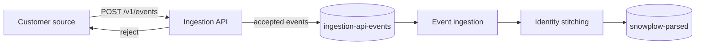
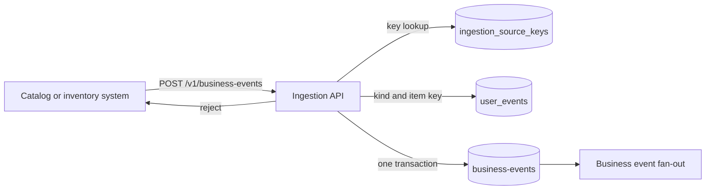

# Data ingestion API

## Purpose

Some customers already collect tracking data with their own tools, or produce events on their servers: orders, payments, deliveries. Today they must re-instrument with a Snowplow tracker, or speak the Snowplow tracker protocol by hand. This API accepts their events in a plain JSON format, checks each one, and sends it down the same path as a tracker hit, so that identity stitching, metrics, and journeys see no difference.

## Scope

In scope:

- An authenticated HTTPS endpoint that accepts a batch of events.
- A second endpoint for business events, which concern an item rather than a person. See [Business events](#business-events).
- Per-event validation and a per-event result.
- Handing accepted events to [event ingestion](../architecture/components/event-ingestion.md), so that they pass through [identity stitching](../architecture/components/identity/identity-stitching.md).

Out of scope:

- Profile data. `customer_profiles` is fed by another system.
- Snowplow tracker hits. They keep going to the collector.
- Deleting or correcting events after they are accepted.
- Backfill: importing history older than the allowed lateness of event-time processing.
- The Snowplow tracker protocol as a request body. The API takes only the plain JSON below.
- More than one customer on a deployment. A deployment serves one tenant, so a source key names a source, not a customer. See [decision 0027](../architecture/decisions/0027-multi-tenancy.md).

The owner decided on 2026-11-05 that the API writes to topics of its own, whose format carries no Snowplow fields, that the body is plain JSON only, that backfill is out of scope, that a deployment has one tenant, and that an admin creates and revokes source keys in `studio`.

## Terms

| Term | Meaning |
|---|---|
| Source | One system of one customer that sends events, such as "order service". Each source has its own key. |
| Source key | A secret that identifies a source. Sent in a request header. An admin creates and revokes it in `studio`. |
| App id | The name an admin gives a source when creating its key, such as `inventory-service`. Every event accepted with the key carries it. |
| Batch | One request: a list of events. |
| Accepted event | An event that passed validation and was handed to event ingestion. |
| Rejected event | An event that failed validation. The response says why. Nothing is stored. |

## Behavior

The order service posts two events:

```http
POST /v1/events
Authorization: Bearer <source key>
Content-Type: application/json

{
	"events": [
		{
			"event_id": "6b0c8f3e-1d2a-4c55-9a77-1f0e2d3c4b5a",
			"event_name": "com.acme/purchase",
			"event_time": "2026-10-18T09:13:02.120Z",
			"user_id": "0912345678",
			"attributes": { "order": { "id": "SO-1001", "total": 12990000 } }
		},
		{
			"event_id": "not-a-uuid",
			"event_name": "com.acme/purchase",
			"event_time": "2026-10-18T09:14:00Z"
		}
	]
}
```

The response says which events were accepted:

```json
{
	"accepted": 1,
	"rejected": [
		{ "index": 1, "event_id": "not-a-uuid", "reason": "event_id must be a UUID" }
	]
}
```

The API writes the first event to the topic `ingestion-api-events`, which [event ingestion](../architecture/components/event-ingestion.md) reads next to the collector's topic. The message is keyed by `anonymous_id`, else `user_id`, the key identity stitching runs under. `event_time` is in epoch milliseconds, `app_id` is the app id of the key that posted it, and an absent id or `attributes` is `null`:

```json
{
	"schema_version": 1,
	"event_id": "6b0c8f3e-1d2a-4c55-9a77-1f0e2d3c4b5a",
	"event_name": "com.acme/purchase",
	"event_time": 1792314782120,
	"user_id": "0912345678",
	"anonymous_id": null,
	"app_id": "order-service",
	"attributes": { "order": { "id": "SO-1001", "total": 12990000 } }
}
```

The API writes each request's accepted events in one Kafka transaction, as for business events, and event ingestion reads committed messages only. The event then appears on `snowplow-parsed` with `event_name = com.acme/purchase`, `event_json = {"order": {...}}`, and the `canon_id` of user `0912345678`, as if a tracker had sent it.

The name stays as sent, `com.acme/purchase`. The platform uses one form of event name, `<vendor>/<name>`, in the catalog, in tracking, and in this API, so a sender sends the name that the [event catalog](event-catalog.md) lists. A tracker's self-describing event takes the same name from its schema.



### Business events

A business event concerns an item, not a person: a price drop, a restock. The customer's catalog or inventory system posts it to its own route, and [business event fan-out](../architecture/components/business-event-fan-out.md) finds the people it concerns:

```http
POST /v1/business-events
Authorization: Bearer <source key>
Content-Type: application/json

{
	"events": [
		{
			"event_id": "0f8b2c1e-5d4a-4c3b-9a21-7e6f5d4c3b2a",
			"event_name": "com.acme/price_drop",
			"event_time": "2026-10-21T09:00:00Z",
			"attributes": { "product": { "id": "SKU-123", "price": 899000 }, "drop_percent": 15 }
		}
	]
}
```

The event name must be a catalog event of kind `business`. The API reads the item key from the attribute that the catalog names, here `product.id`, and rejects an event without it. A business event carries no person, so the API rejects one with `user_id` or `anonymous_id`. Accepted business events go to the topic `business-events`, keyed by event name and item key. They do not pass through identity stitching.

The accepted price drop above becomes this message, with the key `com.acme/price_drop` + U+001F + `SKU-123`. `event_time` is in epoch milliseconds, and `app_id` is the app id of the key that posted it.

```json
{
	"schema_version": 1,
	"event_id": "0f8b2c1e-5d4a-4c3b-9a21-7e6f5d4c3b2a",
	"event_name": "com.acme/price_drop",
	"event_time": 1792573200000,
	"item_key": "SKU-123",
	"app_id": "inventory-service",
	"attributes": { "product": { "id": "SKU-123", "price": 899000 }, "drop_percent": 15 }
}
```

The API writes each request's accepted events in one Kafka transaction. A reader of `business-events` reads committed messages only, so a request that fails with `503` leaves nothing visible.



### Source keys

An admin opens the source keys page, `/data/sources` in studio v2 ([data health](data-health.md#source-keys-view)), enters an app id, and creates a key. Until cutover, the classic page `/admin/source-keys` does the same. `studio` shows the key once and stores only its SHA-256 hash, with the app id. An app id has at most two keys that are not revoked. To rotate a key, the admin creates a second key for the app id, switches the sender to it, and then revokes the old one, so the sender is never without a valid key ([decision 0048](../architecture/decisions/0048-ingestion-keeps-tracker-parity-a-per-replica-limit-and-two-keys-for-rotation.md)). A third create for the app id is refused until one key is revoked. A revoked key is refused with `401` from the next request on.

A key can also be granted record types for [data import](data-import.md#writers-and-scopes), in `import_source_scopes`. A key without scopes imports nothing, and revoking a key stops its imports too (DIA-FR-40). A rotated key starts with no scopes, and the admin grants them again.

## Functional requirements

| Id | Requirement |
|---|---|
| DIA-FR-01 | The API must reject a request without a valid source key with `401`, and must store nothing from it. |
| DIA-FR-02 | Each event must have `event_id` (a UUID), `event_name` (non-empty), and `event_time` (ISO 8601 with a zone, or epoch milliseconds). An event without them must be rejected. |
| DIA-FR-03 | Each event must have `user_id` or `anonymous_id`, or both. An event with neither must be rejected, because it could never reach a journey. |
| DIA-FR-04 | `attributes`, when present, must be a JSON object. It becomes the event's `event_json`. |
| DIA-FR-05 | The API must validate each event on its own. One bad event must not reject the others in its batch. |
| DIA-FR-06 | The response must list every rejected event with its index, its `event_id` when present, and a reason. |
| DIA-FR-07 | Accepted events must reach `snowplow-parsed` through the same parsing and identity stitching as tracker hits. `anonymous_id` plays the role of `domain_userid`. |
| DIA-FR-08 | Sending the same `event_id` twice must not count the event twice in metrics or journeys. |
| DIA-FR-09 | Each accepted event must carry the source's app id, so that its origin can be traced. |
| DIA-FR-10 | Event names and attribute paths follow the same rules as tracker events: a sender sends the catalog's name, of the form `<vendor>/<name>`, rules match the name exactly, and refer to attributes by dotted path from the root of `attributes`. |
| DIA-FR-11 | `POST /v1/business-events` must accept only events whose name is a catalog event of kind `business`, and must reject the others with a reason. |
| DIA-FR-12 | A business event must carry its item key at the attribute path the catalog names for its event. An event without it must be rejected. |
| DIA-FR-13 | A business event must not carry `user_id` or `anonymous_id`. An event with either must be rejected. |
| DIA-FR-14 | Accepted business events must reach `business-events`, keyed by event name + U+001F + item key, with their `event_id`, name, time, item key, attributes, and the source's app id. |
| DIA-FR-15 | `POST /v1/events` must reject an event whose name is a catalog event of kind `business`, and name the business route. |
| DIA-FR-16 | Only an admin may create or revoke a source key. Creating one must show the key once and store only its hash. |
| DIA-FR-17 | A revoked key must be refused like a key that does not exist. |
| DIA-FR-18 | An app id must hold at most two keys that are not revoked. Creating a third must fail and write nothing. |
| DIA-FR-19 | Both routes must accept an event whatever its catalog entry's status. Status hides an event from the journey builder only. |
| DIA-FR-40 | A source key must import only into the record types `import_source_scopes` grants it, and a revoked key must import nothing, by the rules of [data import](data-import.md#writers-and-scopes). |

## Non-functional requirements

| Id | Requirement |
|---|---|
| DIA-NFR-01 | A batch holds at most 500 events and 1 MiB. A larger request gets `413` and stores nothing. |
| DIA-NFR-02 | Each source key has a rate limit, default 100 requests per second and configurable. Each app replica counts it on its own, so a deployment with N replicas accepts up to N times the limit and sets the limit to its intended total divided by N ([decision 0048](../architecture/decisions/0048-ingestion-keeps-tracker-parity-a-per-replica-limit-and-two-keys-for-rotation.md)). Over the limit, the API returns `429` with `Retry-After`. |
| DIA-NFR-03 | An accepted event reaches `snowplow-parsed` within 5 seconds at the 99th percentile. |
| DIA-NFR-04 | `200` means every accepted event is durably stored. A client that gets a timeout or a `5xx` may resend the whole batch. DIA-FR-08 makes that safe. |
| DIA-NFR-05 | Source keys are stored hashed, can be revoked, and never appear in logs. |
| DIA-NFR-06 | Only HTTPS is accepted. |

## Interfaces

| Direction | Interface | Contract |
|---|---|---|
| In | `POST /v1/events` | The batch above. `Authorization: Bearer <source key>`. |
| In | `POST /v1/business-events` | A batch of business events, in the same shape without `user_id` and `anonymous_id`. Same key, limits, and response. |
| Out | Kafka `business-events` | Accepted business events, key event name + U+001F + item key, in the message format in [Business events](#business-events). Written in transactions: readers use `read_committed`. Read by [business event fan-out](../architecture/components/business-event-fan-out.md). |
| Out | Response | `200` with the accepted count and the rejected list. `400` for a body that is not a batch. `401`, `413`, `429` as above. |
| Out | Kafka `ingestion-api-events` | Accepted person events from `POST /v1/events`, key `anonymous_id`, else `user_id`, in the message format in [Behavior](#behavior). Written in transactions: readers use `read_committed`. Read by [event ingestion](../architecture/components/event-ingestion.md). |
| UI | `/data/sources` | Create and revoke source keys. Admin only. Under `/v2` until the prefix drops, as the [studio shell](studio-shell.md#routes) says. |
| UI | `/admin/source-keys` | The classic page, the same actions, until cutover. From cutover it redirects to `/data/sources`. |
| Store | Table `ingestion_source_keys` | App id, key hash, a short hint of the key for display, who created it, and when it was created and revoked |
| Store | Table `import_source_scopes` | The record types each key may import. See [data import](data-import.md). |

Event fields:

| Field | Required | Meaning |
|---|---|---|
| `event_id` | Yes | UUID chosen by the source. The same event always has the same id. |
| `event_name` | Yes | Must equal a name in the [event catalog](event-catalog.md) for rules to use it. |
| `event_time` | Yes | When the event happened, not when it was sent |
| `user_id` | One of the two | The logged-in account id, the same value the customer's trackers send as the user id |
| `anonymous_id` | One of the two | A device or cookie id, the same value the trackers send as the domain user id |
| `email` | No | The person's email address. A guarded match key, normalized by the [identifiers](../architecture/components/identity/identifiers.md#normalize-an-identifier) rules. It does not replace `user_id` or `anonymous_id`. |
| `phone` | No | The person's phone number, in E.164 or in the deployment's default phone country. Same rules as `email`. |
| `attributes` | No | The event's data |

## Failure handling

| Case | Behavior |
|---|---|
| Body is not JSON, or has no `events` list | `400`. Nothing is stored. |
| Event fails validation | It is listed in `rejected`. The others are accepted. |
| Downstream storage is unavailable | `503`. Nothing from the batch is stored. The client retries. |
| The API is not configured with its Kafka brokers | `503`. Nothing is stored. |
| `event_time` is older than the metric retention period | Accepted, but metrics ignore it, as they ignore a late tracker event. |
| A business event names a person event, lacks its item key, or carries a person id | It is listed in `rejected` with the reason. |

## Acceptance criteria

- Given a valid key and the batch in [Behavior](#behavior), when it is posted, then the response accepts 1 and rejects index 1 with "event_id must be a UUID". (DIA-FR-02, DIA-FR-05, DIA-FR-06)
- Given no key, when a batch is posted, then the response is `401` and nothing reaches `snowplow-parsed`. (DIA-FR-01)
- Given an event with `user_id` `u1`, when it is accepted, then it reaches `snowplow-parsed` with the same `canon_id` as a tracker hit with `uid=u1`. (DIA-FR-07)
- Given the same batch posted twice, then the metric for `com.acme/purchase` grows by one per event, not two. (DIA-FR-08)
- Given an event with neither `user_id` nor `anonymous_id`, then it is rejected. (DIA-FR-03)
- Given 501 events in one request, then the response is `413`. (DIA-NFR-01)
- Given the business event in [Business events](#business-events), when it is posted, then it is accepted and reaches `business-events` with the key `com.acme/price_drop` + U+001F + `SKU-123`. (DIA-FR-11, DIA-FR-12, DIA-FR-14)
- Given a business event without `product.id`, then it is rejected and the reason names the item key. (DIA-FR-12)
- Given a business event with a `user_id`, then it is rejected. (DIA-FR-13)
- Given `com.acme/add_to_cart`, a person event, posted to the business route, or `com.acme/price_drop` posted to `/v1/events`, then it is rejected and the reason names the right route. (DIA-FR-11, DIA-FR-15)
- Given an admin who creates a key for `inventory-service`, then the key is shown once, and the stored row holds its hash and not the key. (DIA-FR-16, DIA-NFR-05)
- Given an editor, when they try to create or revoke a key, then the action fails and writes nothing. (DIA-FR-16)
- Given a key with no import scopes, when it posts `POST /v1/imports` for `orders`, then the response is `403`, and its `POST /v1/events` still works. Given the key revoked, then both return `401`. (DIA-FR-40)
- Given a key that an admin revoked, when a batch is posted with it, then the response is `401` and nothing reaches `business-events`. (DIA-FR-17)
- Given a key posting more requests in one second than its rate limit, then the next request gets `429` with `Retry-After`. (DIA-NFR-02)
- Given an app id with one active key, when an admin creates a second, then both keys are accepted until one is revoked. When the admin tries a third, then the create fails and writes nothing. (DIA-FR-18)
- Given a business event whose catalog entry is `inactive`, when it is posted with a valid item key, then it is accepted and reaches `business-events`. (DIA-FR-19)

## Open questions

[Decision 0048](../architecture/decisions/0048-ingestion-keeps-tracker-parity-a-per-replica-limit-and-two-keys-for-rotation.md) settled catalog status, the rate limit, and key rotation on 2026-11-14. One question is the owner's:

- **Where the API runs.** The API runs inside `studio`, so ingestion uptime and scaling follow `studio`. Keep it there, or move it to its own service? The answer decides where `POST /v1/events` and the rate limit live, and sets infrastructure cost.

## Related

- [Event ingestion](../architecture/components/event-ingestion.md)
- [Identity stitching](../architecture/components/identity/identity-stitching.md)
- [Business event fan-out](../architecture/components/business-event-fan-out.md)
- [0032. Fan out business events to interested people](../architecture/decisions/0032-fan-out-business-events-to-interested-people.md)
- [Event catalog](event-catalog.md)
- [Onboard a customer](../operations/onboard-a-customer.md)
- [Tracking integration guide](../integration/tracking-guide.md)
- [Data import](data-import.md)
- [Known issues](../known-issues/features/data-ingestion-api.md)
