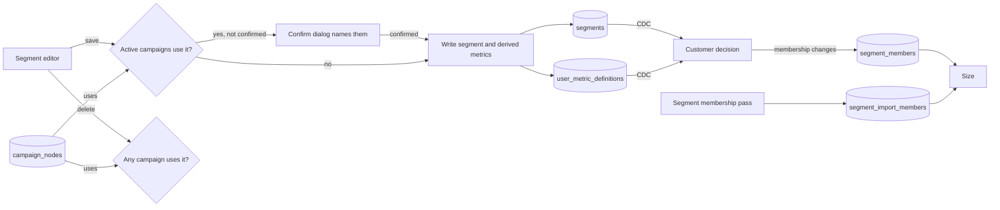

# Segments

## Purpose

Marketers describe the same people in many campaigns: VIP shoppers in Hanoi, people who added to cart three times this week. A segment saves that description once, under a name. A campaign can start when a person enters a segment, and any node can test whether a person is in one. Changing the segment changes every campaign that uses it.

## Scope

In scope:

- The segment pages of studio v2: the list with where-used and size, and the editor to create, edit, and delete a segment.
- What a segment can contain.
- How campaigns refer to segments, and when a segment cannot change or go away.
- What a segment's size counts, and what the page says about it.

Out of scope:

- Evaluating membership and detecting entries. [Customer decision](../architecture/components/customer-decision.md#track-segment-membership) does that.
- Storing membership. The [profile writer](../architecture/components/profile-writer.md#segment-membership) stores tracked members, and the [segment membership pass](../architecture/components/segment-membership-pass.md) stores customers known only from imports.
- The trigger and condition editors in a journey. The [journey builder](journey-builder.md#conditions) owns them, and the segment editor uses the same condition editor.
- Sending a business event to a segment's members. [Business event fan-out](../architecture/components/business-event-fan-out.md) does that.

## Terms

| Term | Meaning |
|---|---|
| Segment | A saved, named list of condition groups. Row in `segments`. |
| Member | A person whose data passes every group of a segment's conditions at a given moment. |
| Enter | To become a member after the decision job last saw the person not be one. |
| Re-entry setting | On a segment entry trigger: whether a person who entered before can enter again. |
| Tracked member | A person with events whom the decision job last saw in the segment. Row in `segment_members`. |
| Imported-only member | A customer key known only from imports, with no tracked person, that the last nightly pass found in the segment. Row in `segment_import_members`. |
| Size | The count of a segment's tracked members plus its imported-only members. |
| Stored membership | `segment_members` and `segment_import_members` together. |

The [journey builder](journey-builder.md#conditions) defines groups, conditions, and their types.

## Behavior

A marketer opens **Segments** and creates "Hanoi cart builders":

- Group 1: `city IN [Hanoi]`.
- Group 2: `add_to_cart` `COUNT >= 3` over 7 days.

A campaign then starts on "enters Hanoi cart builders", with the re-entry setting "after 30 days". A shopper in Hanoi adds to cart for the third time this week. At that event the decision job sees the shopper become a member, and the campaign starts for them. If the shopper qualifies again 10 days later, after dropping out, nothing starts. After 30 days it can start again.

By default, a campaign starts only for people who enter after it is published. A shopper who is already in "Hanoi cart builders" when the campaign goes live starts it only after dropping out and qualifying again. If the marketer chooses **Also include current members** at publish, every tracked member at that moment enters once, at most 1,000 a second, subject to the re-entry setting. The owner decided both on 2026-11-08. The [journey builder](journey-builder.md#publish-checklist) offers the option.

A person the decision job sees for the first time, such as an imported-only customer at their first tracked event, gets a flag and starts no journey. They enter through **Also include current members** on a publish while they are a member, or by leaving the segment and coming back. The owner decided this on 2026-11-08.

Another campaign's check node adds the condition "is not in Hanoi cart builders". The decision job evaluates the segment's two groups at that moment. Size never answers a condition.

This page names final paths. While both studios run, the studio v2 pages live under `/v2`, such as `/v2/segments/new`, and `/segments` is the classic page. At cutover the classic page redirects to `/v2/segments`. When the `/v2` prefix drops, each `/v2` path redirects to the same path without it. The [studio shell](studio-shell.md) holds the routes.

- **List.** `/segments` lists every segment with its name, its description, its creator, its last change, and where it is used, as [The segment list](#the-segment-list) says. Once membership is stored, it also shows each segment's size. The header action is **New segment**, and each row has **Edit** and **Delete**.
- **Create.** **New segment** opens `/segments/new`, a full page with the name, the description, and the condition editor that the journey builder uses, in person mode. `segment_membership` is not offered inside a segment.
- **Edit.** **Edit** opens `/segments/[id]`, the same page for one segment. Every field but the id can change while campaigns use the segment. A right rail shows where the segment is used and a Size card. When an active campaign uses the segment, the save first opens a dialog that names each active campaign, and writes nothing until the marketer confirms. The owner decided this on 2026-11-05. The change applies to the next evaluation.
- **Delete.** Refused while any campaign, active or paused, uses the segment. The refusal names each one. Otherwise the page asks once and deletes. Its stored membership goes too. Customer decision publishes `exited` for each tracked member, and the next nightly pass deletes the imported-only rows.

Every staff user with a session can create, edit, and delete segments. No action needs the admin role. The owner decided this on 2026-11-05.

A campaign uses a segment when one of its `campaign_nodes` rows holds a trigger of kind `segment_entry`, a `business_event` trigger with a segment audience, or a `segment_membership` condition, with that segment's id. Only the rows of `active` and `paused` campaigns count, since drafts are not stored in `campaign_nodes`.

### The condition editor in segment mode

The editor is the journey builder's condition editor. Groups are cards under "All of these must hold", and rows inside a card sit under "Any of". A row picks a profile field or a behavior, an operator that fits the field's type, and a typed value. A behavior row reads as a sentence, such as "performed **Add to cart** **at least 3** times in the last **7 days**".

In segment mode, the editor hides **+ filter** on a behavior row until customer decision applies event filters to a segment's behavior conditions. Then the row offers **+ filter** to narrow which events count, such as "`add_to_cart` where `product.price` > 500000". A stored condition keeps the filters it has, and before then the row shows them read-only with a note.

### The segment list

Each segment shows its name, its description, its creator's email or "Unknown" when the user was deleted, its last change, and where it is used. Where-used lists every campaign that uses the segment by the rule above, with the campaign's name, its status, and how it uses the segment: entry trigger, business-event audience, or condition. Each campaign links to its page at `/journeys/[id]`. A segment that no campaign uses says "Not used by any journey". A search box matches the typed text anywhere in the name or the description, ignoring case, and a filter shows only segments in use or only unused ones. The list sorts by name.

### Segment size

Size counts stored membership. It is the segment's rows in `segment_members` plus its rows in `segment_import_members`. What the page shows depends on how much membership is stored:

The [runtime registry](journey-builder.md#runtime-registry) switches the page between these states, with its entries 4 and 5:

1. **Before membership is stored,** the list has no Size column, and the editor's Size card reads "Size shows once membership is stored".
2. **Once the profile writer stores tracked members,** the list shows each segment's size, and the Size card shows the count with "Tracked people as of their last activity".
3. **Once the segment membership pass runs,** the count includes imported-only members, and the Size card says "Tracked people as of their last activity, imported customers as of last night's pass".

The page states four limits of the count, next to it:

- A tracked member whose behavior window passes with no new event stays counted until their next event, because the decision job evaluates people at their events. A member with no event for months stays counted, as of their last event.
- A customer key that becomes a tracked person can count twice, once in each table, until the next nightly pass.
- A member whose change was lost, after an outage longer than a day, counts again at their first event at least 30 days after the decision job last published their membership.
- A behavior condition counts events from the time its metric started counting. A new segment's behavior condition, such as `add_to_cart` `COUNT >= 3` over 7 days, sees a full window only after 7 days.

## Functional requirements

| Id | Requirement |
|---|---|
| SEG-FR-01 | Staff must be able to create, list, edit, and delete segments in studio v2, at `/segments`, `/segments/new`, and `/segments/[id]`. The sidebar entry must sit under the group **Audience**, and the page title and breadcrumb must say **Segments**. |
| SEG-FR-02 | A segment's id must be `SEG-` followed by 16 hexadecimal digits, and must not change. |
| SEG-FR-03 | A segment's conditions must be groups of `profile_property` and `behavior` conditions, saved in the shape the [journey builder](journey-builder.md#saved-format) uses. A segment must not contain a `segment_membership` condition. A group must not be empty, and a segment must have at least one group. |
| SEG-FR-04 | Deleting a segment must be refused while an active or paused campaign uses it, and the refusal must name each campaign. |
| SEG-FR-05 | A saved change to a segment must reach the decision job without a restart, and must apply to the next evaluation. |
| SEG-FR-06 | Behavior conditions in a segment must name derived metric definitions, by the rules of [campaign management](campaign-management.md#metric-definitions). A metric definition must be `LIVE` while a segment that exists names it, whether or not a campaign uses the segment. This is the lead's default, pending owner review. |
| SEG-FR-07 | The edit page must name the campaigns that use the segment before it saves. A save of a segment that an active campaign uses must first be confirmed in a dialog that names each active campaign, and must write nothing until it is. |
| SEG-FR-08 | The segment pages must show a segment's member count only from stored membership, with its basis, and must show no count before the runtime registry holds size from tracked members. |
| SEG-FR-09 | The segment list must show every segment with its name, description, creator, last change, and where it is used, as [The segment list](#the-segment-list) says. Where-used must name each active or paused campaign that uses the segment, its status, and the kind of use. |
| SEG-FR-10 | Deleted (studio v3). The segment list now writes, so the rule that it must not write and must link to the classic page no longer applies. |
| SEG-FR-11 | The segment editor must use the journey builder's condition editor. In segment mode it must not offer event filters on a behavior condition until customer decision applies them to a segment's behavior conditions ([DEC-FR-36](../architecture/components/customer-decision.md#functional-requirements)). |
| SEG-FR-12 | Once the profile writer stores tracked members, a segment's size must count each tracked member as of their last event, and the page must say so next to the count. |
| SEG-FR-13 | Once the runtime registry holds size with imported-only members, after the segment membership pass runs, a segment's size must also count the imported-only members of the last pass, and the page must say that they count as of that pass. |
| SEG-FR-40 | A segment's `profile_property` conditions must accept imported fields and the relative-date operators, by the rules of the [journey builder](journey-builder.md#conditions). The editor must offer them only once the segment runtime evaluates them (JBD-FR-31). |
| SEG-FR-41 | A segment that names an imported field must count as a use of that field's column or imported metric, for the rename, retype, and delete guards on columns and the rename and archive guards on imported metrics, in [data import](data-import.md#versions). |
| SEG-FR-42 | When the segment list cannot load, the page must say "Segments could not load." with **Try again**, which loads the list again without a page reload. |
| SEG-FR-43 | A save that breaks SEG-FR-03 must name the group and the condition and what is missing, such as "Group 2, condition 1 needs a number of times. Fill it in, or remove the condition. Nothing you typed was lost.", mark the field, and keep every typed value. |

The list's preview and classic-studio notes, the editor's details card, and the size notes are layout only: their content comes from SEG-FR requirements above and the [studio shell](studio-shell.md) preview rules, and they add no behavior.

## Non-functional requirements

| Id | Requirement |
|---|---|
| SEG-NFR-01 | A saved segment reaches the decision job through CDC within seconds. |
| SEG-NFR-02 | Every action requires a session, and any staff user with one may take it. No action requires the admin role. See [admin authentication](admin-authentication.md). |

## Interfaces

| Direction | Interface | Contract |
|---|---|---|
| UI | `/segments` | List with where-used and size. New segment, edit, and delete. |
| UI | `/segments/new`, `/segments/[id]` | Full-page editor with where-used and the Size card |
| UI | Classic `/segments` | List, create, edit, and delete, until cutover. Then it redirects to the studio v2 list. |
| Read and write | `segments` | `id`, `name`, `description`, `conditions_json`, `created_by`, `created_at`, `updated_at`. `conditions_json` holds `groups` as the [saved format](journey-builder.md#saved-format) does, with the `metric_id` the save derives in each behavior condition. The publication `segments_pub` feeds customer decision through CDC. |
| Write | `user_metric_definitions` | Derived definitions for the segment's behavior conditions |
| Read | `campaign_nodes` | Uses of a segment: entry triggers, business-event audiences, and `segment_membership` conditions |
| Read | `segment_members` | Tracked members, for size. Written by the [profile writer](../architecture/components/profile-writer.md#segment-membership). |
| Read | `segment_import_members` | Imported-only members, for size. Written by the [segment membership pass](../architecture/components/segment-membership-pass.md). |
| Read | `import_record_types`, `import_record_type_versions`, `import_metric_definitions` | Imported fields for the profile field picker |

## Failure handling

| Case | Behavior |
|---|---|
| A save breaks SEG-FR-03 | Reject it, name the group and condition, and keep what was typed. |
| An edit that active campaigns use arrives unconfirmed, or a campaign started using the segment after the editor opened | Write nothing. Return the active campaigns to confirm, and ask again. |
| A behavior condition names an event that is not in the catalog | Reject the save and name the event. |
| Delete while campaigns use the segment | Reject it and name the campaigns. |
| The size count fails to load | Show the segment without its size, and say that size could not load. |
| The database is unavailable | Show a fixed message that names the action. Keep what was typed. |

## Acceptance criteria

- Given the segment in [Behavior](#behavior), when it is saved from `/segments/new`, then `segments` holds it with two groups, and a derived metric definition exists for its behavior condition. (SEG-FR-01, SEG-FR-03, SEG-FR-06)
- Given a segment, when the marketer opens it from the list, then `/segments/[id]` shows its name, description, conditions, where-used, and Size card, and **Delete** on the list removes an unused segment after one confirmation. (SEG-FR-01)
- Given a segment with a `segment_membership` condition or an empty group, when it is saved, then the save is rejected and names the condition or the group. (SEG-FR-03)
- Given a paused campaign that tests "is in" a segment, when the segment is deleted, then the delete fails and names the campaign. (SEG-FR-04)
- Given an active campaign that uses a segment, when the segment's city changes from Hanoi to Da Nang, then the decision job evaluates the next event of a person in Da Nang against the new definition. (SEG-FR-05)
- Given a segment whose behavior condition only it names, when the one active campaign that uses the segment is paused, then the metric stays `LIVE`. When the segment is deleted, then the metric is `PAUSED`. (SEG-FR-06)
- Given two active campaigns that use a segment, when the marketer opens it to edit, then the page names both campaigns. (SEG-FR-07)
- Given two active campaigns that use a segment, when the marketer saves a change, then a dialog names both campaigns, and the segment changes only after the marketer confirms. (SEG-FR-07)
- Given membership not yet stored, then the list has no Size column and the Size card reads "Size shows once membership is stored". (SEG-FR-08)
- Given 3 `segment_members` rows for a segment and the profile writer storing members, then the list and the Size card show 3, and the card reads "Tracked people as of their last activity". (SEG-FR-08, SEG-FR-12)
- Given 3 `segment_members` rows and 2 `segment_import_members` rows for a segment, once the segment membership pass runs, then size is 5, and the card reads "Tracked people as of their last activity, imported customers as of last night's pass". (SEG-FR-12, SEG-FR-13)
- Given a staff user who is not an admin, when they create a segment, then it is saved. (SEG-NFR-02)
- Given the segment runtime evaluates imported fields, when a marketer builds "Big spenders" on `orders.spend_90d >= 5000000`, then it is saved with that condition. Before the runtime evaluates them, the picker does not list `orders.spend_90d`. (SEG-FR-40)
- Given "Big spenders" on `orders.spend_90d`, when an admin archives the imported metric `spend_90d`, then the archive is refused and names the segment. (SEG-FR-41)
- Given a staff user in studio, then the sidebar shows **Segments** under **Audience**, and `/segments` has the title **Segments**. (SEG-FR-01)
- Given "Hanoi cart builders" used as the entry trigger of an active campaign and as a condition of a paused one, then the segment list shows both campaigns with their status and kind of use, each linking to its page. (SEG-FR-09)
- Given a segment no campaign uses, then its row says "Not used by any journey", and the unused filter shows it. (SEG-FR-09)
- Given customer decision does not yet apply event filters to segment behavior conditions, then a behavior row in the segment editor offers no **+ filter**. Once it does, the row offers **+ filter**, and a saved filter appears in `conditions_json`. (SEG-FR-11)
- Given the segment list request fails, then the page says "Segments could not load." and **Try again** loads the list. (SEG-FR-42)
- Given group 2's first condition "Added to cart at least _ times" with no number, when the marketer saves, then nothing is written, the message names group 2, condition 1, and the number of times, the field is marked, and every other typed value stays. (SEG-FR-43)

## Open questions

None.

## Related

- [Journey builder](journey-builder.md)
- [Studio shell](studio-shell.md)
- [Campaign management](campaign-management.md)
- [Customer decision](../architecture/components/customer-decision.md)
- [Profile writer](../architecture/components/profile-writer.md)
- [Segment membership pass](../architecture/components/segment-membership-pass.md)
- [Business event fan-out](../architecture/components/business-event-fan-out.md)
- [0031. Reusable segments with entry triggers](../architecture/decisions/0031-reusable-segments-with-entry-triggers.md), amended by [0038. Store segment membership and evaluate every segment](../architecture/decisions/0038-store-segment-membership-and-evaluate-every-segment.md)
- [Data import](data-import.md), whose imported fields segments can name. SEG-FR-13 covers imported-only customers.
- [Known issues](../known-issues/features/segments.md)
