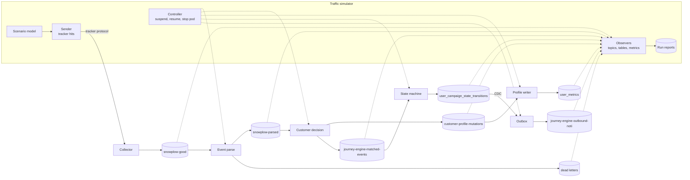

# Traffic simulator

## Purpose

An engineer who deploys the journey engine needs to know three things: that every stage of the pipeline is running, that journeys do what their contracts say, and how much traffic the deployment carries before it falls behind. The traffic simulator answers all three with one model of an e-commerce site. Simulated shoppers browse, search, add to cart, and buy, and send the same tracker hits a real site sends. The engineer picks a mode and gets a verdict: a smoke run says which stage is broken, a logical run says which requirement is broken, and a load run says where the deployment's limits are.

## Scope

In scope:

- One scenario model of an e-commerce site: its events, products, and shopper personas.
- Three modes on that model: smoke, logical, and load.
- The test events and test campaigns the simulator needs, and removing them afterward.
- A report for every run.

Out of scope:

- Replaying a recorded dataset, such as a public e-commerce event log. It is a later addition that reuses this contract's model and modes.
- Testing studio's screens. [Journey builder](journey-builder.md) and [campaign management](campaign-management.md) own those.
- Delivering notifications. The sender outside this repository owns that ([notification outbox](../architecture/components/notification-outbox.md)).
- Changing the system under test. The simulator only sends input and reads output.

## Terms

| Term | Meaning |
|---|---|
| Run | One execution of the simulator in one mode. It has a run id, a start and end time, a verdict, and a report. |
| Mode | `smoke`, `logical`, `load`, or `bench`. |
| Scenario model | The events, products, personas, and funnel that every mode shares. |
| Persona | A kind of shopper with a behavior, such as a browser who never buys or a returning buyer who logs in. |
| Shopper | One simulated person in a run. Each has a device id, and some log in with a user id. |
| Funnel | The ordered steps a shopper can take: view a page, search, view a product, add to cart, start checkout, purchase. Each step has a chance to drop off. |
| Stage | One hop of the pipeline that the simulator checks: the collector, `snowplow-good`, `snowplow-parsed`, `snowplow-parsed-dead-letters`, `customer-profile-mutations`, `journey-engine-matched-events`, `user_campaign_state_transitions`, and `journey-engine-outbound-noti`. On `snowplow-parsed-dead-letters`, smoke passes when none of its shopper's events arrive. |
| Test fixture | An event in the [event catalog](event-catalog.md), a campaign, or a metric definition that the simulator creates for its runs. Its name starts with `sim_`. Metric definitions come from publishing a `sim_` campaign, which creates them in the same transaction (CMP-FR-01). |
| Expectation | A logical scenario's predicted outcome, tied to the requirement id it checks. |
| Component under test | One part of the pipeline that a run checks or measures on its own: the collector, a Flink job, Kafka, or Postgres. |
| Drain rate | The events per second a component processes while it works through a backlog of its input. The bench mode's measure of maximum throughput. |
| Limiter | The resource or code path that bounds a measured number, such as one core, the database, or the load generator itself. |
| Expected failure | An expectation that a known issue breaks. It names the known-issue id, and its failure does not fail the run. |

## Behavior

The engineer starts a run by choosing a mode and its parameters. The simulator does not start on its own, and a deployment never starts a run.

1. **Prepare.** The simulator makes sure its test fixtures exist: the `sim_` events in the catalog and, for a logical run, the `sim_` campaigns its scenarios need, published and active. Preparing twice creates nothing new.
2. **Send.** Shoppers send tracker hits to the collector over the tracker protocol, the same way a site's tracker does. Most hits are POSTs that batch several events, and some are single GET pixels. Every event carries the run id, and every shopper's ids are unique to the run.
3. **Verify.** What the simulator checks depends on the mode:
	- **Smoke** sends a few events from one shopper and follows each one through every stage, until it appears or the stage's timeout passes.
	- **Logical** plays scripted shoppers whose outcome is known in advance, and checks each expectation against the topics and tables.
	- **Load** sends traffic at a rate profile and measures throughput, lag, and latency while it runs.
4. **Report.** The run ends with a verdict and a report that lists every stage or expectation with its result and evidence. The verdict is `fail` if any check failed, `incomplete` if none failed but some could not run, and `pass` if every check passed.
5. **Clean up.** On request, the simulator removes its test fixtures and the rows its shoppers created, and nothing else.

Example. After a deploy, an engineer runs smoke. One shopper views a product and adds it to the cart. Ninety seconds later the report shows six stages passed and one failed: the event reached `journey-engine-matched-events`, but no row reached `user_campaign_state_transitions` within the stage timeout. The engineer now knows to look at journey execution, not at ingestion.

## Algorithm

### Funnel

A shopper starts with a page view and moves through the funnel one step at a time. At each step, the persona's probabilities decide whether the shopper continues, repeats the step, or leaves. Products are drawn from the catalog with a long-tail popularity: a few products get most views. A logged-in persona sends its user id from its login step onward. Before that step, it sends only its device id.

| Persona | Share of shoppers (load) | Behavior |
|---|---|---|
| Browser | 60% | Views pages and products. Never adds to cart. |
| Hesitant | 25% | Adds to cart. Leaves before purchase. |
| Buyer | 12% | Logs in and purchases. |
| Returning buyer | 3% | Comes back on a second session with the same device and buys again. |

### Logical scenarios

Each scenario sets up its fixtures, plays its shoppers, waits up to its window, and checks its expectations.

| Scenario | Shoppers do | Expectation |
|---|---|---|
| Abandoned cart | Add a product to the cart and do not purchase within the campaign's window | Exactly one notification request on `journey-engine-outbound-noti` for that shopper and campaign (OUT-FR-01), with the same `execution_id` if it is published again (OUT-FR-05) |
| Purchase cancels | Add to cart, then purchase within the window | No notification request for that shopper and campaign |
| Identity stitching | Browse anonymously on one device, then log in with a user id | Events before the login carry the device's `canon_id`. Events from the login on carry the user's `canon_id`. Both follow the [identity stitching](../architecture/components/identity/identity-stitching.md) contract (ING-FR-07). |
| Duplicate event | Send the same event id twice | One effect downstream: one transition, one notification at most |
| Invalid event | Send an event without an event id, and an event that breaks a gated `sim_` schema | Neither reaches `snowplow-parsed`. Both reach `snowplow-parsed-dead-letters` with their drop reason (ING-FR-03, ING-FR-12, ING-FR-13). |
| Structured event | Send a structured event with `se_ac` | Its parsed `event_name` is the lowercased `se_ac` (ING-FR-14) |

## Test architecture

The simulator has three parts. The **sender** produces shopper traffic. The **observers** read what the pipeline produced. The **controller** changes the pipeline's state for a bench run, by suspending and resuming a job or stopping a pod. Every mode uses the sender and the observers. Only `bench` uses the controller.

### What each mode does to each component

| Component under test | Smoke | Logical | Load | Bench |
|---|---|---|---|---|
| **Collector** | A hit returns success and lands in `snowplow-good` | A malformed hit lands in `snowplow-bad` (ING-FR-01) | Response rate, errors, and latency against the sent rate | The rate is ramped until responses fail or latency climbs, with the sender's own CPU watched so that the sender is not the limiter |
| **Event parse** | The run's events reach `snowplow-parsed` | Invalid, structured, and duplicate events, and identity stitching (ING-FR-03, 07, 12, 13, 14) | Lag on `snowplow-good`, and latency from send to `snowplow-parsed` | Drain rate of a `snowplow-good` backlog, with busy and backpressure time per operator and the stitcher's database time |
| **Customer decision** | The run's events reach `journey-engine-matched-events` and `customer-profile-mutations` | Triggers and conditions of the `sim_` campaigns match as configured | Lag on `snowplow-parsed` | Drain rate of a `snowplow-parsed` backlog, with metric-read latency and state size |
| **Profile writer** | The run's mutations reach `user_metrics` | A shopper's metric value after a known sequence of events | Lag on `customer-profile-mutations`, and the database write rate | Drain rate of a `customer-profile-mutations` backlog, with database write latency |
| **State machine** | A transition row appears for the run's shopper | Abandoned cart and purchase cancels each take their expected path | Lag on `journey-engine-matched-events` | Drain rate of a `journey-engine-matched-events` backlog, with the transition write rate |
| **Outbox** | A notification request appears for the run's shopper | One request per engagement transition, with the same `execution_id` on a repeat (OUT-FR-01, OUT-FR-05) | Delay from a transition row to its notification request | Publish rate after a burst of transitions, with replication-slot lag |
| **Kafka** | Every topic accepts and serves the run's messages | Not applicable | Produce and consume rates, and disk use | Not measured on its own. It is a limiter candidate in every Flink bench. |
| **Postgres** | Not applicable | Not applicable | Write latency, replication-slot lag, and disk use | Not measured on its own. It is a limiter candidate for the stitcher, decision, writer, and outbox. |

### How a bench run measures a job

A bench run measures one Flink job at a time, by **suspend, fill, resume**:

1. The controller suspends the job with a savepoint, so its state survives.
2. The sender drives traffic through the real path until the job's input topic holds the target backlog. The jobs upstream keep running.
3. The controller resumes the job from its savepoint. The observers measure the drain rate until the backlog is gone, and record the job's per-operator busy and backpressure time, its checkpoints, and the CPU and memory of its pods.

Draining a backlog takes the sender out of the measurement, so the sender cannot be the limiter of a job's number. The backlog moves through the real ingestion path, so the simulator never builds the collector's binary payloads itself.

A suspend and a resume change Flink state, so a bench run keeps these rules:

- **One bench at a time.** A run holds a cluster-wide lock from before it changes anything until it ends, whatever way it ends. A second run refuses to start while the lock is held, and names the holder.
- **The deployment cannot undo a suspend.** Before its first suspend, the run turns off Argo CD's automated sync of the application that deploys the jobs, and it puts the sync policy back exactly as it found it after its last resume. Every step after the sync goes off runs inside the step that puts it back and reports. The run puts back only a change it confirmed it made: when turning the sync off fails, it changes nothing and reports the policy it read and the policy now. A sync during a suspend would set the job running again. The run refuses to start while another job is suspended, or while the automated sync is already off.
- **Only a job that checkpoints is suspended.** A job whose last checkpoint is older than three checkpoint intervals, or whose recent checkpoints failed, cannot take a savepoint, so the run stops before it suspends that job.
- **A run never leaves a job without its state.** A savepoint that does not complete sets the job back to running, and the run turns Argo CD's sync back on only once it sees the job run. When the run cannot confirm that a job runs again from its savepoint, it leaves Argo CD's sync off and reports the job, its savepoint, and the sync policy to restore.
- **The WAL cap holds.** The run reads `max_slot_wal_keep_size` from Postgres at every reading and stops when it cannot. On top of the load run's stop conditions (SIM-FR-12), every reading checks the WAL the replication slots hold against the cap, and stops the run over 70%, or when a slot is no longer reserved. A first probe run with a small backlog measures the WAL a record costs over a whole run: the upstream writes during the fill, the drain, and the downstream writes after it. Before each run, the WAL the slots already hold plus that cost times the backlog must fit under half the cap, using a conservative estimate per event until a run has measured the cost, and the run waits for the slots to release earlier runs' WAL before it refuses. During the fill, the run projects the rest of its WAL from the rate the fill writes it, and stops the fill and resumes the job before the slots would pass 70%.

Bench also has three runs that do not use a backlog:

- **Recovery.** While load runs, the controller stops one TaskManager pod of a job. The observers measure the time until the job is `RUNNING` again, and count the run's events at every stage afterward, to find loss or duplicates.
- **Scaling.** The drain rate of the job that limits the pipeline, at parallelism 1, 2, and 4, inside the existing compute capacity.
- **State growth.** Checkpoint size and duration, and state size, as a run's shopper count grows from 10,000 toward 400,000.

## Functional requirements

| Id | Requirement |
|---|---|
| SIM-FR-01 | All three modes must use one scenario model. A change to an event, product, or persona must take effect in every mode. |
| SIM-FR-02 | The simulator must send only events whose names are `sim_` events in the event catalog, except in scenarios that test invalid input on purpose. |
| SIM-FR-03 | Every event must carry the run id in its event data, and every shopper's device id and user id must be unique to the run. |
| SIM-FR-04 | The simulator must send tracker hits to the collector's public tracker routes with the tracker protocol, as POSTs that batch events and as GET pixels. |
| SIM-FR-05 | Preparing fixtures must be idempotent: a second prepare must create, change, and delete nothing. |
| SIM-FR-06 | A deployment must never start a run. Every run must start from an engineer's explicit command. |
| SIM-FR-07 | A smoke run must check every stage in [Terms](#terms) for its events, in order, and must report for each stage `pass`, `fail`, or `not reached`, with the evidence: the message or row it found, or the timeout. |
| SIM-FR-08 | A logical run must play every scenario in [Logical scenarios](#logical-scenarios) and report each expectation as `pass`, `fail`, or `expected failure`. |
| SIM-FR-09 | An expectation that a known issue breaks must name the known-issue id, and its failure must not fail the run. An expected failure that passes must be reported, so the known issue can be checked. |
| SIM-FR-10 | A load run must follow a rate profile of ramp, steady, peak, and soak phases, each with a target events-per-second rate and a duration that the engineer sets. |
| SIM-FR-11 | A load run must measure and report, per phase: events sent, send errors, collector responses, consumer lag on `snowplow-parsed` and `journey-engine-matched-events`, and end-to-end latency from send to `snowplow-parsed`. |
| SIM-FR-12 | A load run must abort, and report why, when a stop condition holds: the Kafka volume is over 70% full, the Postgres volume is over 70% full, or more than 1% of the run's events reach the dead-letter topic. |
| SIM-FR-13 | Two runs at the same time must not change each other's verdicts. |
| SIM-FR-14 | Clean-up must remove the run's test fixtures and the rows its shoppers created, and nothing that a `sim_` name or a run id does not mark. |
| SIM-FR-15 | The simulator must send only synthetic data. No real person's data may appear in an event. |
| SIM-FR-16 | Every run must end with a machine-readable report and a short readable summary: the mode, the parameters, the verdict (`pass`, `fail`, or `incomplete`, as [Behavior](#behavior) defines them), and every stage, expectation, or phase with its result. |
| SIM-FR-17 | The simulator must create its fixtures through studio's own interfaces, signed in as a dedicated service account at the staff identity provider with the `admin` role, so that every fixture passes the same validation and the same publish transaction as one a person makes (CMP-FR-01). It must not write catalog or campaign rows directly. It signs in through the provider's standard sign-in page as a person would, and calls studio's catalog and publish operations the way studio's own pages call them. |
| SIM-FR-18 | The `sim_` campaigns of logical scenarios must use a window a few times the measured latency from send to journey execution, 60 seconds by default, so that a purchase cannot race the window's timer. The window must be configurable per run. |
| SIM-FR-19 | The simulator must keep each run's report as one JSON document per run in the environment's durable object storage, under `sim-reports/<run id>.json`, for as long as the environment exists. |
| SIM-FR-20 | A smoke run does not start automatically after a deployment. An engineer starts it on demand, like every other run (SIM-FR-06). |
| SIM-FR-21 | A bench run must measure one job at a time by suspend, fill, and resume, and must resume the job from the savepoint it suspended with. A job must never lose state in a bench run. |
| SIM-FR-22 | Every bench number must be reported with its unit, the number of runs, the median and range, and its limiter, named from metrics taken during the run. A number without a named limiter must be reported as inconclusive. |
| SIM-FR-23 | A bench comparison, such as parallelism 1 against 2, must take at least 5 runs per side, alternating the sides. A difference smaller than the run-to-run range must be reported as no measurable difference. |
| SIM-FR-24 | Every bench and load report must count errors and dropped events, and must confirm that the work happened: the events the component under test consumed and produced match what the run sent. |
| SIM-FR-25 | Whenever the sender drives the measured rate, as in the collector bench, a bench run must check that the sender is not the limiter, and must say so in the report. |
| SIM-FR-26 | A recovery run must report the time from the pod stopping to the job being `RUNNING` again, and the count of the run's events lost or duplicated at every stage after it. |
| SIM-FR-27 | A bench run must run each component as the deployment runs it: the deployed image, settings, parallelism, and state backend, unless the run exists to change one of them, which its report must name. |

## Non-functional requirements

| Id | Requirement |
|---|---|
| SIM-NFR-01 | A smoke run must finish within 3 minutes on a healthy deployment. The 3 minutes do not count the first smoke after a publish of its campaign. That run first waits, for up to 330 seconds, until a probe shopper shows that the state machine holds the new journey graph. |
| SIM-NFR-02 | A logical run must finish within 20 minutes. Its test campaigns use the shortest windows that journey execution allows. |
| SIM-NFR-03 | The load generator must sustain 3,000 events per second for 10 minutes with under 1% send errors, using only the deployment's existing compute capacity. |
| SIM-NFR-04 | The average daily load is 25 million events, about 290 events per second. The default rate profile must include a soak of at least 1 hour at that rate. |
| SIM-NFR-05 | A load run must report its measurements at least every 15 seconds while it runs, so the engineer can watch it alongside the deployment's dashboards. |
| SIM-NFR-06 | Running the simulator must add no compute to the deployment. It may add an image repository and narrow permissions for its own reports, whose cost is cents. |
| SIM-NFR-07 | The simulator must run without a web browser. Its image stays small: no browser engine or browser automation. |

## Interfaces

| Interface | Direction | Use |
|---|---|---|
| Collector tracker routes: `/com.snowplowanalytics.snowplow/tp2` (POST) and `/i` (GET) | Writes | Every tracker hit |
| [Event catalog](event-catalog.md) | Writes | The `sim_` events and their attributes, one with its schema gate on |
| [Campaign management](campaign-management.md) | Writes | The `sim_` campaigns that logical scenarios use, published and active |
| `snowplow-good`, `snowplow-parsed`, `snowplow-parsed-dead-letters`, `customer-profile-mutations`, `journey-engine-matched-events`, `journey-engine-outbound-noti` | Reads | Stage checks and expectations, matched by run id or shopper id |
| `user_campaign_state_transitions`, `identity_graph` | Reads | Stage checks and expectations. See the [data model](../architecture/data-model.md). |
| `user_events`, `user_event_fields`, `campaigns`, `user_metric_definitions` | Reads | Prepare compares the stored `sim_` fixtures with the ones it needs, in a read-only session, and writes through studio only what is missing or differs (SIM-FR-05). Clean-up lists the `sim_` campaigns and catalog events, and reads them again after it deletes them. |
| `user_campaign_state_transitions`, `user_metrics`, `identity_graph` | Deletes | Clean-up, only when asked to apply, removes the rows of the given runs in batches of the runs' devices, each batch in its own transaction, so a load run's hundreds of thousands of devices fit its memory (SIM-FR-14). A clean-up that stops part way leaves earlier batches removed, and running it again with the same run ids finishes it. It deletes the `sim_` campaigns and catalog events through campaign management and the event catalog, never in Postgres. |
| Run report | Writes | One per run, as [SIM-FR-16](#functional-requirements) says |

The simulator reads topics with a consumer group of its own per run, so it never moves the offsets of the pipeline's jobs.

## Failure handling

- **The collector does not answer.** Smoke fails at the first stage, and its report names the collector. Load counts the failure as a send error.
- **A stage never sees an event.** The stage fails at its timeout, and every later stage is `not reached`.
- **A fixture cannot be created.** The run stops before it sends anything, and reports which fixture failed and why.
- **The simulator stops mid-run.** A new run starts with a new run id and is not affected. Clean-up removes what the stopped run left.
- **Late or duplicate input.** The duplicate-event scenario covers duplicates. The simulator itself never re-sends an event unless a scenario says so.

## Acceptance criteria

- [ ] Given a healthy deployment, when an engineer runs smoke, then the report shows every stage `pass` within 3 minutes (SIM-FR-07, SIM-NFR-01).
- [ ] Given the journey-execution jobs are stopped, when an engineer runs smoke, then the report fails at `user_campaign_state_transitions` and marks the later stages `not reached` (SIM-FR-07).
- [ ] Given the fixtures exist, when the engineer prepares them again, then nothing in the catalog or campaigns changes (SIM-FR-05).
- [ ] Given a healthy deployment, when an engineer runs logical, then every expectation in [Logical scenarios](#logical-scenarios) is `pass` or an `expected failure` with a known-issue id (SIM-FR-08, SIM-FR-09).
- [ ] Given a logical run, when the abandoned-cart window passes, then exactly one notification request exists for that shopper and campaign (SIM-FR-08, OUT-FR-01).
- [ ] Given a load profile peaking at 3,000 events per second for 10 minutes, when it runs, then send errors stay under 1% and the report gives lag and latency for every phase (SIM-NFR-03, SIM-FR-11).
- [ ] Given a load run, when the Kafka volume passes 70%, then the run aborts and its report names the condition (SIM-FR-12).
- [ ] Given two runs at the same time, when both finish, then each verdict matches what it would be alone (SIM-FR-13).
- [ ] Given a finished run, when the engineer cleans up, then no `sim_` fixture and no row with that run's id remains, and no other row changed (SIM-FR-14).
- [ ] Given a deployment sync, when Argo CD applies the simulator's manifests, then no run starts (SIM-FR-06).
- [ ] Given a backlog of 2 million events on `snowplow-parsed`, when a bench run resumes customer decision, then the report gives its drain rate with the run count, median, range, and a limiter named from metrics (SIM-FR-21, SIM-FR-22).
- [ ] Given a bench run, when it ends, then the job resumed from its savepoint and its state is intact (SIM-FR-21).
- [ ] Given a recovery run, when a TaskManager pod stops, then the report gives the time back to `RUNNING` and the loss and duplicate counts per stage (SIM-FR-26).
- [ ] Given a parallelism comparison, when it ends, then each side has at least 5 alternating runs and the verdict respects the run-to-run range (SIM-FR-23).

## Open questions

None. Version 0.3 settled the fixture path (SIM-FR-17), the window (SIM-FR-18), and the image (SIM-NFR-07).

## Risks

- **The fixture path depends on two things outside the simulator.** One is the provider's sign-in page markup, and the other is how studio's pages call its catalog and publish operations, which can change with any studio build. Either change breaks fixture preparation. The run then stops before it sends anything (see [Failure handling](#failure-handling)), so a broken fixture path never produces a wrong verdict. A stable automation interface in studio would remove this risk, as a feature of its own.

## Related

- [Event ingestion](../architecture/components/event-ingestion.md), [journey execution](../architecture/components/journey-execution.md), [notification outbox](../architecture/components/notification-outbox.md), and [customer decision](../architecture/components/customer-decision.md): the contracts the logical scenarios check.
- [Event catalog](event-catalog.md) and [campaign management](campaign-management.md): where the fixtures live.
- [AWS Free Plan environment](../operations/aws-free-plan.md): the first deployment the simulator runs against, and its capacity limits.
- [Known issues](../known-issues/features/traffic-simulator.md).
