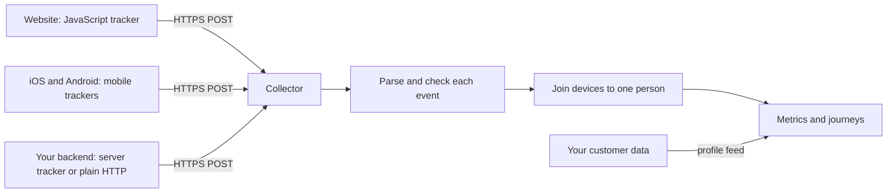

# Tracking integration guide

This guide is for the developers who connect a website, an app, or a backend to the journey platform. It says where to send events, how to configure the Snowplow trackers, and which rules an event must follow to reach a journey. Each rule below exists because the platform drops or misreads events that break it, usually without an error.

We use the [Snowplow tracker protocol](https://docs.snowplow.io/docs/events/http-requests/). If you already run Snowplow, your trackers need a new endpoint and a few settings. If you don't, the Snowplow SDKs are the easiest way to send events. A backend can also send events directly over HTTP.

## How your data flows



The platform links each event to one person, so that a shopper who browses on a phone and buys on a laptop is one person in every journey. The [identity rules](#identity) decide how well that works.

## Your endpoint

We give you one collector URL per environment, on a subdomain of your own site, such as:

```text
https://collector.example.vn
```

Events go to `POST https://collector.example.vn/com.snowplowanalytics.snowplow/tp2`. The trackers add this path themselves.

Use POST. GET requests and the image-pixel endpoint `/i` also work, but a browser can cut off a long URL, so a large event can fail.

## Web: JavaScript tracker

Use the browser tracker, version 4. The [initialization options](https://docs.snowplow.io/docs/sources/trackers/web-trackers/tracker-setup/initialization-options/) list every setting.

```js
import { newTracker, trackPageView, trackSelfDescribingEvent, setUserId } from '@snowplow/browser-tracker';

newTracker('sp', 'https://collector.example.vn', {
	appId: 'shop-web',          // the app id we agree with you
	eventMethod: 'post',
	encodeBase64: false,        // send plain JSON
	cookieDomain: '.example.vn',
	contexts: { session: true },
});

trackPageView();

// After login, and again on every page load while the user is signed in:
setUserId('0912345678');

trackSelfDescribingEvent({
	event: {
		schema: 'iglu:com.acme/add_to_cart/jsonschema/1-0-0',
		data: { product: { id: 'SKU-1', price: 12990000 }, quantity: 1 },
	},
});
```

- **`eventMethod: 'post'`.** It is the default, so keep it.
- **`encodeBase64: false`.** It is the default with POST, and keeps the requests readable when you debug. Base64 also works.
- **`cookieDomain`.** Set it to your parent domain, so that the device id survives across your subdomains.
- **`setUserId`.** Call it with the same id your backend and apps use for the account. The [identity rules](#identity) explain why.

## Mobile trackers

Use the iOS and Android trackers, version 6. The [setup guide](https://docs.snowplow.io/docs/sources/trackers/mobile-trackers/installation-and-set-up/) shows the full configuration.

Android (Kotlin):

```kotlin
val tracker = Snowplow.createTracker(
	context, "sp",
	NetworkConfiguration("https://collector.example.vn", HttpMethod.POST),
	TrackerConfiguration("shop-android")
		.base64encoding(false)
		.sessionContext(true),     // required: carries the device id
	SubjectConfiguration().userId("0912345678"),
)
```

iOS (Swift):

```swift
let tracker = Snowplow.createTracker(
	namespace: "sp",
	network: NetworkConfiguration(endpoint: "https://collector.example.vn", method: .post),
	configurations: [
		TrackerConfiguration().appId("shop-ios").base64Encoding(false).sessionContext(true),
		SubjectConfiguration().userId("0912345678"),
	])
```

- **Keep the session context on.** Mobile apps have no cookie. The device id comes from the session context, and an anonymous event without a device id never reaches a journey.
- **Don't turn on user anonymisation.** It replaces the device id with zeros, which makes every anonymous user look like one person.
- **Set the user id at login,** and clear it at logout.

## Server-side events

Send events from your backend for things the browser doesn't see: a confirmed payment, a shipped order, a refund.

| Language | Tracker | Settings |
|---|---|---|
| Node.js | `@snowplow/node-tracker` | `eventMethod: 'post'`, `encodeBase64: false`. Set the ids with `setUserId` and `setDomainUserId`. |
| Python | `snowplow-tracker` | `method="post"`, `TrackerConfiguration(encode_base64=False)`. Set the ids with `Subject().set_user_id()` and `set_domain_user_id()`. |
| Java | `snowplow-java-tracker` | POST is its only method. `TrackerConfiguration.base64Encoded(false)` is optional. Set the ids with `Subject.setUserId` and `setDomainUserId`. |

Send the same user id the frontends send. Send the device id too when you know it, for example from the request that placed the order.

### Send a raw tracker-protocol request

Any language can send a plain HTTPS POST. This request sends one `add_to_cart` event:

```bash
curl -sS -X POST 'https://collector.example.vn/com.snowplowanalytics.snowplow/tp2' \
	-H 'Content-Type: application/json' \
	--data @event.json
```

`event.json`:

```json
{
	"schema": "iglu:com.snowplowanalytics.snowplow/payload_data/jsonschema/1-0-4",
	"data": [
		{
			"e": "ue",
			"p": "srv",
			"tv": "custom-1.0",
			"eid": "5f0c1a2e-8a51-4c4e-9d1b-1d2f3e4a5b6c",
			"dtm": "1760778781900",
			"stm": "1760778782000",
			"aid": "shop-server",
			"uid": "0912345678",
			"duid": "a1b2c3d4-0000-4000-8000-000000000001",
			"url": "https://shop.example.vn/p/sku-1",
			"ue_pr": "{\"schema\":\"iglu:com.snowplowanalytics.snowplow/unstruct_event/jsonschema/1-0-0\",\"data\":{\"schema\":\"iglu:com.acme/add_to_cart/jsonschema/1-0-0\",\"data\":{\"product\":{\"id\":\"SKU-1\",\"price\":12990000},\"quantity\":1}}}"
		}
	]
}
```

The platform reads it as:

| Field | Value |
|---|---|
| Event name | `com.acme/add_to_cart`, by rule 2 of [How the event name is chosen](#how-the-event-name-is-chosen) |
| Attributes | `{"product": {"id": "SKU-1", "price": 12990000}, "quantity": 1}` |
| Event time | `1760778782280`: the collector's clock, minus the 100 ms the device clock was ahead |

Rules for a raw request:

| Field | Rule |
|---|---|
| `eid` | A UUID, new for every event. Resend the same `eid` only when you retry the same event. |
| `dtm`, `stm` | Epoch milliseconds, as strings: when the event happened, and when you sent it. Or send `ttm`, the true time of the event, instead. |
| `e` | `ue` for your own events, `pv` for a page view |
| `ue_pr` | The event as a JSON string inside the JSON, not a nested object |
| `p`, `tv` | Required by the protocol. Use `srv` for a backend, and your own version string. |
| `uid`, `duid` | At least one of them. See [Identity](#identity). |

## Design your events

### How the event name is chosen

Journeys match events by name, so a marketer can build "when `com.acme/add_to_cart`" only if the name is right. Every event a journey can use has one form of name, `<vendor>/<name>`, where the vendor is your workspace's vendor prefix, such as `com.acme/`. The catalog, the templates, the [data ingestion API](../features/data-ingestion-api.md), and tracking all use that name.

Send each business event as a self-describing event, with one schema per event named in `snake_case` under your workspace's vendor. The platform names it by joining the schema's vendor and name with `/`: `com.acme/add_to_cart` for `iglu:com.acme/add_to_cart/jsonschema/1-0-0`. The version is ignored, so every version of a schema gives the same name. A schema under another vendor gives a name that the catalog cannot hold, so journeys never see it.

The platform takes the first of these that exists:

1. An `event_name` field inside the event's data. It overrides the schema's name, so it must hold the whole name, `com.acme/add_to_cart`. A bare `add_to_cart` here gives a name the catalog cannot hold.
2. The vendor and the name in the event's schema, joined by `/`, as above.
3. `view_page` for a page view.
4. For a structured event (`se`), its action (`se_ac`), lowercased. A structured event without an action is dropped.
5. `transaction` for a transaction (`tr`), and `transaction_item` for a transaction item (`ti`).
6. The raw event type.

Rules 3 to 6 name Snowplow's built-in event types. Those names have no vendor prefix, so the catalog cannot list them and journeys cannot use them. The events still reach the pipeline. If a journey needs a page view or a structured event, send it as a self-describing event instead.

Before you ship an event, an admin adds it with a sample payload under Data > Events in the studio, so that marketers can pick it. The admin types only the part after the vendor prefix. The catalog is what marketers pick from. Data > Tracking setup in the studio, at `/data/tracking`, walks a developer through these steps with your collector address and app id.

### Put the attributes in the event's data

Only the self-describing event's own `data` is available to journeys. A marketer writes conditions with dotted paths into it, such as `product.price > 500000`.

- **Contexts are not used.** Entities you attach to a self-describing event, such as a product context, are dropped. Put what journeys need in the event's data.
- **Avoid these paths:** `event.name`, `page.location`, `page.url`, `page.referrer`, and `product.name`. They name the platform's own fields, as a literal key or as nested objects. A condition reads your attribute at one of these paths only when the platform's field is not set. Every other name, such as `url` or `user_id`, reads your attribute.
- **Use numbers for numbers.** `"price": 12990000`, not `"12,990,000"`. Numeric conditions need a number.
- **Keep each event under 32 KiB of data.** A larger event is dropped.

Structured events (`se`) carry `category`, `action`, `label`, `property`, and `value`. Transactions (`tr`) carry `order_id`, `affiliation`, `total`, `tax`, `shipping`, `city`, `state`, `country`, and `currency`. Transaction items (`ti`) carry `order_id`, `sku`, `name`, `category`, `price`, `quantity`, and `currency`. Page pings (`pp`) are discarded. Prefer a self-describing event for anything with richer attributes.

Some older apps send a `basic` context instead of a self-describing event. If yours do, tell us your schema vendor, and we read the `basic` context's data as the event's attributes.

## Identity

| Id | What it is | Who sends it |
|---|---|---|
| User id (`uid`) | Your account id for a signed-in person, such as a phone number or a customer number | Every tracker, after login. Your backend, on every event. |
| Device id (`duid`, or the mobile session context) | A cookie or install id, which exists before login | Web: the tracker's first-party cookie. Mobile: the session context. Backend: when you know it. |

- An event with a device id and a user id joins that device to that person. Later anonymous events from the device belong to the person.
- An event with neither is accepted and stored, but never reaches a journey.
- Use one user id per person, the same on web, mobile, and backend, and the same as `cdp_uuid` in the [profile data](#profile-data).
- Don't send a placeholder as an id. The platform ignores blank values, `unknown`, `undefined`, and `null`. Any other value, such as `0` or `guest`, is a real id, and every event that carries it becomes one person. Tell us if your apps use another placeholder, and we add it to the list.
- Shared devices, such as a family tablet or a store kiosk, merge everyone who signs in on them.

## Profile data

Journeys can test profile fields, such as city or age, and messages use contact details. These come from a table that you fill from your own customer data, through a feed we agree on during onboarding.

| Column | Type | Meaning |
|---|---|---|
| `cdp_uuid` | text | **The user id your trackers send.** This is how events find the profile. |
| `customer_id`, `cardcode`, `fid` | text, text, integer | Your own customer numbers |
| `name`, `first_name`, `pronoun`, `gender` | text | Display and personalization |
| `phone`, `email` | text | Message delivery |
| `age` | number | |
| `city` | text | |
| `user_time` | text | A time value you want journeys to test |
| `env`, `network_user_id` | text | Optional |

A person whose `cdp_uuid` does not match any user id gets an empty profile: profile conditions fail, and messages have no contact details.

## What gets dropped

| Event | What happens |
|---|---|
| `eid` missing or not a UUID | Dropped |
| No `dtm`, `stm`, or `ttm` | Dropped |
| Neither a user id nor a device id | Stored, never reaches a journey |
| Data over 32 KiB | Dropped before journeys |
| Same `eid` twice | Counted once |
| An event whose catalog entry is Strict, with a Must be sent field missing or a field of the wrong type | Dropped |

Dropped events leave no error on your side. We count them by reason, and an admin can read each dropped event and its reason for 7 days under Data > Monitoring > Dropped data in the studio. Use the test checklist below after every tracker change.

## Test checklist

1. Send one event from each platform, and send the [raw example](#send-a-raw-tracker-protocol-request).
2. Tell us the `eid` values and the time. We confirm that each one arrived with the right name, attributes, and identity.
3. Sign in on two devices with one account, and send an event from each. We confirm that both devices map to one person.
4. Send a profile row for the test account. We confirm that a profile condition matches it.

## Related

- [Snowplow tracker protocol](https://docs.snowplow.io/docs/events/http-requests/)
- [JavaScript tracker options](https://docs.snowplow.io/docs/sources/trackers/web-trackers/tracker-setup/initialization-options/)
- [Mobile tracker setup](https://docs.snowplow.io/docs/sources/trackers/mobile-trackers/installation-and-set-up/)
- For our team: [onboard a customer](../operations/onboard-a-customer.md)
