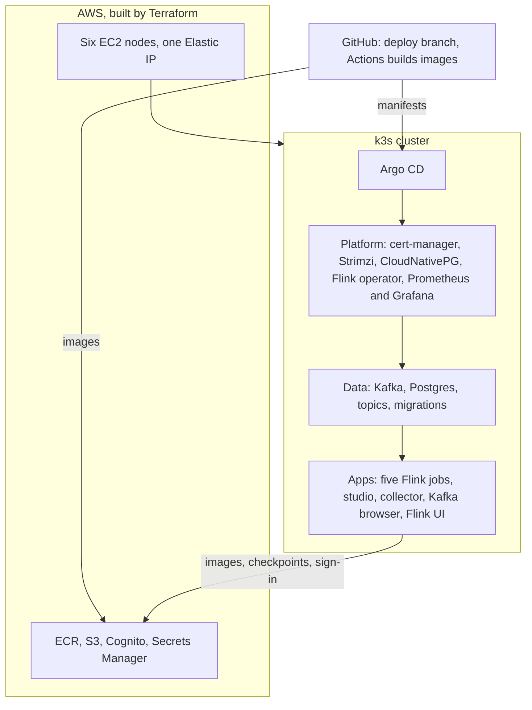
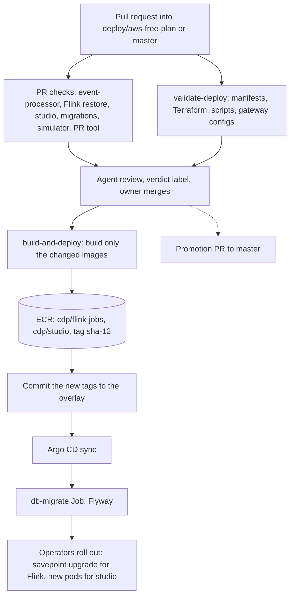

# AWS Free Plan environment

This page is the contract for one deploy target: a short-lived environment on an AWS account that is on the Free Plan. It runs the platform the way a production data platform does. Kubernetes runs on six nodes. Operators run Kafka, Postgres, and Flink. Argo CD syncs everything from git, and Prometheus watches it. It sits in `operations/` and not in `features/` or `architecture/components/`, because an environment is neither a feature nor a component, and its rules have to name hosts, namespaces, and instance types. The `deploy` skill builds it from [references/aws-free-plan.md](../../../.agents/skills/deploy/references/aws-free-plan.md).

## Purpose

An account on the AWS Free Plan has a fixed credit and a fixed end date, and AWS closes the account when the plan ends. The managed AWS target in the `deploy` skill (EKS, MSK, RDS) does not fit such an account. MSK is closed to it, and that target costs more per day than the credit allows. This environment runs the same five Flink jobs, the collector, Postgres, Kafka, and studio on k3s, on six EC2 nodes. A person can then sign in to studio over HTTPS, build a journey, send tracker hits to a public collector, and watch the jobs in Grafana and the Flink UI until the account closes.

## Scope

In scope:

- The AWS resources, their sizes, and their cost.
- The Kubernetes cluster, its node pools, the operators, and the GitOps layout.
- The image build in GitHub Actions and the image pull from ECR.
- Public access to studio, the collector, Argo CD, and Grafana, and staff sign-in through Amazon Cognito.
- What happens to the environment when the Free Plan ends.

Out of scope:

- Production. Each stateful service has one replica and no backup.
- The managed AWS target. See [references/aws.md](../../../.agents/skills/deploy/references/aws.md).
- Journeys that complete end to end. The [blocking known issues](../known-issues/README.md#what-stops-a-journey-today) apply here as on every target.

## Terms

| Term | Meaning |
|---|---|
| Free Plan | The AWS account plan for accounts created on or after 2025-07-15. It holds a credit balance and an expiry date. |
| Credit | The USD balance that `aws freetier get-account-plan-state` reports as `accountPlanRemainingCredits`. |
| Expiry | `accountPlanExpirationDate` from the same call, or the moment the credit reaches zero, whichever is first. AWS closes the account at expiry. |
| Node pool | The value of the node label `cdp.io/pool`: `platform`, `data`, or `compute`. Each node is named after its pool and a number, such as `compute-2`. |
| Public hostname | A name under `sslip.io` that resolves to the server node's Elastic IP, such as `studio.3-90-12-7.sslip.io`. `<ip>` below stands for the dashed address. |
| Deploy branch | The git branch that Argo CD syncs: `deploy/aws-free-plan`. |

## What the account allows

These facts were measured on account `582577265946` on 2026-11-07. Recheck them on another account.

| Check | Result |
|---|---|
| `aws freetier get-account-plan-state` | Plan `FREE`, `ACTIVE`, $121.37 left, expiry `2026-11-14T04:10:56Z` |
| `ec2 run-instances --dry-run` for `t3`, `m7i`, `m7i-flex`, `c7i-flex`, and `r7i` types up to `2xlarge` | Every one returns `DryRunOperation`. The dry run does not apply the Free Plan rules. |
| `ec2 run-instances` for `m7i-flex.xlarge` | Refused with `InvalidParameterCombination`: "The specified instance type is not eligible for Free Tier." |
| `ec2 describe-instance-types --filters Name=free-tier-eligible,Values=true` | `t3`, `t4g`, and `t8i` in `micro` and `small`, `c7i-flex.large` (4 GiB), and `m7i-flex.large` (2 vCPUs, 8 GiB) |
| Service quota `L-1216C47A` (running on-demand standard instances) | 16 vCPUs |
| `kafka list-clusters-v2` | `SubscriptionRequiredException`, so MSK is closed to the account |
| `eks`, `rds`, `ecr`, `ecs`, `cognito-idp`, `secretsmanager` list calls | Succeed. Whether their create calls succeed was not tested. |
| `aws pricing get-products`, us-east-1, Linux, on demand | `m7i-flex.large` $0.09576 an hour. gp3 $0.08 a GB-month. Public IPv4 $0.005 an hour. |
| [AWS Free Plan docs](https://docs.aws.amazon.com/awsaccountbilling/latest/aboutv2/free-tier-plans.html) | The plan excludes "services and features that could possibly deplete your credits". The page gives no full list and no limit on instance size. After expiry, AWS keeps the content for 90 days, then deletes the account and its resources. |

A dry run checks permissions and parameters but not the Free Plan's rules. The first real launch of `m7i-flex.xlarge` failed for that reason, and the cluster moved to the largest eligible type.

## Behavior

1. The operator reads the credit and the expiry. The deploy prints the projected spend until expiry and stops if it is over the limit.
2. Terraform creates the AWS resources in [AWS resources](#aws-resources), and the nodes start k3s from their user data.
3. A push to the deploy branch runs GitHub Actions. For each image, it compares the image's build inputs at the pushed commit with those at the commit that the image's deployed tag names. It builds only an image whose inputs changed, and pushes it to ECR with the tag `sha-<12-char commit>`. The Flink jobs image reads `event-processor/`. The studio image reads `studio/`, `shared/`, and the pnpm workspace files at the repo root. A push that changes neither builds nothing, and a run started by hand can force either image or both. Only one run waits behind the run in progress, so a push that arrives while a run is going replaces a hand-started run that is still waiting, and GitHub marks that run cancelled. The operator who starts a run by hand checks that it completed, and starts it again if it was cancelled.
4. The operator installs Argo CD once and points it at `infra/k8s/envs/aws-free-plan` on the deploy branch. Argo CD installs the operators first, then Kafka and Postgres, then the Flink jobs, studio, and the collector, in sync waves.
5. A staff member opens `https://studio.<ip>.sslip.io/login`, signs in through Cognito, and lands in studio with the role that their Cognito group maps to.
6. A tracker sends hits to `https://collector.<ip>.sslip.io`. The events reach `snowplow-good`, then `snowplow-parsed`.
7. To change what runs, the operator pushes to the deploy branch. CI builds the images whose inputs changed, then commits their tags to the overlay. Argo CD rolls out only the workloads whose tag moved, and the Flink operator takes a savepoint before it upgrades a job. A push that changes only studio restarts no Flink job. Changes to AWS resources do not deploy this way. The operator plans and applies them with Terraform after the spend check.

   This repository cannot require status checks or an up-to-date branch, because GitHub returns 403 for branch protection and rulesets on a private repository without GitHub Pro. The merger enforces both by hand. Before merging a pull request, the merger opens its latest `PR checks` run and finds the line `Merge <head> into <base>` in a job's checkout step. If `<base>` is not the current tip of the deploy branch, the checks tested an old base. The merger runs `gh pr update-branch <number>`, or pushes a new commit, and waits for the new run to pass. Re-running the old run is not enough, because a re-run reuses the original event's merge commit. After the merge, the `PR checks` run on the push to the deploy branch must pass. The rollout does not wait for that run, so a failed push run means the deployed commit is broken. The merger then reverts the merge or pushes a fix before anything else merges, and that push's run must pass.
8. At expiry, AWS closes the account. Nobody tears the environment down by hand.

Example. With $121.37 left and 162 hours to expiry, six `m7i-flex.large` nodes cost 6 × $0.09576 × 162 = $93.08. Six 30 GB gp3 volumes cost about $3.20, and six public IPv4 addresses about $4.86. ECR, S3, and Cognito cost cents. The projected spend is about $101, which is 83% of the credit. Every hour of delay before the launch takes $0.62 off it.

## Functional requirements

| Id | Requirement |
|---|---|
| AFP-FR-01 | Before every apply that adds resources, the operator must run the spend check. It reads the credit and the expiry, prints the projected spend until expiry, and fails if the spend exceeds the limit in AFP-NFR-01. |
| AFP-FR-02 | Every AWS resource the deploy creates, including volumes and network interfaces, must carry the tag `project=cdp-free-plan`, so one tag query lists all of them. |
| AFP-FR-03 | The deploy must not create MSK, EKS, NAT gateways, load balancers, or RDS. |
| AFP-FR-04 | CI must build an image when its build inputs differ from those at the commit its deployed tag names, or when an operator asks for it by hand, and at no other time. If that commit is unknown or is not an ancestor of the pushed commit, CI must build the image. CI must tag each image it builds `sha-<12-char commit>` and push it to ECR. The overlay must name, for each image, the tag it was last built with, so the two images may carry different tags. No manifest may use `latest`. |
| AFP-FR-05 | CI must sign in to AWS through GitHub's OIDC provider and a role that only the deploy branch of this repo can assume. CI must hold no AWS access key. |
| AFP-FR-06 | The nodes must pull images from ECR with their instance role, through the kubelet's ECR credential provider. No image pull secret may hold AWS keys. |
| AFP-FR-07 | Argo CD must sync every Kubernetes object in [Kubernetes layout](#kubernetes-layout) from the deploy branch, except the secrets in [Secrets](#secrets) and Argo CD's own install. Automated sync with prune and self-heal must be on. |
| AFP-FR-08 | Argo CD must apply the layers in this order of sync waves: operators and CRDs, then the Kafka cluster, topics, and Postgres cluster, then the [schema migrations](../architecture/components/schema-migrations.md), then the Flink jobs, studio, and the collector. Within the jobs, the profile writer, state machine, and outbox go before customer decision, and customer decision goes before event parse. |
| AFP-FR-09 | Postgres must run version 16 under CloudNativePG with `wal_level=logical`, and `max_replication_slots` and `max_wal_senders` must each be at least 20. The cluster's bootstrap must create no table. The schema comes from the [schema migrations](../architecture/components/schema-migrations.md), which run on every sync. |
| AFP-FR-10 | The database role that the Flink jobs and studio use must have the `REPLICATION` attribute, and must own every object in the schema because the migrations run as that role (MIG-FR-09, MIG-FR-10). |
| AFP-FR-11 | Kafka must run under Strimzi in KRaft mode. Strimzi must create every topic in the [runtime checklist](../../../.agents/skills/deploy/references/runtime-checklist.md#kafka) as a `KafkaTopic`, and automatic topic creation must be off. |
| AFP-FR-12 | Each Flink job must run as its own `FlinkDeployment` in application mode with `upgradeMode: savepoint`, the RocksDB state backend, and checkpoints, savepoints, and HA metadata in the S3 bucket under `flink/<job name>/`. |
| AFP-FR-13 | Every `FlinkDeployment` must set `DB_HOST`, `DB_USER`, `DB_DATABASE`, `DB_PASSWORD`, and `KAFKA_BROKERS` to the values in [Service addresses](#service-addresses), and the event parse job must set `KAFKA_EVENT_TOPIC_PATTERN=snowplow-good`. |
| AFP-FR-14 | Every Flink pod must expose the Prometheus reporter from `infra/monitoring/flink-prometheus-reporter.yaml` on port 9249. A `PodMonitor` must scrape the pods, and `infra/monitoring/journey-engine-alerts.yaml` must load into Prometheus. |
| AFP-FR-15 | Studio, the collector, Argo CD, Grafana, the Flink UI, and the Kafka browser must be reachable only over HTTPS on port 443, through the k3s Traefik ingress, with certificates from Let's Encrypt that cert-manager gets for the public hostnames. Port 80 is open only for the ACME challenge and the redirect to HTTPS. |
| AFP-FR-36 | The collector must record each visitor's own public address as `user_ipaddress`, never a cluster address. The ingress must keep the client's source address, and must replace any `X-Forwarded-For` header a client sends with the address it received the request from, so a client cannot set its own `user_ipaddress`. |
| AFP-FR-16 | No other port may be open to the internet. Operators reach the nodes and the Kubernetes API through AWS Systems Manager Session Manager. |
| AFP-FR-17 | Studio must sign staff in through a Cognito user pool with a confidential app client. Membership in the Cognito group `studio-admin` must map to the studio role `admin`, and membership in `studio-editor` to `editor`. |
| AFP-FR-18 | No secret may appear in git, user data, a tag, an image, an SSM command, or a command line. The server node generates the secrets it can, and reads the Cognito client secret with its own role. |
| AFP-FR-19 | Terraform must own every AWS resource in [AWS resources](#aws-resources), with its state in the S3 bucket under `tfstate/`. A plan against an unchanged environment must show no changes. |
| AFP-FR-20 | After CI pushes an image for a commit, it must commit that image's tag to the overlay on the deploy branch. That commit must change only the tag lines of the images it built, and it must not start another image build. A failed build of one image must not hold back the rollout of the other. CI must never apply changes to the cluster or to AWS directly. |
| AFP-FR-21 | CI must check every pull request and push that touches `infra/`. It must build the overlay as committed and with every layer, fail if a placeholder token survives, and run `terraform validate` and shellcheck. |
| AFP-FR-33 | CI must test every pull request into the deploy branch on the commit that would result from merging it into the current deploy branch. A change to `event-processor/`, `infra/db/`, or `docs/internal/operations/deployment.md` runs the Flink jobs' format check, style check, and tests, because those tests check the schema and the upgrade notes. A change to `studio/`, `shared/`, `infra/db/`, or the pnpm workspace files runs studio's lint, tests, and build. A change to `infra/db/` or the migration Job runs the migration checks of the [schema migrations](../architecture/components/schema-migrations.md#acceptance-criteria). A change to `simulator/`, `studio/app/actions.ts`, or `studio/src/entities/journey/model/parseCampaign.ts` runs the simulator's tests, because those tests check studio's action names and campaign parser. CI must fail when a test reads a repo file that its check's inputs leave out. Each of these checks keeps a fixed name and reports success when its inputs did not change. CI must run the same checks after every push to the deploy branch, chosen by the changes since the branch's previous commit, so a break between two merged pull requests shows up on the branch itself. |
| AFP-FR-22 | The environment must create the table `customer_profiles` if it does not exist, empty, owned by the role in AFP-FR-10, with the columns of the [profile data](../integration/tracking-guide.md#profile-data). It must do so after the Postgres cluster and before the Flink jobs, and must never change rows. Neither `infra/db/schema.sql` nor a migration may define the table, because another system owns it in production. Profile lookups then find no profile instead of failing. |
| AFP-FR-23 | One URL, `https://flink.<ip>.sslip.io`, must serve a landing page that lists the five jobs, each linking to its own Flink web UI under `/<job name>/` on the same host. |
| AFP-FR-24 | Every request to the Flink URL must pass a sign-in at the Cognito user pool first, and only members of the group `studio-admin` may pass. The sign-in uses its own confidential app client, not studio's. |
| AFP-FR-25 | The Flink web UI and its REST API must be read-only from outside the cluster: no request through the Flink URL may cancel, stop, rescale, or submit a job. |
| AFP-FR-26 | Grafana must have a dashboard named "Flink jobs", provisioned from git, that shows all five jobs on one screen: job state, restarts, records in and out per second, Kafka consumer lag of each job's input, backpressure and busy time, checkpoint duration, size, and failures, and CPU and memory of each JobManager and TaskManager. A row named "Pipeline health" must show the WAL status of each CDC replication slot, its retained WAL as a share of `max_slot_wal_keep_size`, the age of its row in `cdc_heartbeat`, each job's time since its last completed checkpoint, and each job's restarts per hour. |
| AFP-FR-27 | A tool with built-in OIDC sign-in must sign people in through the Cognito user pool, each tool with its own confidential app client, so that a person already signed in to studio opens it without a password prompt. Today these tools are Argo CD, Grafana, and the Kafka browser. |
| AFP-FR-28 | Argo CD must give members of `studio-admin` its admin role, and everyone else who signs in read-only access. |
| AFP-FR-29 | Grafana must give members of `studio-admin` its Admin role, and members of `studio-editor` its Viewer role. Anyone else must be refused. |
| AFP-FR-30 | The Kafka browser at `https://kafka.<ip>.sslip.io` must let members of `studio-admin` read topics, partitions, consumer groups, and messages, and must not let anyone produce, delete, or change a topic. A person outside `studio-admin` may complete the sign-in, but must be refused every request for cluster data, and so must anyone who has not signed in. |
| AFP-FR-31 | A tool without built-in OIDC keeps its own login. The Flink UI has no login, so the sign-in proxy of AFP-FR-24 is its gate. No other proxy may be added for single sign-on. |
| AFP-FR-32 | Argo CD and Grafana must keep their local `admin` accounts as break-glass logins, stored in `cdp-free-plan/logins`, for when the identity provider is unavailable. |
| AFP-FR-34 | Prometheus must load the pipeline alerts in [Pipeline alerts](#pipeline-alerts), so that a CDC or Flink outage fires an alert within minutes. No alert may depend on a Flink job's state, because a job in a restart loop reads `RUNNING` between restarts. Each alert must show in Grafana's alert list and in Alertmanager. |
| AFP-FR-35 | Prometheus must scrape the metrics of the Postgres cluster `cdp-pg`. The cluster must export, for each replication slot, its `wal_status`, whether a consumer is active, the WAL bytes it retains, `max_slot_wal_keep_size` in bytes, and the age of its row in `cdc_heartbeat`. The role `pg_monitor` must have `SELECT` on `cdc_heartbeat`. |

## Non-functional requirements

| Id | Requirement |
|---|---|
| AFP-NFR-01 | The projected spend from the provisioning step until expiry must stay at or below 85% of the credit. The user accepted this limit on 2026-11-07. Hitting zero credit ends the plan early, and AWS closes the account at that moment. |
| AFP-NFR-02 | The cluster must have six nodes of a Free Tier eligible type with at least 8 GiB of memory and 2 vCPUs each, and the type must have no CPU-credit charges. Today that type is `m7i-flex.large`. The user chose six nodes on 2026-11-07. |
| AFP-NFR-03 | The sum of memory requests in the cluster must stay at or below 80% of the allocatable memory of the nodes. |
| AFP-NFR-04 | Flink state must survive the loss of any pod or node, because it lives in S3. Kafka and Postgres data must survive a pod restart. They need not survive the loss of their node's volume. |
| AFP-NFR-05 | After a node reboots, every Flink job must return to `RUNNING` from its last checkpoint without an operator action, within 10 minutes. |
| AFP-NFR-06 | Studio must answer `GET /login` with `200` within 60 seconds of its pod start. |

## Interfaces

### AWS resources

All resources are in `us-east-1`, in the default VPC, in one availability zone that offers `m7i-flex.large`.

| Resource | Size or setting |
|---|---|
| EC2 instances | Six `m7i-flex.large` nodes, `platform-1`, `data-1`, and `compute-1` to `compute-4`. Amazon Linux 2023, 30 GB gp3 root volume each, IMDSv2 required with a hop limit of 2 so that pods can reach the instance role. |
| Elastic IP | One, on `platform-1`. The other nodes use their auto-assigned public IPv4 address for outbound traffic only. |
| Security group `cdp-free-plan` | Inbound 80 and 443 from anywhere. All traffic between members of the group. Nothing else. |
| IAM role `cdp-free-plan-node` | `AmazonSSMManagedInstanceCore`, `AmazonEC2ContainerRegistryReadOnly`, read and write on `s3://cdp-free-plan-<account id>/flink/*`, `cognito-idp:DescribeUserPoolClient` on the one user pool, and get and put on the SecureString parameters under `/cdp-free-plan/k3s-agent-token/`, where each server publishes the agent join token under its own instance id. Agents read only their server's parameter, so a replaced server's token is never used. Get and put on the secret `cdp-free-plan/logins`, and no permission to create secrets. |
| IAM role `cdp-free-plan-ci` | Trusted by `token.actions.githubusercontent.com` for `repo:18120158binh@55783367/salarose@1451030863:ref:refs/heads/deploy/aws-free-plan` only. GitHub puts the numeric owner and repo ids in the subject. Push to the two ECR repositories. |
| S3 bucket `cdp-free-plan-<account id>` | Private. Flink checkpoints, savepoints, and HA metadata under `flink/`, and the Terraform state under `tfstate/`. |
| ECR repositories | `cdp/flink-jobs` and `cdp/studio`, scan on push |
| Secrets Manager secret `cdp-free-plan/logins` | The Argo CD, Grafana, and studio logins as one JSON value. Terraform creates the secret with no value, so its state never holds a login, and with no recovery window, so the account closes with nothing pending deletion. The server node writes the value. |
| Cognito user pool `cdp-studio` | A domain prefix for the managed login pages, groups `studio-admin` and `studio-editor`, and one confidential app client with the authorization code grant and the scopes `openid`, `email`, and `profile`. Confidential app clients `flink-ui`, `argocd`, `grafana`, and `kafka-ui` serve the tools' sign-in (AFP-FR-24, AFP-FR-27). |

### Deployment layers

The environment stacks four layers. Each is created by the one above it: Terraform builds the AWS layer, k3s runs on it, Argo CD installs the platform from Git, and the platform's operators run the workloads.

| Layer | Holds | Where |
|---|---|---|
| AWS | Nodes, the network, image registries, the checkpoint bucket, the user pool, the logins secret | [AWS resources](#aws-resources), `infra/aws-free-plan/terraform/` |
| Cluster | k3s, one server and five agents, in three node pools | [Kubernetes layout](#kubernetes-layout) |
| Platform | The Helm charts that Argo CD installs: certificates, the Kafka, Postgres, and Flink operators, monitoring | `infra/k8s/platform/` |
| Data | The Kafka cluster and its topics, the Postgres cluster, the migration job | `infra/k8s/data/` |
| Apps | The workloads and their ingresses, monitors, and alerts | `infra/k8s/apps/`, overlay in `infra/k8s/envs/aws-free-plan/` |

### CI/CD

A change reaches the cluster in two stages: checks on the pull request, then build and rollout after the merge into `deploy/aws-free-plan`. A promotion PR later copies the deploy branch to `master`.

| Step | Workflow or tool | What it does |
|---|---|---|
| 1. Checks | `pr-checks.yml` | Decides which parts changed, then runs only their jobs: `mvnw` tests with Spotless and Checkstyle, a real savepoint restore of the Flink jobs, studio tests, lint, and build, the migration check, the simulator tests, and the PR tool tests. A guard fails an image pin removal that the deployed image cannot honor |
| 2. Validation | `validate-deploy.yml` | Renders the Kustomize manifests, validates Terraform, and tests the bootstrap scripts and the gateway configs |
| 3. Review | `pull-request` skill | A reviewer agent posts its verdict and labels the PR. The owner merges |
| 4. Build | `build-images.yml` | On a push to `deploy/aws-free-plan`, builds the images whose inputs changed and pushes them to ECR with an immutable `sha-<12 hex>` tag, signed in through the GitHub OIDC role |
| 5. Pin the tag | `build-images.yml`, job `deploy` | Writes the new tags into the overlay and pushes that commit |
| 6. Sync | Argo CD | Applies the overlay. The `db-migrate` Job runs Flyway first |
| 7. Roll out | Flink operator, Kubernetes | Each `FlinkDeployment` stops with a savepoint and starts the new image from it. studio rolls new pods |
| 8. Promote | Promotion PR | Copies the deploy branch to `master` |
| Simulator | `build-simulator.yml` | Builds the traffic simulator image on the same push |

### Kubernetes layout

The cluster runs k3s, with the server on `platform-1` and agents on `data-1` and `compute-1` to `compute-4`. Pin the k3s version at provisioning time.

| Node | `cdp.io/pool` | Runs |
|---|---|---|
| `platform-1` | `platform` | The k3s server, Traefik, cert-manager, Argo CD, the four operators, Prometheus, and Grafana |
| `data-1` | `data` | The Kafka broker on a 6 GiB volume and the Postgres instance on an 8 GiB volume. Flink pods may also land here. |
| `compute-1` to `compute-4` | `compute` | Flink JobManagers and TaskManagers, which prefer this pool, and studio and the collector |

| Namespace | Holds |
|---|---|
| `argocd` | Argo CD |
| `cert-manager` | cert-manager and the `ClusterIssuer` `letsencrypt` |
| `monitoring` | kube-prometheus-stack: Prometheus, Grafana, and the Prometheus Operator |
| `strimzi` | The Strimzi operator, which watches `cdp` |
| `cnpg-system` | The CloudNativePG operator |
| `flink-operator` | The Flink Kubernetes Operator, which watches `cdp` |
| `cdp` | The Kafka cluster `cdp`, the Postgres cluster `cdp-pg`, the five `FlinkDeployment`s, studio, the collector, and the Kafka browser |

Git layout on the deploy branch:

| Path | Holds |
|---|---|
| `infra/k8s/platform/` | One Argo CD `Application` per Helm chart: cert-manager, Strimzi, CloudNativePG, the Flink operator, and kube-prometheus-stack. Each pins its chart version. |
| `infra/k8s/data/` | The `Kafka`, `KafkaNodePool`, and `KafkaTopic`s, the CloudNativePG `Cluster` with the slot metrics query `ConfigMap` (AFP-FR-35), and the migration `Job` `db-migrate` with the `ConfigMap` `db-migrations` that `infra/db` generates |
| `infra/k8s/apps/` | The five `FlinkDeployment`s, studio, the collector, the Kafka browser, their `Ingress`es, the `PodMonitor`s for Flink and Postgres, and the `PrometheusRule`s |
| `infra/k8s/envs/aws-free-plan/` | The Kustomize overlay that sets the image registry and tag, the hostnames, the bucket, and the Cognito ids, plus the `Job` that creates `customer_profiles` (AFP-FR-22) and grants `pg_monitor` read access to `cdc_heartbeat` (AFP-FR-35). The root Argo CD `Application` points here. |

### Service addresses

| Service | Address |
|---|---|
| Kafka bootstrap | `cdp-kafka-bootstrap.cdp.svc:9092`, plaintext, inside the cluster only |
| Postgres primary | `cdp-pg-rw.cdp.svc:5432`, database `auroracy`, role `cdp` |
| Postgres credentials | The secret `cdp-pg-app` in `cdp`, which CloudNativePG creates, with the keys `username` and `password` |
| Flink UI | `https://flink.<ip>.sslip.io`, a landing page with one link per job, each to `https://flink.<ip>.sslip.io/<job name>/`, behind the Cognito sign-in. `kubectl -n cdp port-forward svc/<job name>-rest 8081` over Session Manager still works. |
| Studio | `https://studio.<ip>.sslip.io` |
| Collector | `https://collector.<ip>.sslip.io` |
| Argo CD | `https://argocd.<ip>.sslip.io` |
| Grafana | `https://grafana.<ip>.sslip.io` |
| Kafka browser | `https://kafka.<ip>.sslip.io`, read-only, behind the Cognito sign-in |

### Pipeline alerts

These alerts come from the outage in #320. Postgres invalidated every CDC slot, and each job then restarted about every 30 minutes while its state read `RUNNING`. Replayed over that night's metrics, `FlinkJobRestarting` fires within two minutes of the invalidation. The slot and heartbeat alerts had no metrics then.

| Alert | Fires when | Severity |
|---|---|---|
| `CdcReplicationSlotLost` | A slot's `wal_status` is `lost` or `unreserved`. A lost slot never streams again. | critical |
| `CdcReplicationSlotInactive` | A slot that is not lost has had no active consumer for 5 minutes. This is expected while its job is suspended. | warning |
| `CdcReplicationSlotWalNearLimit` | A slot retains more than 70% of `max_slot_wal_keep_size` for 1 minute. It does not fire when the cap is unlimited. | critical |
| `CdcHeartbeatStale` | A slot's row in `cdc_heartbeat` is older than 10 minutes. Sources write it every 30 seconds. | critical |
| `CdcSlotMetricsMissing` | Prometheus has had no slot metrics for 10 minutes, so the four slot alerts cannot fire. | warning |
| `FlinkCheckpointsFailing` | A job failed a checkpoint in the last 10 minutes. | warning |
| `FlinkCheckpointStalled` | A job has completed no checkpoint for 5 minutes. A job that has completed none since it started counts from its uptime. | critical |
| `FlinkJobRestarting` | A job restarted in the last hour. | warning |
| `NodeDiskOver70Percent` | A node's root disk is more than 70% full for 10 minutes. On `data-1` that disk holds the Kafka and Postgres volumes. | warning |

Alertmanager has no receiver yet. Its route sends every alert to the receiver `null`, so nobody is paged. The alerts show in Grafana under **Alerting > Alert rules**, and in Alertmanager through its `Alertmanager` data source in Grafana. To page someone, add a receiver and a route to the kube-prometheus-stack `alertmanager.config` value.

### Secrets

Argo CD does not manage these. A bootstrap script on `platform-1` creates them with `kubectl create secret`, from generated values and from AWS. A rotation script on `platform-1` gives Argo CD and Grafana new admin passwords, writes both into `argocd-secret` and `grafana-admin`, deletes `argocd-initial-admin-secret`, and stores every login in the Secrets Manager secret `cdp-free-plan/logins`. That secret is where operators read the logins, from the AWS console or the AWS CLI.

| Secret | Namespace | Keys |
|---|---|---|
| `studio-env` | `cdp` | `OIDC_CLIENT_SECRET`, `SESSION_SECRET` |
| `grafana-admin` | `monitoring` | `admin-user`, `admin-password` |
| `flink-ui-auth` | `cdp` | `client-id` and `client-secret` of the `flink-ui` app client, and `cookie-secret`, the sign-in proxy's cookie secret |
| `argocd-oidc`, `grafana-oidc`, `kafka-ui-oidc` | `argocd`, `monitoring`, `cdp` | `client-id` and `client-secret` of each tool's app client, read from Cognito on the node like `studio-env` |
| `studio-platform` | `cdp` | `argocd-token`, the API token of the Argo CD account `studio-health`. Like every signed-in subject, the account has the default `role:readonly`: read-only access to everything Argo CD shows, application logs included, and no write. The token never leaves studio's server. As the bootstrap's last step, the node makes it through Argo CD's API, signed in as the break-glass `admin`. The password comes from `argocd-initial-admin-secret` while it exists, which is before the first rotation and on a rebuilt server, and from `cdp-free-plan/logins` after that. A rerun keeps an existing token only if Argo CD still accepts it on a read of `/api/v1/applications`. A token Argo CD rejects, such as a revoked one, is replaced under the same id. Studio reads the secret at start, so it needs a rolling restart whenever the bootstrap prints `argocd token: created for studio-health`. |
| `argocd-secret` | `argocd` | `admin.password`, the bcrypt hash of the Argo CD admin password, and `admin.passwordMtime` |
| `cdp-free-plan/logins` | AWS Secrets Manager | `argocd` and `grafana`, each with `url`, `user`, and `password`, and `studio` with `url` and a note that studio users are Cognito users |
| `repo-salarose` | `argocd` | The read-only deploy key that Argo CD uses to read the private GitHub repo, labeled `argocd.argoproj.io/secret-type=repository` |

Studio settings that differ from the defaults:

| Setting | Value |
|---|---|
| Issuer | `https://cognito-idp.us-east-1.amazonaws.com/<user pool id>` |
| Role claim | `cognito:groups` |
| Role map | `{"studio-admin":"admin","studio-editor":"editor"}` |
| Redirect URL | `https://studio.<ip>.sslip.io/api/auth/oidc/callback` |
| Post-logout URL | `https://studio.<ip>.sslip.io/login` |

Sign-out follows AUTH-FR-14 of the [admin authentication contract](../features/admin-authentication.md). The user accepted that on 2026-11-07. Cognito's discovery document does name an `end_session_endpoint`, `https://<domain prefix>.auth.us-east-1.amazoncognito.com/logout`, so studio sends the browser there with `client_id`, `post_logout_redirect_uri`, and `logout_uri`. Cognito reads the return address only from `logout_uri`, which must match the client's allowed sign-out URL. Measured on 2026-11-08, `logout_uri` set to studio's `/login` returns a `302` to studio's `/login`.

Cognito findings, measured on 2026-11-07 before the first sign-in:

- The app client sets no read-attribute list, so it can read every attribute, and it grants the `email` scope. The first admin's `email_verified` attribute is `true`.
- `cognito:groups` lists the user's groups. The first admin is in `studio-admin`. Cognito puts this claim in the ID token by default. That is inferred from Cognito's documentation, not yet seen in a token.

## Acceptance criteria

- [ ] `aws freetier get-account-plan-state`, read a day after provisioning, shows a credit drop no larger than 24 times the projected hourly rate, plus $1.
- [ ] `aws resourcegroupstaggingapi get-resources --tag-filters Key=project,Values=cdp-free-plan` lists every resource in [AWS resources](#aws-resources) and none from AFP-FR-03.
- [ ] `kubectl get nodes -L cdp.io/pool` shows six `Ready` nodes: one `platform`, one `data`, and four `compute`.
- [x] Argo CD shows every application `Synced` and `Healthy`.
- [ ] `kubectl -n cdp get flinkdeployments` shows five jobs with job status `RUNNING` and lifecycle state `STABLE`, and each job's REST API shows at least one completed checkpoint in S3.
- [ ] `curl -sI https://studio.<ip>.sslip.io/login` returns `200` with a certificate that a default trust store accepts. The same holds for Argo CD and Grafana.
- [ ] A Cognito user in `studio-admin` signs in and sees the campaign list. A user in no group gets `not_authorized`.
- [x] A tracker hit sent to the collector's `/com.snowplowanalytics.snowplow/tp2` adds a message to `snowplow-good`, then to `snowplow-parsed`.
- [x] `customer_profiles` exists in `auroracy`, owned by `cdp`, with no rows. (AFP-FR-22)
- [ ] Grafana shows the Flink checkpoint metrics for all five jobs, and Prometheus lists the `journey-engine-alerts` rules.
- [ ] Opening `https://flink.<ip>.sslip.io` without a session redirects to the Cognito sign-in. A `studio-admin` member lands on the page with five job links, and each link opens that job's Flink UI. A user in no group is refused (AFP-FR-23, AFP-FR-24).
- [ ] A `PATCH` to `/<job name>/jobs/<id>` or a `POST` that would stop or submit a job, sent through the Flink URL with a valid session, is refused, and the job keeps `RUNNING`. So is a `GET` to `/<job name>/jobs/<id>/yarn-cancel`, which Flink still routes to job cancellation (AFP-FR-25).
- [ ] Grafana's "Flink jobs" dashboard shows each panel of AFP-FR-26 with data for all five jobs (AFP-FR-26).
- [ ] Prometheus lists the `pipeline-alerts` rules. The query `cnpg_cdp_replication_slots_active` returns one series for each row of `pg_replication_slots`, and `CdcSlotMetricsMissing` is not firing (AFP-FR-34, AFP-FR-35).
- [ ] While a slot shows `wal_status = lost` in `pg_replication_slots`, `CdcReplicationSlotLost` fires for that slot in Grafana's alert list. Once the slot's job resumes on a new slot, the alert resolves (AFP-FR-34).
- [ ] A `studio-admin` member signed in to studio opens Argo CD, Grafana, the Kafka browser, and the Flink UI, each without a password prompt, and lands with the role AFP-FR-28 to AFP-FR-30 give (AFP-FR-27).
- [ ] The Kafka browser refuses to produce a message or delete a topic, even for a `studio-admin` member. A signed-in user in no group gets no topic, group, or message, and `https://kafka.<ip>.sslip.io/metrics` without a session holds no metric of the cluster (AFP-FR-30).
- [ ] With the Cognito domain unreachable, the break-glass `admin` logins still open Argo CD and Grafana (AFP-FR-32).
- [ ] A tracker hit sent from a machine outside AWS lands in `snowplow-good` with that machine's public address as `user_ipaddress`, and the same hit sent with `X-Forwarded-For: 1.2.3.4` still carries the machine's address (AFP-FR-36).
- [ ] A scan of the six nodes' public addresses from outside AWS finds only ports 80 and 443 open, and those only on `platform-1`.
- [ ] After `sudo reboot` on a `compute` node, the five jobs return to `RUNNING` from a checkpoint within 10 minutes, with no operator action.
- [x] A commit that changes the image tag in the overlay rolls each job through a savepoint, and the job resumes from that savepoint.
- [ ] A pull request into the deploy branch that changes only `infra/db/schema.sql` runs the Flink jobs' tests on the pull request (AFP-FR-33).
- [ ] A pull request into the deploy branch that changes only `studio/app/actions.ts` runs the simulator's tests (AFP-FR-33).
- [ ] A merge into the deploy branch that changes only `studio/` runs studio's checks on the branch and skips the other checks (AFP-FR-33).
- [ ] A push that changes only `studio/` moves only the studio tag in the overlay, and every Flink job keeps running without a savepoint upgrade. A push that changes neither image's inputs commits no tag (AFP-FR-04, AFP-FR-20).

## Open questions

- Does studio accept Cognito's ID token, with its `email_verified` and `cognito:groups` claims, as the [admin authentication contract](../features/admin-authentication.md) requires? Cognito is not in the provider table in [configuration](configuration.md#oidc-provider-setup). The first sign-in in a browser answers this.
- Does `sslip.io` stay under Let's Encrypt's rate limits for a new host? It is on the Public Suffix List, so each IP should count as its own registered domain. That is unverified.
