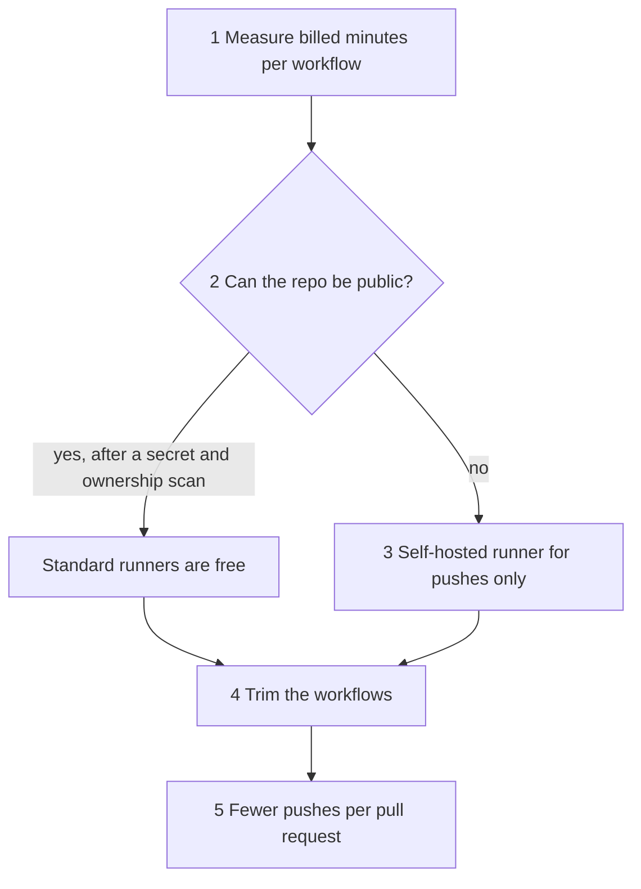

# Keep CI cheap

How to cut the cost of GitHub Actions for this repo, and what we learned when CI hit its limit.

## What happened

On 2026-11-09 the repo was private on GitHub Free, which includes 2,000 Linux runner minutes a month. About 130 pull requests in four days used them up, and Actions stopped. A rough count put the pace at 10,000 to 15,000 billed minutes a month. Each push ran about 20 to 30 billed minutes: the Maven tests, a real Flink savepoint restore, the studio build, and the deploy validation. GitHub rounds each job up to the minute, so many short jobs cost more than their run time suggests.

We fixed it in three steps, cheapest first:

1. **Made the repo public.** Standard GitHub-hosted runners are free for public repos. Before that, we scanned every file and the whole history for secrets and for anything that was not ours to publish, and started a fresh history.
2. **Planned a self-hosted runner** on our own AWS account, for pushes to the deploy branch only.
3. **Trimmed the workflows.** Most of the trims were already in place. Only `validate-deploy` lacked a `concurrency` group.

## How to cut CI cost

Work in this order. Each step is cheaper and safer than the next.

### 1. Measure first

Sum the billed minutes per workflow from the Actions API: list the month's runs, list each run's jobs, and round each job's duration up to the minute. The billing page under Settings, Billing and plans, Usage shows the same total. Don't trim before you know which workflow costs the most, and check what each workflow already does. Here most of the trims we had in mind were already done.

### 2. Make the repo public, if it can be

This removes the cost of standard runners. Before you do it:

- Scan the whole history with a secret scanner such as gitleaks, not only the current files.
- Search the history for names, emails, hosts, and data that belong to someone else. Commit author emails are part of the history too.
- If the history holds anything that must not be public, publish a fresh history from the current files instead of rewriting the old one.

### 3. Self-hosted runner, for pushes only

A runner on your own machine or cluster costs no GitHub minutes. On a public repo, never let a pull request from a fork run on it. The fork's code would run inside your network, next to the database and the cloud credentials. Use the self-hosted runner only for pushes to protected branches, keep pull request checks on GitHub-hosted runners, and require approval for workflows from outside collaborators.

### 4. Trim the workflows

| Rule | Why | Where in this repo |
|---|---|---|
| Every workflow has a path filter | A docs change should not build the Flink jobs | `paths` in `validate-deploy.yml` and `build-simulator.yml`, `paths-ignore` in `build-images.yml`, and the `changes` job in `pr-checks.yml`, which skips each test job whose files did not change. Two short jobs skip the filter: `test-inputs` runs on every event, and `pin-removal` on every pull request |
| Every workflow has a `concurrency` group that cancels an outdated pull request run | A new push makes the older run moot | `pr-checks.yml` and `validate-deploy.yml`, with push runs grouped by commit so each merge still runs once. `build-images.yml` and the `simulator` job in `build-simulator.yml` set `cancel-in-progress: false`, so a running build finishes. A newer push still replaces a pending build, and the `changes` job in `build-images.yml` diffs against the deployed tag, so the newer run builds what the dropped one skipped |
| Commits that only move image tags build nothing | The images for that commit already exist | The deploy job pushes its tag commit with the workflow's own token, which starts no workflow. `paths-ignore` in `build-images.yml` skips any other push that only touches the overlay, the simulator tag, or docs |
| Heavy checks run only when their inputs change | The Flink savepoint restore takes minutes | The `flink-restore` job in `pr-checks.yml` runs only when the `event-processor` filter matches: `event-processor/`, `infra/db/`, `deployment.md`, or `pr-checks.yml`. A manual run, or a failed `changes` job, runs it too |
| Build only the images whose inputs changed | A studio change should not rebuild the Flink image | The `changes` job in `build-images.yml` |

One rerun is kept on purpose. `pr-checks` runs again on every push to the deploy branch, filtered on that push's own diff. Two pull requests can each pass on their own and break each other once both are merged, and that rerun catches it within minutes.

### 5. Push less often

Each push to a pull request reruns its checks. Group small fixes into one issue and one pull request when they change the same code, and answer a review with one push, not one per finding.
